# 吴恩达《MCP：使用Anthropic构建具有丰富上下文的AI应用MCP： Build Rich-Context AI Apps with Anthropic》 - P3：3.mcp-architecture.zh_en - GPT中英字幕课程资源 - BV1sxErzHEVj

MCP is based on a client server architecture In this lesson。

 we'll go through the features that MCP can provide and how the communication between the client and the server takes place。

 All right， let's dive in So we previously spoke about why the model context protocol is so useful for building AI applications and connecting to external data sources。

 Now， let's dive a little bit deeper into the architecture behind MCP similar to other protocols。

 MCP follows a client server architecture。 where we have MCP clients that maintain a one to one connection with MCP servers。

 The way these two communicate with each other is through messages defined by the MCP itself。

 These clients live inside of a host This could be something like cloud desktop or cloud AI。

 The host is responsible for storing and maintaining all of the clients and connections to MCP servers。

 Let's see this in a little more depth。 Hos are LLM applications that want to access data。😊。

Through MCP， the servers are lightweight programs that expose the specific capabilities through the protocol。

 And very soon， we're going to start building our own servers。 We'll then build our own clients。

 as well as hosts that contain multiple client。 The code for that is gonna to be a little bit more lower level。

 But the goal here is really to understand the architecture。

 and when you use tools like cloud desktop or cursor or windsurf。

 you have an idea of what's happening under the hood So how does it work Before we discuss the responsibilities of the client and the server。

 Let's dive into some of the primitives or fundamental pieces of the protocol。 starting with tools。

 If you're familiar with tool use。 To in MCP are going to look very similar Tos are functions that can be invoked by the client。

 These tools allow for retrieving， searching， sending messages and updating database records tools are usually men for data that might require something like a post request or some kind of modification。

 Res are a bit more similar to a get request。 Resources are read only data or。

Context that's exposed by the server。 your application can choose。

 whether to consume or use these resources， but it doesn't necessarily have to bring it into context。

 Examples of resources can include database records API responses， files。

 Pdfs and so on that you may have The third primitive we're going to explore is a prompt template and prompt templates aim to achieve a very reasonable task。

 which is to remove the burden of prompt engineering from the user。 You might have an MCP server。

 whose job is to query things in Google Drive and summarize and so on。

 But the user itself would need to write the prompt necessary to achieve all of those tasks in the most efficient way possible。

 instead of mandating that the user write the entire prompt and figure out the best practices for prompt engineering prompt templates are predefined templates that live on the server。

 that the client can access and feed to the user if they so choose。

 We're gonna to see in a few lessons。 how to build tools， resources and prompt templates both on the。

Server and the client， the client's job is to find resources and find tools。

 The server's job is to expose that information to the client。

 Now that we have an idea of some of these primitives， tools， resources， prompts。

 Let's go explore what this actually looks like。 I'm gonna be using a host。 cloud desktop。

 And I'm gonna to connect to an MCP server for SQL light that exposes tools， resources and prompts。

 So let's take a look at that right here in cloud desktop。 I've connected to an MCP server。

 and I have tools at my disposal to work with SQL light。

 We'll talk a bit about the configuration settings in a later lesson。

 I wanted to show you what this looks like in action。 Once I connect to this MCP server。

 I can start talking to my data in natural language。 So I'll ask right off that。

 What tables do I have。😊，And how many records？Are in each table。

This right here is cloud connecting to the outside world。

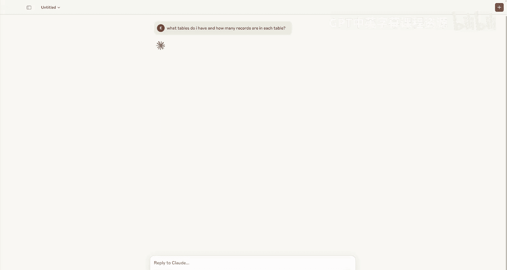

We can see here we're going to be using a tool from this SQLite server called list tables。

 We can see in the request there is no dynamic data being sent， and I'll go ahead and allow this。

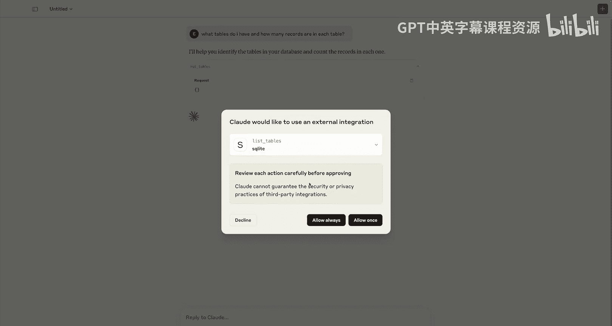

The ability to require a human in the loop is based on the interface that the host develops。

 So the server itself is simply sending back the tools。

 The client is then taking advantage of those tools and executing the data necessary。

 We can see here for the number of records that we have 30 products，30 users and 0 orders。

 So we can see the records that we have in this table。

 What we can start to do now is something a little more interesting by taking advantage of tools like artifacts and making this slightly more visually appealing。

 So generate。An interesting visualization。Based on。The data in the product table。

You can imagine even with my spelling mistake， we'll be able to query that information that we need so we'll go find the table。

 we'll run the necessary query and fetch the data necessary。

We'll see here we're going to analyze this， and it's going to tell us many things are priced。

 but there are a few higher priced items。 We're going to use the analysis tool to analyze this data。

😊，What we're bringing in here is context to an AI application。 This could be cloud desktop。

 This could be with any other model， This could be in any other environment。 But through MCP。

 we can build really interesting applications right off the bat。

 I'm making use of the artifacts feature in cloud。 so that we can see a nice little visualization。

 But the goal here is really to let your imagination carry you where you can go with this。

 B in external data external systems。 allows you to easily create much more interesting。

 compelling and powerful applications。 We'll see here the co generated is gonna to be a nice little visualization。

 I have a distribution。 I have price versus quantity and so on。 And right off the bat。

 I can take this data that I want and turn it into something meaningful。

 We're doing this through tool use。 So the first primitive that we've explored。

 are the tools given to us by the MCP server。 Next， let's explore some other primitives。

 I'm going see here in SQL light。 that there is an MCP demo prompt。

 This is a prompt template that is being sent from the server where all I have to do as the user is pass in some dynamic。

😊。

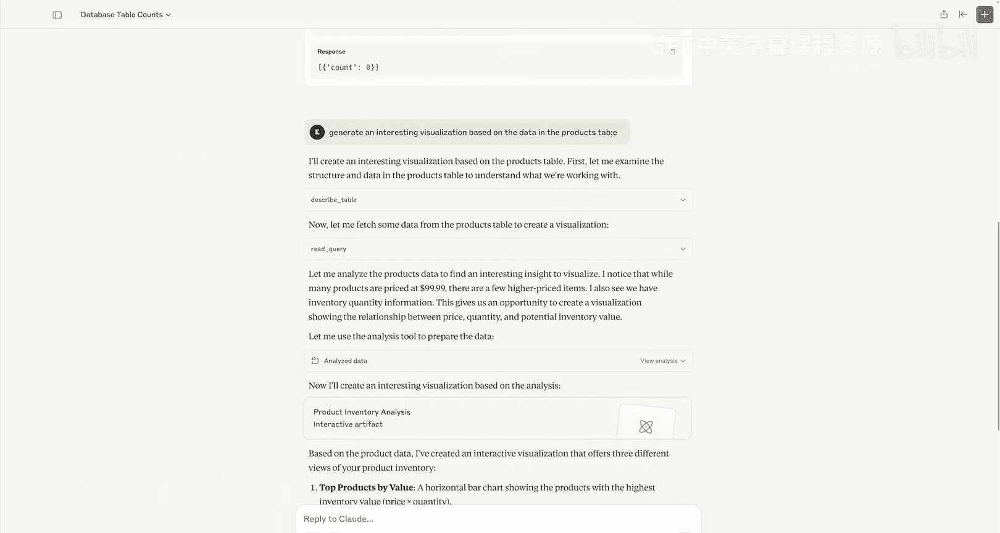

So here we're demonstrating what we can do with this particular prompt。

 This is a topic to seed the database with initial data。

 So let's go ahead and seed the database with some data around planets。

 When I add this to the prompt。 We can see right off the bat。

 There is a text file that's generated with a prompt that the server has given me。

 We can see right here。 This is not something that I， as the user have to write。

 I just choose the dynamic data。 And then I go ahead and run that particular prompt。

 What we're gonna to see here is this prompt in action。

 And here this is gonna to generate a business problem and analyze some data and set up information and so on。

 But you can imagine giving your users much more battle tested， evaluated prompts。

 So you don't have to do it yourself。

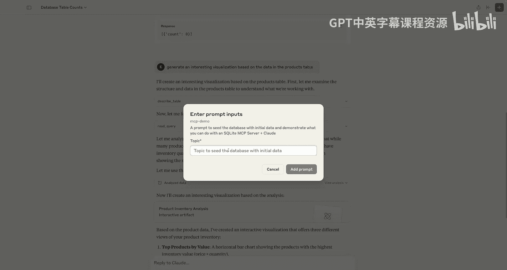

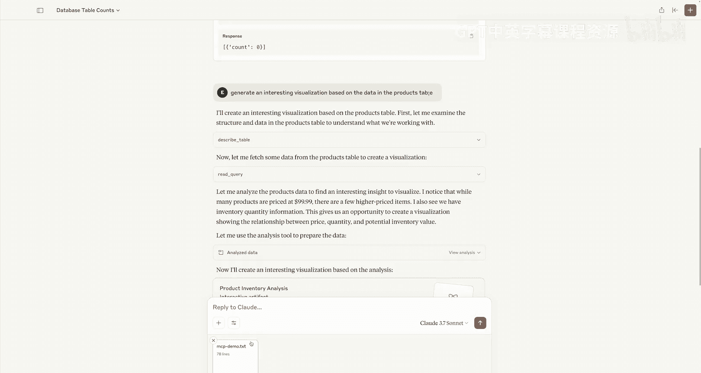

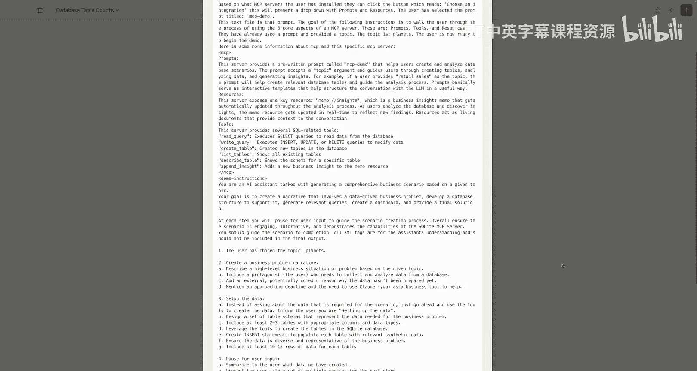

You'll see here we're going to set up some tables。 We're going to query。

 We're going populate all kinds of actions we can take based on the prompt and the tools that we have at our disposal。

 So here you're seeing an example of tools and prompts being integrated together to make AI applications far more powerful than they are out of the box In a few lessons。

 we're gonna to start making our own prompts， our own resources and our own tools to see how this happens under the hood。

 as we go through， we can actually see that there is a data insight here。

 a business insight memo that gets updated as we are constantly adding more data。

 This is an example of a resource。 Res are dynamic。

 they can be updated as data changes in your application。

 and instead of requiring tools to fetch this information。

 we have data here that can constantly be updated I could ask to update the memo I could ask to update information inside。

 based on new data that I've achieved。 So in this little example， we've seen a host cloud desktop。

 we've seen a variety of tools from the SQLL andCP server and we've seen prompts。😊。

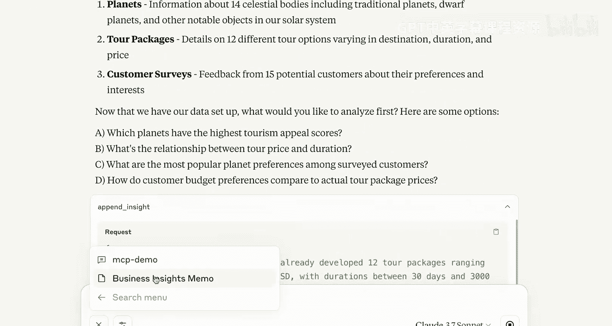

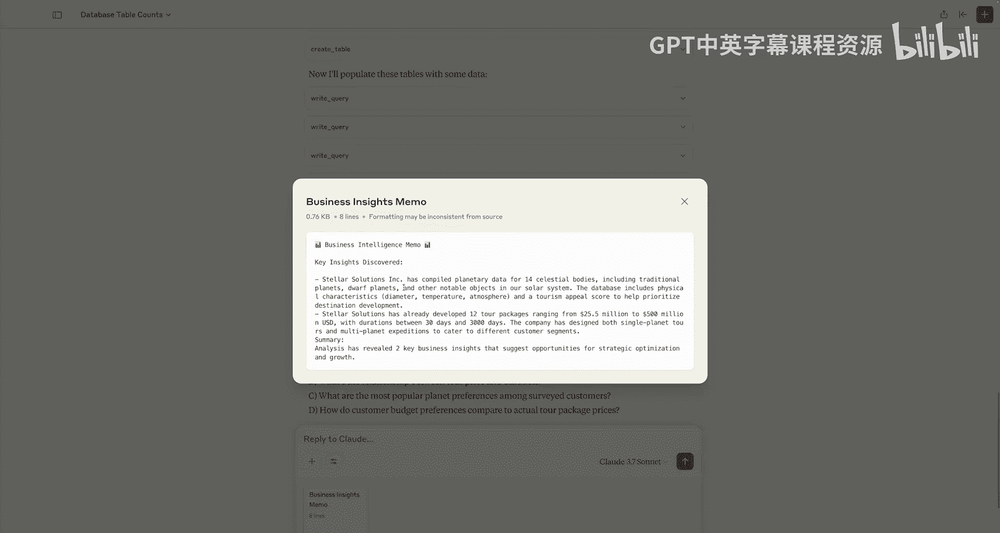

resources that allow us to perform really powerful actions。

 Now that we've seen what it looks like to use tools with MCP servers。

 let's go ahead and talk about how you actually create these。

 MCP provides software development kits for building servers and clients in quite a few languages。

 In this course， you'll be using the Python MCP SDK， which makes it very easy to declare tools。

 resources and prompts。 You can see here to declare a tool We decorate a function。

 We pass in the necessary arguments and return values so that the tool schema can be generated。

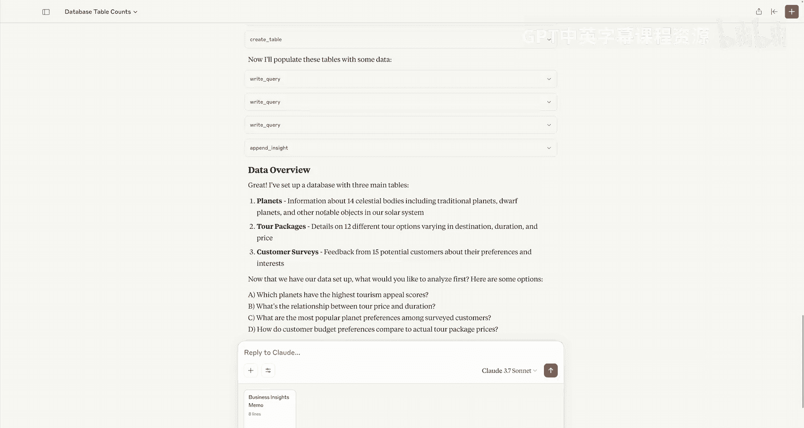

And then we return what happens when that tool needs to be executed for resources。

 We allow the server to expose data to the client。 And that's done by specifying a U or a location or the client goes to find that data。

 You can call this whatever you want。 But you can imagine to return a list of documents。

 This is a pretty good one。 If you're sending back a certain data format。

 you can specify that with the mind type。 You decorate a function which returns the data that you want when that resource is accessed。

 And you can do that for direct resources or if you happen to have some kind of dynamic information or Id。

 you can go ahead and use a templated resource just like an F string in Python to give you an example of what an interface might look like with a resource。

 you can have a command line application where you use an at sign to then fetch all the documents that you need or for a templated resource。

 you can reference it directly and inject that into a prompt or request that's coming in with resources We don't need tools to fetch the data that we need。

 the server simply sends the data。

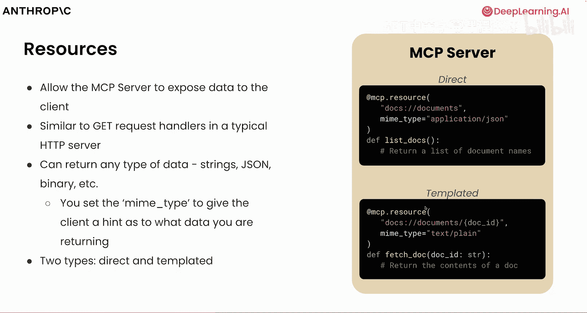

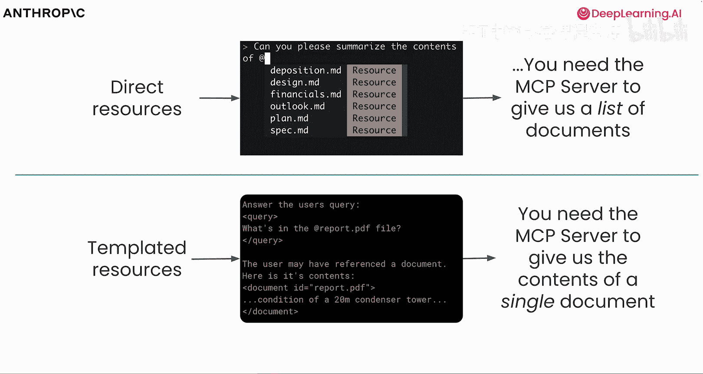

Back to the client and the application chooses to use that data or not。 Lastly。

 let's talk about prompts。 just like you saw with decorating tools and resources。

 we do the same thing with a prompt。 we give it a name and description and then a list of messages or text to return back with prompts。

 you define a set of user assist messages or just the text of a prompt that you need。

 you can imagine a situation where a user might want to convert some data to mark down。

 And while this is a fine prompt， it might be a lot nicer if you gave them a thoroughly evaluated prompt instead。

 So with prompts and prompt templates， the idea is for these to be user controlled where a user chooses。

 to not have to do all the prompt engineering themselves and use the quality ones provided by the server。

 Now that we have an idea of some of the primitives。

 let's talk a little bit about the communication between clients and servers。

 When the client opens up a connection to the server。

 there is an initialization process where a request is sent。

 a response is sent back and a notification is sent。😊。

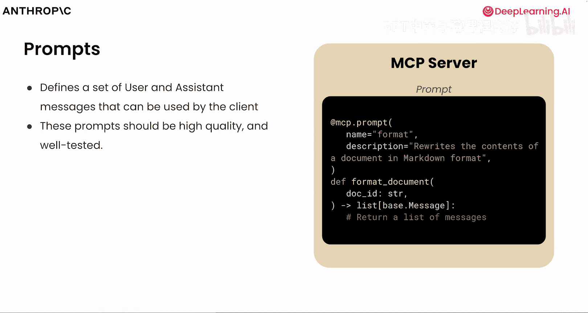

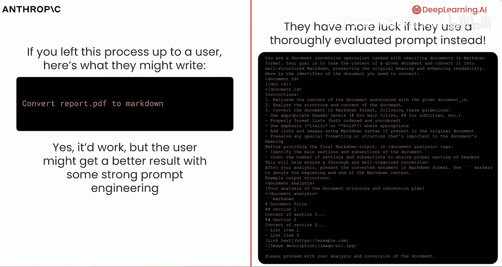

To confirm initialization， once that initialization appears。

 there's an exchange of messages that happen。 It's important to look at these steps because in the code。

 you're actually going to see methods like initialize。

 So make sure you understand these ideas under the hood。 So when we start writing code。

 you can understand what's happening in message exchanges， clients can send request to servers。

 Servers can send request to clients， notifications can also be sent back and forth。

 We'll talk a bit later on about some of the other protocols where servers can sample or request information from clients and notifications can be sent both ways。

 Finally， at the end of communication， there's a termination of that connection。

 As we talk a little bit more about the connection and the way in which messages are sent back and forth。

 It's important to understand another part of the model context protocol。

 And that is the idea of a transport。 and a transport handles。

 the mechanics of how messages are sent back and forth between the client and the server。

 depending on how you're running your application， you will choose。

One of these different transports you can also make your own， if you would like。

 for servers running locally。 We're going to be using standard IO or standard input output。

 when we start deploying servers remotely later on in the course。

 we have the choice between using HtTP and server side events。 We're using the streamable HtTP。

Transport as of this time of recording， streamable HtTP is not supported yet across all software development kits。

 So we're gonna to be talking in depth about it， but in our example。

 we'll be using HttP with servercent events to give you a little bit of a distinction when you're using HttP with server and events you need to open up a stateful connection that maintains a back and forth that's open for certain kinds of applications and deployments or stateless deployments。

 this does not suffice。 So in a newer version of the specification。

 the streamable HtTP transport allows for stateful connections as well as stateless to talk about our first transport standard Io。

 the process involves the client launching the server as a subproces and the server reading and writing alongside the client with standard in and standard out。

 All of this is going to be abstracted away from us but it's important to understand when using standard Io that this is most commonly what's done when running servers locally。

 when we talk about the transports or remote。You'll see that there are different transports based on different versions of the protocol。

 The original transport for remote servers involved using HttP and server sent events for a stateful connection in a stateful connection the client and the server are communicating with each other with no closed connection between requests。

 data can be shared data can be sent and remembered between different requests with the ability to introduce state in servercent events。

 the server is also able to send back events and messages back to the client。

 While this can work for a variety of applications Many applications when deployed are not stateful nor need to be stateful。

 In fact， it is sometimes more efficient for scaling applications to have servers that are ephemeral or stateless where each connection and each request is different and not remembered to support both stateful and stateless connections updated versions of the protocol included a new transport called streamable HtTP。

 which allows for making。Use of HTTP with servercent events for Staple connections or standard stateless connections with HTTP on its own。

Going forward， the streamable transport is what is going to be recommended and used so that you can support stateless connections。

 as well as stateful connections。 The way that this works is by using HttP get and post requests to some endpoint。

 In this case， we have slash MCP to initialize a request and the server returns a response。

 If we want to opt into or upgrade to server sent events。

 we can go ahead and issue an optional get requests and send notifications back and forth。 Otherwise。

 we make post requests and we issue responses In this lesson you've seen quite a bit from the architecture behind MCP with clients and servers and hosts to demos。

 making use of some of the most popular primitives like tools， prompts and resources。

 you saw some of the different transports and mechanisms for sending data。

 And now it's time for you to get your hands on some code。😊，In the next lesson。

 we're going to take a look at some functionality and some tools that we'll be using。

 And then we're going to start layering on NP logic to build our own servers and eventually clients and hosts See。

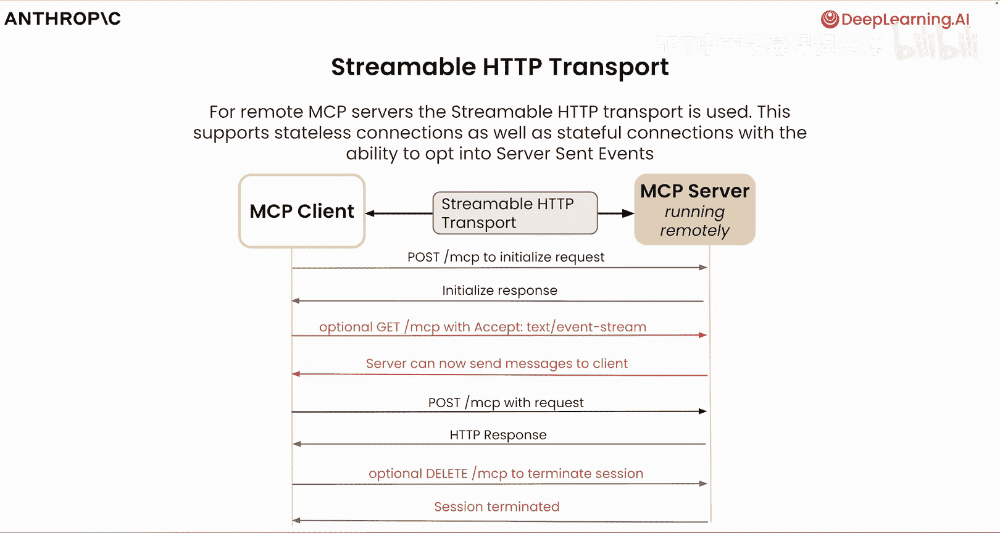