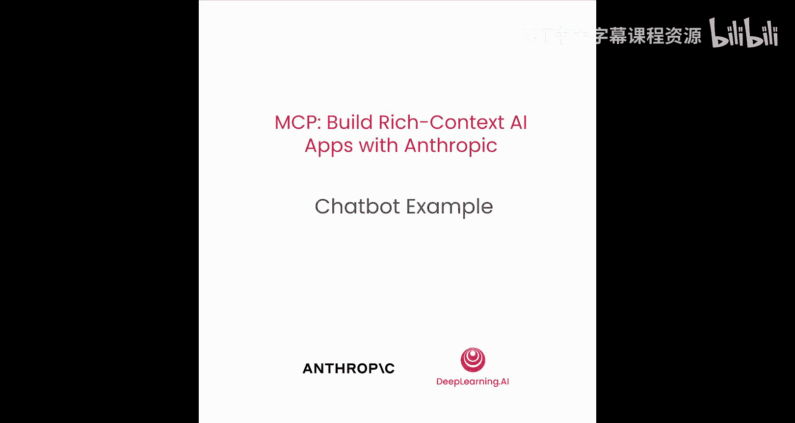
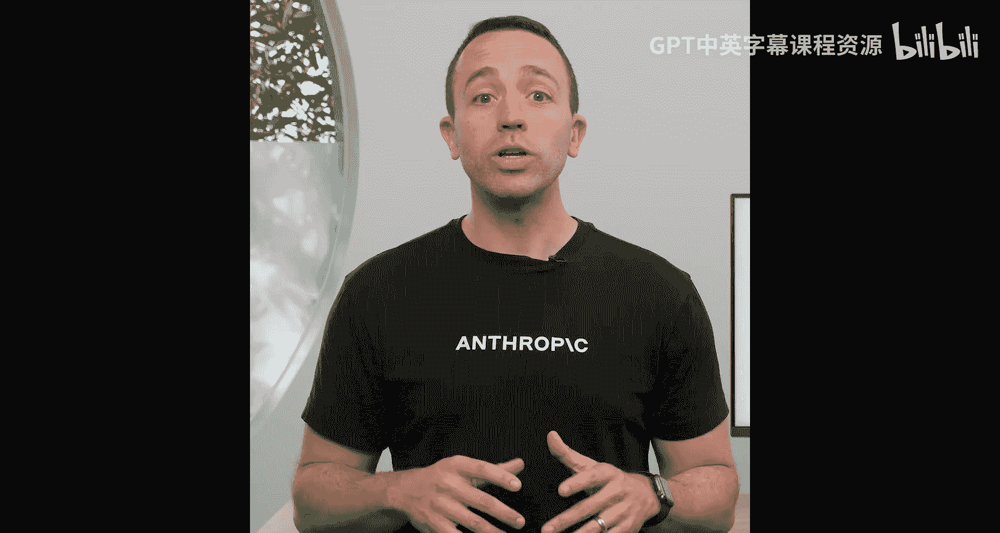
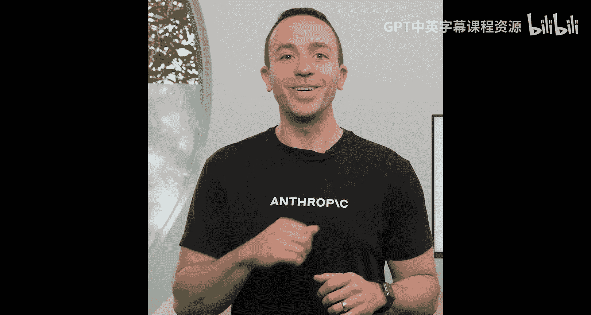
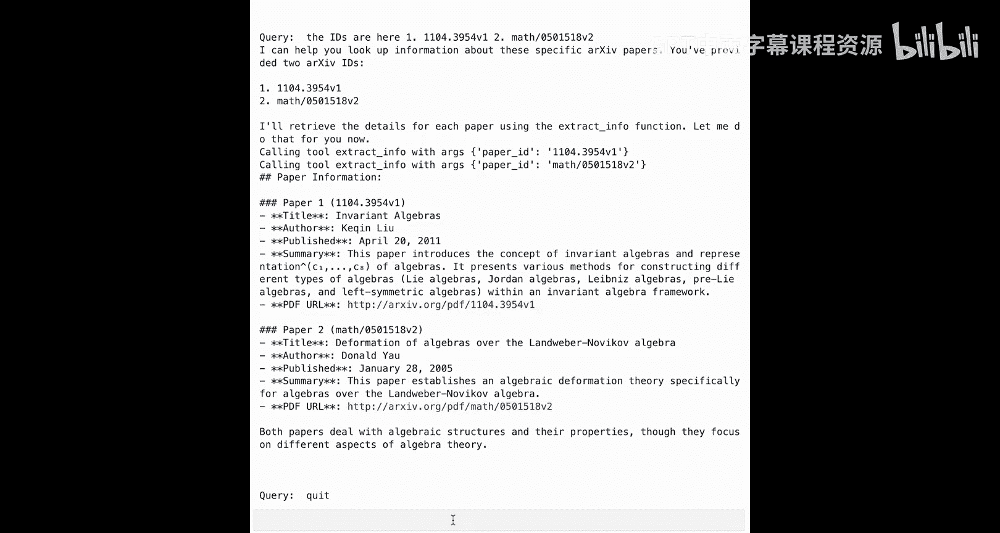

# 吴恩达《MCP：使用Anthropic构建具有丰富上下文的AI应用MCP： Build Rich-Context AI Apps with Anthropic》 - P4：4.chatbot-example.zh_en - GPT中英字幕课程资源 - BV1sxErzHEVj

Now it's time to start coding in this lesson， you'll build a chatbot and code its tools。

 Before you start working with MCP， let's make sure you have a good foundation with tool use and prompting large language models。

Alright， let's code。 So let's get started building our chatbot。

 And before we hop into building MCP servers， we're gonna start just by building a very simple application with a chatbot that makes use of archive for searching for papers and finding some information。

 If this is information that you're already familiar with。

 feel free to skip this lesson and hop into building your first MCP server。

 So let's get started by bringing in some libraries that we need。

 So we're going bring in the archive SDk。 This is going to allow us to start searching for papers。

 We're then going bring in the Json module for some formatting the O module for environment variables。

 We're going bring in a little bit of typing。 so we can type our code。

 and then we'll make sure we bring in the anthropic SDk。

 I'm going first start by defining a constant here called paper directory which is just going to be the string papers。

 And this is what I'm going to be using for saving information to the file system。

 I'm then going bring in my first function here。 So let's go take a look at this。

 This function is called search papers。 And it accept some kind of topic and a number of results which defaults the5 and what I'm doing here。

😊。

for papers on archive and if you're not familiar， archive is a open source repository of many different published papers across a variety of domains from mathematics to science to many different disciplines So we're going to search for some papers and then we're going return a list of paper Is and we're going then use those paper Is in another function to get more detail and summarization。

 we're gonna to initialize our client and then we'll start searching for relevant articles We'll take the results of those search and we'll go ahead and create a directory if it exists already great if not we'll go ahead and make it and we'll save this information to a file called papers In Json What we're going do is process each of these papers and create a dictionary and then we're going go ahead and write that to our file This is going give us back some Is when we're done。

 and let's go ahead and search for some papers for computers。

 We'll see here this is being saved to a file locally and we've got a bunch of Is that we can use to get some more information around We're going go ahead and bring in our second function here now to make use of this paper I So we're going to find another function here called extract info。

Is going to take in one of these paper Is。 It's going to look in our papers info Json and give us back some information about that paper。

 And if it can't be found， we'll go ahead and just return a string。

 There's no saved information for that paper。 So I'm going to go ahead and grab this first I D right here。

Let's go ahead and run this function And then we'll go ahead and call this function with that particular I just to show you what this looks like。

 We can see right here， we're getting back some data not only related to the title of this。

 but also the URL for the Pdf as well as a summary of this particular paper。

 We're going start with these two functions。 And then we're going go ahead and start bringing in these functions as tools for a large language model。

 So what we're going to be able to do is pass in some tools for anthropics cloud model。

 We're then going to go ahead and build a small chatbot that takes in these tools and knows when to call them and return the data particularly for these functions。

 So let's define our tools list。 if you are familiar with tool use。

 It should be nothing terribly new， but every single tool that you make is always going to have a name and the description and then some kind of schema that it needs to follow。

 So in this case， we have a tool for search papers and a tool for extract info。

 Remember that the model itself is not going to call these functions。

 We actually need to write the code to call those functions and pass the data back to the model。

 But these tools are。😊，to allow the model to extend its functionality。

 So instead of saying I don't know or hallucinate， we're gonna to get back the answer that we want here。

 So let's go ahead and start writing some of our logic for working with our large language model and executing these tools。

 Let's bring in a little bit of mapping for our tool And right here。

 we've got a function that is going to map the tools that we have calling that underlying function。

 What you can see here is we have a dictionary for each of our tool names。

 these refer to the functions that we have below and then a handy helper function to then go ahead and call that particular function and return the result to us in a variety of data types that come in。

 Let's go ahead and start building in our chatbot right now。

 And that's going start by bringing in any environment variables that we have API keys and then creating an instance of our anthropic client。

 We're going to need this so that we can go ahead and make calls to our model and get back some data。

 Let's go ahead and bring in our boilerplate function to go ahead and start working with the model。

 If you've worked with anthropic before or many other models。 This is going look very familiar。

 We're going start with a list of messages。😊，We're gonna go ahead and pass in the query that the user puts in。

 We're going to talk to cloud 37 sonnet right now。 We're going go ahead and start a loop for the chat。

 And if there is text data， put that into the message。 If the data that's coming in is tool use。

 if the model detects that a tool needs to be used。

 We're going go ahead and bring in our helper function for executing the tool and then appending that tool result to the list of messages。

 Let's go ahead and see this in action， bring in our chat loop。

 we got all the functionality we need to start working with tool use talking to our model。 Now。

 let's start with a very simple example for what it's going to look like to actually use this function。

 We're gonna run an infinite loop until we pass in the string quit。

 So let's go ahead and start talking to our large language model Call our chat loop function。

 Right now， we can start putting in a query to start talking to our model。

 So let's start with something very simple， like just saying hi and make sure this works as expected。

 We can see the model here is going to let us know not only that it's an AI assistant。

 but also let us know some of the tools that it has available。 This is excellent。

 So let's go ahead and start making use of these tools。😊。

Let's search for recent papers on a topic of interest。

 So why don't we go and search for papers on algebra。

 and this should make use of the tool that we have to go ahead and search for papers。

 We can see that topics being passed in and the results are saved here。This is great。

 It's even following up with Would you like me to extract more detailed information。

 So I'll go ahead and say， yes， please。 extract information on the first two。😊。

You found and summarize them both for me。 So what we're going to do is make use of that tool result that we got before。

 and we're going to pass that in。 And it's going to tell us which Is it's interested in。

 So I'm going to make sure that I pass in those particular Is so I can get that correctly done。

The Is are here。 So we're gonna see here。 it's going to extract the info with these particular Is。

 And we're going to go ahead and get the result as well as a summarization here。

 So we've got some information about invariant algebras and deformation of algebras。 Honestly。

 I cannot tell you what this is。 But hopefully， I can read the paper and get up to speed on what this information is。

 Something to remember is that there is no persistent memory here。

 So as you go ahead and search for queries and get I。 nothing is going to be stored permanently。

 So just make sure as you keep  querying。 you're passing in those Is and think of each conversation as brand new each time。

 If you ever want to get out of this chat。 Remember， we can always type in quit。

 So make sure you run that。 And we'll see that we're all done here。

 So what we've seen in this lesson is a review of large language models。

 tool use and making use of the archive SDk。 What we're going to see shortly is how we can refactor this code to turn those tools into NP tools to allow for a server to pass that information to us。

 We're then going to test that server and see what the results look like。

 I'll see you in the next lesson。😊。

