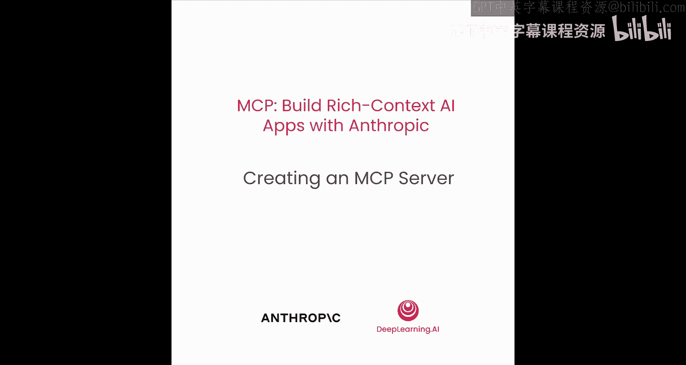
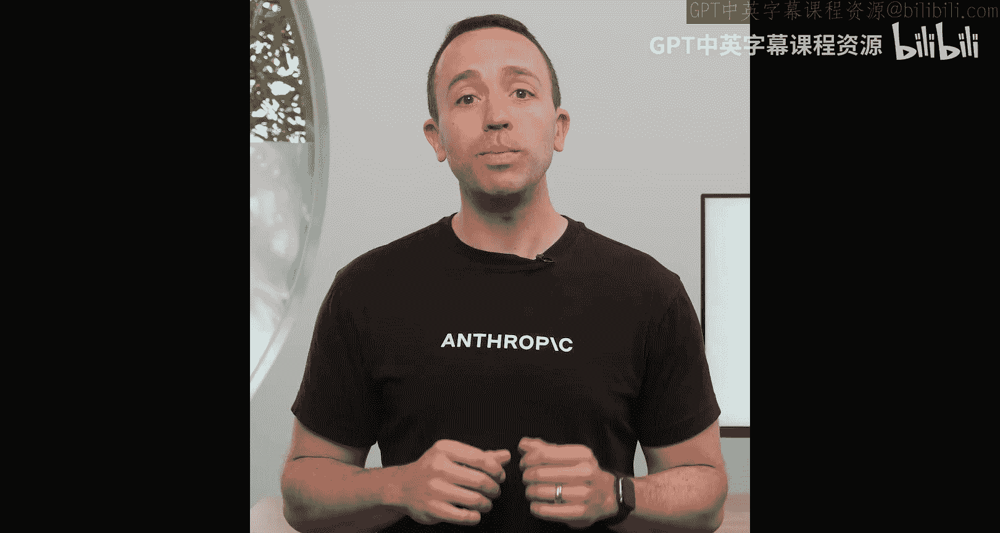
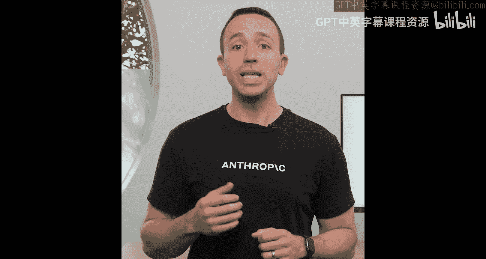
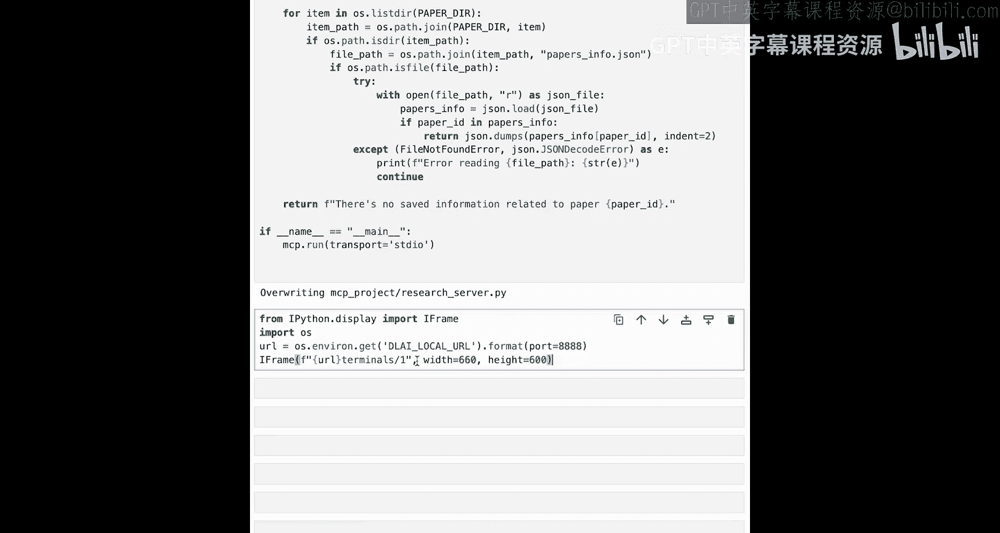
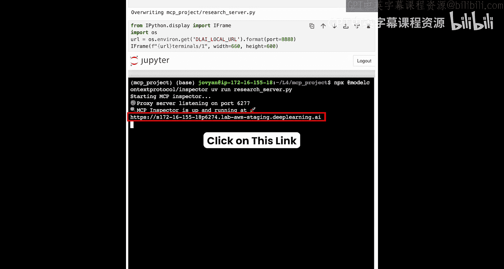
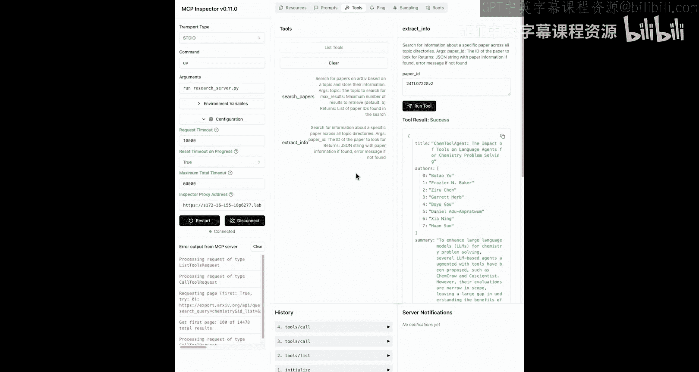
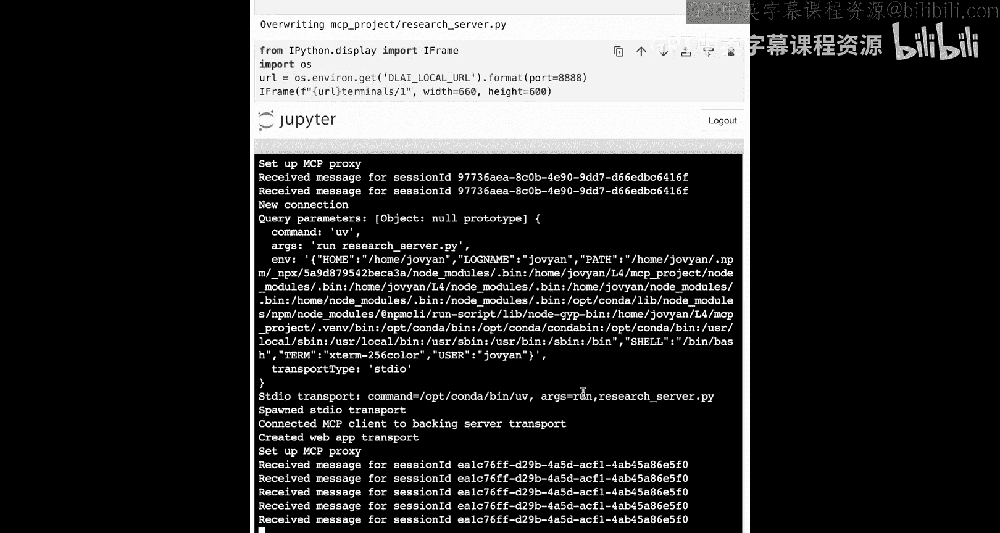
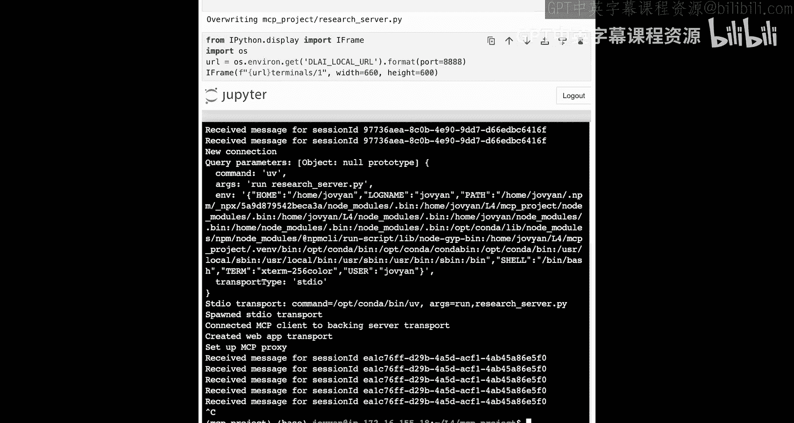
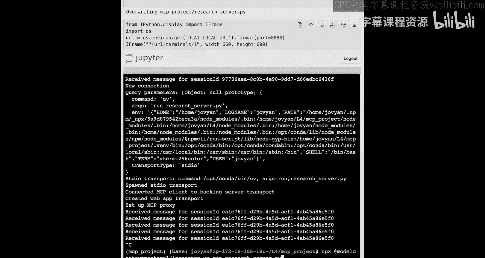

# 吴恩达《MCP：使用Anthropic构建具有丰富上下文的AI应用MCP： Build Rich-Context AI Apps with Anthropic》 - P5：5.creating-an-mcp-server.zh_en - GPT中英字幕课程资源 - BV1sxErzHEVj

You'll now take the tools you implemented for the chatbot and wrap them in an MCP server using the standard IO transport。

 you'll use fast MCP， which provides a high levelvel interface to build an MCP server。 Finally。

 you'll use the MCP inspector to test your server。

Let's get coded。 So we're gonna pick up where we left off with the last lesson where we defined two functions search papers to go ahead and find papers on archive。

 and then another function that we had down here extract info。

 We took these functions and we define them as tools and pass them to our large language model。

 What we're going to do now is abstract away the definition of these tools and the schema of these tools and create an MCP server and use a library called fast MCP to help us build that quickly。

 So with just a few lines of code， We're going to bring in fast MCP。

 We're going to define each of these functions as tools using MCP。

 And then we're going to go ahead and start our MCP server and test that in the browser。

 So the first thing I'm going to do is bring in the necessary import that I need。

 So from MCP do server fast MCP。 I'm going import the fast MCP class。

 I'm then going to go ahead and initialize that MCP server。 So I'll initialize our。😊，MCP server。

And I'll declare a variable here， which is the result of initializing that I'll give this serverber a name we'll call this research。

 and let's go ahead and make use of that MCP variable。As we saw before。

 there are quite a few primitives in the model context protocol。 We saw tools， resources， prompts。

 And what we're going to start with right now is just defining a tool。

 And that's as easy as decorating this function with MCP do tool。

 We'll go ahead and make sure we do that for our function below as well。

 And what this is going to do is define two tools on our MCP server that we can start running and testing。

 One last thing we need to do here is make sure that we have the right command to start this server。

 So what I'm going to bring in is a very standard bit of Python。

We're gonna say if Dunder name is equal to Dunder main， this allows me to run this directly。

 and if there are imports， this code does not run。 I'll go ahead and initialize and run the server。

 I'll do that by calling MCp do run。 and I'm going to pass in a transport As we saw before。

 we can run servers locally and we can run them remotely And when we're running our servers locally。

 We almost always use standard iio。 So I'll pass in a transport of standard Iio。

 And that's all we need to start writing our MCP server。 You can see at the top here。

 we've got a magic function to go ahead and actually write a file called research server do pi。

 So I'm going to go ahead and execute this cell。 And we're going to see that we write a file called research server do pi This Python file is going to be used when we start our MCP server。

 So let's go ahead and set up our environment and test our server to do this。

 I'm going to go ahead and open up a new terminal in the environment that we're in。

 we're going to need this code necessary。To create and run code inside of a terminal。

 if you want to run this code locally on your own machine， you're more than welcome to do so as well。

 We can see here。 I've got a terminal， and I'm gonna C D into a folder called MCP project where my code list。

 I can see here。 I have my research server pi。 In fact。

 this research server pi is all of the code that we just created above。

 What I need to do here is install the necessary dependencies。 Just start working with MCP。

 as well as install the archive SDk。 What I'm going to do here is instead of using Pip。

 I'm going to use a package manager called E Uv Uv is slightly faster than Pip and provides quite a few other nice tools to make it easier to manage your dependencies in Python。

 Once I run Uvid。 We're going to see I have initialized project called MCP project。

 based on the name of the folder。 If you're familiar with virtual environments or creating a virtual environment。

 this part's gonna to look familiar。 If you're not familiar with virtual environments。😊。

They' are simply ways to self contain the dependencies that you have so that you're not installing things globally and potentially conflicting with other installations。

 So let's go ahead and create our virtual environment using U V Ven。

 We'll see here we have a virtual environment and actually a folder called dot Ven。

 Let's go ahead and activate this virtual environment。 We'll do that using source dot Ven。

Then activate。 and I am using tab completion here。 so I don't make any spelling mistakes。

 We can see here now that we're in a virtual environment called MCP project。

 And now we need to install the necessary dependencies。

 I'll clear so you can see what we have at the top。

 and I'll go ahead and bring in the dependencies of MCP and archive。

 We'll give this a second to install And we're going pull in these dependencies so that when we start running our MCP server。

 we get the correct information。 The next step right now is to test our server file。

 Instead of just running this code in Python to test the server。

 We're going to use a tool developed called the inspector。

 which gives us a browser based environment to explore the tools， resources。

 prompts and other primitives that we have。 I'll clear here so we can start from the top In order to use that tool。

 I'm going to run the command Nx at model context protocol slash inspector。

 What this is going to do is pull in the command to start this server so that I don't have。😊。

To install it locally。 and then the command that I want to use to run the application is Uv run research server。

 I'm using U run， so I can sure I have the correct dependencies and I'm in my virtual environment。

 This simply makes it an easier way to run Python files。

 We'll see here that we're starting our MCP inspector and the MCP inspector is up and running。

 So I'm going to head over to the browser and hop into that particular inspector that we're looking at。

When we take a look at this inspector， we're going to see that we have a few different kinds of transport types。

 We have server sent events and streamable H TTP， our remote protocols。 But remember。

 our server is running on standard I O。 So let's keep that as is the command that we use to run is U V run research server dot pi。

 We saw in the command line。 That's what we passed in。 and that's being applied right here。

 One small note。 since we're running this in a slightly different environment。

 We're going to have to pacee in a proxy address that we've provided in the notebook。

If you're running this locally， this is not something you'll have to do。

 So I'm going to go ahead and paste in that proxy address。

And let's go ahead and connect to our server。 Once we connect。

 we're going to see some of the primitives that we have access to。 We discussed resources。

 prompts and tools。 And what we've created on this server right now are just some tools。

 But what I do want you to see is this initialized process right here。 If you remember。

 back in our previous lesson when we spoke about communication and the transports。

 The first process was a handshake or initialization from client to server。

 We're going to head over to tools。 And we're going to go see what tools we have available。

 This list tools is another command we can issue。 to go ahead and find the particular tools that the server is providing。

😊，We can also go ahead and run these tools。 So what's really nice about the inspector is without building any kind of MCP client or host。

 you have a sandbox to play around with the tools or prompts or resources that the server is returning。

 We can also see here from the dock string。 We inferred a description。

 as well as the parameters that are required。 Let's go ahead and search for a topic。

 I'll go search for chemistry。😊，And let's look for one result。 When I run that tool。

 we're going to go ahead and get back the return value。

So we have not yet added any kind of large language model or functionality here。

 we' simply just testing the MCP server。I can go ahead and test my other tool with that paper I。

And we should expect that I get back a success as well。

 The MCP inspector is extremely valuable as you start building servers。

 And even when you install servers that other people have written。

 it's a great way to have a stand box to play around。 Once you're done using the inspector。😊。

We can head back to our notebook， and if you need to quit the server。

 you can stop that process using control C。

And we're back in the terminal。

If you ever need to start that again， you can always press up。

To get access to your previous command so you don't have to type the whole thing In the next lesson。

 we're going to start layering on an MCP host and a client and integrate this MCP server with a chatbot that we build all talking with MCP。

 See there。

