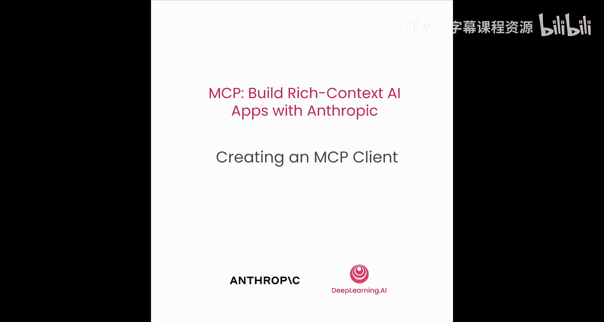
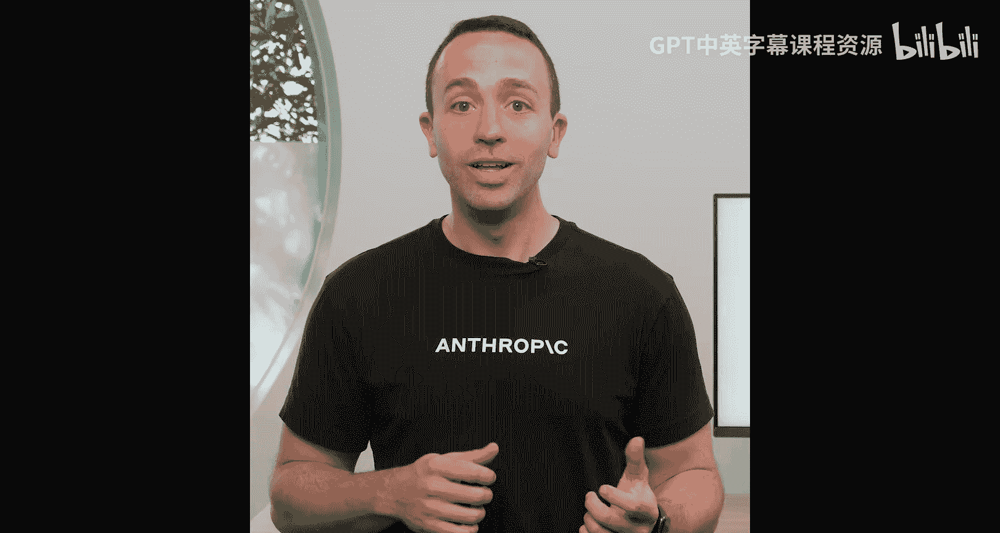
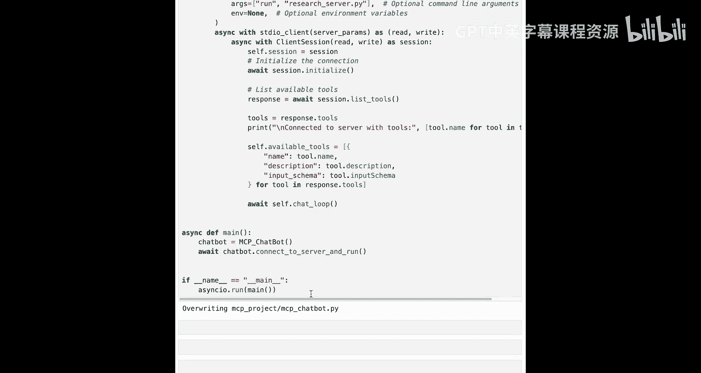
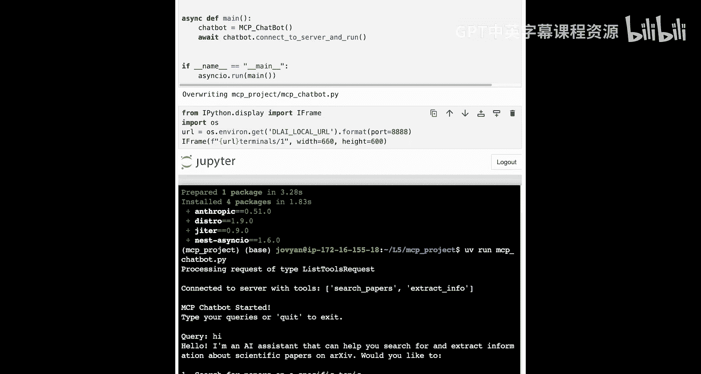
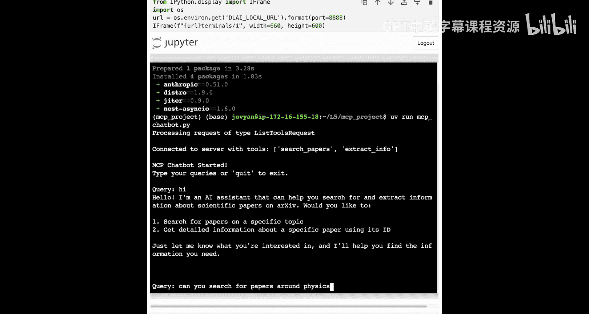
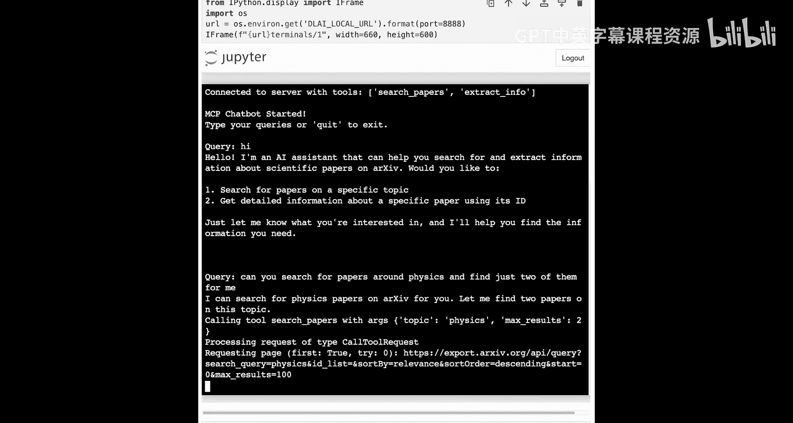
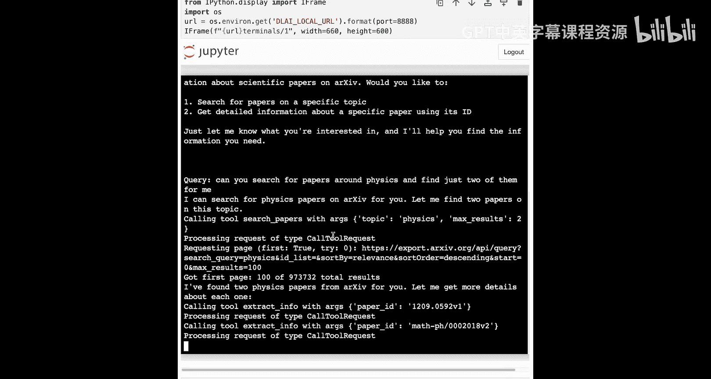
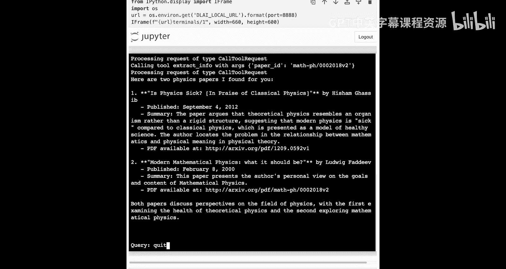

# 吴恩达《MCP：使用Anthropic构建具有丰富上下文的AI应用MCP： Build Rich-Context AI Apps with Anthropic》 - P6：6.creating-an-mcp-client.zh_en - GPT中英字幕课程资源 - BV1sxErzHEVj

With your MCP server ready， it's now time to create an MCP client inside your chatbot to let the chatbot communicate with the server and get access to the tool definitions and results。

 Let's have some now that we've seen how to build a server with MCP。

 Let's go ahead and move past the inspector and build our own host to contain a client to talk to our MCP server。

 We're going to be working with the chatbot directly。

 But if you want to take a look at other files like the server that we've made before。

 Feel free to do so。 We're gonna to start by revisiting what we saw before in our chatbot example。

 You're gonna to see a lot of this code again。 but we're gonna to layer on a little bit more as we start bringing a client into the mix。

 Everything you're seeing here we've seen before。 This is simply the ability to process a query using Cloudde37 sonnet as well as tool use。

 We can see here that we're not actually defining any tools that's all being done in the server that we made。

😊。

In the last lesson， let's go ahead now and start talking about how to bring in and create an MCP client。

 I'm going to bring in a bit of code from the underlying MCP library。

 because I want to talk through what's actually happening here。

 if you remember when we create an MCP client which lives inside of a host We need to make sure that that client establishes a connection to an MCP server。

An important note here。The code that we're looking at is slightly lower level。

 You won't always find yourself building clients from scratch。

 but it's really important that when you see other tools like cloud desktop or cloud AI。

 you have an idea of what's happening under the hood。 So if this code looks relatively intimidating。

 Don't be too worried， we'll go step by step。 The goal here is really to make sure you understand how clients are created and how they establish connections to servers。

What we're seeing here are a few imports from the underlying MCP library to bring in the necessary classes to establish a connection to a server。

 as well as the ability to start a subproces from the client。

 So the first thing we're going to do here。 is establish the server and the parameters necessary that we want to connect to。

 And this is actually going to look pretty familiar。

 That same command that we ran Uv run research server do pi。

 We're specifying here to let our client know how to start the server。

 if there are any environment variables that we need， we can pass those in here。

 The next step is to actually establish that connection and launch the server as a subproces。

 Since we might not want this to be blocking。 We're gonna to be making use of async and await quite a bit in Python。

 If you're not too familiar with that， No worries。 I'll walk you through what needs to be done here。

 We're going to define a function called run。 and we're going to set up a context manager。

To first pass in the parameters from our server and establish a connection as a subproces。

 Once we've established the server to connect to。 we're going to get access to a read and write stream that we can then pass to a higher level class。

 call the client session in this client session when we pass the read and write stream。

 We'll get access to an underlying connection that allows us to make use of functionality for listing tools。

 initializing connections and doing quite a bit more with other primitives。

 The first thing we're going to do is establish that handshake and initialize our session。

 We'll then go ahead and list all of the available tools that the server is providing。

 remember the client's job is to query for tools and take those tools and pass them to a large language model we'll make use of our chat loop functionality that we saw before。

 and if there is a tool that needs to be invoked。We'll go ahead and let the MCP server do that work。

 So we're going to see a slightly different bit of code for executing the underlying tool。

 We're going to bring in the tools from the MCP server。 And if a tool needs to be executed。

 we'll let the MCP server know what to do。And we've defined all the code necessary in the previous lesson for what happens when that tool is executed。

 since we're working in an async environment， we're going to be moving past MP dot run and using async I O dot run。

 So with that in mind， let's put this all together。 we're going to go ahead and add。

Our MCP client to our chat bot。We're going to go ahead and write a file called MCP Chabot dot Pi。

 Since this is what we're going to run in the terminal to start interacting with our chatbot。

 we're going to bring in all of the imports that you saw before， alongside Nest async Iio。

 which is necessary for different operating systems to work properly with the event loop in Python。

 We're going to bring in any environment variables that we have and then initialize our chatbo when we initialize our chatbot。

 We don't have a current session。 and we don't have any tools available to us。

We're going to see that once we start establishing the connection， These values will change。

 Our process query looks very similar to above with a slight difference of what happens when the tool needs to be invoked。

 We're using the session established to go back to the MCP server and execute the tool necessary。

 We're then going to follow similar logic for appending a message and making use of tool use that we've seen before。

 Our chat loop as well， is going to look very similar。

 We're going to go ahead and keep running until someone types in quit。

And process that particular query whenever data comes in to wrap this up。

 we're going to define a function called connect to server and run。

 which does just that like we saw before。 We establish a connection to an MCP server。

 We get access to the read and write stream and the underlying session so that we can establish that connection list the tools that we need and then take those tools and pass them for tool use in the model to wrap this up。

 We initialize our chatbot and we call our connect to server and run function。

 inside of a Dunder name equals D main We run our main function using async Iio。

 So let's go ahead and run this code to create the necessary MCP chatbot do pi file。

 So let's go ahead and bring in our terminal。😊。

And we'll see here I'm in the L5 directory， I'm going to C D into the MCP project folder。

And if we take a look at what I have right here。I have a virtual environment that already exists。

 So I'm going to go ahead。And start by activating that virtual environment source dot then。

 then activate。 We're also gonna to need a couple other dependencies to make this project work。

 So I'll go ahead。 Cl this。 and I'll add the Anthropic SD K。

 the Python dot Ev module for environment variable access。 and Nest async Iio。

 Once I add those dependencies。 I should have everything necessary to start my chatbo。

 Before I start the chatbo， let's just make sure we see how this is coming together。

 When I type in Uv run MCP chatbo dot pi。 We are going to connect to our MCP server。

 make use of the tools that are defined past those tools to Cla and then create a nice interface for us to start talking with Cla to get access to those tools and any other data that we want。

 We can see here that when there is a connection， we're processing that request of list tools request。

 This is the underlying functionality。😊，In the protocol that allows me to pull in the tools necessary。

 we've connected to the server with the following tools， and we can start talking to our chatbot。

 We can always start with something simple。 Just make sure things are working。

 a friendly query to greet our chatbot。 Now， let's go ahead and make use of some of those tools that we have。

So I'll ask， can you search for papers？Around physics。

And find just two of them for me what we're going to do here is make use of those particular tools that we have。

We're going to see here using the call tool request that the MCP client is sending this data to the server。

 The server is invoking that tool and returning it back to us。

 We're then using Claude with that additional context to return a nice summary to us。

While we've done a little bit of lower level programming to make this work。

 we've started to build a foundation for something incredibly powerful。

 We're going to first establish multiple client sessions to allow for the use of many different MCP servers。

 so these can all start to work together， and then we're going to start layering on additional primitives like resources and prompts to really see this work at much larger scale。

😊，See you in the next lesson。And don't forget， if you ever want to get out of the chatbot。

 you can always type quit。

