# 吴恩达《MCP：使用Anthropic构建具有丰富上下文的AI应用MCP： Build Rich-Context AI Apps with Anthropic》 - P7：7.connecting-the-mcp-chatbot-to-reference-servers.zh_en - GPT中英字幕课程资源 - BV1sxErzHEVj

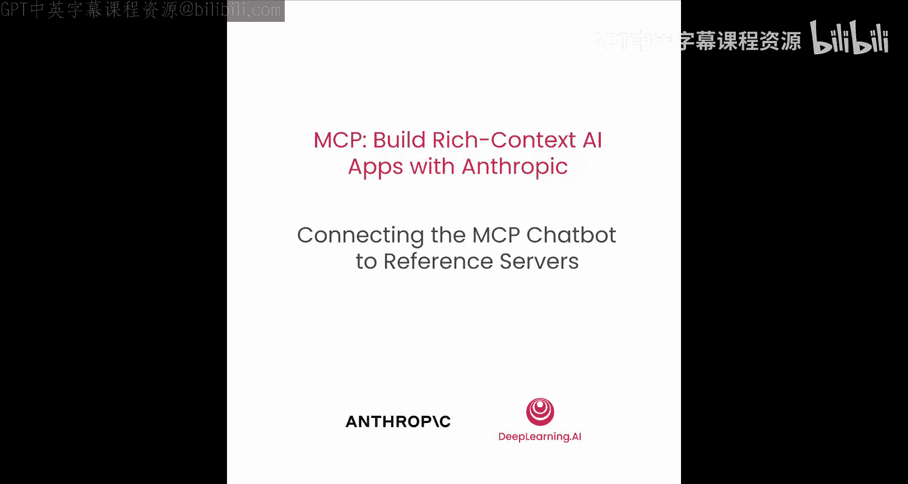

In the previous lesson， you connected your chatbot to one server that you built。 Now。

 you'll update your chatbot so that it can connect to any server。

 You'll learn more about the reference servers developed by the Anthropic team and how you can download them。

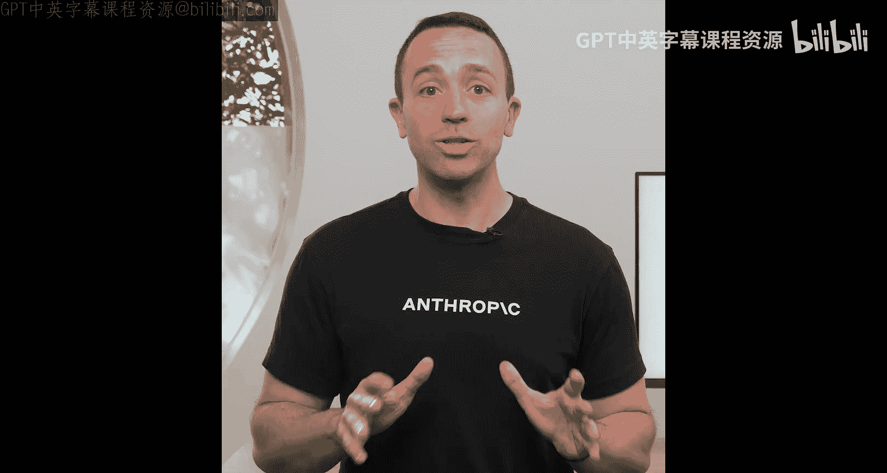

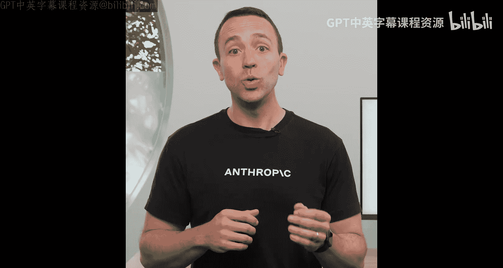

Let's get to it。 So far， we've seen how to build MCP servers as well as clients and connect those on a one to one basis。

 What we want to start introducing now is the ability to not only build multiple clients that can work with multiple servers。

 but also introduce the entire ecosystem of servers that exist out there。

 So I'm going to start here by taking a look at some of the servers that are reference servers from Anthropic on our repository。

 So let's go take a look on Github for the reference servers that we have。

With the model context protocol， as you take a look through all of the servers here。

 there is a massive， massive list。 So we're just going to start with the reference servers。

 These are ones that we have worked on and built at Anthropic。

 There are also many different third party servers and official integrations。

Any data source that you can imagine talking to at this point probably has in MCP server。

 Instead of you having to download these servers and run them locally。

 we're also going to see how we can add the command necessary to run the server without that much hassle。

 The servers that we're going to be using are the fetch server as well as the file system server。

 So let's take a look at the fetch server。 What's so interesting about this is that if you look at the underlying source code for many of these servers。

 it's actually going to look pretty familiar to what you built before。

 we can see here that the fetchch MCP server exposes tools and a prompt to us。

 and we can see what the installation is as well。 Since this server is written in Python。

 we're actually going to use the U command to directly run a command called MCP server fetch。

 which will run all the code necessary to download what we need and establish the connection。

 So instead of Uv run， we're going to be using Uvx。 the fetch server allows us to retrieve。😊。

Content from web pages convert Hml to markdown so that LLMs can better consume that content。

 The second server that we're gonna be looking at is the file system server。

 And just like you can imagine， this is gonna be a way for us to access our file system reading writing files。

 searching for files getting metadata and so on。 we can see here there are resources and tools exposed quite a few different tools for reading and writing files。

 If you take a look at the source code here， you can see that this is not written in Python。

 this is in fact written in Typescript， which means instead of Uvx。

 we're gonna to be using a slightly different command。

 If we take a look at the installation instructions to run this。

 the command necessary is Nx y so that we don't need to press enterer for any other installation instructions and then model context protocol server file system。

 So similar to running Uvx where we can download what we need and execute it right away。

 we're gonna to be using NPx from the NP。Package manager。

 we then specify any paths that we allow for reading and writing files into。 As you can see。

 each of these reference servers have a bit of configuration required。 the name of the server。

 the command necessary and so on。 So what we're going to do is we're going to make some updates to our chatbo。

 Instead of hard coding these server parameters。 we're gonna to make a small Json file that we can read from to figure out the necessary commands to interact with our servers。

 willll be using the file system server。 The research server that we're building as well as the fetch server。

 and we'll see how we can put all three of those together to create very powerful prompts。

 in order to make this happen。 We're going to have to go ahead and change the code in our MCP chabo。

 the reference servers stay the same。 our research server stays the same。

 But we have to update the code a bit for our MCP chabo。 There is a good amount here。

 that is relatively lower level and plenty of opportunity for refactoring。 So。😊。

Walk you through what we have here。 And I welcome any changes you'd like to make to grow this as its scale in order to get this to work。

 we're going to have to set up our own Json file to configure how we want to connect to each of the individual servers。

 And here's what that's going to look like。 We're going to start with a little bit of Json to contain all of our servers。

 then we'll specify the name of those servers。 As well as the underlying command necessary。

 and any arguments required。 for the research server， this is going to look relatively familiar。

 And for the reference servers since we're not downloading it and then running it locally ourselves。

 we're using commands like Nx and Uvx to run those immediately。

 So we're going to see this file and you can find this file as well。

 in your list of files for this lesson under the folder MCP project。 for the file system server。

 If you remember， we had to specify the paths that we wanted access to。

 And here we're specifying a dot which means the current directory that we're in。😊。

This is not going to be able to read or write from files or folders outside of this current directory。

 Now， let's go ahead and take a look at the code necessary for our MCP chatbot to not only connect to multiple servers with multiple clients but also correctly read the JSO file for the server configuration necessary。

's go ahead and see what we need to update our MCP chatbot to handle these connections。

 If you take a look at the code that we have here for our MCP chatbo。

 there's quite a bit more happening under the hood and especially some lower level ideas that I want you to not feel too intimidated by the most important takeaway here is to understand how tools like cloud desktop cloud AI cursor Winsurf work under the hood when they set up multiple connections to multiple servers What I'm going to do here is start by adding a little bit more to my MCP chatbot I'm going to maintain a list of all of the sessions that I've connected to as well as all of the tools and。

Particular session that that tool is related to。 Again， this is not production ready。

 This is really just giving you a sense of how to get started。

 And the focus here is to make sure that we correctly map a tool to the session that we're working in。

 We have a type definition here as our tools are a little bit more complex than we had before。

 We're gonna to have some similar code to connect to a server。

 except that since we have multiple context managers inside of an asynchronous environment。

 We have to set up our connection a little bit differently。

 So we use an async exit stack to manage our connections for reading and writing as well as managing the entire connection to the session below。

 we're gonna to see some pretty familiar code。 We initialize a session。

 We list those tools and we take the tools and append them to our list of available tools。

 You can imagine that this is a function that's going to be run multiple times for each of the servers that we want to connect to。

 and that is exactly what we're doing down here。 We're going to go ahead and read from our server config file。

😊，We're going to parse that Json。 turn it into a dictionary that we can then iterate over。

 and for each individual MCP server， connect to it。

 If you are familiar with asynchronous programming。

 you can see that this code is blocking and maybe you could refactor this to use asynioga or so on。

 But again， the focus here is understanding conceptually what's going on。

 I welcome any refactor you'd like to do。 Once we connect to all of these servers。

 we're then going to use some logic that looks pretty familiar as well。

 We're going to go ahead and get access to our model。

 We're going to pass in any information coming in from a query。

 And then if there is a tool that we need， we're going to go find it and call that particular tool。

 The rest of this logic is very familiar。😊，The chat loop that we have is exactly as what we had before with one small note that when we need to go ahead and close any connection that we have。

 we do this using our contact manager for multiple different connections。

 Our main function has a little bit more to allow us to connect to all of the servers that we need and then start the chat loop。

 And once that's all done we can go ahead and clean up any lingering connections that we have to these servers。

 And just like we had before。 We're going to start this application by calling async Iio dot run with our main function。

 So let's go ahead and write this file。 And we'll hop back to the terminal in the terminal here。

 I'm gonna first C D into MCp project。 And I'm going to see here that I have again。

 a dot then folder。 So let's go ahead and activate the virtual environment So then， then activate。😊。

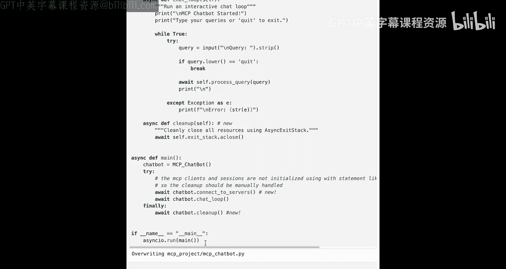

And then let's go ahead and run our chatbot。I'll clear so we can take this from the top and I'll type in U run MCP。

😊，茶八大牌。What we're going to do here is connect to multiple MCP servers by setting up multiple clients。

 We can see here we've connected to the file system with the allowed directory of the current directory we're in。

 We've connected with these particular set of tools。

 We've connected to our research server as well as the fetch server itself。

 We have the same exact chat interface that we had before。 So I'm going to paste in this prompt。

 where I'm going to ask it to fetch the content of the model context protocol and save the content to a file called MCP summary and then create a visual diagram that summarizes the content。

 So what we're going to be doing here is use a multitude of tools to fetch information and then to summarize that information。

 We're then going to have it draw a nice little diagram for us。

 So let's go take a look at what that looks like。 We can see here it's saved to a file called MCP summary M。

 So in our file system。 Let's go take a look at what that file looks like。

 So we've got this nice little diagram here for the model context protocol。😊。

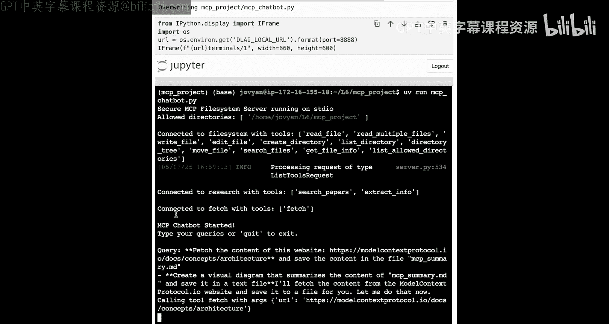

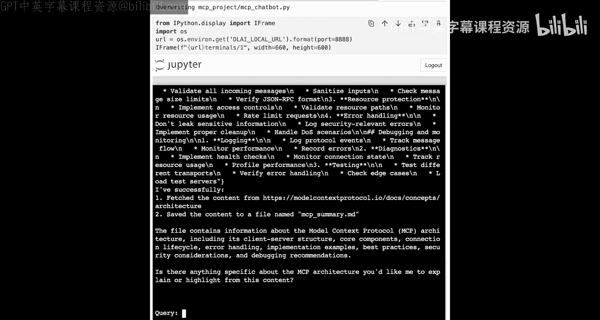

Was done by fetching information from the website， summarizing that information。

 turning it into a nice visualization。 And again， we're gonna to see an even prettier one when we start bringing in tools like cloud desktop。

 But now the Ui is totally up to you for what you want to do。

 But you can do whatever you want with this file right now。

 So we've seen how a couple of these servers can work together。

 Let's try bringing all three together。 So we'll say fetch deep learning do AI and find an interesting term。

😊。

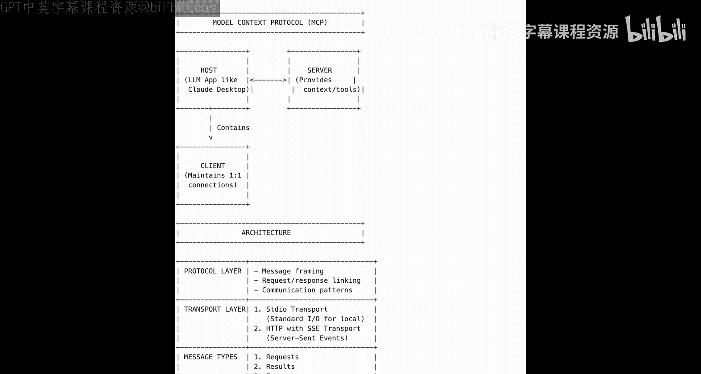

To search papers around。

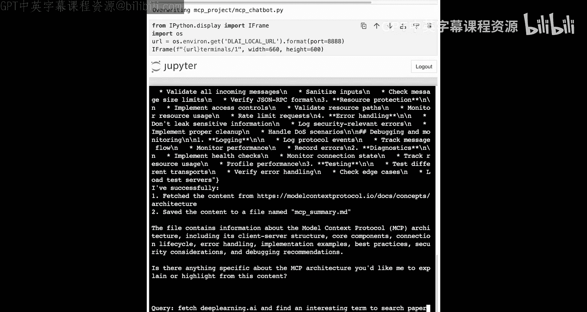

And then summarize your findings。And write them to a file called resultsult。 TXt。

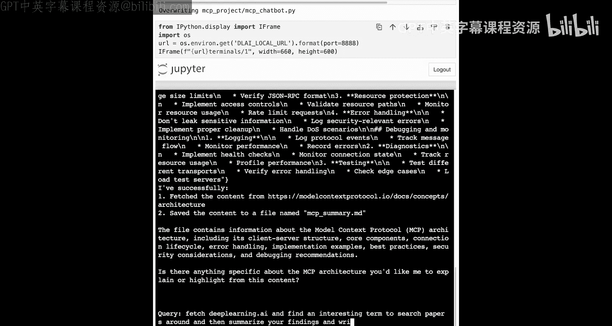

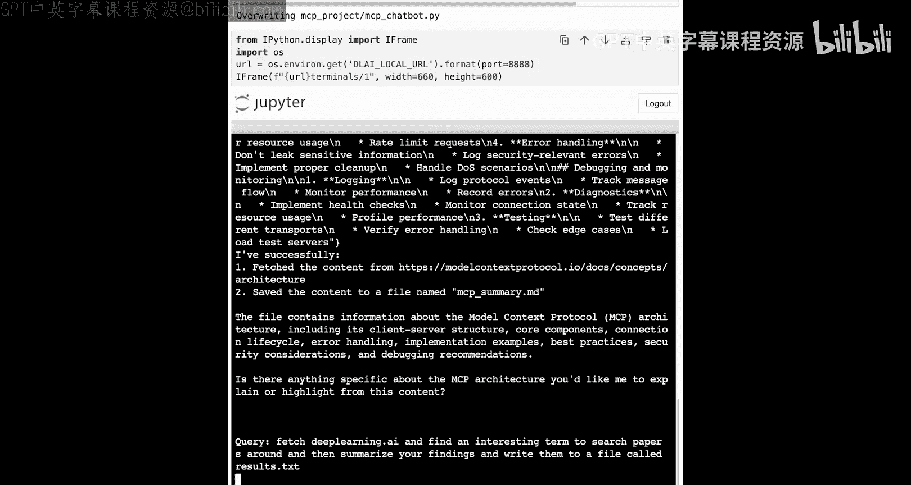

We're going to make use of the fetch tool here to visit a website。

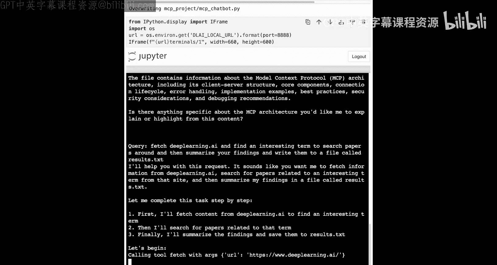

And find the content of that website。Based on that content， we'll find some interesting terms。

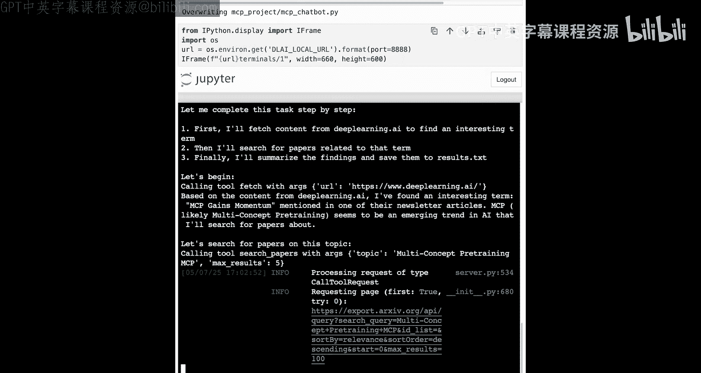

In this case， we've got multi concept pre training。

 We're then going to go ahead and find papers related to that。

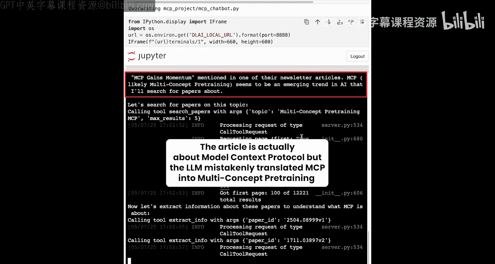

AndWe're going to take that data and we're going to write it to a file。

You might not find yourself using a combination of these servers for many real world use cases。

 but now your imagination can carry you。Any existing MCP server can be added with minimal configuration。

And you can take the results of these different MCP servers to add all the context you need to connect models like cloud to the outside world。

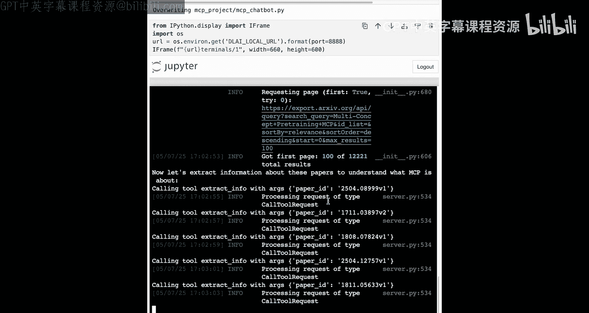

We can see here we've got a really nice summary。

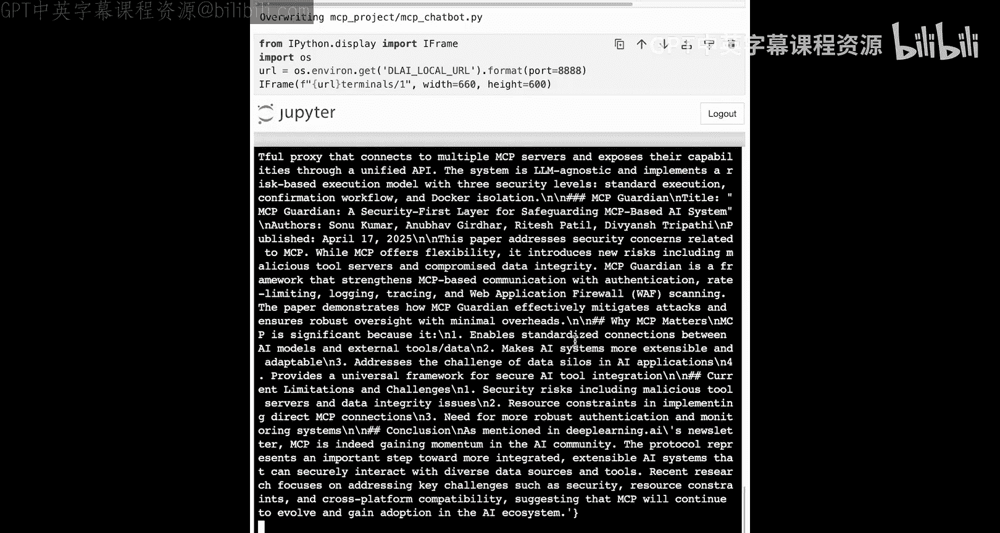

Let's go ahead and see what's been written here。 So we got a very interesting result from our research。

 It seems that while MCP or model context protocol is a very powerful tool。

 there also is another acronym for MCP for multi concept retraining So it looks like the model got a little bit confused here。

 When in doubt， this is why prompt engineering is so important。

 And we could even follow up with a follow of this is why you should include the model context protocol and not other concepts as well。

 As always， if we want to leave this chat session， we can type in quit。

 Now that we have multiple servers connecting to multiple clients Let's start adding on a few other primitives like resources for read only data and prompt templates for the ability to generate prompts on the server。

 that the user can use so that they don't have to write prompts completely from scratch。

 I'll see you in the next lesson。😊。

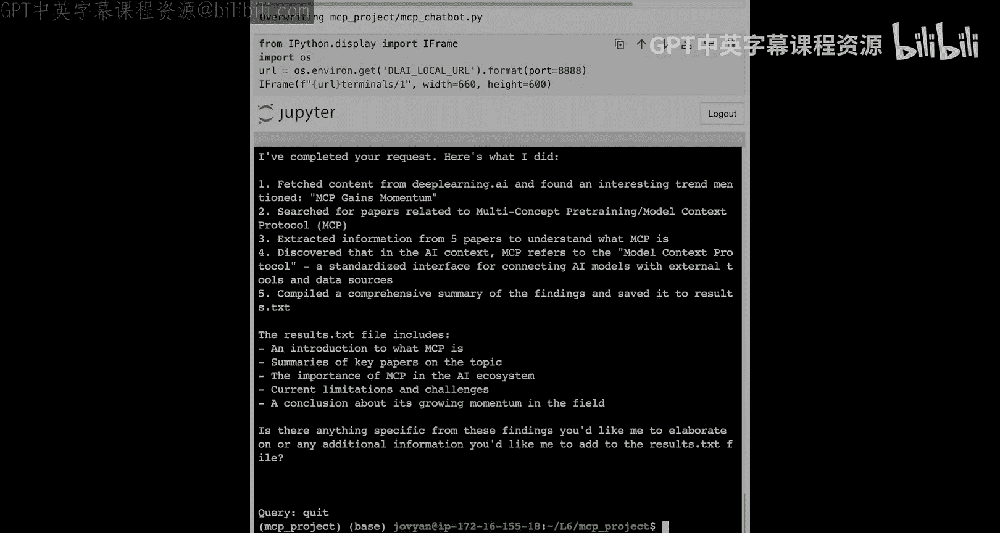