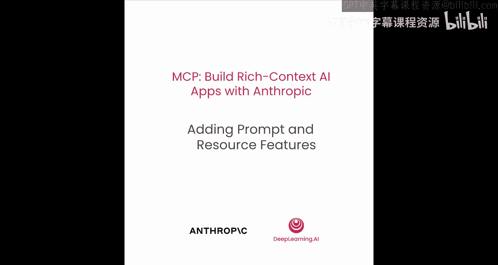
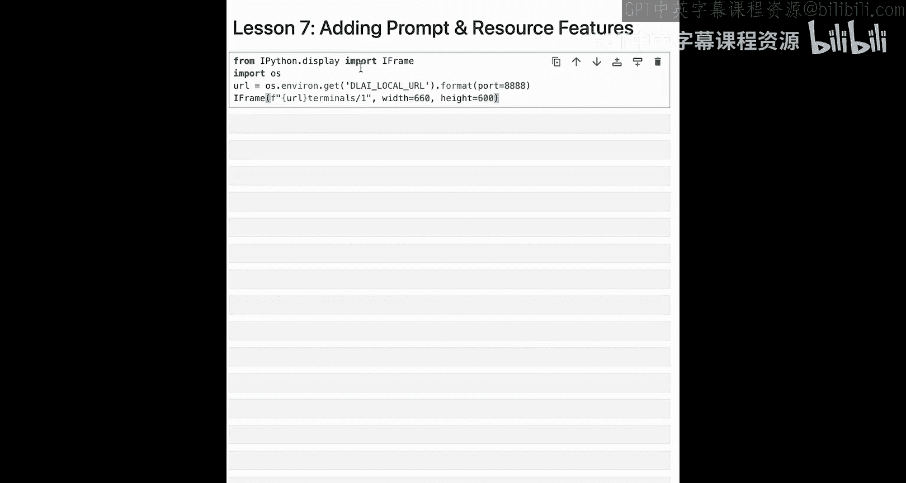
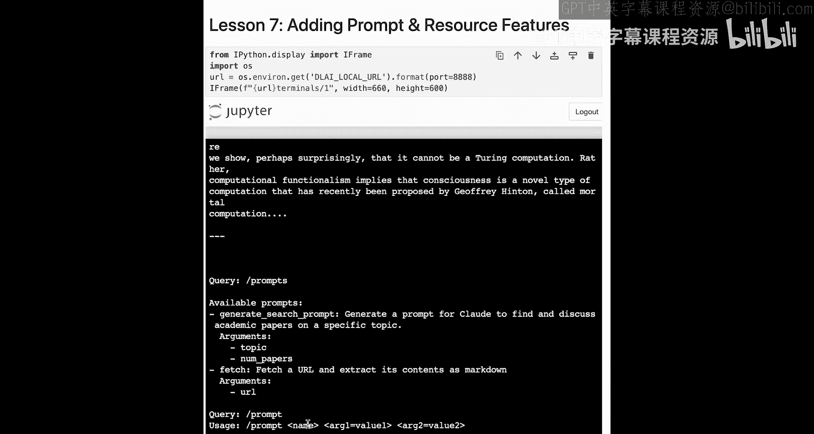
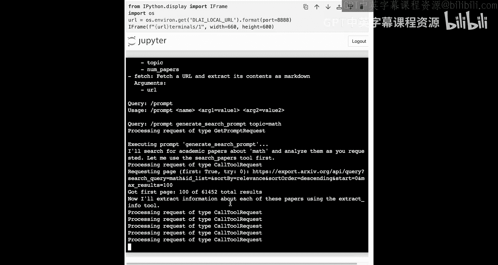
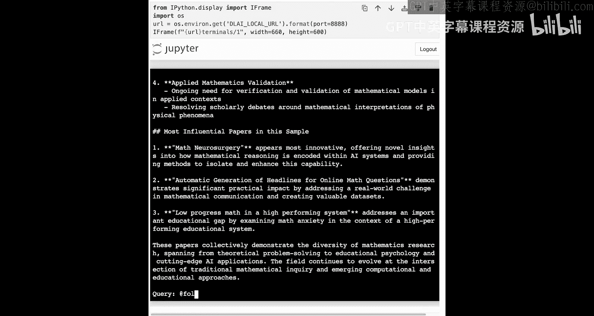
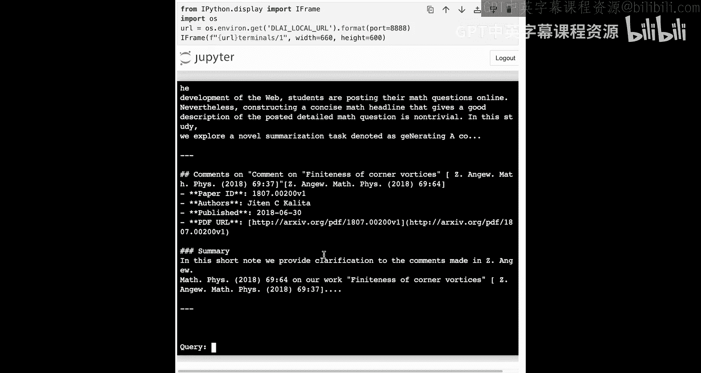

# 吴恩达《MCP：使用Anthropic构建具有丰富上下文的AI应用MCP： Build Rich-Context AI Apps with Anthropic》 - P8：8.adding-prompt-and-resource-features.zh_en - GPT中英字幕课程资源 - BV1sxErzHEVj

So far， your MCP server only provided tools to your chatbot。

 you'll now update your server so that it also provides resources and a prompt template on the chatbot side you'll expose those features to the user let's do it。

We've already seen how to create multiple MCP clients connecting to multiple MCP servers。 Now。

 let's shift back to some of the other primitives in the protocol， like resources and prompts。

 and talk about how we can add that both on the server as well as on the ability of the client to consume that data in our research server do Pi。

 You can find all of these files in your file system。 All of these files are provided to you。

 So what I'd love to do is walk through some of the code。

 Both on the server side and with our clients as we saw before。

 adding a tool is as easy as decorating MCP do tool。 Now， let's bring in resources and prompts。

 and we'll talk a bit how to add those。 The code here right now is living on our server and what we're going to do is bring in a couple resources for all of our particular folders as well as any papers on a particular topic。

 Remember that resources are read only data that the application can choose to use。😊。

Or we can give to the model。 So instead of making tools to go and fetch things from the file system。

 the same way we have a get request to fetch our data with HttP。

 we're gonna do the same thing with resources。 So on the server。

 I have a resource with the U for papers， Col s folders to go ahead and list the available folders in the paper directory。

 I also have a resource here to fetch information about a particular topic。

 we haven't done any of the implementation yet for what this is going to look like。

 how it's going to be presented or how it's going to be fetched。

 All we're setting up on the server or just ways to listen for requests for these particular resources。

 We have a little bit of string manipulation here as well as reading files to go ahead and fetch the data necessary with some error handling to make sure that if papers are not found。

 we go ahead and put that error message。 we can see here we're reading from our papers info Json file。

 And then returning a bit of text around the content that we have aside from our resources。

 we can also add prompt。Or prompt templates to our MCP servers。

 So let's take a look at the prompt that we have here。 Before we dive into this code。

 let's remember the purpose of the primitive for a prompt template。

 Promps are meant to be user controlled。 You can imagine as the user of an AI application。

 You don't want to have to do complex prompt engineering yourself。 In fact。

 you may be working with a server， you may be trying to get some information。

 but you might not know the best way to fetch it or retrieve it based on the prompt that you have。

 prompt templates are created on the server and our stent to the client so that the user can use those entire templates without having to do all the prompt engineering on their own。

 So instead of asking the user to just specify how to search for papers。

 We're actually going to provide to them a battle tested prompt that includes the dynamic information that they can put in。

 like the topic or the number of papers。 You can imagine we can do some pretty sophisticated evaluations and prompt engineering testing。

 And by the time it gets to the user this is abstracted away。 We create。

A prompt template by decorating a function with MCP dot prompt。

 And then we return what the prompt template looks like。

 All that we're going to do on the client side is have the user put in the number of papers。

 which is optional。 and the topic， which is going to be required。

 Now that we've seen what's going to be sent from the server to the client。

 Let's make sure we figure out now how to start bringing in these resources and prompts and how to create a Ui for what the resources and prompt templates should look like。

 This U I that we create this presentation that we create is completely up to you as the developer to make。

 What's so powerful about MCP is that it doesn't mandate that all interfaces look the same and work the same。

 We're simply focused on sending back data and manipulating data and the presentation is up to the client and the host to create。

 So with that in mind， let's hop back to our chatbo。 As we saw before。

 there is going to be some slightly lower level code happening here。 Fortunately， it。😊。

Going to be relatively similar to what we saw before。

 We're going to store a list of the available tools and prompts that we have。

 as well as all of the Us that we have for our particular resources。

 We're gonna see in our connect to server function。

 that things look pretty similar to what we saw before。

 We're going to be using this exit stack to manage all of our connections in an asynchronous environment。

 we're going to initialize the session。 And then instead of just getting access to the tools。

 we're going to do the same thing for our prompts and our resources。

 We're going to go ahead and use the session that we establish for each client to list the prompts list the tools and list the resources。

 If that server does not provide prompts or resources we'll handle that error and print that exception。

 if there are any issues connecting to the server will' handle that as well。

 our connect to servers function look similar to what we saw before。 We're going read our Json file。

 load in all of the names of the servers and the configuration necessary。 Our process。

Query is also going to look relatively similar。We're going to go ahead and create a message with our available tools。

 If we're using tool use， we'll append that information。

 and then we'll go ahead and make sure that we call the correct tool where things will look slightly different is where we start handling resources and prompt templates。

 So let's start with resources。To get an individual resource。

 we're going to go ahead and make sure that we're dealing with the correct U。

 And once we have that correct U， we're going to read the resource from that U。

 All that we're doing here is simply printing out the content of that particular resource。

 But depending on your interface that you want to build。

 you could do whatever you want with that data。 We're going to do a similar thing for listing our prompts。

 We're going to go ahead and find all of the available prompts that we have。

 And if there are any arguments that those prompts require。

 We're going to go ahead and show that to the user。 When a prompt comes in。

 we're going to go ahead and execute it。 We'll see shortly what it looks like for a resource and a prompt to come in。

 for the particular session that we're in， We fetch that prompt。

 We go ahead and we execute that particular prompt with that query。

 The function here that we have for executing a prompt is going to require us to get access to the prompt name and any arguments that it might have。

 once we fetch that particular prompt。 we go ahead and pass it in as the content of our message。

And we go ahead and process the query with those arguments where things look a little bit different is our chat loop。

 Here is where we're going to start adding in the particular user interface for getting access to our resources and our prompts。

 We're doing a little bit of string manipulation here。

 and this is totally up to you as the developer of the host and clients for how you want things to be presented。

 We're going to be using the ad sign to get access to a particular resource。

 And if we see that there is a topic that's passed in first， we'll fetch it using that U。

 If we see that our query starts with a slash。 This is how we'll denote that we're using a particular prompt。

 If the command is slash prompts， we'll show the user all of them。 If the command is slash prompt。

 we'll go ahead and make sure we're passing in those arguments to pass in those arguments。

 We're doing a little bit of string manipulation as well。

 We're looking for key value pairs separated by an equal sign。 And once we have what we need。

 we execute the prompt。 We have similar cleanup logic to what we saw before。 and。

Logic to connect to our chatbot。 That's a lot of code。

 So let's take a step back and then we'll see this in the terminal。

 So let's go ahead and get my terminal。

And we'll see here that I'm inside of the L7 folder。Just like we saw before。

 I'm going to C D into MCP project。 I'll make sure I have my dot then folder。

 which it looks like I do。 So let's go ahead and activate the virtual environment So。

 then bin activate Now that we got this activated， let's go ahead and run our chatbot。You he run。😊。

McP chatbot。大牌。What we're going to see here is that we're going to connect to many different MCP servers。

We have a little bit of error handling here in case these servers do not provide tools。

 resources or prompts。 What we see here is not only the ability to make a query and talk to the large language model。

 but also to get access to resources that we have。 If I take a look at the folders that I have。

 I can see here that we are reading resources at this U R I。

 And here I have access to a folder called computers。 That's because in a previous search。

 I looked for computers。 Let's go get access to those papers。

 And here we'll see I have the information right up here。

 Instead of writing a tool to go ahead and fetch that data and requiring that the model does all that work。

 I now can provide this context to the model。 And if the model chooses to go ahead and add it to its context window and the application requires。

 So I can make use of that。 Let's go take a look at the prompts that I have。 Remember。

 there's a prompt that we made on the server called generate search prompt。

 And we can actually see that the fetch server as well。

Provides a prompt for fetching a URL and extracting its contents as marked down。

 The argument here is the URL。 Let's go ahead and make use of this prompt。

 The way to do so is to add the slash prompt command。

 And we'll see here that the usage requires the name of the prompt。

 as well as any arguments that are required。 So let's go ahead and use our generate search prompt。

I'll use the slash prompt command。 I'll pass in the name of our prompt。

 and then I'll go ahead and pass in the argument that is required， which is the topic。

 Let's go ahead and search for some papers on math。 The numb papers is optional。

 So I can pass in a number if I want， or I can just default to 5。

 So let's go ahead and use this prompt with the dynamic variable of topic that I've defined。

 We'll see here We're processing that to get the prompt。

 And then we're generating the text necessary and executing that prompt。

We'll see here this is going to look familiar。 we're talking to archive to get access to those particular papers。

 we're going to take those papers and we're going to add them to the folder that we have for math。

Once this is done， I should also be able to access this data via a resource。

 Remember that those resources are updated dynamically as data changes in my application。

 My query is finished， and we can see the response that the model is giving me。

 let's go take a look at what our folders look like。

 and we can see here we now have topics for computers and math。

 And if we want to access that file we can go ahead and take a look at what's there。

 we're making use of prompts and resources together。

In this lesson， we've done quite a bit。 We've explored how to add prompts and resources on the server and then consume them in our chat app。

 We put together some of the core primitives like tools。

 resources and prompts connecting to multiple MCP servers。 in the next lesson。

 we're going to start introducing other kinds of hosts for more powerful interfaces。

 But with many of these ideas that we've seen before。 As always， if you want to hop out，ty in quit。

 and I'll see you in the next lesson。😊。

