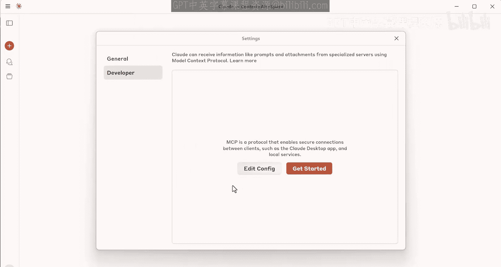
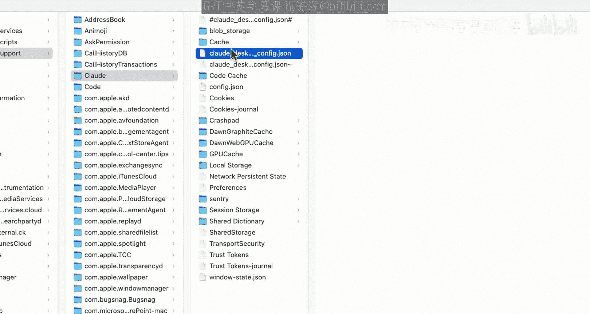
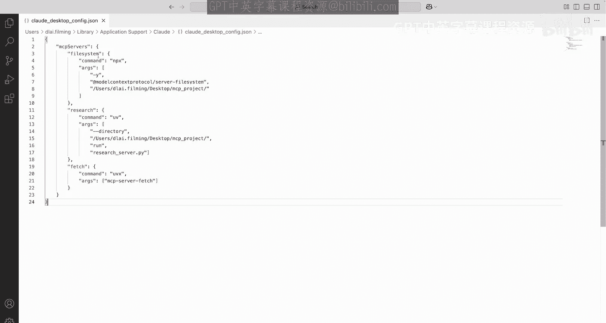
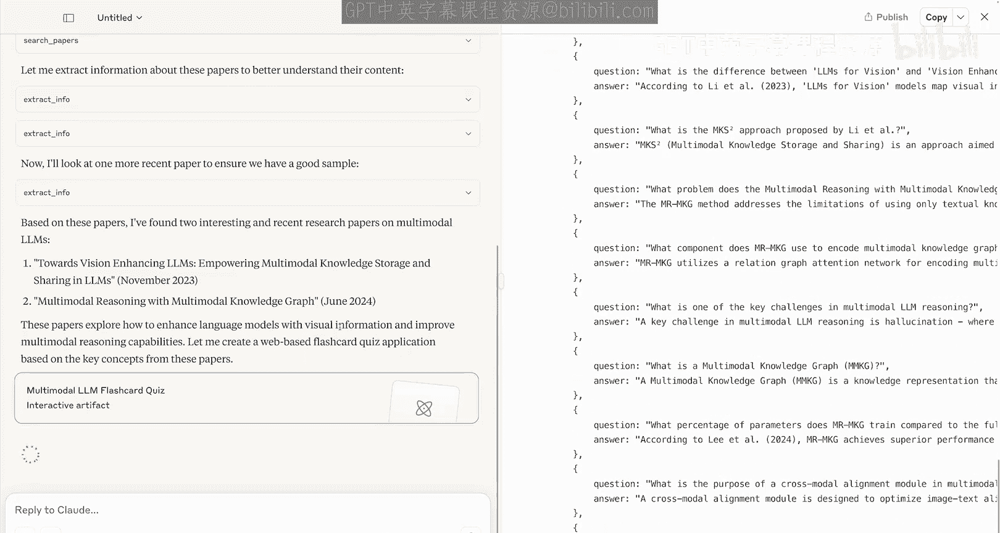
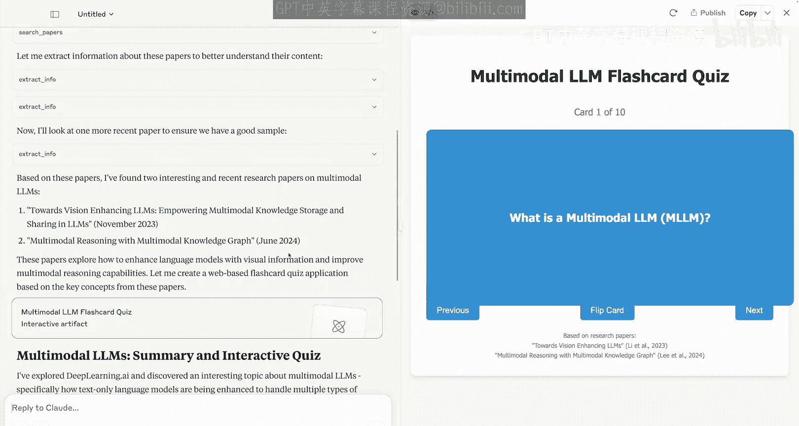
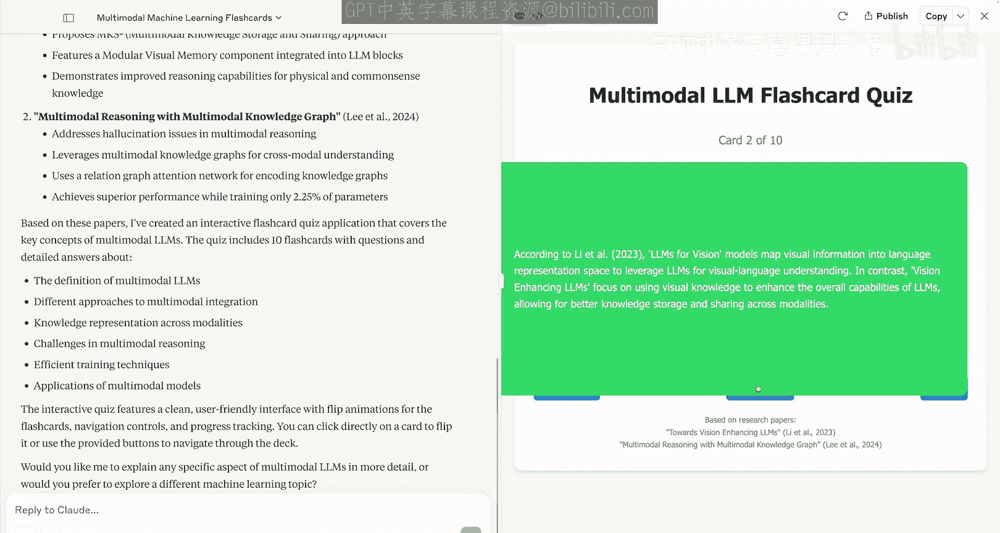
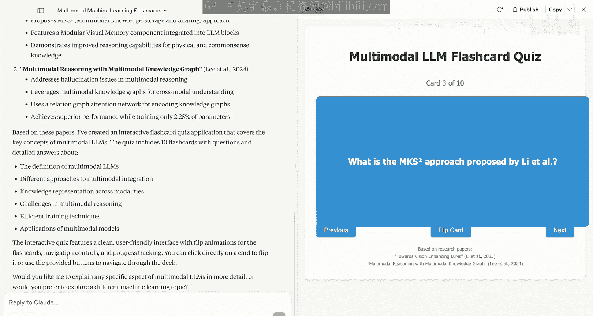
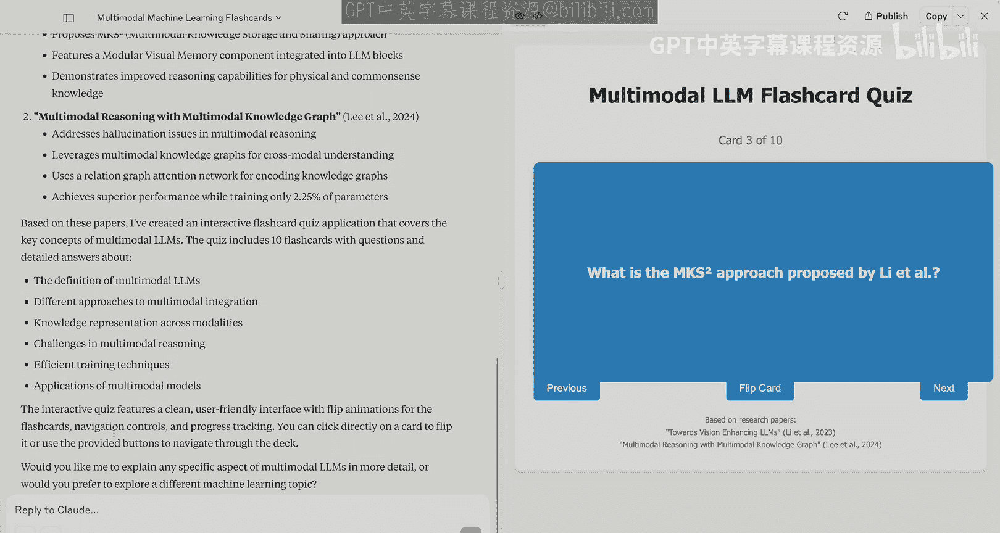

# 吴恩达《MCP：使用Anthropic构建具有丰富上下文的AI应用MCP： Build Rich-Context AI Apps with Anthropic》 - P9：9.configuring-servers-for-claude-desktop.zh_en - GPT中英字幕课程资源 - BV1sxErzHEVj

The MCP server you built and the reference servers you used can also be used with any other MCP compliant application that could be an IDde。

 a desktop app or any gen framework。 Cloud desktops is an example of such an application In this lesson you'll learn how to configure cloud desktop to connect to MCP servers。

 Let's have some fun So you've previously seen how to build your own MCP servers and clients and use prompts resources and tools to build pretty sophisticated applications。

 And I mentioned that some of that code particularly when building clients and multiple clients can be a bit lowle What you're going to see is the ability to use applications like cloud desktop and a variety of other agententtic products to use MCP to connect to MCP servers and abstract away some of the challenges of that lower levell coding right here。

 I'm in a folder called MCP project on the desktop。

 and I have the research server that you made in a previous lesson What I'm going to do now is follow the same steps to create an environment。

😊，With UAnd install the necessary dependencies， and then I'm going to navigate to cloud desktop and bring in this MCP server alongside a couple other of the reference servers that we've seen。

 So I'll start by doing U in it。 I'll make sure to U Ven and I'll activate my virtual environment。

 I'll install the necessary dependencies that we have。

 so I'll go ahead and add archive as well as MCP。Once I've got these added。

 I have all of the necessary dependencies that I need to start my server。

 but I'm not going to run the server here。 I'm going to use cloud desktop to do that for me。

 The same way that we set up our own Json file for configuring how to connect MCP servers。

 We're going to do something similar with cloud desktop in cloud desktop。 I'll head over to settings。

I'll go toDevelop。And we can see here that I can edit a config file to start connecting to MCP servers。

 We're going to go ahead and open up this JSO file。 And inside here。

 I'm going to paste in our configuration file from before。 but with a slight change。

 We're still referencing the name of the server and the command necessary to get the server started。

 What's important， though， is that for our research server。

 I'm specifying the exact file path to go ahead and run the server。😊。

If you remember when using standard I O and connecting locally。

 the client is going to start a connection and a subprocess to these servers with this file and the cloud desktop AI application。

 this is all abstracted away from us。 So all of that lower level code that we were doing earlier。

 we don't need to worry about。 It's important to know how it works under the hood。

 But what we're doing here is that same idea。 Multi clients connecting to multiple servers。

 But all we need is the configuration file。 You're also going to see in cloud desktop what the interface looks like when working with prompts and tools and resources。

 Once we've modified this file， we have to close cloud desktop and reopen it。

 so we can establish these connections。 Now that I've restarted cloud desktop。

 I can take a look at some of the tools I have access to。

 and we saw this before when exploring SQLite 3。 I have my local research server with the tools that we've defined I have my fetch and file system and I have from the research server my resource。

 as well as my prompts。😊。

The interface for prompts and resources and tools is completely up to the developer of a tool like cloud desktop。

 There are a variety of AI assistance and tools and agent products that you can use that support the model context protocol。

 Let's examine those over here on the model context protocol documentation we can see a list of applications that support MCP integrations。

 And a lot of this should look relatively familiar。

 These are some of the primitives we've explored like resources， prompts and tools。

 And in the last section， you'll learn a bit about sampling and routes。

 other powerful primitives that are on their way to getting more and more adoption。

 As you can see here， there's quite a range of applications from web applications。

 agent applications， command line interfaces， integrated development environments that support the model context protocol。

 You can click on any of these， discover them and see how to start talking to MCP servers within these existing applications。

 What's so powerful about this idea is that while this may look extremely vast。

 you've actually seen already how a lot of this works under the。😊。

By building your own servers and own clients。 So let's take a look at how cloud desktoptop uses our tools。

 prompts and resources by connecting to MCP servers。 Now， let's put this all together。

 I'm going to paste in a prompt that I have here to use the fetch tool to visit deep learning AI and find an interesting topic about machine learning。

 I'll then use our research server to research a few papers and summarize the main topics covered。

 I'll then use the artifacts feature to generate a webbased quiz application with a set of flashcards based on the key topics in the papers。

 So what we're doing here is combining a set of tools from different MCP servers to fetch the data that we're looking for。

😊，So we're using the Fe tool here to visit deep learninging AI。

And here looks like there are quite a few interesting topics。

 One of those being multimodal LLMs and advancements in AI models will then use our search papers tool from the research server to extract some information about those papers。

 We'll even look at one more recent paper to ensure we have a good sample。

Here we see the two papers that have been discovered and a web application that's being built at the moment。

 The ability to incorporate visualizations and tools like artifacts with the tools that we get from MCP servers。

 allow us to build really powerful applications across a variety of domains with res。

 While we just have a small example here。 You can let your imagination carry you again for all the different use cases we have。

 We've got a summarization and a little game right here。

 We can take a look at what some of these answers are。 And with a little bit of prompting。

 we can always make this look a little bit nicer。 In this lesson。

 you've seen how to use tools like cloud desktop to connect to MCP servers and abstract away a lot of the lower level networking and code。

 You've also seen a list of many different MCP compatible applications to get you up and running with different Ides。

😊。

Web applications and clientsider desktop applications in the next section。

 we'll dive a little bit deeper into building remote MCP servers。

See you then。

