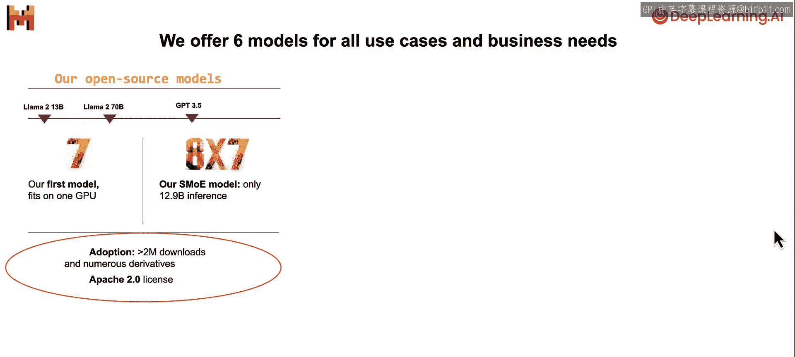
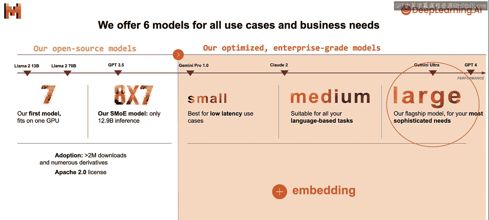
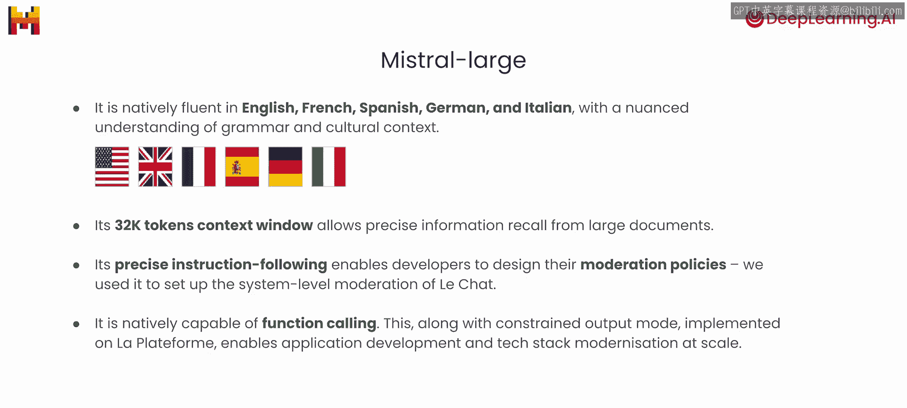
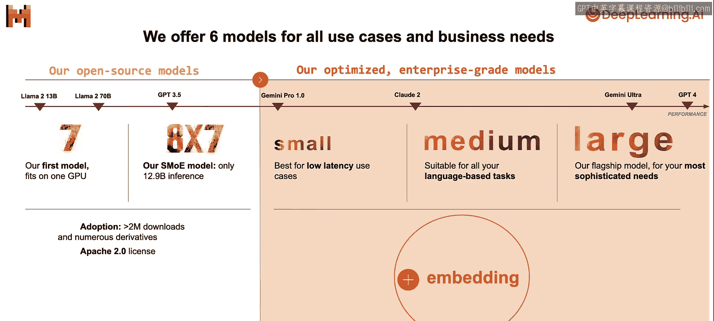
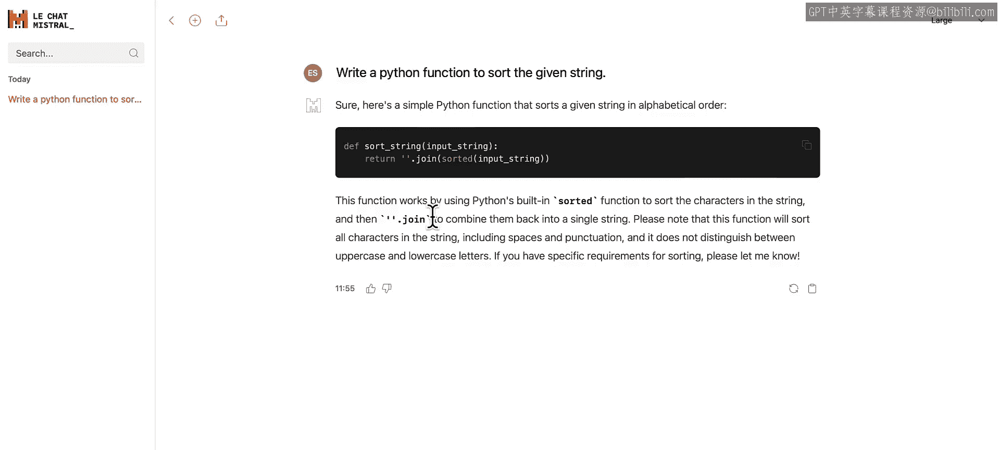
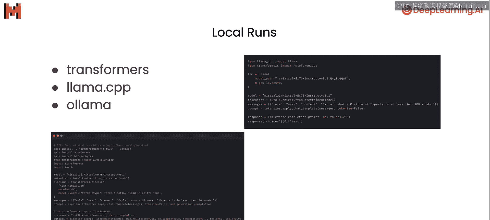
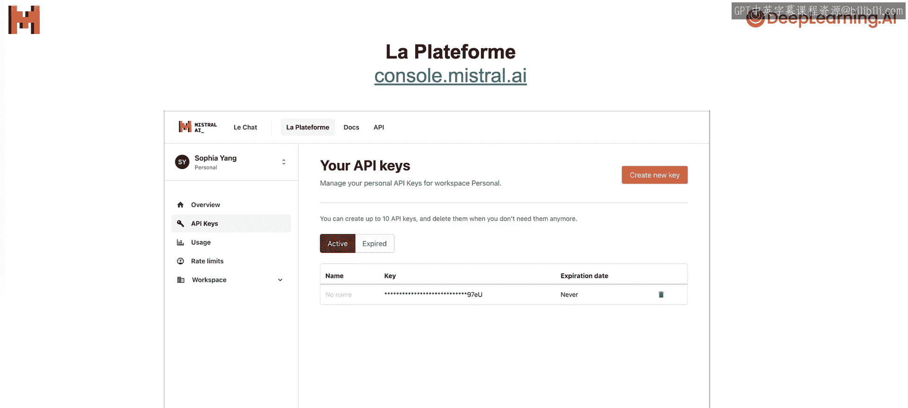

# 吴恩达《Mistral入门｜Getting Started with Mistral》中英字幕 - P2：2.overview.zh - GPT中英字幕课程资源 - BV1Rr421g7TA

In this lesson， you'll get an overview of the various Miral models and Miral。

 we aspire to build the best foundation models。 Currently。

 we offer six models for all use cases and business needs。 Let's dive in。😊。

We offer two open source models that you can download the model weights and use anywhere without restrictions。

 Miral 7b is our first model that was released last September。

 It unperforms Lama models with similar and even greater sizes you can see in the chart the orange bar represents Miral 7b and the other colored bars represent various Lama models on the horizontal axis These labels like knowledge reasoning code are aggregates of standard evaluation benchmarks We measure performance on a variety of tasks。

 For example， the reasoning benchmark includes Paswaag arc easy arc challenge and other tasks the coding benchmark includes humanveil and MPP Miral 7b fits on one GPU perfect for you to get started experimenting with Miral 8x7b is a sparse mixture of expert model。

We released last December at a high level， imagine you have eight experts to help you process your text instead of saying all experts we choose the top experts to help you。

For more details， the foundation of our model is a transformer block， which composed of two layers。

 a feed forward layer and a multihead attention layer。

 Each input token goes through the same layers how can we add capacity to the model we duplicate the feed forward layer and times but now how do we decide which input token goes to which fee4 layers。

 we use a router to map each token to the top K fee4 layers and ignore the rest as a result even though mixedroll has 46。

7 billion total parameters but only uses 12。9 billion parameters per token providing gray performance with fast inference It amperforms La 270b most benchmarks with eight times faster inference and it matches or unperforms GBT3。

5 a most standard benchmarks and we're excited to be contributing to some of the amazing models that are。

Available to the AI community and theyre under the open source Ahe2 license。

 which means you can download the model weights of both models。

 fine tune and customize them for your own use cases and use them without any restrictions。

 For example， you can create your own AI applications for commercial use。

 We are committed to open models and will release more open models in the future。

 We also offer four optimized enterprise grade models。 Mr。

 Small is the best for lower latency use cases。 Mr Medi is suitable for your languagebased tasks that may only require moderate reasoning。

 such as data extraction summarization and email writing。 Mr。

 largege is our fraction model for your most sophisticated needs with advanced reasoning capabilities。

 Mr。 largege approaches the performance of G4。 It has native multilingual capabilities is strongly unperformedma 270 B on common sense and reasoning benchmarks。

In French， German， Spanish and Italian， it offers a 32k tokens context window。 In fact。

 all of our served models have 32k context windowland。

 It excels in instruction following and is natively capable of function calling you can use function calling with both Mr Small and Mr large By the way。

 if you're not familiar with function calling will go through how to do function calling in this course。

 and finally， we have an embedding model， which offers the state of the art embeddings for text and can be used for many use cases like clustering and classification。

 Many customers leverage a model for a wide variety of applications across industries such as banking。

 telecom media Lo， plainech among others。 they have deployed our models for text like Rag content generation content synthesis cogeneration insights generation and more Through this course。

 you will learn how you can。

Use my models on use cases similar to these to get started using our models right away。

 you can use Lu Sha， our chat interface to interact directly with our models。Let's go to chatm。AI。

 we can ask in the chat to write a Python function to sort the given string。

Now we get a nice looking Python function。 Please note that Lucette is currently free to use so you just need to sign up and you can use it If you are interested in running our open source models locally you can use transformers Lama CPP or Oma note that a lot of people use a quantized version of our model in order to load our model into the memory Keep in mind that the model quantization may harm model performance so don't be surprised if the quantized model doesn't perform as well as expected。

Even though it is fun to download myral models on your own machine。

 please keep in mind that for faster influence more reliable performance and to skill。

 we do recommend using a hosting service such as La platformform where you can access not only the open source models but also the enterprise models with a simple API call to access our model through the platform you can create your own API keys to set up your API keys。

 go to consolemtro AI create your own account， set up your billing information。

 and click on API keys to create new API keys。 We offer pricing。

 which is cheaper than some of the other hosting platforms This course will focus on using our API endpoints or dive into many use cases using our API in the rest of the class for the rest of the class you don't actually need to create account will provide a meal API key for you to use in the class In the next lesson youll learn how to use。

Miststral API and learn some of the prompting techniques Let's get started with the Le lesson。

