# 吴恩达《Mistral入门｜Getting Started with Mistral》中英字幕 - P3：3.prompting.zh - GPT中英字幕课程资源 - BV1Rr421g7TA

In this lesson you will learn how to access and prompt Mr models via API calls and perform various tasks like classification。

 information extraction， personalization， and sumization Let's start coding in the classroom the libraries are already installed for you。

 but if you're running this on your own machine， you will want to install the following。

Pip install Myal AI Let's just comment this out because we don't need to run this in this session。

 We have a helper function here to help you load the Mial API key and another helper function here for you to load the myal models so you can get started running Myal API easily We can ask the model hello。

 what can you do feel free to pause the video and change the prompt however you like at the end of this lesson I will walk you through the code in the helper function so that you can see how the API cost works and use the API outside of this classroom environment。

 First， let's take a look at how you can use our models to classify bank customer inquiries in this prompt you are a bank customer service your task is to assess customer intent and categorize customer In We have a list of predefined categories。

 If the text doesn't fit in any of the category。Classify it as customer service Then you can see here we're providing some examples for the model to know exactly what we're expecting。

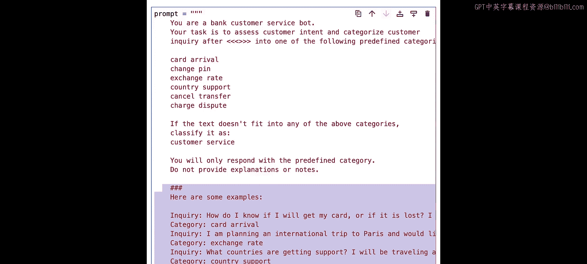

Okay。If we want to make sure our prompt doesn't have any spelling or grammar error。

 we can ask the model to correct the spelling and grammar first。Let's run this。

And then let's print the response。

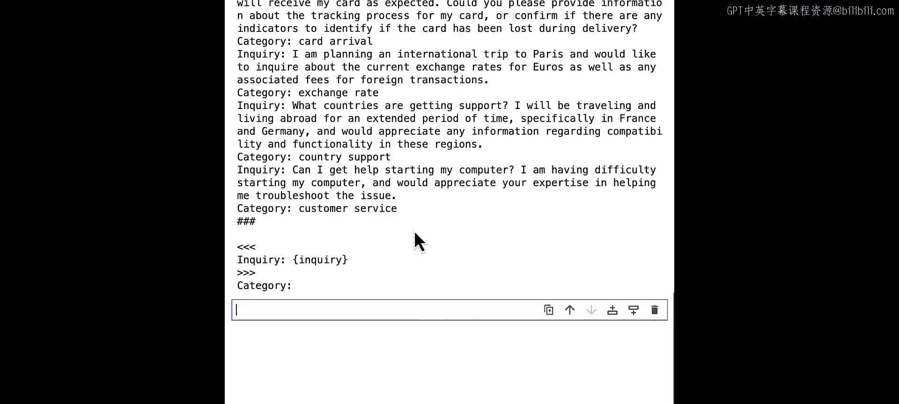

We can see that in some grammar corrections。 For example。

 customer inquiry is now the customer inquiry。 Now we can use this corrected prompt and replace the inquiry with the actual inquiry。

I am inquiring about the availability of your cards in the E U。

 And then let's run the sale and we get country support， which is what we expect。 Now。

 let's run another inquiry， which is a weather today。

 because this is not in any of the predefined categories。

 The model correctly categorize it as customer service。 Now。

 let's come back to take a closer look at this prompt， and see what kind of prompt technique we used。

 First of all， we used row playing to provide our model， a role， which is a bank customer service bo。

 This as personal context to the model。 Second， we used few shot learning。😊。

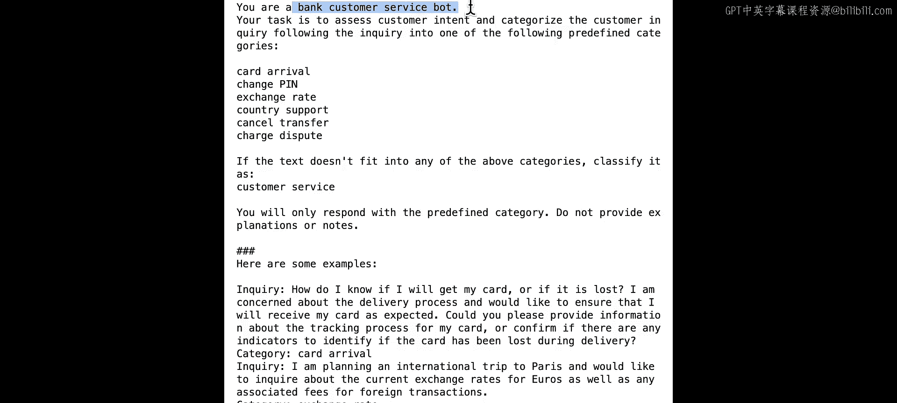

Where we give a few examples in the prompts， Fus learning can often improve model performance。

 especially when the task is difficult， or when we want the model to respond in a specific manner。

 Third， we use dimors like hash or angle brackets to specify the boundary between different sections of the text in our example。

 we use the triple hash to indicate examples and angle bracket to indicate customer inquiry。

 And finally， in a case when the model is ver。 we can add。

 do not provide explanations or notes to make sure the input is concise If you're wondering which dimator to use。

 It doesn't matter。 Just choose whichever you prefer。 Next。

 I would like to show you an example of information extraction。

 We have seen many cases where information extraction can be useful。 in this example。

 let's say you have some medical notes。 And you would like to extract some information from this text。

 in this prompt we。😊。

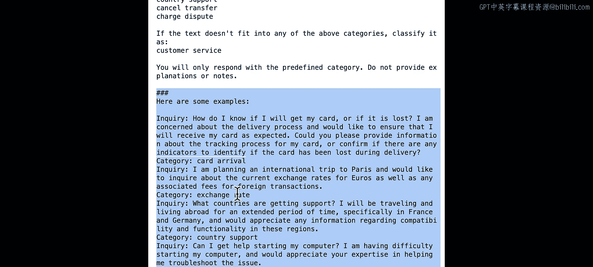

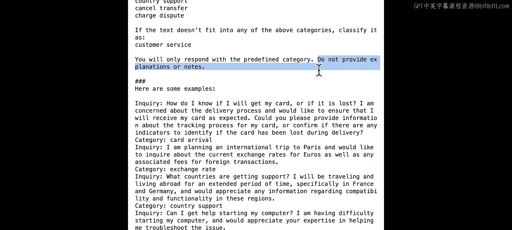

Wide the medical notes and ask the model to return JSO format with the following JSO schema。

 where we define what we want to extract the type of this variable and the list of input options。

 For example， for diagnosis， the model should output one of these four options。 Let's run this one。

 And when we run the model， we get exact format of what we defined here in the Mr function we defined its JO as true to enable JSO mode。

 We'll go through the Python API calls at the end of the lesson。

Let's take a look at this prompt again， one strategy we use here is that we explicitly ask in the prompt to return JSON format。

It's important to ask for the JSO format when we enable the JSO mode。

 Another strategy we use here is that we define the JSO schema。

 We use this JSO schema in a prompt to ensure the consistency and structure of the JSO input note that if we don't have the is JSO equal is true the output may still be a JSO format but we recommend you to enable the JSOM mode to return a reliable JSO format。

 Next， let's take a look at how our models can create personalized email responses to address customer questions。

 because largele models are really good at personalizedization tasks。

 Here's an email where the customer Anna is asking the mortgage lender about the mortgage rate and heres our prompt。

 you are a mortgage lender customer service bo and your task is to create personalized email responses to address customer questions。

 answer the customer inquiry using the provided facts below。

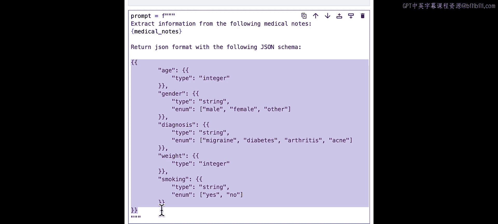

And then we have some numbers about the interest rates in the prompts and similar to what we have seen before。

 we use the string format to add the actual email content to this email variable here。

Let's run the s。In this random mystery model。As you can see。

 we get a personalized email to Anna answering her questions based on the facts provided with this kind of prompt。

 you can imagine that you can easily create your own customer service bar。

 answer questions about your product It's important to use clear and concise language when presenting these facts or your product information This can help the model to provide accurate and quick responses to customer queries。

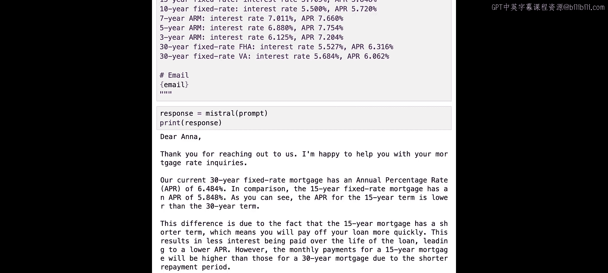

Finally， we have summarization。Summarization is a common task for large length models and our model can do a really good job at summarization。

Let's say you want to summarize this newsletter from the batch。And here's the prompt I triedte。

 you are ac commentator， your task is to write a report on a newsletter when presented with a newsletter。

 come up with interesting questions to ask and answer each question Afterward combine all the information and write a report in the markdown format then I have a section to insert the content of the newsletter and a section for instructions First to summarize key points second is to generate three distinct and thoughtprovoking questions。

 third is to write an analysis report。

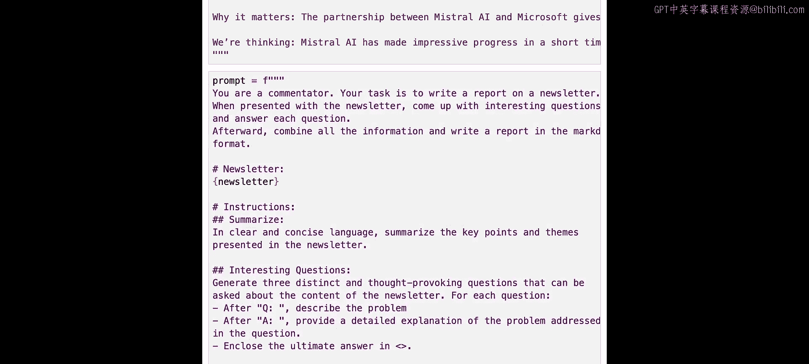

Let's run our Mr。 model。

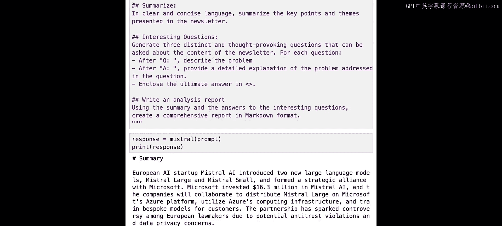

And this is exactly what we ask for。 we get a summary。

 We get interesting questions and we get the analysis report。

 Of course you can always ask the model to summarize the newsletter without these instructions If you have a complex task providing step by step instructions usually help the model to use a series of intermediate reasoning steps to solve complex tasks In our example。

 using these steps might help the model think in each step and generate a more comprehensive report。

 One interesting strategy here is that we ask the model to automatically guide the reasoning and understanding process by generating examples with explanations and steps Another strategy that's used often is that you can ask the model to input in a certain format。

 for example， using a markdown format。😊。

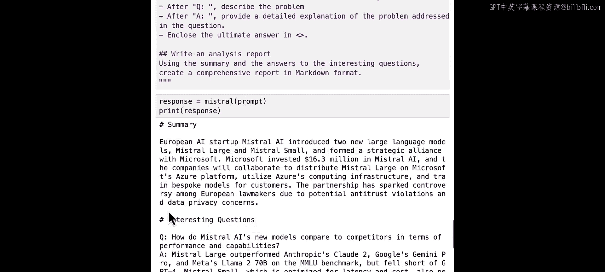

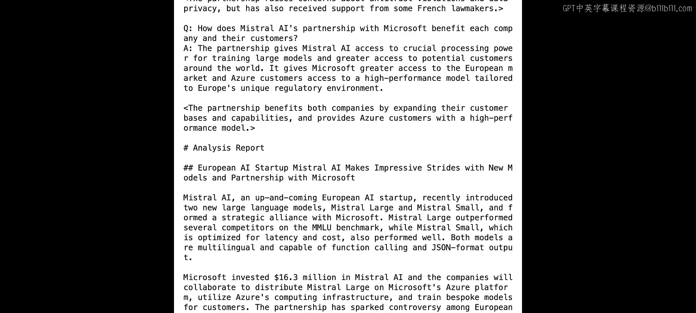

So that's all the prompts I want to show you in this lesson in this lesson we used the helper function to help us load the Mi model。

 here's how the API call works。We first need to define the Mr client。

 You will want to replace this API key variable with your own API key if you are running my models outside the classroom environment we also need to define the chat message the chat message can start with a user message or a system message or an assistant message a system message usually sets the behavior and context for the AI assistant but it's optional you can have both the system message and the user message just in the user message and experiment and see which kind of message produce better result in this lesson will just have everything in the user message then we define how we can get the model response where we need to define the model and the message if we enable the JO mode we need to add a line here response format type as JSO object to specify that we want the response format as。

SoThere are several other non required arguments we can change here you can check the APIs specs to see all the details Okay。

 so that's here for this lesson we learned how we can prompt Mr models to do various tasks in the next lesson we'll take a look at how do you choose which mystery models for which use case See you in the next lesson。

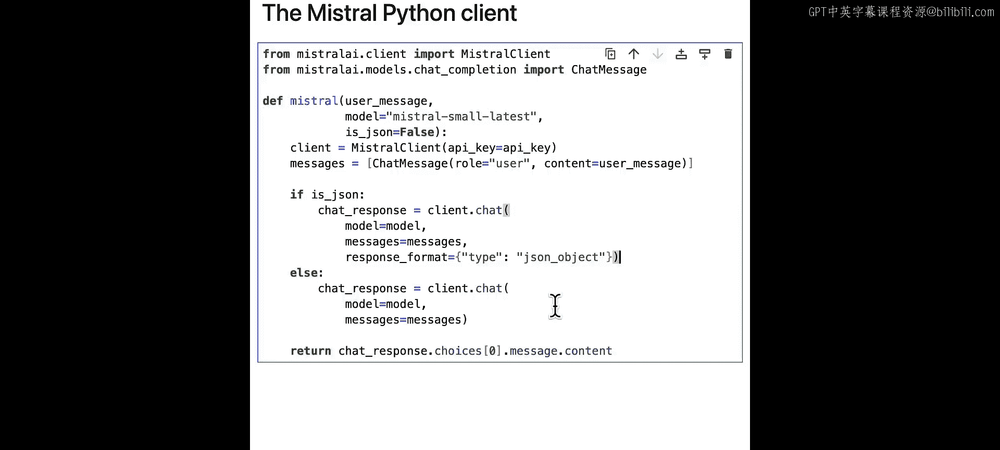