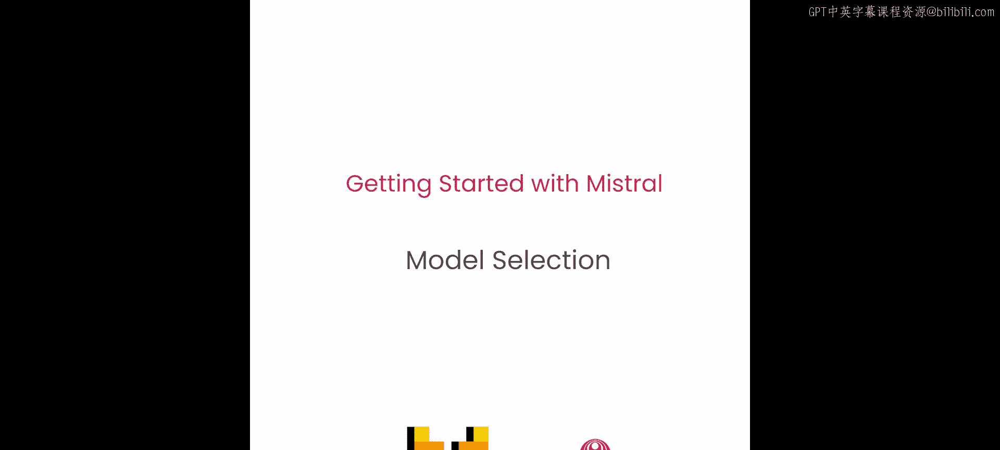
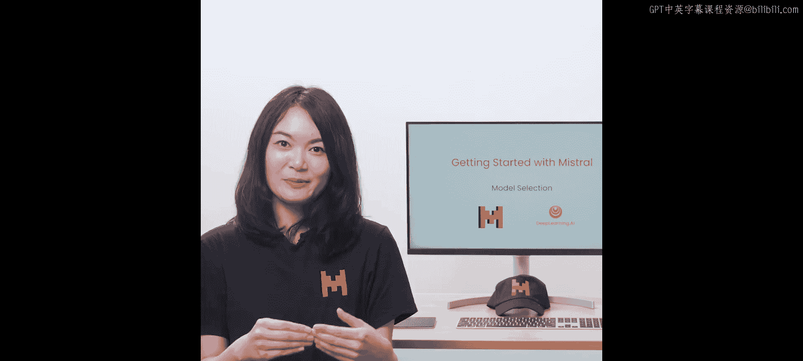
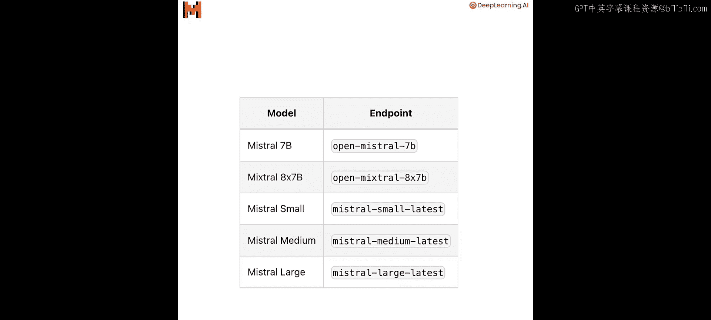
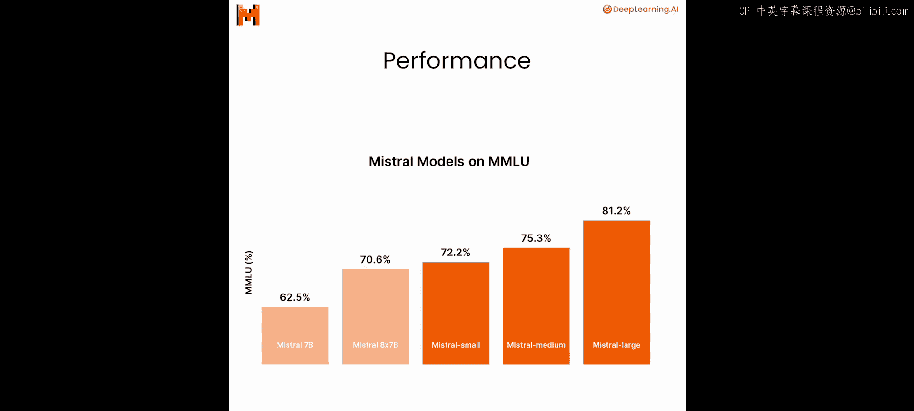
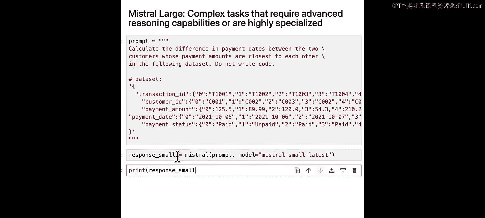
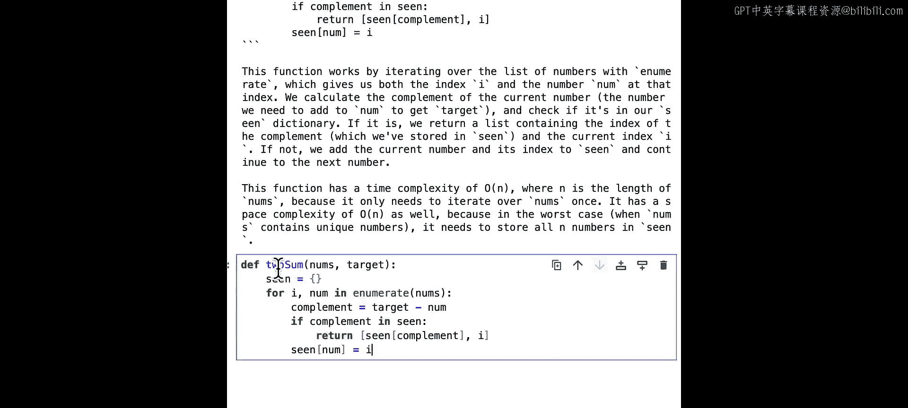
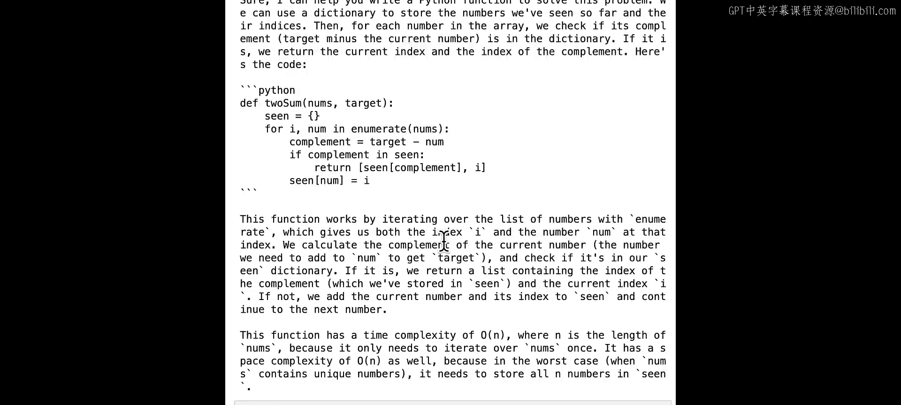
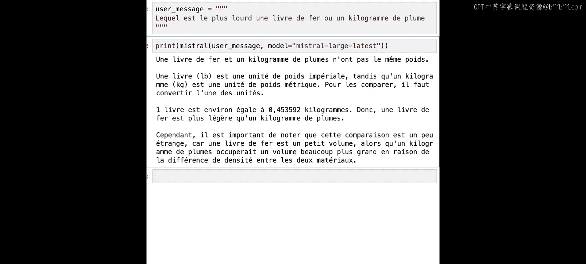

# 吴恩达《Mistral入门｜Getting Started with Mistral》中英字幕 - P4：4.model selection.zh - GPT中英字幕课程资源 - BV1Rr421g7TA

In this lesson， you will learn how to select the appropriate mystery models depending on your use case。

 Let's take a look。

M。 AI provides five API endpoints featuring five leading language models。

 Miral 7b Mi 8 times 7b Mial small Mial medium and Mr。

 largege looking at the model performance such as the MMm multitask language understanding task。 Mr。

 largege performs the best。 In fact， Mr。 largerge unperforms all the other models across various benchmarks。

 including reasoning multilingual tasks， mathematics encoding。 However。

 performance might not be the only consideration here。 For your applications。

 you might also want to consider pricing。 We offer competitive pricing on our models。

 and is worth considering the performance pricing tradeoffs。

 Mral models are behind many large language model applications as skill。

 here's a brief overview on the types of use cases we see along with their respective Mral model。

 S tasks that one can do in bulk such as classification。

Customer support or text generation are powered by Mral Small intermediate tasks that require moderate reasoning like data extraction。

 summarization， writing emails and so on are powered by Mial medium complex tasks that require advanced reasoning capabilities or are highly specialized like synthetic text generation cogeneration Ra or agents are powered by Mr。

 large let's take a look at some examples in this notebook let's first use our helper function to load the API key you can replace this with your own API key if you're running this outside of the class environment。

Let's define a Mirus function to call the Mitom Python API easily。

 we have seen this code in the previous lesson。For simple tasks like classification。

 we can use a smaller size model like Mr。 Small， for example。

 let's classify an email as Bm or not spam。 Let's run our Mr model。 Mr。

 Small was able to classify the email correctly as Bm。 In fact。

 all of our models can give good results here。Using Mr。 Small is more cost effective and it's faster。

 so we recommend using Mr。 Small to do simple tasks Mr Medi is great for intermediate tasks that require language transformation。

For example， we can ask a model to compose an email for new customers who have just made their first purchase with your product。

 make sure you have the order details in the prompt。Let's run my medium。

And let's take a look at the response。And now we get a nice looking email addressing to customer Anna with her order details。

Mr。 Large is great for complex tasks that require advanced reasoning capabilities or that are highly specialized In this example。

 let's ask Mr。 Lage to calculate the difference in payment dates between the two customers whose payment amounts are close to each other in a given dataset。

 Let's try Mr。 Small first。

Here you can see Mr。 Small gives the incorrect final answer。

 But since our model results are probabilistic， if you actually run this multiple times。

 it might sometimes give you the correct result。 Okay， now let's run Mr。 largege and。

Print the model response。As you can see， Mr。 Large can break down this question into multiple steps and is able to give us the right answer。

 Let's try another fun example， given the purchase details， how much did I spend on each category。

 restaurants， groceries， stuffed animals and props， and then we have the transaction details here。😊。

Let's first run Mr。 Small， you can see there are some mistakes here， for example。

 the world food wraps should belong to restaurants。And now let's try Mr。 Laarch。

It happens to categorize the world food wraps correctly as a restaurant and gives us the correct answer for each category。

 In the next example， let's say you are about to meet a really important person named Andrew。

 And you're hoping to make a good impression with him， but you only have 20 minutes to check。

 Will you see him， He ask you， by the way， how do I find two numbers that add up to a third number。

How can Mr。 help you make a good impression， Let's take a look at this coding task。 Mr。

 Lage is the top performer in coding tasks， so let's give it a try。Great。

 so now let's run this function。

And let's see if the code passed these tests。

Is copy and paste you。Great， so it looks like our function works。 And now。

 Andrew would be very happy that you give the right answer。 In addition， Mr。

 Lage has been specifically trained to understand and generate text inmod languages。

 especially in French， German， Spanish and Italian。 Here is an example asking French。

 Which one is heavier。 a pond of iron or a kilogram of feather。😊，Let's real， Mr。 Lage。

I don't understand French， but I hope it answers correctly that a kilogram of feather is heavier。

Okay， so far we have seen many use cases with our models。

 but we have not talked about external tools， connecting our models to external tools can help us build applications that are even more powerful in the next lesson you will learn how to use function calling to connect Mr models to tools。

See you in the next lesson。