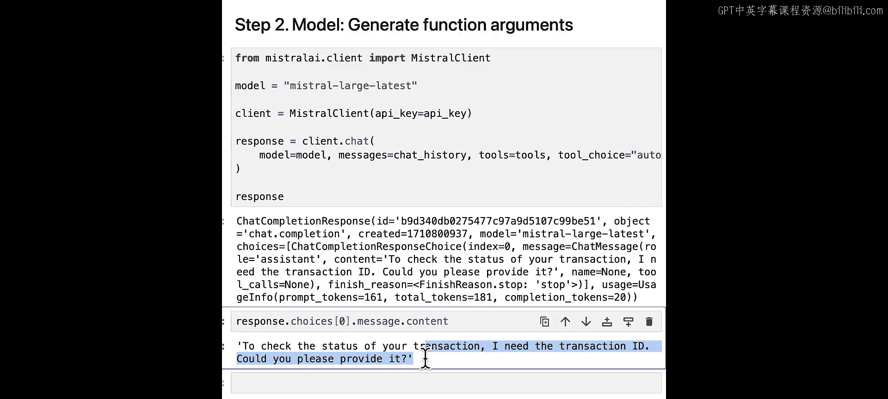
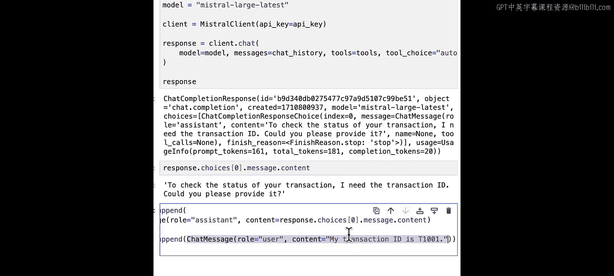
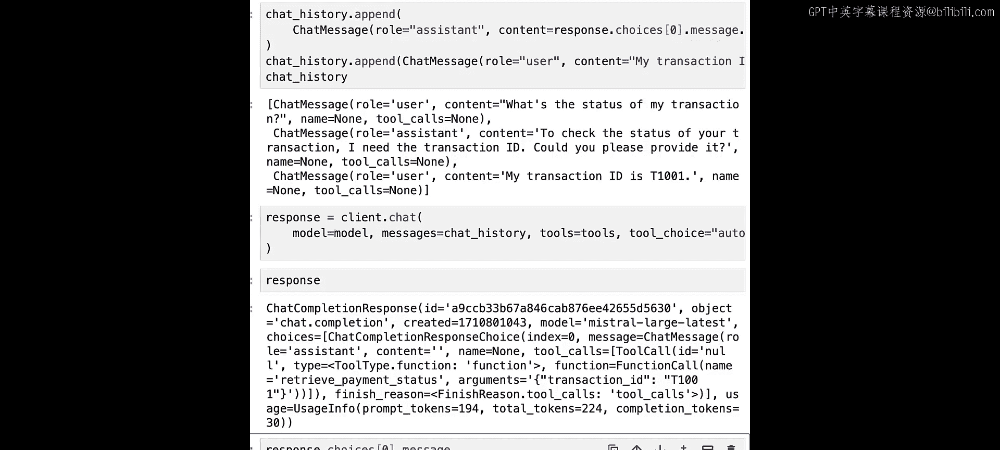
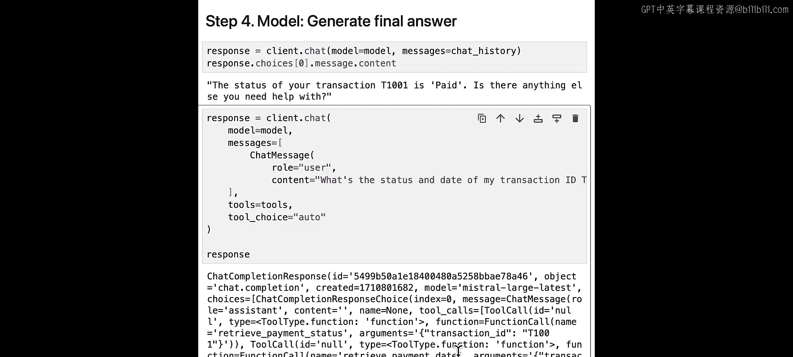

# 吴恩达《Mistral入门｜Getting Started with Mistral》中英字幕 - P5：5.function calling.zh - GPT中英字幕课程资源 - BV1Rr421g7TA

In this lesson， you'll get to implement function calling with Mi function calling allows Mr models to connect to external tools。

 making it easy for you to build applications， catering to specific use cases and practical problems。

 Let's check it out。

At a high level， there are four steps with function calling step one is for users to define tools in user query。

 a tool can be a user defined function or an external API。For example。

 users can write two functions to extract the payment status and payment date information and then when user ask a question what's the status of my payment。

 this question is directly related to the payments status tool and we should use this tool to address the question Step2 is for our model to generate function arguments when applicable based on the tools and the user query our model is able to determine that the function we should use is payment status and the function argument is transaction ID equals T1001 step3 is for users to execute the function to obtain two results we simply passing the function arguments directly in the function。

And we get the result from the function， which is paid in this example。

 Step 4 is for a model to generate a final answer。 According to the information available。

 your transaction ID D T1001 has been paid。 Is there anything else I can assist you with。 Okay， now。

 hopefully you have a good understanding of how function calling works with Mial。

 Let's take a look at the code。 That's import pandas Sd。And assume we have the following data。

We have this data frame of transaction ID and the payment information。

And we would like to ask questions about this data frame。

 So how can we ask questions about this data without function calling we could simply passing this data。

In the prompt， and then ask the question， given the following data。

 what is the payment status for the transaction ID， which is P10，01？Again， let's load our Mr。

 function。And round the Mial model。Okay， we can see the answer the payment status for the transaction with the ID T 1001 is paid。

 and the result tells us how it was able to get the answer from the data。 As you can see。

 Mr true model is pretty good if you give it the right prompts。But in normal use cases。

 you may have a pretty large database of transactions if you use your entire database and fit it into a large language model。

 this may exceed the context window， a more efficient affordable and reliable way to do this is to use function calling to run code to perform this kind of search You just need to prompt the large language model to know when to call each function。

 Let's take a look at how we do function calling step by step。

Users first need to define all the necessary tools for their use cases。For example。

 here we have a function retrieve payment status if we define the function argument transaction ID is T1001。

 we get the status paid from this function， let's try another function retrieve payment date。

And we can retrieve the payment date information based on a transaction ID。And then we get the date。

 So how do Mr models understand these functions in order for Mr models to understand the functions。

 you can online the functions specs with a Json schema。For example。

 here is the JSson schema for the function retrieve payment status， let's specify the two type。

 which is a function in this case， the function A。The function description。

This will tells our model what does this function do， the parameters of the function。

Which includes the arguments of the function， the type of the argument and the description of the argument。

 Let's also specify the required function argument， which is the transaction ID here。

 Please keep in mind the name of the function should be exactly the name of the function we just defined Also please make sure you give a good enough description of your function and a good description of the argument so that our language model can understand which function to use and the needed argument to use。

 Similarlyly， let's define the JSson specs for the retrieve payment and D function。

 Let's combine these two Json specs into a list called tools。

 Then we organize the two functions into a dictionary where the keys represent the function name and the values are the functions。

With the data frame defined， this allows us to call each function based on its function name to give you an example。

 we can call the retrieve payment status function with the argument transaction ID equals T 1001。

Using this names to function dictionary， okay， next we need to define a user query。

Suppose a user asks the following question what's the status of my transaction。

 a standalone large language model will not be able to answer this question as it doesn't have the business logic back end to access the necessary data。

But what if we have the exact tool we can use to answer this question。

 we could potentially provide an answer， so let's see how function calling works in the next step。

Step two is for a model to generate function arguments。

So how do Mr models know about these functions and know which function to use。

 We provide both the user query and the tool specs to Mr models。

 You can have the language model to automatically choose。If we should use a tool or not。

 with the tool choice equals auto or you can define two choice as any to force to use。

Or if you don't want to use any tool， you can set two choice equals none to prevent two use。Okay。

 let's run this code。Let's see the content of the message to check the status of your transaction and need the transaction ID Could you please provide it as you can see our model was able to identify if there is any essential information missing for the function and it will ask for this essential information Now let's save the history of the conversation we have in the chat history and add a user message my transaction ID is T1001。

Now， in the chair message， we have。The original user question。

 what's the status of my transaction ID， we have the assistant message。

Asking us to provide a transaction ID。And then we have a user message telling the model my transaction ID is T1001。

Let's run our model again with this chair history。Let's take a look at the response。

Now the content of the assistant message is actually empty。

But it was able to return the information in tool callss， telling us。

The function name is the retrieve payment status and the arguments we should use for this function。

 Let's again append the model response to the chat history。

 Step 3 is for user to execute the function to obtain tool results。

Currently is the user's responsibility to execute these functions and the function execution lies on the user side。

 let's extract some of the function information from the model response。

We get the function name and the function arguments。

Now we can get the function results based on the function name and the function arguments。

 we get the results status as paid。Let's define this chat message with the row tool。

Name as the function name。And the content as the function result。

 let's save this tool message using the Cha message method with the role as tool name is the function name。

 the content is the function result， and we append it to the chair history。

And let's take a look at the history right now。Here as you can see。

 we have the assist message telling us the results of function tool calls with the function information and we have the two results returning the results of the function Now step 4 is4 model to generate a final answer。

 Let's just give our model the entire share history and it will return a personalized answer。

 the status of your transaction T1001 is paid I there anything else you need help with。

So that's the four steps for function calling Mr model also provides parallel function calling。

Feel free to pause the video and change the prompt。

 see how can you call both functions at the same time。

 for example in your user message if you ask for both the status and the date。

Of my transaction IDP was 0，01。Let's see what would the model respond， let's run this cell。

As you can see here， our model actually responded with two function calls。

1 is the retrieve payment status。 Another one is the retrieve payment date。 Now。

 you can execute both functions to get the desired input As for function calling in the next lesson。

 we'll learn about Rag and how you can use Ra as a tool for function calling。

 See you in the next lesson。

