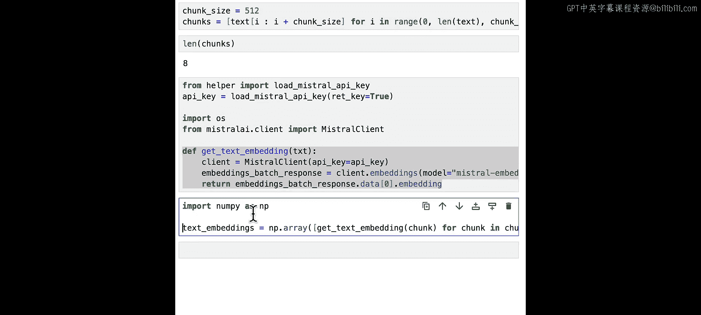
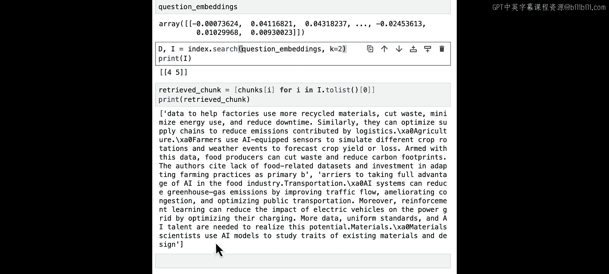
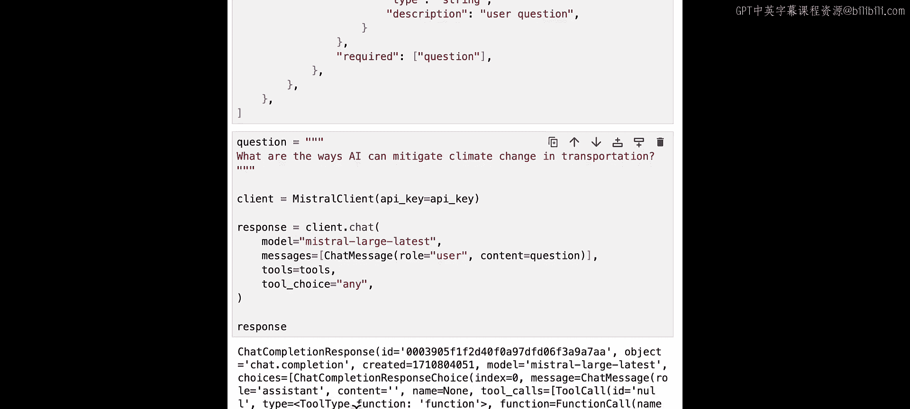
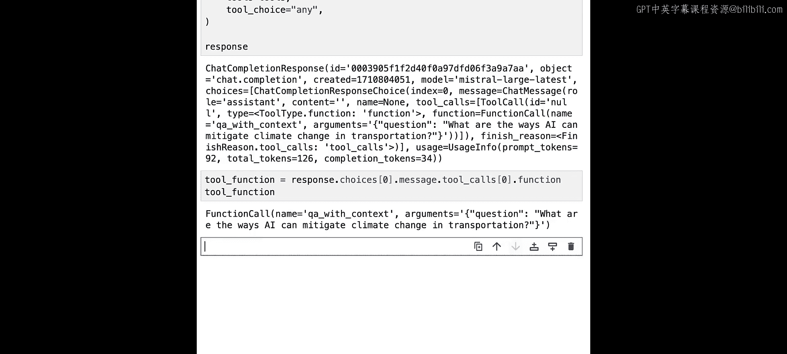
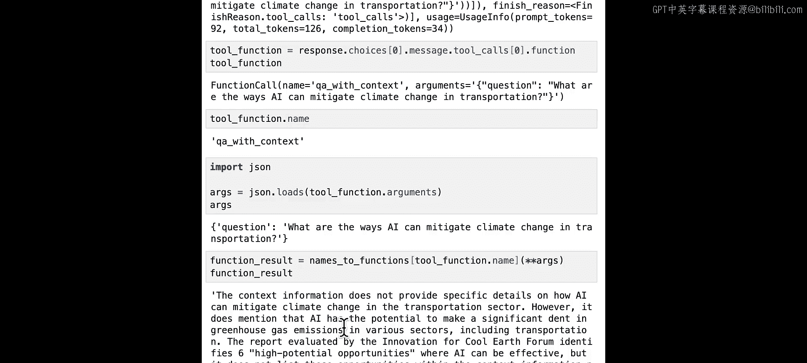
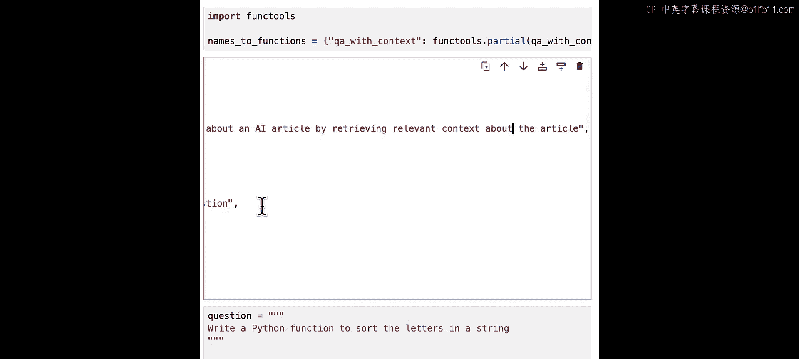
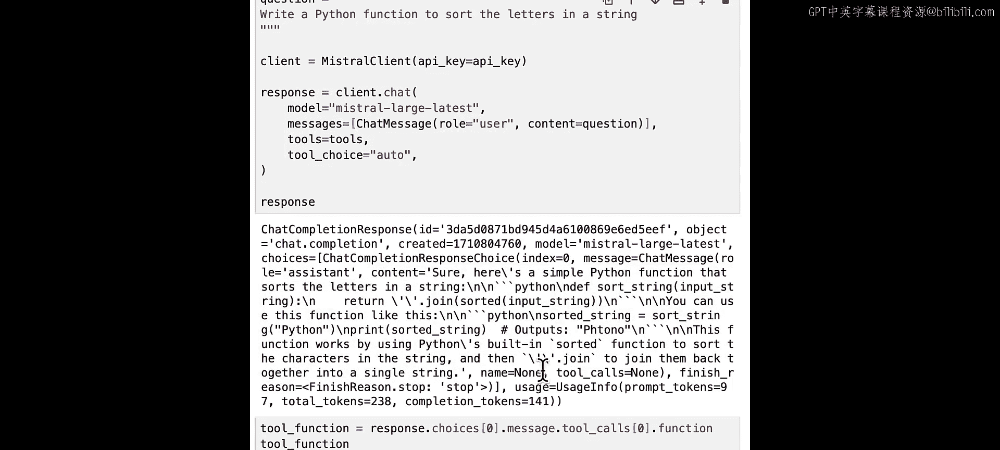
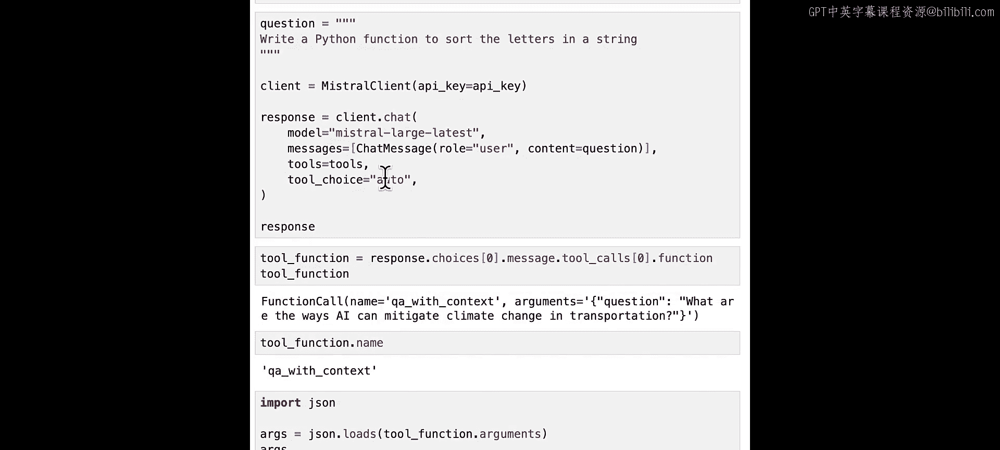
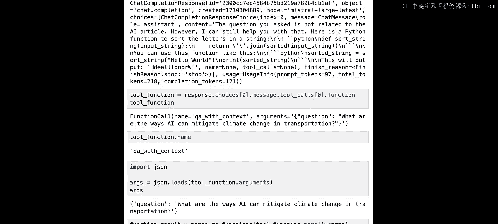

# 吴恩达《Mistral入门｜Getting Started with Mistral》中英字幕 - P6：6.rag.zh - GPT中英字幕课程资源 - BV1Rr421g7TA

In this lesson， you are practice implementing GG with Mi models Retrieval augmented generation is an AI framework that combines the capabilities of large niche models and information retrieval systems。

 It's useful to answer questions or generate content， leveraging external knowledge。

 Let's take it up。

So why do we need RA， large next models can face a lot of challenges， for example。

 it doesn't have access to your internal document， it doesn't have the most up to date information and it cant hallucinate。

One of the potential solution for these problems is Ra at a high level， here's how ragg works。

When users ask a question about an internal document or a knowledge base。

 we retrieve relevant information from the knowledge base where all the texting meings are stored in a vector store。

 the step is calledRetrieval， then in a prompt， we include both the user query and the relevant information。

So that our model can generate output based on the relevant context。

 this second step is called generation In this lesson。

 let's take a look at how we can do Ra from scratch let's first get an article from the batch。

This is the link of the article we're interested in。

And we use an HTML parser called Beauti So to find the main text of the article Next。

 let's split this document into chunks， It's crucial to do so in a rack system to be able to more effectively identify and retrieve the most relevant piece of information In this example。

 we simply split our text by character combining 512 characters into each chunk。

And we get eight chunks， depending on your specific use cases。

 it may be necessary to customize or experiment with different chunk sizes。

 Also there are various options in terms of how you split the text you could split by tokens。

 sentences， HTML headers and others， depending on your application Now with these eight text chunks。

 let's create embeddings for each of them。Again， we use a helper function to load our API key。

 you can replace this with your own API key outside of the coursing environment。

 we define this gear text embedding function using the myal embeddings API endpoint to get embedding from a single text chunk then we use this list comprehension to get text embeddings for all text chunks let's take a look at how it looks。

These resulting text embeddings are numerical vectors representing the text in the vector space。

 If we take a look at the length of the first embedding vector， it returns 1024。

 which means that our embedding dimension is 1024。Once we get thembeddings。

 a common practice is to store them in a vector database for efficient processing and retrieval。

 There are several vector databases to choose from。 In our simple example。

 we use a open source vector database face with face。

 we define an instance of the index class with the。😊，Ebedding dimension as the argument。

 We then add the text embeddings to this indexing structure。When users ask question。

 we also need to create embeddings for this question using the same embedding models as before here we get the questioningbeddings。

Now we can retrieve text chunks from the vector database that's similar to the question we asked。

We can perform a search on the vector database with index do search。

 this function returns the distances and the indices of the K most similar vectors to the question vector in the vector database。

And then based on the return indices， we can retrieve the actual relevant text chunks that correspond to those indices。

 as you can see here we get two text chunks because we defined K equals 2 to retrieve the two most similar vectors in the vector database note that there are a lot of different retrieval strategies in our example we used a simple similarity search within embeddings depending on your use case。

 sometimes you might want to perform metadata filtering first or provide weights to the retrieved documents or even retrieve a larger parent chunk that the original retrieved chunks belong to。

Finally， we can offer the retrieved text chunks as the contact information within the prompt。

 here's the prompt template where it can include both the retrieved text chunks and the user question in the prompt。

 let's again use this min function we have seen before。With a prompt， we get a response。

So this is how RaG works from scratch feel free to use another batch article or combine multiple batch articles and ask questions about these articles Also we just went through a very basic RaG workflow if you're interested in more advanced RaG strategies there are several other courses you can learn from if you're developing a complex application where RaG is one of the tools you can call or if you have multiple rags as multiple tools you can call then you may consider using Ra inside of function calling let's take a look at a simple example here。

 let's wrap up the Rag logics we define above in a function we call it QA with context。

Now we organize this function into a dictionary called Na2 function。

 as we have seen in the previous lesson， this might not look that useful with just one function。

 but if you have multiple tools or functions， this is very useful to organize them into one dictionary。

Now we can online the function specs with the JS schema to tell our model what this function is about。

 where the function name is QA with context， the required argument is the user question。

Now with passing the user question and the tool to the model。

 we get the tool call results with the function name as QA with context and the arguments is our user question。

 let's extract the function formation from the model response。

 we get the function name and the function arguments。

Then we execute the function to get the function results as an exercise。

 please feel free to write another RA function， asking question about another badge article and provide both of them as tools to our Mi model。

 just as an exercise， what if we change the user query to write a Python function to sort the letters in a string？

What would it happen。It shouldn't use our tool QA with the context， right。

 because this question has nothing to do with this tool。

So why would this happen Its because we use the tool choice as any， which forces a tool use。

 Now we change it to auto， which means the model decides if we use a tool or not。

 but now it still uses the QA with context tool。Okay。

 so maybe this is because our description of the tool is too general we need to specify the tool to be more specific。

 let's add some details in this description you answer user question about AI。

By retrieving relevant context。Lets run this。10 work。

Let's change our description to answer user question about an AI article by retrieving relevant context about the article。

 so now the description is more specific。

When we wrote this again， as we can see。Is returning the Python function we asked in the content？

And now returning tool calls and this is exactly what we needed。 and of course。

 if you know that this question is not supposed to use the tool， we can set to a choice as none here。

And it will guarantee that we're not going to call any tools or functions。Now let's try any again。

 remember that any forces function call and now I can see even though we changed the function description is still using the function call because our two choice is any which forces function calling okay so the default behavior is auto and I recommend you to use auto for two choice Just a I note that you can use myal to do rag with other tools like La chain Lama index and haystack check out our documentation could see how it works in the Le lesson we'll learn how to create simple UI interfaces with the myal models and panel See you in the Le lesson。

