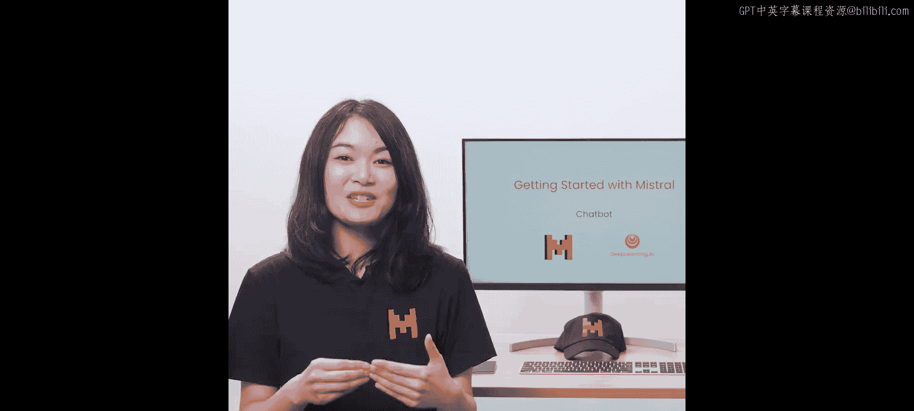
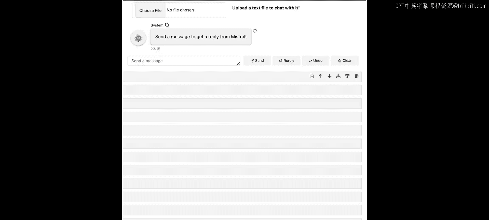
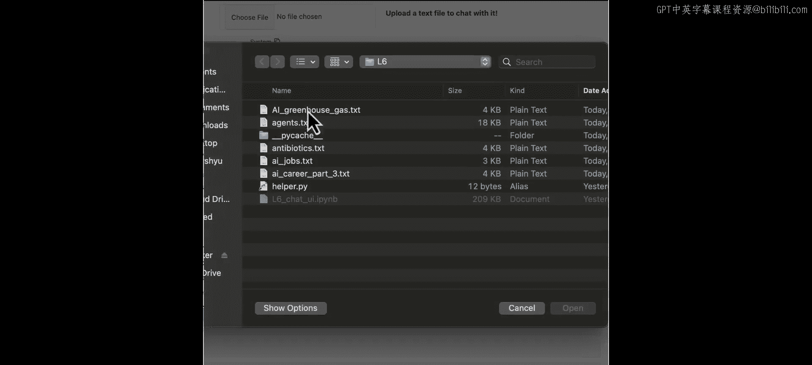
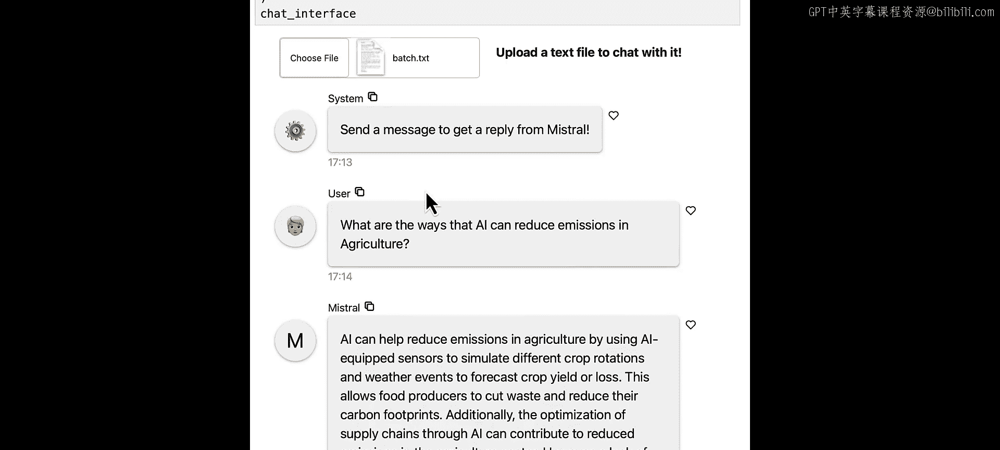

# 吴恩达《Mistral入门｜Getting Started with Mistral》中英字幕 - P7：7.chatbot.zh - GPT中英字幕课程资源 - BV1Rr421g7TA

In this lesson， you'll create a simple chat interface to interact with the Mr models and chat with an external document。

 Let's try that。

In this lab， let's create two simple chat interfaces for interacting with the models and chatting with a document。

 The first one is a basic chat UI where you can send a message。😊，For example。

Write an email to schedule unemployment with my CSs professor to discuss research opportunities。

By the way right now I just want to show you the end result we'll walk you through the code in detail in a little bit okay now you can see this detailed email requesting for appointment to discuss research opportunities to a professor。

The second Chabo is where we can upload a document， for example， the batch newsletter。

 and ask the questions about this document。

What are the ways that AI can reduce emissions in agriculture based on the batch newsletter。

 we get a good output In this lesson， we'll take a look how we can create these two chat interfaces。

 so that you can create your own chat apps with Mr models。 Okay， let's get started。

 Let's first import needed packages。 The new package we have here is panel。

 which is an open source data exploration and web app framework。 We import panel S PN。

We need to run this line PN do extension to load customized JavaScript and CSS extensions for panel applications。

Here we have a myal function we have seen before。Note that we have these two additional arguments。

 user and chat interface that's not using the function， but we need it to include here for the UI。

Now let's simply run these four lines of code and we get this chat interface we can interact with the model。

Pretty cool， right？Okay， let's take a closer look at the code。

 We define a chat interface widget with PNcha do chat interface。

 This widget handles all the UI and the logic of the chat app。

 then we define how the system responds in the callback function。

 which is the Mi function we define above， then we can define the callback username as Mi to indicate responses from the Mi model。

Right here。As you can see here with only few lines of code。

 you can get a Sim chat interface to interact with our model。Next。

 let's see how we can create a changer face to chat with an external document。

We have seen this code before we get a newsletter from the batch。

 we save the text of the newsletter as the Bshta TXD file。Okay。

 now let's copy and paste some erect code just for a short recap， first of all， in the prompt。

 we have the contact information。Which is the retrieved text counts based on the user query。

And then we have the user query and we're trying to get an answer。

We have a function to get the text embeddings using this toolss embedding model。

Another function to run the Mr model， we recommend using Mr。

 Lage for the best performance for rack tasks。The main function is this answer question function。

 We start with the text we get from the file we upload。

 we'll talk about this file input widget in a little bit， we split the document into chunks。

 load the text chunks into a vector database， creating em beddings for a question。

 retrieve similar chunks from the vector database， and finally generate response based on the retrieved relevant text chunks。

And here are the code for the chat interface in this chat interface。

 we first need to define a file input widget for us to upload files let's take a look at this widget file input where we can choose a file and upload a file。

Like there。Then we need to define the chat interface widget where we define how the system responds in the callback function。

 which is the answer question function we just defined。

 we can then arrange the file input widget in the header as you can see here the first thing we see is the file input widget with some text descriptions we can optionally start the chat interface with a system message so that users know what you expect from this chat app as you can see here is the system message we defined。

Now let's give it another try。We upload the badge。 TSD file。We ask a question about this file。

And we get an answer from Mr。 Large。So that's the code for this S chat Ui as an exercise。

 feel free to try different articles from the batch by changing the URL here。

And then try to upload a different article and ask questions about this article and see how Mr。

 largege responds in the next lesson， I will conclude the course and share some thoughts about the next steps。

 see you in the next lesson。

