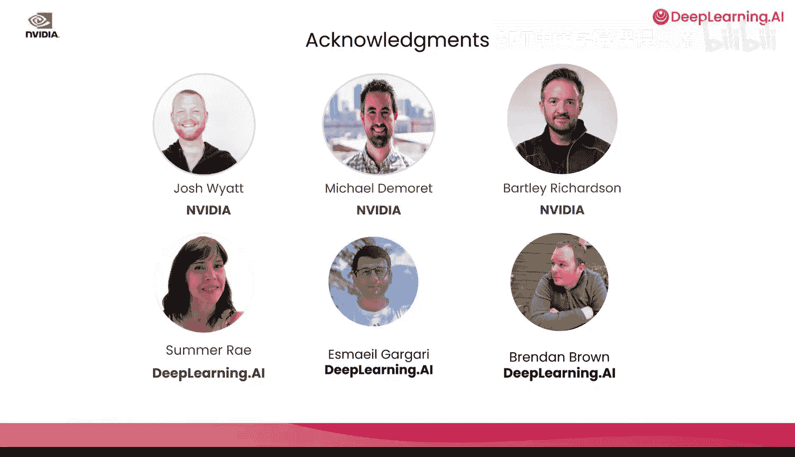

# 吴恩达《NVIDIA NeMo 智能体工具包：打造可靠的智能体｜NVIDIA NeMo Agent Toolkit》中英字幕 - P1：1.introduction.zh_en - GPT中英字幕课程资源 - BV1pYBxBgEik

Welcome to this course on NviDdia's Nemo agent toolkit。

 which will show you how to harden your agent for production。

 This course is built in partnership with NviDdia and is taught by Brian McBer。

 who is solutions architect in Geneita AI at Nvidia One problem that many teams face is how to take that demo that works maybe 60% of the time and turn into something reliable that you can safely deploy to users。

😊，Nviious open source Nemo agent Tookit or NAT gives key tools for doing so。Specifically。

 NAATT makes it easy for you to add observability to build and repeat run Evals and also deploy your agent workflow。

Maybe you've already built an agent workflow in R Python or using a framework like Landanggraft or C AI。

You can then integrate NT to get observability to see what your agent workflow is doing。 For example。

 if your agent occasionally calls the wrong to， NAT will show you execution traces so you can actually see what's going on。

😊，In addition， entity makes it easy for you to set up and run EVs in a disciplined way。

 this is very hopeful if you want to run maybe a CICD process or if you just want to drive a systematic process for improving your agent's performance。

In this course， you will learn in A T by building an agent to analyze climate data。

 You'll start by registering Python functions as tools to add more functionality to your agent。

Agents reason in natural language， so without the right tools。

 it's hard to know why they made certain decisions。You'll use open telemetry tracing。

 visualized in Phoenix to see exactly how your agent reasons。

 which tools it considers and what choices it makes。You'll also or your own custom code。 So finally。

 you'll expand the climate analyzer agent to a multi agent workflow where specialized agents built with frameworks like Lagraft collaborate on different aspects of climate analysis。

Deploying agents introduces so many complexities。 You need an API endpoint， authenticuthation。

 rate limiting。 Sudden， you're writing infrastructure code instead of working on your agents and all of these problems reappear any time you want to iterate on the models you're using or the prompts you're passing in。

Through several labs in the course， you will learn how NAT makes AI agents ready for production。

Many people have worth to trade this course。 I' like to thank from Nvidia Josh Wyatt。

 Michael Demart and Bartley Richardson， and from D AI， Summer Ray， Ismail Gagari and Brenan Brown。

 In the first lesson， you build your first agent in NATT。

 Connect it to an API endpoint as he working in real time。 Let's go to the next video to get started。

😊。

