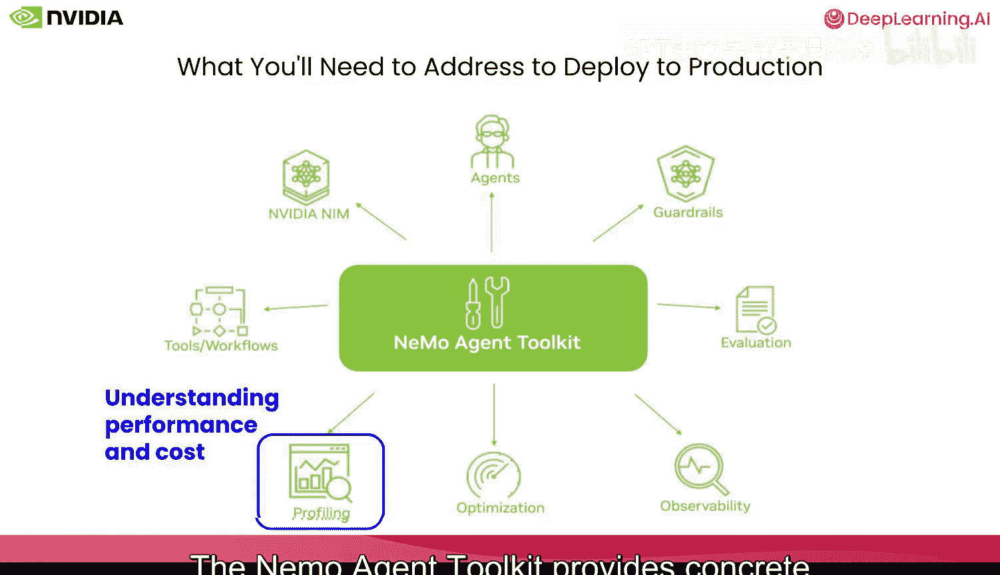
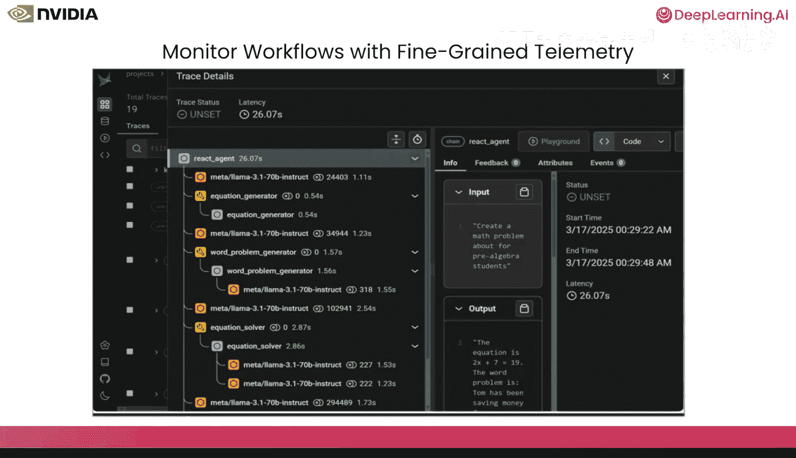
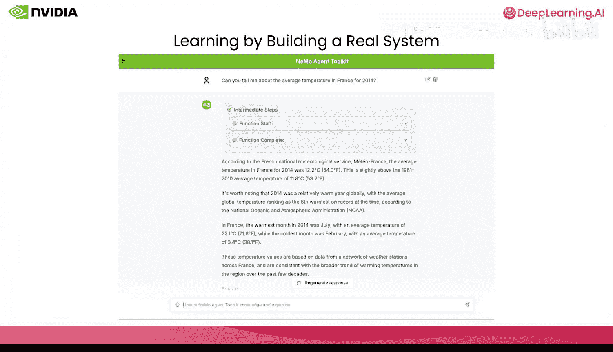
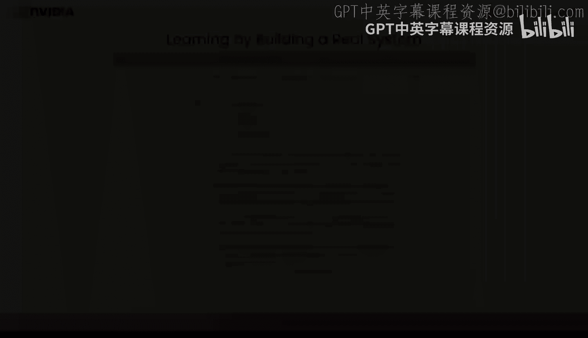

# 吴恩达《NVIDIA NeMo 智能体工具包：打造可靠的智能体｜NVIDIA NeMo Agent Toolkit》中英字幕 - P2：2.overview-of-nat.zh_en - GPT中英字幕课程资源 - BV1pYBxBgEik

Welcome to this short course on building enterprise ready agents with the Nemo agent toolkit。

 where you'll learn how to build agentic AI systems that go beyond prototypes。

 agent systems that are observable， deployable and maintainable in production environments。

By the end of this course， you'll have built a complete agent application with observability。

 API deployment， evaluation and a front end U I connected to a working agent。

 You know how to build a local prototype agent。 It works with prompts you send it。

 gives you the answers you'd expect against the experiments you've run。

 but shipping it to production is where reality hits。Whether you built your agent with L chain。

 Lama index， curura I or custom Python code， getting it into the hands of others reveals the real challenges。

 Also， while there are many great agent frameworks available。

 they don't all work together seamlessly。These are the day two problems。Day 1 is building the agent。

 Day 2 is everything else。 Inration complexity， managing multi agent systems built on heterogeneous components becomes increasingly difficult。

 as agents include arbitrarily nested tools and sub agents。Repeatability。

Egentic systems are non deterministic without consistency。

 their value diminishes A small parameter change or new L L M can dramatically affect performance。

 It worked on my machine does not work in production。 code reuse。

Teams implement great agents and tools， but sharing across frameworks often means reimpleation。

This fragmentation leads to developers redoing work instead of leveraging collective efforts across the organization。

Performance and cost。 Most computation happens in external systems， with expensive L L M calls。

Bottlenecks hide in the complexity。 Where's the time being spent。

 Where are the tokens being consumed。Mixed workloads make it difficult to optimize production requirements。

We need to expose our agents as Apis。 We need to monitor what's happening inside。

 We have to make sure that edge cases don't break production。

 We need to enable continuous learning from feedback and preserve data privacy。

 And we need to build an evaluation to quickly identify issues。 How do we do these things。

 Nemo agent toolkit is specifically designed to address these day two problems。

 And it works with whatever you built on day 1。The Nemo agent toolkit is an open source Python library。

 and it bridges a gap between your prototype agents and battle hard and deployable products。

 Being open source means no vendor lockkin。 You can inspect the code。

 You can contribute improvements， and you can deploy anywhere。

You don't have to rip out your existing agent framework or rewrite your application to use an Nemo agent toolkit。

 It works with agents building in any popular framework like Langchain or Lnggraft or Cr AI or semantic kernel or Google A K orllma index or whatever youre using。

 It augments what you've already built。 Think of it as a unified interface layer。

 providing the following。Production infrastructure。

 It provides an API deployment and it configurable using Yaml。

 This allows for rapid prototyping and quick changes， unified observability。

ItProvides in to end tracing across heterogeneous frameworks。 You can see exactly what's happening。

 even when agents call other agents in different frameworks。Systematic evaluation。

It provides standardized， fully customizable evaluations for any part of your workflow。

Performance intelligence， find bottlenecks， profile your workflow and discover optimization opportunities。

 Automatic hyperparameter tuning will allow you to improve accuracy and reduce costs。

Integration support， as we'll see， the NeEmo agent toolkit supports many plugins。

 including memory systems， MCP， including client and server and more。Instlation is straightforward。

 just Pip， install Nvidia dash N A T， and there are optional plugins for specific frameworks that you can install as needed。

Here's where the Nemo agent toolkit differs from a typical library， it's config driven。

Instead of hard coding agents and tools and workflows into your code。

 you define them in a Yaml configuration file。 Your tools become composable functions。

 Your LLM choices are declared in the config， and your workflow structure is defined in the same config。

Why does this matter， Because configuration files are easier to change。

 They can be version controlled， and you can experiment with them more easily than you can with code。

You can swap an L M without even touching your python。

 You can add a new tool by adding a few lines to your Yal config。

 You can run evaluations against different workflow configurations to see what works best all without touching your code Throughout this course。

 you're going to see this in action， as you build a climate science chat bot。

 But the patterns we'll see would apply to any agentic system。When you move agents to production。

 several concrete problems emerge。First， visibility into what's happening。

Your agent takes an input and returns an output。 But what happened in between。

 How many tools were called， What order were those tools called in， If there was an error。

 what was the error without this visibility， debugging production issues is guesswork。Second。

 deploying as a service。A local script is not useful to other applications。

 You have to expose your agent as an API of some sort。

 so other services and dashboards and applications can query it。

 And this requires a structured deployment。 Third， knowing if it's working。

 your agent seemed correct during testing。 But after deployment。

 you'll discover edge cases or hallucinations or incorrect tool choices。

 and you have to have systematic evaluation to catch these before they affect users。Fourth。

 understanding performance and cost， L O M calls cost money and tool implicationss take time。

 So in production， you need granular insight into where your cycles and dollars are going so you can intelligently optimize The Nemo agent toolkit provides concrete tools to solve each of these problems。

How do you get telemetry and performance data from your agent system。

 Some teams writing agent code just don't think about this。

 Other teams hard code the telemetry syncs within their code base。

 So their logic is interweaved with logging and telemetry syncs。

But a better way would be to instrument your code base with something that can take open telemetry data and pass it on to your observability team system。

 The Nemo agent toolkit makes it possible to add this instrumentation via a config file versus interweaving your code's logic with telemetry syncs。

 The result is a unified single pane of glass view that provides complete visibility and it empowers your team to manage and debug complex systems with the tools they already know and trust。

 The benefit here。 When something goes wrong in production。

 you have visibility into the execution trace。 You can identify whether the issue is a slow tool or excessive token usage or an incorrect tool selection or something else entirely。

We just talked about observability。 The Nemoagent toolkit also provides evaluation。

 which is similar but different。 Observability tells you what happened。

 It lets you look into the running system， But evaluation tells you whether what happened was correct。

 And you know what is correct or incorrect for agentic system。Given an input。

 you know what the correct output should be。The Nemoag toolkit allows you to build an evaluation set of these inputs and outputs and run them in an automated way to test your agentic system。

Then you're free to make changes to your configuration file and run the evals to see how it affected your agent。

This matters because agents are adaptive systems。 they don't follow predetermined code paths。

 The reason they adapt。 and this is powerful， but it also means that edge cases can pop up。

 An evaluation helps you discover these systematically。 During this course。

 you'll actually encounter a bug that emerges after deployment。

 something that wouldn't show up in casual testing。

 and you'll use evaluation to catch it systematically， and then you'll understand why it happened。

Moving beyond visibility and evaluation， the NeMmoagent toolkit includes automatic hyperparameter optimization and comprehensive profiling capabilities。

The slide shows an agent workflow that we were able to optimize。

Each chart is a series of agent iterations over time。On the left。

 you can see that we had a bunch of sequential tool calls。

 and the optimizer was able to show us that these could be parallelized。 So on the right。

 you see after we parallelize those tool calls， we were able to dramatically reduce the amount of time the gen workflow took。

The optimizer uses Optua and genetic algorithms to automatically tune your workflows。

In one agent application， we saw massive improvements just by running the optimizer。

So how does the optimizer work， You define which parameters are tunable。

 like the L Li temperature or the model choice or retri logic or tool parameters。

 And then you say which metrics matter to you like accuracy or latency or token cost。

 And then the optimizer runs your workflows against test cases with different combinations of parameters。

 and it finds the settings that optimize for your goals。

 The profiler gives you insight into workflow performance。On this slide。

 we can see an agent workflow that is tested across many different models with input or prompt tokens and output or completion tokens。

And the profiler lets us see how those different models interact with the agent workflow。

 The profiler gives detailed insights into token usage， tool execution times， workflow patterns。

 You need these to be able to optimize your agent。 And together。

 these tools eliminate the guesswork from agent tuning。 We won't implement these in the course。

 but they're powerful capabilities you can explore after mastering the fundamentals。

The Nemo agent toolkit lets you compose your various systems together。

It makes your agents and tools reusable mix and match components。

 And here we can see some of the frameworks and libraries that it integrates with natively。

It's open source and pluglugable。 So if you don't see your library here， you can easily integrate it。

 and we're adding new frameworks and libraries all the time。 You're going to build a real system。

 This will be a climate science chatbot capable of fetching and analyzing and visualizing real N NoAA climate data。

 And it's not going to just be a demo。 You're going to write the code。

 You're going to deploy it yourself。 and you'll see at work and sometimes fail in real time。

 You'll face real challenges。 connecting to Apis， composing multiple agents。

 debugging unexpected behavior。 We're going to observe token usage。

 and then we're going to deploy it for actual queries。

 And you'll even discover and fix a real bug using evaluation tools。

 You'll start with a basic react agent built from standalone Python functions。

 This will be a concrete， simple foundation。 And then you'll progressively add real world capabilities。

 API deployment， observability integration， Interopability， systematic evaluation。 And finally， a Ui。

 Each step builds directly on the previous one。 You'll learn production。

tterns by implementing them with your own hands。

