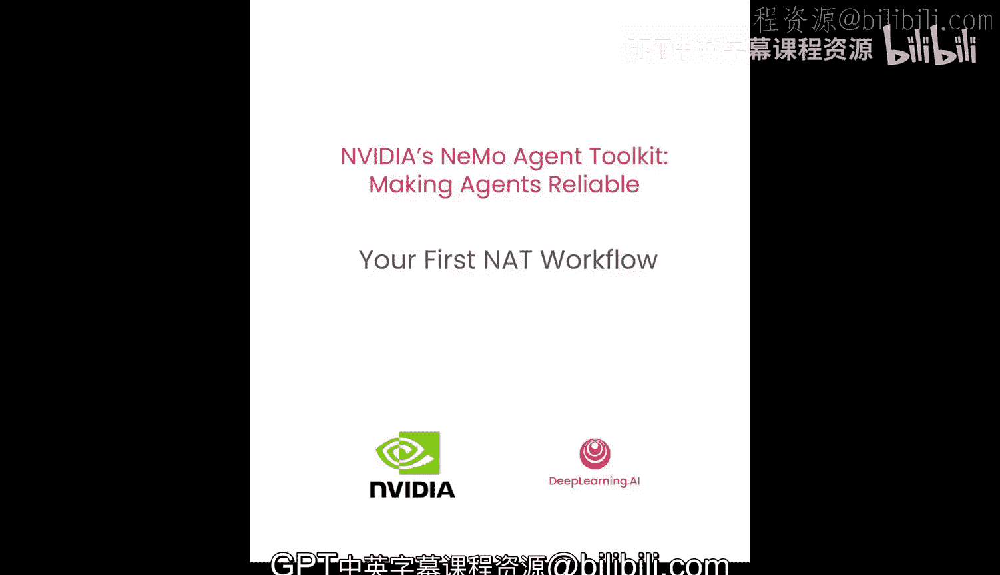
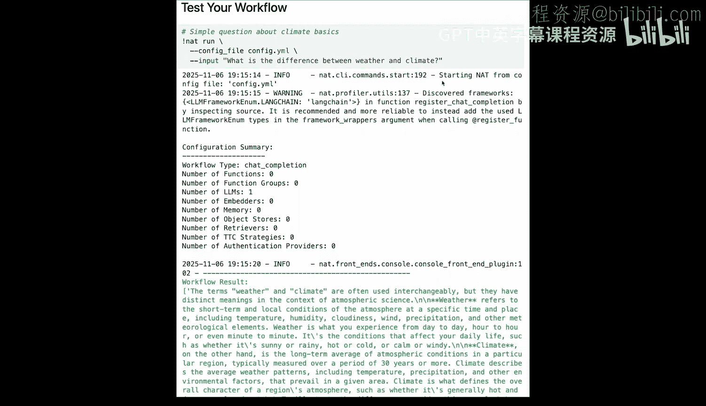
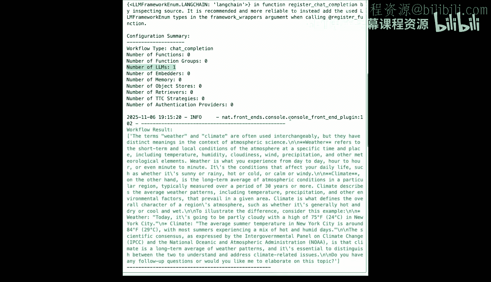
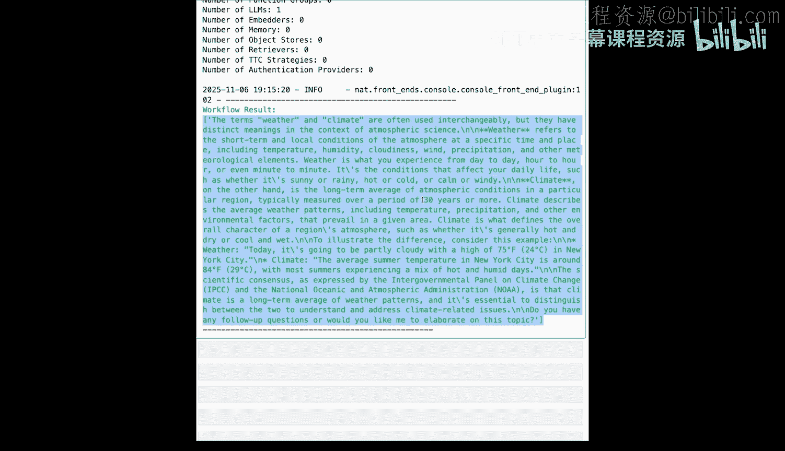
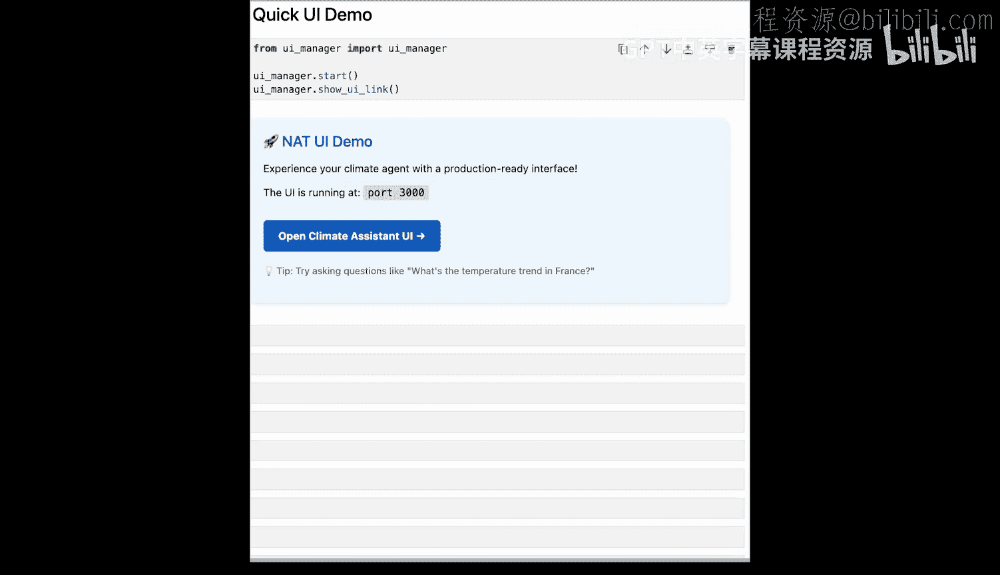
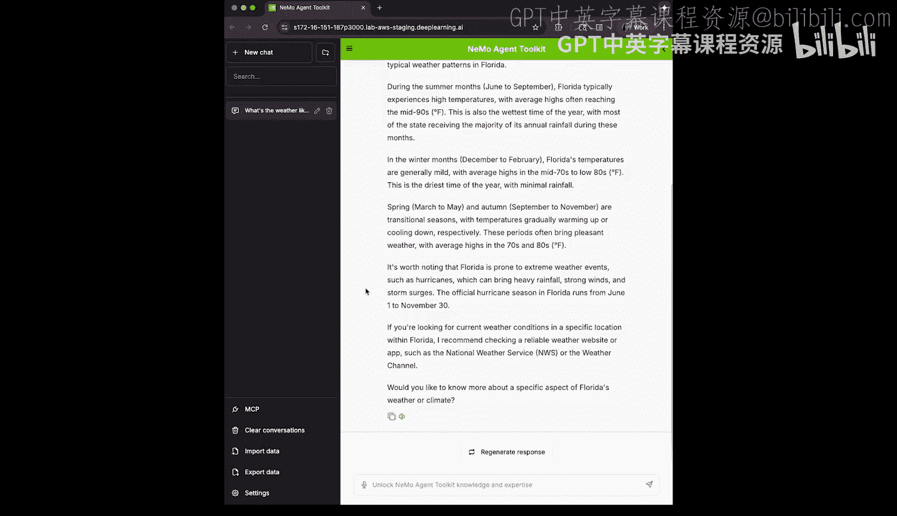
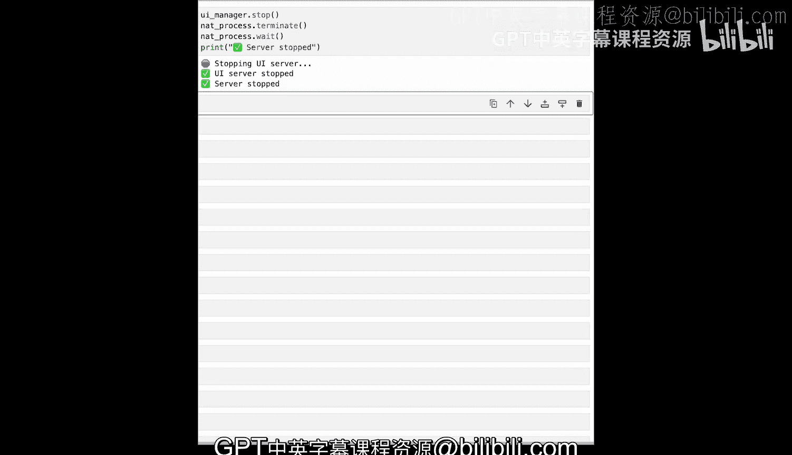

# 吴恩达《NVIDIA NeMo 智能体工具包：打造可靠的智能体｜NVIDIA NeMo Agent Toolkit》中英字幕 - P3：3.your-first-nat-workflow.zh_en - GPT中英字幕课程资源 - BV1pYBxBgEik

In this lesson， you'll learn how to create and run NAT workflows。

 You'll create and run a minimal workflow， and you'll serve it as a rest API。

 showing how NAATT brings production capabilities to even the most simple of workflows。

 Let's dive in。

The N AT C I gives you the ability to run agents quickly and serve them as APIpis that can be consumed by other services。

 And in this lesson， we're going to build a simple but production ready NA agent。

 and we're going to use the NT C I to serve that agent as an API。

 and we're going to connect it to a U I and watch it run at the heart of an N A agent workflow is a configuration file。

 This is a simple Yaml file that lets us quickly change how our agent runs。

In the example on this slide， we have two properties， a workflow and L L Ms。

 The L O Ms define and configure how we connect to large language models。 In this case。

 in Nvidia Nim container， it could be something else like open AI or Gemini。And a workflow。

 The workflow defines what the agent does。 In this case， it's a react agent。

 and it uses the L O M that we defined below。 The configurations can be simple。

 or they can be complex， They can contain evaluation information， observability information。

 They can define multiple tools for the agent to call。

 and many other features such as retrieveverrs or rerannks， or they can be simple like this one。

 a workflow and some L O Ms。To run these workflows， we use the N AT C I。

 and you can see listed here several of the C I commands。

 N A T run will run the workflow with a simple input。When you're ready to serve it as an API server。

 you run NATT Ser against the same configuration file。

If you want to run evaluations in C ICD or just by yourself， you would run NT Eval。

 and if you want to check and optimize your workflow。

 you can run NATT optimize and to check that your Yaml file is valid， you can run N AT validate。

In this notebook， we're going to create our first NAATT workflow。

If you're running this notebook on your own machine。

 you'll want to run the contents of this cell to install the Nemo agent toolkit and the Lng chain dependency。

In this environment， it's already set up for you and ready to go。 First。

 we're going to create the NAT configuration。 The configuration is a Yaml file。

 and in this Yaml file， we have two top level properties， LLMs and workflow。

Remember that NAT composes these together into your agent workflow。

 And so the first thing we're going to look at are the LLms。 You could have multiple LLms。

 In our case， this is a simple agent workflow， and we just have one， And I've called it Cl LL M。

 Each LLM has to have a type。 This tells the Nemoag toolkit how to connect to the LL M provider。

 It could be open AI。 It could be Google or any number of other providers。 In our case。

 we've chosen Nim， which is an Nvidia inference container。

 And the type will determine what properties you give the LLM。 For instance。

 it might need an open AI API key。 In our case， we need a model name， which is Lama 3。170 B instruct。

 We'll give it a base URL to tell it where to call an API key。 and we've decided to set temperature。

To0。7 and Max tokens  to 2048。Now we have our LLM ready to go to be wired into our Gen workflow。

 so let's look at the workflow。Again， we have a type defined。 There are many built in types。 and。

 of course， you can create your own。 In this case， it's a built in type called chat completion。

 This is a simple input output response to the L L M。And chat completion needs an LLM。

 so we will pass it the climate LLM that we defined earlier。And a system prompt。

 You are a knowledgeable climate science assistant。 When we run this workflow。

 Nemo agent toolkit is going to look at this configuration file。

 It's going to load the chat completion workflow type。

 It's going to create the LM that we defined and pass it into that workflow type。

 and then it's going to run whatever input we have combined with the system prompt and give us the output。

 Let's write this configuration file。 Now we can run the workflow。There are many different ways。

 as we'll see over the course of this course to run workflows。 In this case。

 we're going to use the N AT C I， and we're going to use the run command。

This does a simple run against a workflow。We'll pass it the configuration file that we saved in the previous cell。

 and we will pass an input。So we can see how the Nemoag toolkit has started to run from that configuration file。

And we have some output about the configuration。Number of L LMs is one。

 which is the one we set up earlier。And we can see the workflow result。

What is the difference between weather and climate and it's past it to our LLM。

 and it's returned us an answer。 So that's our first Nemo agent Tokit run。

Let's go ahead and ask a second question。In this case， we'll use the same configuration file。

 but the input has changed to how much has global average temperature increased since pre industrial times。

And let's run this。And we can see the output。And let's run it one more time。 this time。

 let's give it a specific question that would benefit from real data analysis。In this case。

 our LLM is going to be constrained by its training data。

 so I don't have high expectations for the results。As we can see， the L O M tried its best。

 but I don't believe that these numbers are correct。 Notice a limitation here。

 Our agent is just an L O M call。 It doesn't have any access to external data。

 Just general knowledge， whatever the L O M was trained with。 We see that it cites some sources。

 but these sources are dated， and it possibly could have hallucinated to。

Now that we have this Nemoagent toolkit configuration， let's deploy it as an API。In production。

 you would run N A T Ser in a terminal。 However， this is running in a Jupiter notebook environment and so。

We are going to have to run it as a subprocess。We're dealing with sub processes because this is a Jupyter notebook。

 but the command that we're running is N A T Ser， and we're passing at the configuration file。

Previous， we run N A T run and passed a single input。

 This serve is going to serve that agent workflow as a self contained API。

And we see their servers running in the background， so now we can test the API。

In order to test the API， we're going to use a standard Python requests library。

 and if you're familiar with the Open AI API chat completions endpoints。

 then this will be familiar to you。Our server is running on local host on port 8000。

 and we're going to call s v1 s chat s completions。And for our input。

 we will pass messages and a single message and let's ask a climate message what causes El Nino and how does it affect global weather。

And we'll tell it not to stream back results so we can get it in a self contained Json。

And once we get a 200 status code， then we can parse the open AI API compatible response choicesice。

 the first choice， the message and then the content。 And if there were an error。

 we could print out the error。 Let's run the sincere API in action。And there we get a response back。

 describing El Nino being a complex weather phenomenon。

So we've seen how to run the NeEmo agent toolkit with a single input。

 we've seen how to serve it as an API， and now we'll see how to launch a UI that we can interact with our agent workflow using a chat interface。

The Nemo agent toolkit API can be used by any UI， however。

 there is a Nemo agent toolkit UI that is production ready。

 showing that from a Jupyter notebook can be complicated。

 so we have a UI manager class here that will help us show it from the Jupyter Note。

The Nemo agent toolkit ships with a rich Ui， but we're going to look at that more in depth in a later lesson。

 For now， let's just take a quick peek at the Ui as it talks to the simple climate assistant that we created。

This U I might be somewhat familiar to you if you've used other chatbot Uis。

It allows you to create new chats， search through existing chats， connect to MCP servers。

 import data， export data， etc ce， and right now it's connected to the simple climate As that we created。

Let me send a prompt to our naive climate agent。What's the weather like in Florida。

Since our agent isn't grounded in any real world data sets。

 it's just going to draw from the LLM's knowledge， and we see that it gives some general information about Florida weather。

You'll notice that it gives me a follow up so I can continue chatting。

 and even though our agent is simple， you can see that adding a UI on top of it gives you powerful tools to interact with an agent workflow over the series of notebooks that we're going to work on in this course。

 we're going to build a very powerful climate and mathematical agent that can answer deep questions about climate data over several years。

 and with this UI we'll be able to chat in depth about that data。

All right， let's stop our server and clean things up for the next notebook。

In this notebook we have built a simple but working climate assistant that is able to answer general questions about climate data。

 we served it as an API and we even consumed it in a chatbot UI。It's limited。

 it doesn't have access to real data， but it's a beginning Next。

 we're going to add tools for actual climate data analysis。

