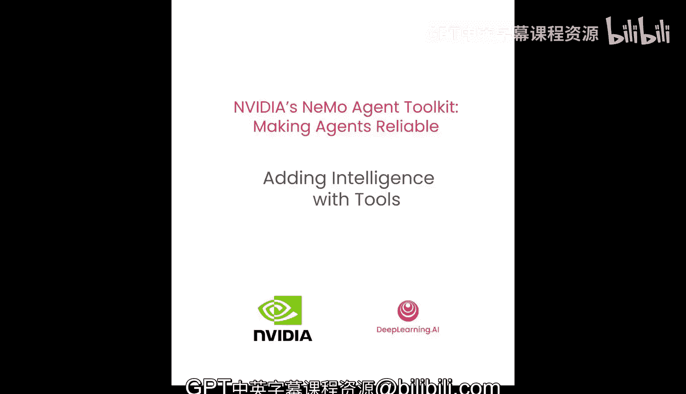
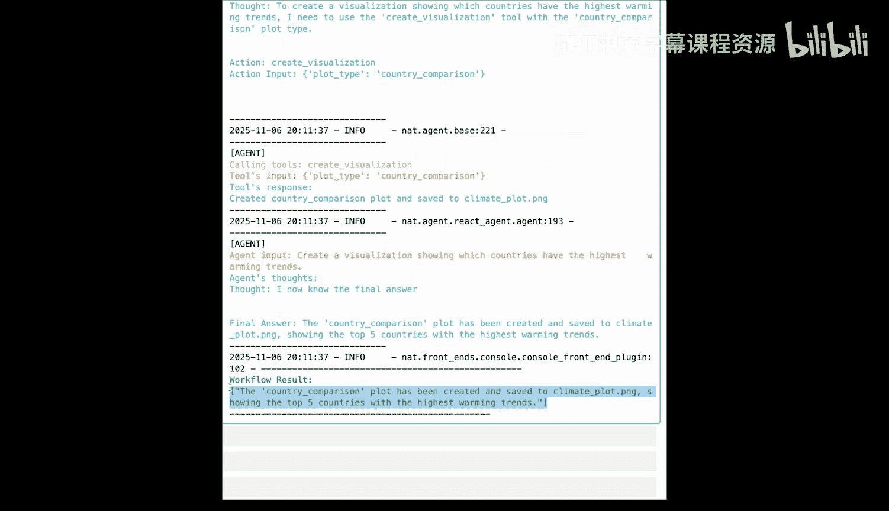
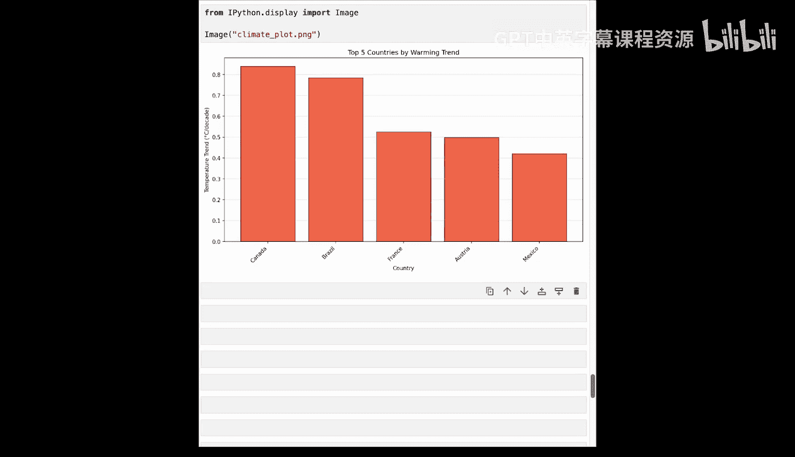
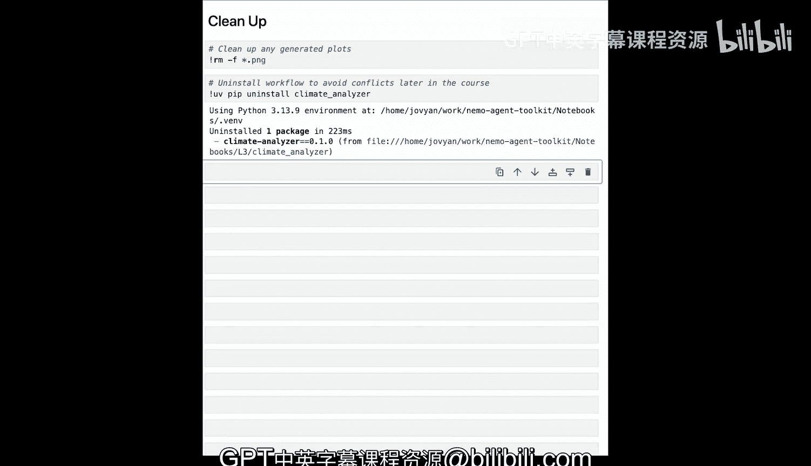

# 吴恩达《NVIDIA NeMo 智能体工具包：打造可靠的智能体｜NVIDIA NeMo Agent Toolkit》中英字幕 - P4：4.adding-intelligence-with-tools.zh_en - GPT中英字幕课程资源 - BV1pYBxBgEik

In this video， you'll expand your entity workflow to serve as a react agent。

 and you'll add Python tools for analyzing NOAA climate data。

You'll register your functions， define input schemes with Byedantic。

 and you'll add descriptions so your react agent can determine which tools to use。

 You'll turn your agent from a simple chat bot into one that takes intelligent data driven actions。

All right， let's code。In this lesson we're going to build on what we learned previously。

 this time we're going to build a climate analysis assistant。

 and we're going to use multiple tools with that assistant。

We're going to take plain Python functions， and we're going to turn them into NAT tools。

 and then we're going to register those tools to make them available to our agents。

Will'll package all that up as a python package and will'll also examine some other concepts。

 such as how a react agent uses tools。 What is a react agent， It's a common agent pattern。

 It stands for reasoning and acting， and it's basically a loop。

 And LO M will reason about what to do next。 It'll formulate one or more actions。

 It'll call those actions， and then it'll reason some more。

 and it'll continue that loop until it's finished。This react agent has access to three tools。

 and you'll notice that each of these tools is written in a completely different framework。

When it runs， it will decide which of these tools to use。

 and it'll iterate on tool use until it has a final answer。

 The data set we'll be working off of is real climate data from NOAA。

 and it includes information from multiple countries like the United States， France， Japan。

 Brazil will introduce some plain Python functions that are able to analyze this data。

 and we'll see how to wire these functions into an agent workflow。

Python functions are the foundation of N A T tools。

 The top function is a vanilla Python function to calculate temperature statistics。

 It optionally takes a country， and then it returns the statistics。

 If we want to use this as an Neag toolkit tool。 We simply register it as a function。

 and then we wrap it in some boilerplate， such as in a sync method and in a sync wrapper，Ultimately。

 it calls to calculate statistics function， and then we yield some function info to let an Ne agent toolkit know how this function runs。

It's a bit of boilerplate， but it's not too much， and now we're ready to wire it into our genetic workflow。

The Nemo agent toolkit CI can generate most of the boilerplate you need to wrap functions。

 but we're going to look at this here and then in a lot more detail on the slides。

Every tool starts with a configuration class。This is the class that takes information in our Yaml file and makes it available to the tool。

Every tool also has an input schema。 This is a pedantic class that tells the large language model or the agent workflow how to call the tool。

And finally， we have to decorate the function with a registration decorator。

 And this wires the tool into the Nemo agent toolkit。

 We will look at this in a lot more depth in the notebook book。😊，To package our workflows。

 we just use a standard Python project。 A P project atmal file。

 There's nothing Nemoagent toolkit specific here。 We give the project a name。

 We specify entry points。 And then we install it using Pip or U VPip install Once we have all of our tools registered in the Nemo agent toolkit。

 We simply have to create a configuration file。 In this configuration file。

 you can see we have a list of functions。 And the top one is calculate statistics。

 This is the tool we were just discussing that we wrapped to make it available to the Nemo agent toolkit。

 There's a couple other tools as well。 filter by country and create visualization。

 These are similar functions that we've wrapped。You can see that our react agent has gained some powers。

 It has a tool name's property， and we have passed the three functions that we have defined above to the react agent now is ready to reason and act using these tools。

Of course， the configuration file is not just about running the agent。 while it provides tools。

 it also provides for telemetry， such as open telemetry tracing and running evaluations against our agent to make sure it doesn't regress over time。

An Nemo agent toolkit project is just a standard Python project。

 You can use the NAT C I to generate a lot of the code that we've looked at。 For instance。

 this command， NA A workflow create climate assistant will create the following project structure。

 This is just a standard Python project。 That is ready to go with N A T。All right。

 let's add some intelligence to our agents with tools。First。

 let's look at some standalone climate tools。 These are not agent tools。

 These are just Python functions。 We're going to import a series of Python functions here that can load climate data。

They can calculate climate statistics， they can filter climate data by country， find extreme years。

 create visualizations， and list the countries of the climate data。

Let's take a look at what this climate data looks like。

 So we have 1210 temperature records ranging from 1950 to 2025 and spanning 10 countries。

 And now let's look at some of the functions。So the documentation for calculate statistics says it calculates basic statistics from temperature data。

 it takes a data frame with temperature data and an optional country to filter it by and it'll return adjacent Json string with the statistics。

So let's call this function and see how it works。In this case。

 we've called calculate statistics and we've passed it the data frame， but not a country。

 Remember country is optional， and let's print the global statistics and we get some data output here。

Now let's look at a different function， create visualization。

 and this creates climate data visualizations and saves it to a file as an image。

 and we can see the arguments that it takes here and what it returns。

Let's test this function out and see what it does Here。 we see that calling create visualization。

 and we pass it a plot type and a place to save will output a plot of climate visualization data。

 Each of these tools returns Json。 They have a single responsibility。

 but they are not plugged into our genetic workflow。 Let's go ahead and do that。

Now we're going to register a single tool into our NeEmo agent Tookit workflow。

When you register a tool with an Nemo agent toolkit。

 there are three things that you need to consider。 The first is the input to the tool。

 So an Nemo agent toolkit will use pedantic to let you define what the input to the function looks like。

So we're going to import base model and field from pedantic and our tool is calculating statistics。

 so we will call this input definition， calculate stat's input and calculate stats takes a country that is optional and so in our case we will give it a description country name to filter by。

 leave empty for global statistics and now that we have our inputs defined we can move on。Next。

 we'll set up our configuration。Nemo agent toolkit is config based。

 and we've seen Yaml files already。 How do the properties from the Yaml get into our tool or our L OM or our workflow。

 It's through a config object。 So in our case， we're going to define a calculate statistics config。

 We'll give it a name。 And this is going to become the type that we set in our Yaml file。

And we can give it a description。 and in our case， we're just going to pass。

 which means there's no properties on this class， which means that our calculate statistics tool does not take any configuration。

 but if it was going to take any configuration properties from the Yal， we would define them here。

And now we're going to register the tool itself。We register with a decorator。Register function。

And we pass into that decorator， the config type， which is that config that we created earlier。

This is a bit of boilerplate， and the NA A C I has generate commands that will generate some of it for you。

 We're not going to talk in detail about all the aspects of this。

 but we'll see here that we have a wrapper function that wraps the python function that we're going to expose as a tool。

 It takes two properties that we'll talk about in greater depth later on。

 the configuration which will be injected in。 And if we have properties on our configuration object that we defined earlier。

 then this would be an argument that contains those properties pulled from the Yaml。

 And then a builder， which we can use to grab other aspects of our workflow。

 such as an LLM or retriever or any other thing that we've defined in our Yal。 In our case。

 we're not going to be using either of these。 we are going to load our climate data as a data frame。

 And then as we wrap our tool， we will pass that data frame in。

Here's the actual function that we're wrapping， calculate statistics that we looked at earlier。

We pass in the data frame that we loaded a few lines above。 And then you see that。

We are also accepting a country parameter。This is optional， of course， as we defined earlier。

 and we will pass that country in as well to calculate statistics， and then we'll return the result。

So we've wrapped the Python function， but we still need to describe it to the Nemo agent toolkit。

 and so what we will do from this is we will yield a function info object。

And the function that will pass to that function info object is the wrapper that we just looked at。

And the input schema that we talked about earlier that defines what the input looks like to our tool。

And a description in this description will help the agent workflow know whether it should call this tool or not。

 So a bit of boilerplate code。 But again， this would be generated for you。

 A lot of it would be generated for you by the Nemo agent toolkit， C I。

If you wanted to see and run the full registered dot p file， you could run this cell here。

 and we would be able to see what the Python file looks like。 Now。

 let's look at what the configuration looks like。 We have this configuration already saved to disk。

 So we're going to load it into our cell and take a look。

And here's the config file that we're going to use for this N A T workflow。

 Some of it will already be familiar to you。 The climate L O M that we looked at in the previous notebook book。

 But we have a new section， and this is called functions。

 And these are the tools that we can make available to our agents。

And the first and only function we have listed here is calculate statistics。And we give it a type。

 and we looked at this type earlier。 simple tool demo slash calculate statistics。

 This is how the Nemo agent toolkit knows how to find this tool in our Python functions。

And we can override the description here for the tool。

Our workflow is similar but different than before。 So you'll recall before the type was just a simple LLM call。

 And now we're telling it that the workflow is a react agent。

 A react agent reasons and then acts in a loop。 And this is a built in agent to the Nemo agent toolkit。

 So we're going to say run a react agent。 And the react agent is going to have the following tools available。

And we pull the tool from the functions listed above， so we have calculate statistics here。

 and we have passed that in as a tool to our react agent。 It also takes an LLM。

 which we defined earlier the climate LLM。 and we're going to set verbosity to true。

 and this way we'll be able to see detailed outputs for the tool use。Allright。

 let's go ahead and install and run our react agent workflow。 So the。

Tools that we looked at earlier do need to be installed into our virtual environment。

 And so I'm going to go ahead and install them here。And now that those are installed。

 we can run our workflow。 So you're familiar with N A run。

 We'll pass it the config file that we looked at earlier。And in input。

 what is the global temperature trend per decade。And we can see it reasoning through。The agent input。

 what is the global temperature trim per decade and the agent thinks about this and decides that it's going to call calculate statistics。

So it calls calculate statistics， and it gets an error no data found for country nuns。

 This is probably room for us to improve our agent later on。

 realizes it should call with an empty string。 So it calls calculate statistics。

 again with an empty country。 and it gets back the results that we looked at earlier when we ran calculate statistics。

 The agent concludes it knows the final answer， and it gives us the answer here。

 The global temperature trend per decade is 0。241 degrees Celsius per decade。

Let's uninstall our simple tool demo package to so we'll be ready to run other packages and other notebooks。

So let's talk through what we did to register a Python function as a tool。

 We need a configuration class with unique name。We need in a sync wrapper function。

We need to yield the function info with an LM description。

 and then we can reference it in our config file as package name slash tool name。

 You can use N A T workflow C to create all the scaffolding you've done by hand in this notebook。

 And if you want more information on that， you can run N A T workflow create dash dash help。

 Here's a configuration file that has all of the tools that we looked at earlier registered in。

So we have calculate statistics， which we've previously seen。

 but now we've wired in the other tools as well。 list countries， filter by country。

 find extreme years， create visualization。 These are just sub propertiesties of the functionss top level property。

 And then we'll pass them in our react agent here。 previously。

 we just had calculate statistics listed as a tool。

 But now we've listed all of the tools and made them available to our react agent。

We've also made two other small changes since we have many tools。

 Sometimes the react agent needs to iterate several times。

 we've told it it can iterate up to five times， and then also sometimes it will call a tool incorrectly and have to retry。

 and we've told it that it can retry up to two times。All right。

 now that we have all of our tools registered， we are ready to run more complicated queries against our agent。

First， let's ask about global warming trends over run N A T run and we'll pass it that long configuration file we just looked at with the input of what is the global temperature trend per decade。

And we can see the react agent reasoning down through the tools that we provided it decides to call calculate statistics。

 and it gets us the global temperature trend per decade。Now let's ask for country analysis。

In this case， we're going to ask about a specific country， specifically France's climate data。

Let's see if it'll use multiple tools during this run。We can see it filtering by country。

 and we get the results back from the tool of specific country data。

And then we see it calculating statistics and this time it's passing a specific country。

 which is France， and it gets data back from that。And now we see the L O M take the provided Json that it got from the various tools and put it together into a final answer。

 which it returns to us。 Let's test the visualization tools next， in this case。

 we're going to ask for a visualization showing which countries have the highest warming trends。

And we can see that it's chosen to call create visualization。

And it's let us know that it has saved that to a file， and that file is ready for us to view。

Let's take a look at what it rendered。And here we can see it gave a surrender rendering of the top five countries by warming trend。

Finally， let's give it a really difficult question that's definitely going to require multiple tools and see how it handles it。

In this case， we wanted to compare the temperature trends of Canada and Brazil to answer the question which one is warming faster and then also create a visualization of global trends。

And we can see it reasoning down through calculating the statistics per country。 First for Canada。

 then for Brazil。 we can see it having to retry a few times。

But we finally get to the point where it's able to save a ping image of the global trends。

And give us a final response。Giving us the trend per decade。And let's look at that output。

And here we can see a plot of temperature over year。And now we'll do some cleanup。

 So let's delete the images that we've created。And let's uninstall the workflow that we created just so it doesn't conflict with later notebooks in the course。

In this notebook， we've seen how we can take standalone Python functions and wrap them as tools to be used by Nemo agent toolkit agents。

