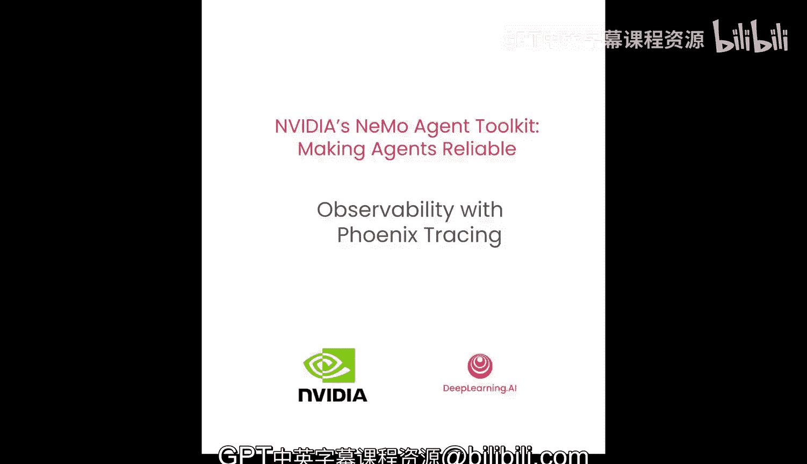
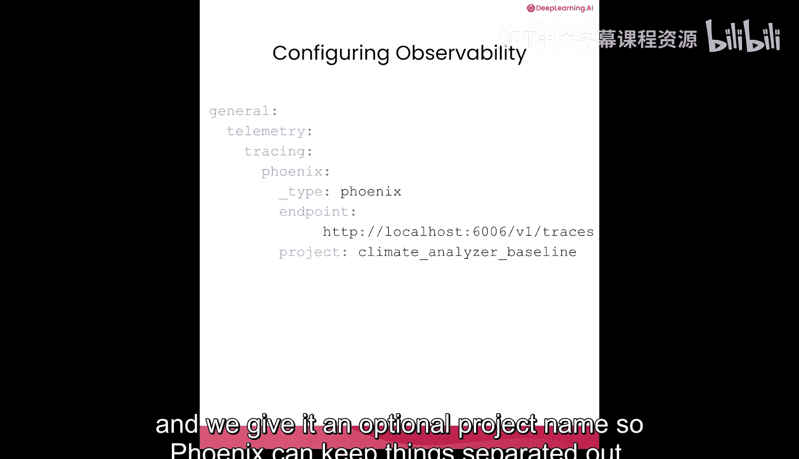
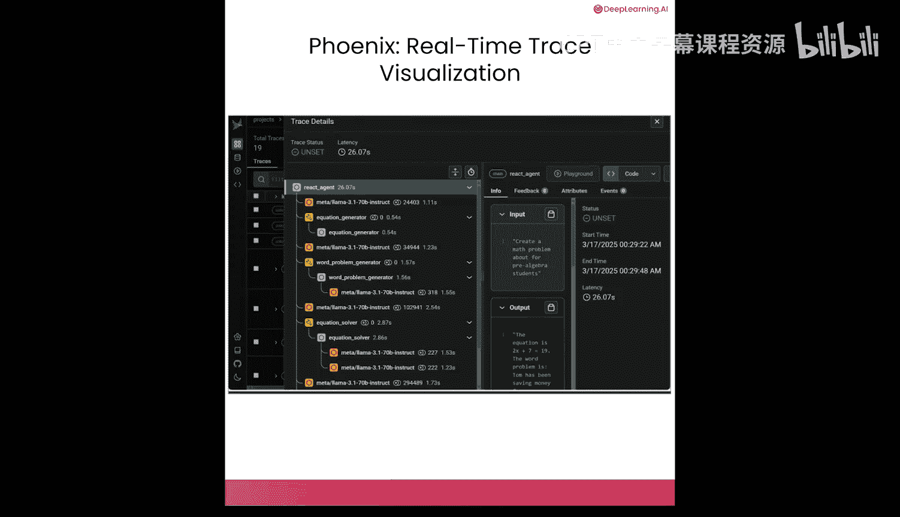
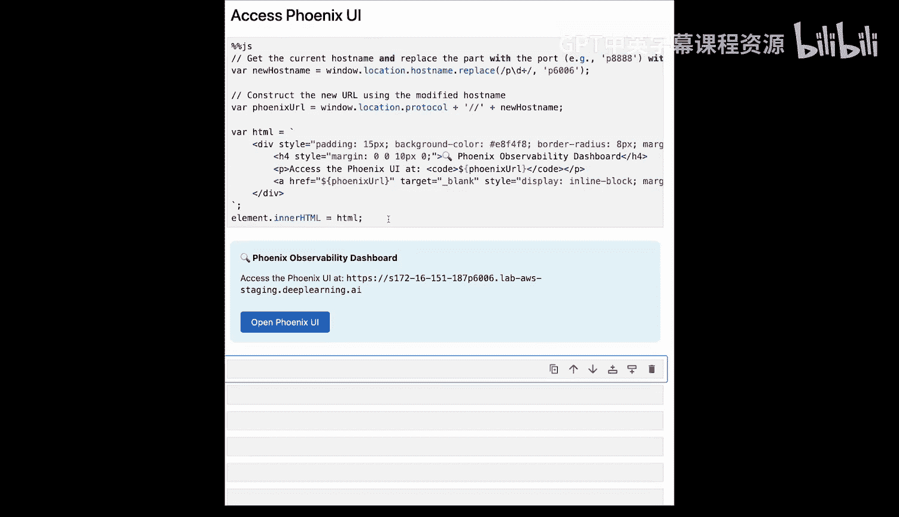
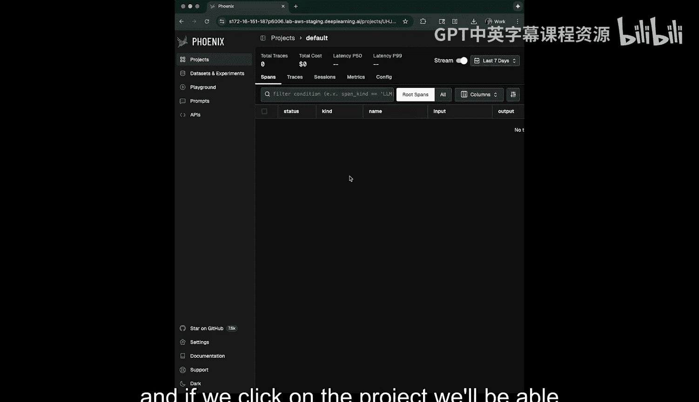
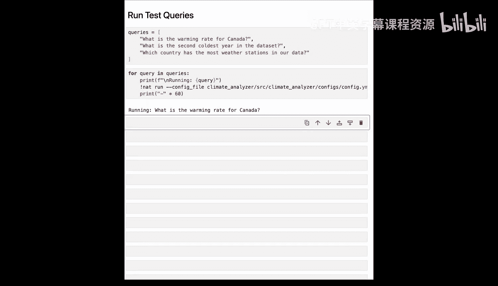
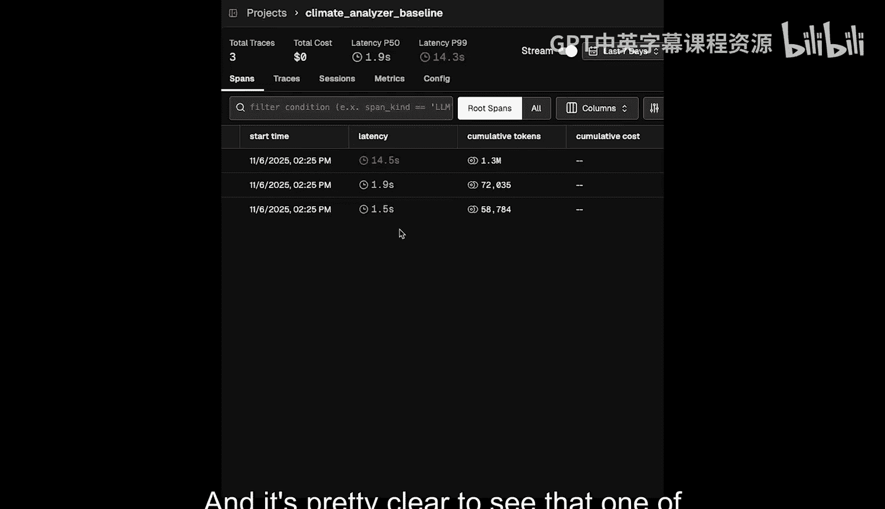
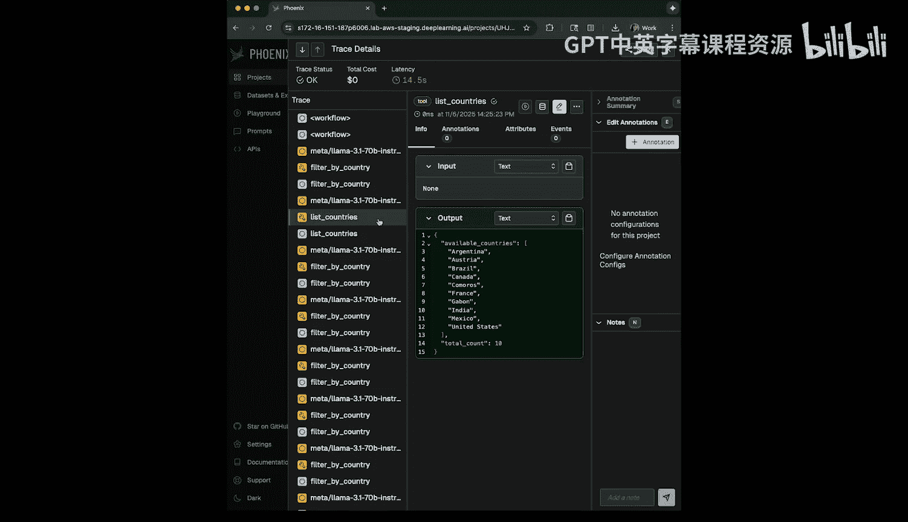
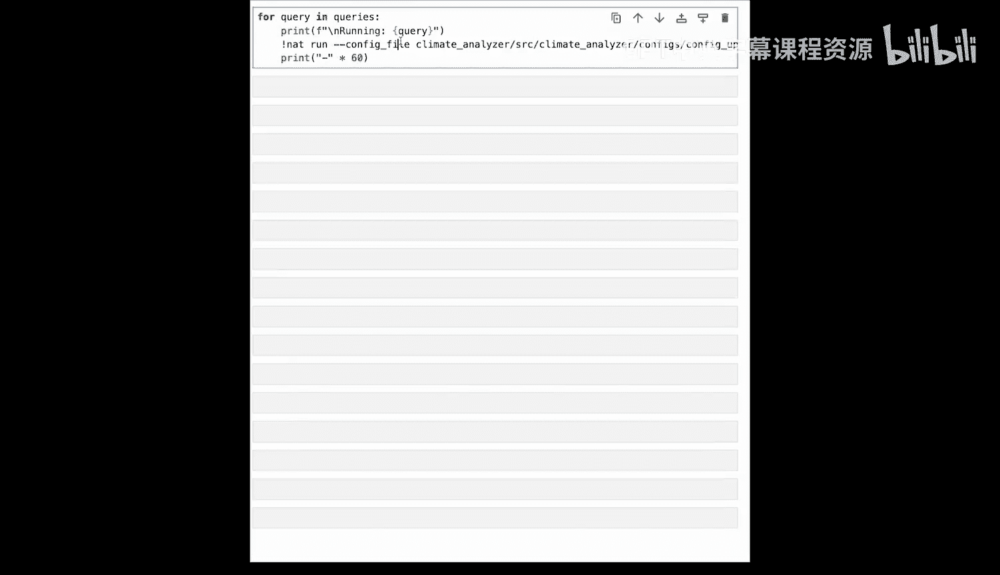
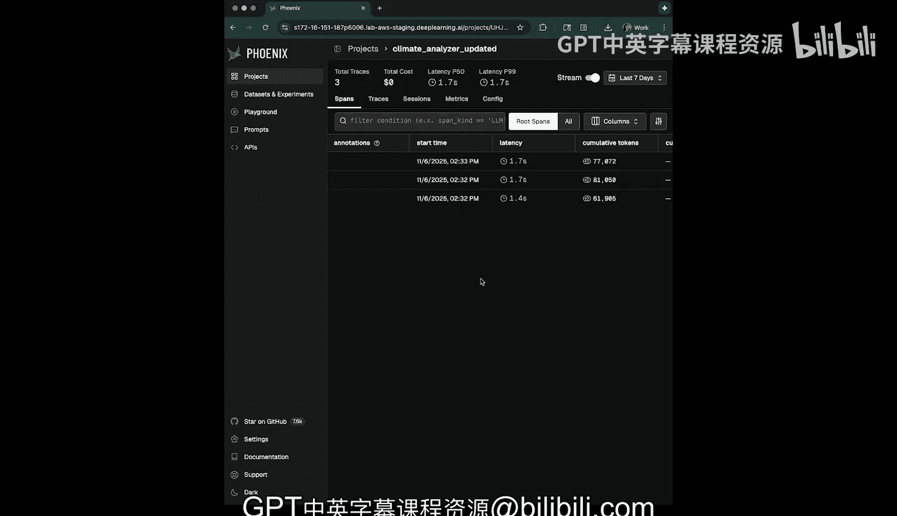

# 吴恩达《NVIDIA NeMo 智能体工具包：打造可靠的智能体｜NVIDIA NeMo Agent Toolkit》中英字幕 - P5：5.observability-with-phoenix-tracing.zh_en - GPT中英字幕课程资源 - BV1pYBxBgEik

Next， with just a few lines of configuration， you'll add tracing and monitoring to your agent so you can spot performance issues in real time。

 and you can optimize your workflows with confidence。

All right， let's go。 This lesson is all about observability。 We're going to set up a Phoenix server。

 and we're going to watch observability data flow in。

 and we're going to use that to identify performance bottlenecks by analyzing traces。

 And we'll use that to optimize tool usage。We can even compare workflow performance before and after changing our config。

And by the end of this lesson， you should be able to understand NAT's unified observation stream。

 What is observability， Observability means understanding what's happening inside your AI workflows by examining their outputs。

That's not hard to do at a simple function level。The power of N A T is that it enables it at all of your functions。

 Whether those functions are a complicated sub agent with its own functions that are instrumented for observability or simple Python function。

 It takes all of these and sends them to whatever observability server you're using。

Configuring observability is as simple as modifying your config。

Here we have a general section at the top of our config。

 and we've told it that we are going to be configuring telemetry， specifically tracing telemetry。

 and we give it a target。 We name the target Phoenix， and the type is Phoenix。 In this course。

 we're going to be using Phoenix， A U I written by arise rise。

 And so we specify that it is a type Phoenix， and we give it the end point to that Phoenix server。

 and we give it an optional project name。 So Phoenix can keep things separated out。

 Phoenix is a handy U I and observability server。

In this image， we can see that someone has run an agent workflow。

 and we can see trace data from that workflow。 We can see the LL M calls。

 the tools the agent decided to call and the results of those tools。

 We can also see the latency that this call took 26 seconds。

And that's the real power of observability。 The user might ask which country has the most weather stations。

 And without observability， we wait a little while， Let me get the correct answer eventually。

 But with observability， we see that that correct answer came with 15 tool calls and 3000 tokens。

 and it took 8 seconds to get the answer back to the user。

 That might be something we can optimize later on。In this lesson。

 we're going to be looking at observability and tracing in the Nemo agent toolkit。

 N A T can emit many different types of observability data， open telemetry data or otherwise。

 it's pluggable。 So if there is a type of data that it doesn't output。

 you can write an adapter and plug that in。In our case。

 we're going to be emitting open telemetry data in this notebook。

 and we're going to be consuming it and looking at it in Phoenix， which is a UI written by ArISise。

Normally， you would just run Phoenix Ser in a terminal to start Phoenix。

 But since it's in a notebook， we have to run some medal commands。

Now we have Phoenix running in the background ready to accept our NAT telemetry。

Before we run N A T and emitm data， let's take a look at the Phoenix U I。

 This is just some jascript here to give you the location of Phoenix running on your own system。

 So when you run it， it'll give you an open Phoenix U I button。

This is the Phoenix Ui， and we're not going to go too deep into it。

 but we can see that it says no traces uploaded yet。 When our NAT T workflow begins to send traces。

 it'll send a project name， and that project name will show here along with the traces。

 And if we click on the project will be able to see all of the traces that have flowed in。

Let's install our claim and analyzer agent that we've been working on。Now that that's installed。

 let's look and see what it takes to flow open telemetry data from Nemo agent toolkit into Phoenix。

In our configuration file where we have configured our LLMs and our workflow and our tools。

 we can add another section， and this section is called General。

And this is where we can put N A T configuration specific data。 For instance， telemetry。

 And there's various types of telemetry like logging or tracing。 And we are going to do tracing。

 So we'll have a tracing header here。And then we can define many different tracing targets。

 You might have multiple Phoenix servers。 You might have a Prometheus server。 In our case。

 we have one Phoenix server， and we're going to call it Phoenix。 and the type is going to be Phoenix。

And we will give this Phoenix configuration an endpoint that points to the Phoenix server that we started earlier。

 and we'll give it a project name Cl Anar baseline。

And that's all we need for our NeEmo agent toolkit workflow to start flowing its data into Phoenix。

In order to see tracing data， we need to actually run our agent。 So let's set up some queries。

 So we have three queries here。 The warming rate for Canada。

 the second coldest year in which country has the most weather stations in our data。

 Let's run these queries。And as that's running， I'm going to switch over to Phoenix。

So now we can see this project， Cl analyzer baseline， which is what we call it N our config。

 And we have three total traces， which corresponds to the three queries that we ran。

If we click in here， we can see the trace workflow。We have three chains of thought。So at a top level。

 we can see some information on these， like the kind of tracing， the name of the workflow。

 which we could change in our config if we wanted to。 The output， any annotations， the start time。

How many tokens were taken and the latency。 And it's pretty clear to see that one of these takes a lot longer than the other。

 So let's drill into that。

Here we can see the thought process as the agent is working through its chain。It's making LLM calls。

 It's making tool calls， more LLM calls， more tool calls。

It makes a lot of L O M calls and a lot of tool calls。 In fact， it looks to me like it's churning。

 After analyzing these calls， we came to the conclusion that the agent was looking for station data。

 and we don't have a tool for it to specifically get station data。

 So it was going around that around trying to collect various bits of information from the other tools to look for stations。

So let's look at our fix。 This will be in a new config file。

 and we will copy our old config file to it。 And in this one。

 we'll add another function called station statistics。

And we'll register station statistics as a new tool and our agent workflow。

Just imagine that everything else is here。 The other thing that I'll note that we've changed is the project name。

 So when we look at Phoenix after we run these queries again。

 we'll see a new project there and that just helps keep things separated out so we can see the old calls and the new calls。

 But this will be saved in a new config file。And let's run these queries again in our updated config file。

And as those run， we can update Phoenix。And we can see that they are now flowing in。All right。

 And let's go into our updated project。And we can see the three queries that came in。

 but let's look at their timing now， and we can see that they all have similar latency。

 which indicates that our agent was able to use the new station tool to drastically reduce the latency in this call without observability。

 our agent would be returning the correct information。 But now that we can observe it。

 we can reduce the amount of tokens， the amount of LLM calls and the latency of the system。

 In this notebook， we have looked at observability， how important it is。

 even though we might be getting a correct answer。 We might be getting it in an inefficient way。

 We've seen how we can use the Nemoag toolkit to instrument our agent to workflows to flow observability into tools like Phoenix and examine a workflow and then fix inefficiencies。

