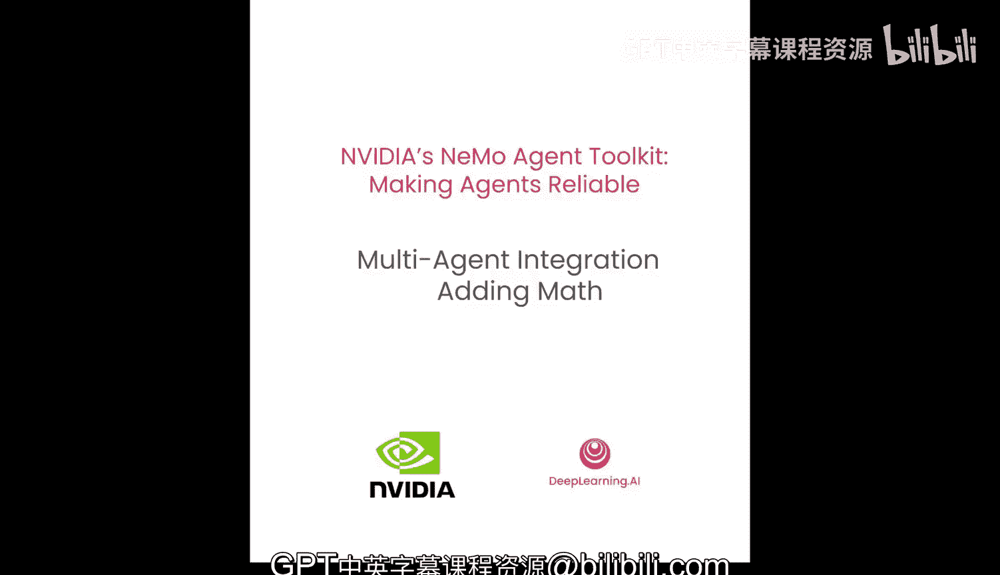
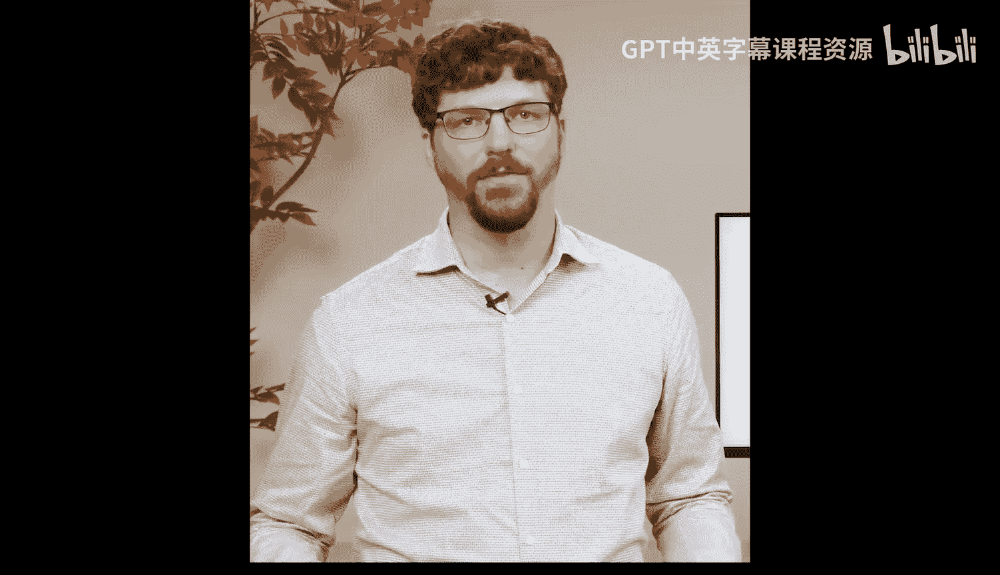
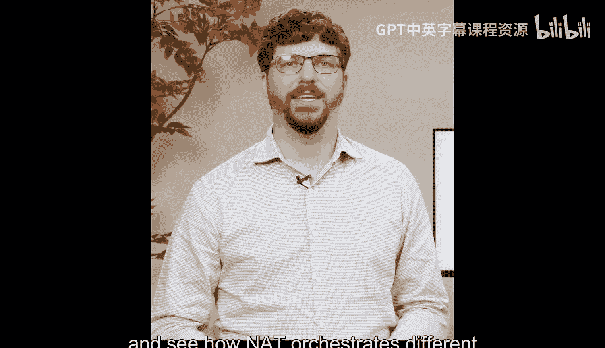
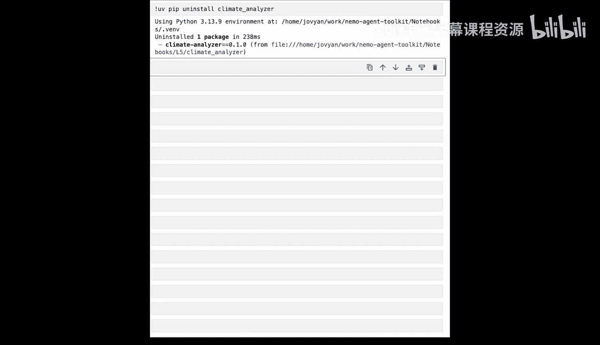

# 吴恩达《NVIDIA NeMo 智能体工具包：打造可靠的智能体｜NVIDIA NeMo Agent Toolkit》中英字幕 - P6：6.multi-agent-integration-adding-math.zh_en - GPT中英字幕课程资源 - BV1pYBxBgEik

Now， it's time to explore ways you can integrate pre existing agents。

 you may have built with any number of frameworks as NA AT tools。

 Compose multiple agents together and see how NAATT orchestrates different frameworks to work seamlessly as a coordinated team。

Let's get coding in this lesson， we're going to take an existing powerful agent， a La graph agent。

 and we're going to expose it to our existing agent as an N A T tool。

 And this will show us how to extend workflow capabilities through agent composition。

We'll also see how to lift hard code of providers such as LLMs up out of our agent into configuration。

 which makes it easier to experiment and iterate later on。

We'll see how N A T orchestrates multiple agent frameworks together。

 All of this means that we'll be able to build more powerful workflows by combining existing agents。

 Sometimes tools just aren't enough。 For instance， our current climate analyzer。

 it can retrieve temperature data。 It can calculate basic statistics。

 and it can create visualizations。But more complicated math。

 such as compound growth rates or multiple step calculations or complex projections。

 It can't do these things。 But what if we had an existing agent， In fact。

 we do this lagra calculator agent。 It can handle complex calculations， as we'll see in the notebook。

So how do we integrate that Lagra agent into our existing agentic workflow？

We just register it as another function。So we've already seen this register function decorator。

 We've already seen this boilerplate that we use to wrap a function。 We've already seen most of this。

 and it's all it takes to wrap an existing complex agent and make it available to our agent workflow。

Let's look at our configuration again now that we've integrated this separate agent。

We have a new function， a calculator agent， and this calculator agent wraps the entire La graph agent that we looked at before。

And if you look under tool names and workflow， you'll see that we've exposed the calculator agent as just another tool。

 We've also added another LLM。 We have a climate L OM from before， but now we have a calculator L OM。

 This isn't required。 We could use the same L OM for multiple tools。 But in our case。

 we wanted a new L OM definition， so we can constrain the max tokens。

 You might have other agents that have other properties that need to be changed， such as temperature。

And now we can begin to understand the power of a gen composition。In this picture。

 we see a workflow on the left， and it has access to three tools。

But the top tool and the bottom tool also have tools。 These tools are actually agents， themselves。

And some of the tools that those agents have also contain tools， those tools are also full agents。

And instead of having a bunch of different agents running separately， now。

 we can compose them together， agents communicating with agents and levering each other's powers。

What this means is we can extend an agent with another agent。Before we did the integration。

 for instance， we couldn't ask for mathematical calculations to be done against our climate data。

 But after integration， now we can combine the power of our calculator agent with the power of our climate agent。

 and we can get much better answers and much better analysis。

And this is the power of unified orchestration。 Do you have a Lagra agent， a crew AI agent。

 some custom fast API service， You can wrap all of these and orchestrate them by NATT's unified orchestration layer。

 In this lesson， we are going to be looking at， integrating multiple agents together。 First。

 let's install our climate analyzer package that we looked at in previous notebooks。All right。

 And I'll let that's installed。 Let's think about some limitations that our current climate analyzer agent cannot handle。

So let's look at some questions that our agent can't handle yet。

 If we want to observe temperature data， but look at the compound annual growth rate。

It's not going to be able to calculate that because it's a climate agent， not a mathematical agent。

If we wanted to get the weighted average of population， again。

 this is a mathematical question and our climate agent is going to stumble on it。

And if we want to ask a question about renewable capacity projected growth whenever we're going to hit a certain amount of gigawatts。

 Our agent's not going to be able to handle that either。 It's a great climate agent。

 but it doesn't know how to do math。Now， we have another agent here。

 It's a completely separate agent。 It's not at all associated with the Nemo agent toolkit。

 It is a langgra agent， and it's a calculator。 It's already built。 It's battle tested。

 It's ready to use， and it knows how to do math。Let's take a look at the calculator agent structure。

So this is a multi step calculator agent and is written in lane graph。

 and it has a number of mathematical tools available to it。 For instance， basic math。

Calculating percentage change。Calculating the compound growth rate and other tools that are available。

Let's set up a difficult question for this mathematical agent to calculate。

 We're going to go ahead and。Put climate data into the prompt， so。

We're going to put in a country's emissions and how those emissions reduced。

And then we're going to ask it to do some calculations on those emissions。

And now the agent has run with that prompt， and it's given us a final result。

 We can see its reasoning as its calculating the emissions in the various years。 And finally。

 it gives us calculated emissions for the year 2025。

 So we can see that it's able to perform a variety of mathematical functions。😊。

Let's switch back to our climate agent。We give our climate agent a question on temperature statistics in India。

 And while it's going to be able to get the climate information for that。

 it's not going to be able to do the math。 Let's run this workflow and watch it fail。

 So we can see the agent trying to solve this problem。It begins to calculate statistics for India。

 but we can see that it calls this function multiple times。

 trying to calculate statistics over various years， including years that are not on our data set。

 It thrashhes for a while。 and then finally hallucinates something in an effort to give us the answer that we want。

So what happened？ It retrieved the temperature data correctly as we would expect it to。

 And it knows the values that it needs， but it can't do the math。

 And so it's most likely going to hallucinate answers。

 What we need to do is integrate the calculator agent that we looked at earlier。

 So how do we integrate that langgrave agent into our Nemo agent toolkit workflow。

 We've already seen how to integrate a simple Python function。 And this is no different。

 It's just another function。We've already seen this boilerplate code before how to take a Python function and wrap it so that it's exposed as a tool。

There are just a few changes。 First， when we decorate our function with this register function。

We can now say that the framework wrapper is Lng chain。

 because our agent is a la graph and therefore Lng chain agent。This allows the Nemo agent toolkit to。

 for instance， better integrate observability and evaluation tools into this wrapped agent。

Something else that we do。 We've seen the builder that was injected into the wrapping function before。

 but we didn't use this builder。 But now we can。 We can ask the builder for an L O M。

And that's what we do here。Instead of hard coding the LLM into our calculator agent now we can control that LLM through the Nemo agentent toolkit Yaml file。

 So we request a specific LLM called calculator LLM。

 and we tell it that it needs to wrap that LLM in an adapter that works with a L chain agent。

And then we're able to create our calculator agent with that LLM。

All of the rest of this will be familiar to you。 We have our wrapper function inside that wrapper function。

 we call the agent itself， and we return the results。And then finally。

 we yield a function info object。That tells our Nemo agent toolkit workflow how to talk to this agent。

Now that we've prepared a calculator agent to be used by the Nemo agent toolkit。

 let's look at what the configuration file will look like。

 We've already seen in our LLM section this climate LLM。

 and while we could reuse this for the calculator agent， let's give it its own dedicated LLM。

We'll call this calculator L L M。 We saw this earlier when we asked the builder for a calculator L L M。

 This is how it finds it。And this will also be anym。We'll use similar parameters to before。

 except let's change the max tokens to 1024。Because we should be outputting less tokens to do mathematical calculations。

Our climate tools remain unchanged， and they're alllighted here。

 but we will register the calculator agent simply as a function。

This is the entire calculator agent now exposed as a simple tool。

 and we can take this tool and plug it into our react agent workflow。

Now a react agent is going to have available to it all the climate functions and the calculator agent。

So what are we've done to take this lang graph agent and make it available to the NeEmo agent toolkit？

First， we've removed the LLM that was hard coded in the Lagra agent。

 and we have moved it into the NAT config that way it's not hard coded and it's configurable。Second。

 we've told Nemo agent Tookit that it is a L chain agent；

 this gives greater compatibility between NAT and the wrapped agent。As for the registration。

 it's just another tool to NAATT， it's another Python function that is now available for any NAT agent workflow to call。

Let's run the same question that we did before with a new config and see if it's able to use the mathematical agent。

We can see it getting climate information from India。

 And now when it goes to calculate the temperature statistics。

 we can see that it is decided to call our calculator agent。 The calculator agent runs。

 and we can see its output there。And finally， it arrives at a non hallucinated answer that the temperature in India in 2050 will be approximately 25。

24 degrees。And finally， let's uninstall our climate analyzer package just so we're ready to run the next notebook。

So what have we done in this notebook？We added mathematical capabilities to our climate agent by pulling in another existing agent。

 And we saw that to the Nemo agentent toolkit。 It's just another Python function。

 We also saw that we can deeply integrate in A T into our existing agent workflows to allow its config driven development to work through all of our agents。

And now our climate agent can handle complex math。