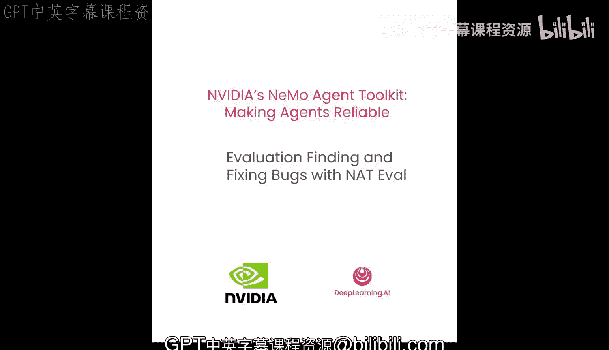
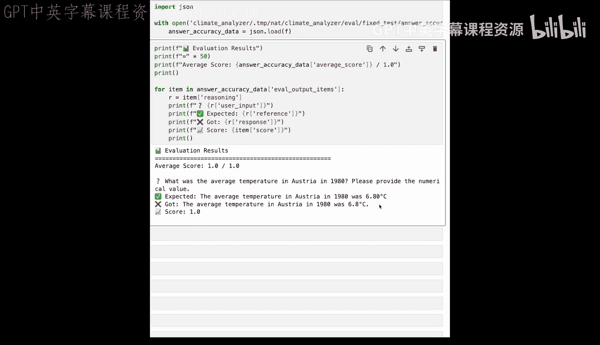

# 吴恩达《NVIDIA NeMo 智能体工具包：打造可靠的智能体｜NVIDIA NeMo Agent Toolkit》中英字幕 - P7：7.evaluation-finding-and-fixing-bugs-with-nat-eval.zh_en - GPT中英字幕课程资源 - BV1pYBxBgEik

It's time to dive into NAT's evaluation framework to measure agent and workflow performance。

 You'll create data sets with ground truth， uncover bugs and use insights to make data driven improvements with confidence。

 Let's get to it。 In this lesson， we're going to learn about agent evaluation。

 Evaluation is super important for agents。 Evaluation can often be overlooked in a complex agent environment。

 N A T makes it straightforward to run evaluations against your workflow。

So in this lesson， we will create evaluation data sets of question and answer pairs。

 and we'll use that data set The test if our agent is actually giving us a correct answer。

And along the way， we will discover a bug in a production workflow and we'll fix it。

Why would you evaluate your agent。Oftentimes， we'll ship something into production， and it'll work。

 but something can drift， and we might not catch it。

 Maybe we update a model or maybe we change a prompt。 Evaluations help keep our agents honest。

N A T has several evaluation frameworks built in。 Of course。

 it's pluggable so you can add your own evaluation framework if you have one that you like。

But it's just a simple matter of adding evaluation properties to your configuration Yaml and running N AT Eval。

So what is NAT's evaluation flow？You give it a data set with a list of inputs and expected outputs。

 and NAATT will run those evals against your agent system。

 and it will score how many were correct and how many were wrong。Of course。

 you might have your own evaluation framework that can't be expressed using input and output pairs。

 NAATT's Eval system is pluggable， so you can just create a wrapper around your own evaluation framework。

What does this look like in config？So we have a new top level property for our configuration file called Eval。

And this e will take a few other properties。The general property is where we tell it where to dump its output and where to load the data sets from。

And you can configure one or more evaluators。In our case， we have one evaluator。

 and we've named it answer accuracy。 and it is a Ras evaluator。

 which is an evaluation framework you might be familiar with， and it's built into N A T。

 Ras has many different metrics that you can pick from。 In this case， we've picked answer accuracy。

 You can see the other metrics in our documentation。 And we've handed it in L O M。

 You can see our question and answer pair here。 The average temperature in Austria。

And we pass that into the simple eval Json dataset set。 And then we call N T eval。

 And this is the power of config driven development。 Instead of changing code。

 rewriting a lot of python， hoping we don't break it。 We can do experiments in our config。

 We can change functions。 We can swap all L O Ms。 If we have our eval set up correctly。

 We can make these changes in runner evals and be confident that our changes are correct。 Of course。

 you can add more than one evaluation to your config as many as you like。

 And you can use them in tandem with other features that we've already looked at。

 such as observability。You can run your evaluations in parallel while or hooked up to Phoenix。

 and you can watch the tray data come in as the evals run。Without observability。

We don't know how our agent arrived at a correct answer without evaluations。

 We don't know if our agent arrived at a correct answer with NAT T's evaluation framework。

 we can score multiple evaluation， question and answer pairs and be confident that our agent is ready to go。

 In this notebook， we are going to look at evaluation。

 How do we find and fixed bugs with Nemo agent toolkit。

 Let's go ahead and install the climate analyzer package that we've been working with and run some evals against it。

Now， that that's installed， let's look at our evaluation data set。

 So we have a very small evaluation data set here。 It contains one question and one answer。

 What was the average temperature in Austria in 1980 and the average temperature in Austria in 1980 was 6。

8 degrees Celsius。Let's find what our climate data says about Austria in 1980。

 We get some values back here。Let's calculate the average to confirm our ground truth。

And we see from our climate data that the average temperature for Austria in 1980 was 6。

8 degrees Celsius。How do we run evaluations in N A T。

 Let's look at a pre written evaluation config file to see This file should be familiar to you。

 We have our LLMs that we wrote in previous notebooks with our climate L O M and our calculator L L M。

We have the functions that we've been working with， climate functions and calculator functions。

 and we have our workflow。But now we have added an evaluation config section。

 Evalal is a top level section， and within eval， we can add several evaluation sets。 First。

 we add a general property here that tells us where to store our evaluation data。

 whether to clean up that evaluation data after a run and where data sets come from。

And now we can list our evaluators。 There are many different types of es you can run。

 Maybe you have some you've written yourself。 Maybe you're using standard evaluations such as Ras。

 And that's what we're going to use here。 So we'll name this answer accuracy。 And the type is Ragus。

 which is built into Nemo agent toolkit。 Ros needs a metric。

 In are several different metrics such as groundedness。 In our case。

 we're going to pick one called answer accuracy。 And you can find these metrics in our documentation。

 How does it evaluate this metric。 It needs an L OM。

 And so we will go ahead and pass at the preconfigured climate L O M。

 And that's going to check our accuracy。 We've seen N A run in N A Ser。

 And now we're going to see a new command in A T Eval。

 This takes the config file that we looked at earlier。

 And it runs the evaluations in there against the workflow defined。

The evaluator is going to write files out to the location that we put in the config。

 And so we see here that is written in answer accuracy output Json file。

 Let's see what's inside that file。So we can see the evaluation results。

 The average score was0 over1， which means that we evaluated very poorly。

So what was the average temperature in Austria in 1980。 This was the question we expected to get 6。

8 degrees Celsius， but instead we got 9。574 degrees Celsius。 Therefore。

 we missed our only evaluation question。 So we got 0 out of one， correct。Now。

 let's look at the reasoning steps that it took in order to get to that wrong answer。

So this is a lot of code。 The evaluator puts out quite large and verbose JON files that will help you track down what went right or wrong in evaluation。

 So this code just pares that JON file so that we can see the results a little bit more cleanly。

So we can see the reasoning steps here of the evaluation。

It tried to pull the average temperature in 1980， but it didn't even pass the year to our calculate statistics function。

And because of that， it got an average for the entire climate period 1950 to 2025。 However。

 it gives us a very confident answer back。And so if we didn't run evals， we probably would miss this。

 It's not obviously wrong。 And the agent is confident in its answer。

 But since we have grounded evals that we can now run against our agent using N A T。

 we can see that it's incorrect。So let's run this with a config that more directly tells the agent to call with the correct year。

Now that that's run， let's load these evaluation results and see that they are correct。

Now we can see from our evaluation results for the one question answer pair we had that we have one correct answer out of one question。

And we correctly got 6。8 degrees Celsius。So in this notebook。

 we've seen how to build an evaluation dataset set。

 how to run it against our agent workflow using Nemo agent toolkit。

 We've looked at a real world use case where the agent confidently gave the wrong answer and we were able to discover that through running evals。

 then we were able to fix that bug and push our agent right back out into production。

