# 吴恩达《NVIDIA NeMo 智能体工具包：打造可靠的智能体｜NVIDIA NeMo Agent Toolkit》中英字幕 - P8：8.production-deployment-with-nat-ui.zh_en - GPT中英字幕课程资源 - BV1pYBxBgEik

It's finally time to deploy your climate analyzer workflow with a professional web interface。

 You'll learn how to serve NATT workflows as HDP and Web socket APIs。

 La the Nemo agent toolkit Ui and interact with agents in a Po production ready setup。😊。

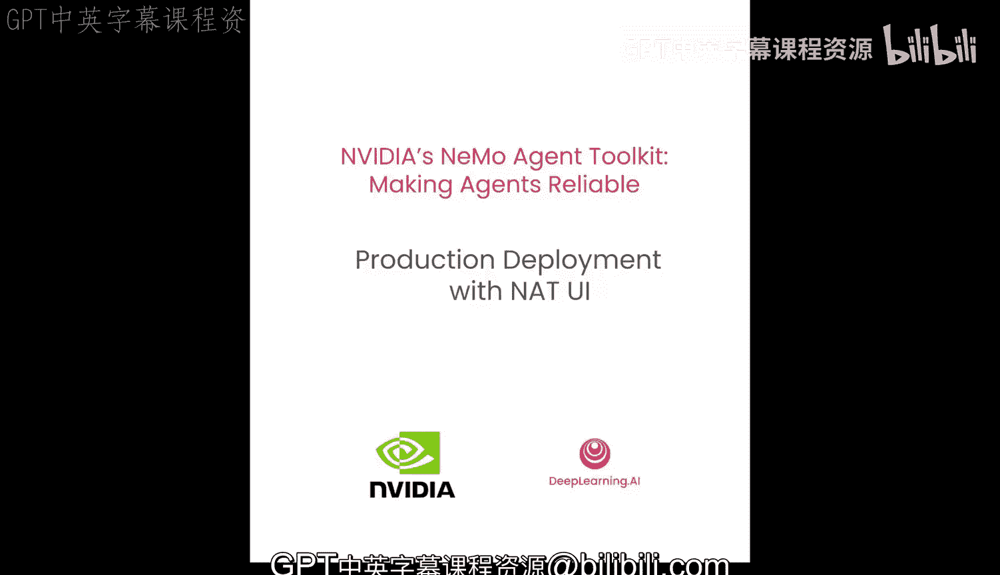

Let's have some fun。Now that we've built our climate agent and we've composed it together with our calculator agent。

 we are ready to serve it in a production ready workflow In this lesson。

 we're going to deploy our workflow as an API， and we're going to connect the Nemo agent toolkit U I to that API。

 and we're going to be able to chat with it in a human interface。 We've already seen this command。

 N A T Ser。 This hosts a fast API server and is ready to go with Web socket support。

 open API docs and health checks。😊。

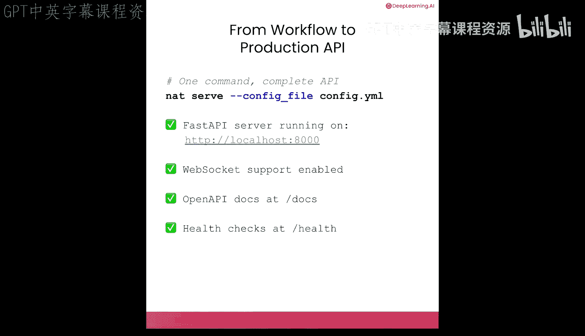

An API server is great。 Now， we can run a Ui on top of that and chat with it using natural language。

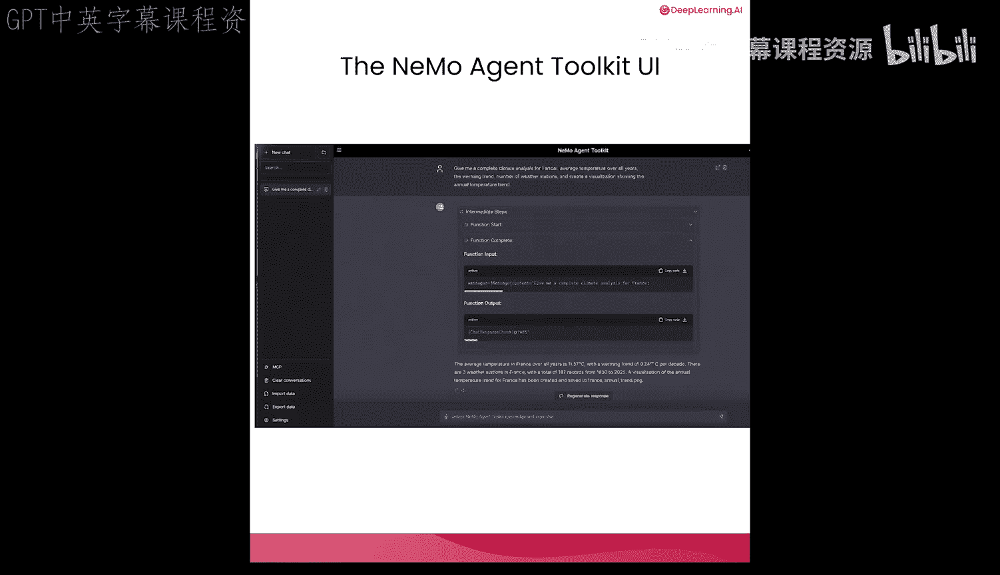

Okay， we built a powerful agent， we've wired in observability， we've run any valves against it。

 Now let's put a UI on top of it so we can actually begin to use it in the real world。

In this notebook， we're going to serve our agent as an API。

 We're going to connect the UI that we saw on the first notebook。

 and we're going to see what an API first architecture looks like with agents。First。

 let's install our climate analyzer just to make sure it's ready to go。

As we've seen in previous lessons normally to serve an API of your agent workflow。

 which's just N A serve。 But since we're going to be running it in the background in a Jupyter notebook。

 there's a lot of extra code that goes around it to run it as a sub process。

 Don't get too bogged down with that。 Just focus on the fact that we're running N A T Ser against our config file。

 like we've seen in the past。 And the API server is running。Next。

 we're going to pull down the Nemo agent toolkit。 U I。 The U I is a separate open source repo。

 And that's because you might have your own Ui， and we didn't want to cross dependencies。

 But you can pull it down to your system and run it， which is what we're going to do right now。

 And that repository is pulled and ready to go。So now that we've pulled the UI and we've got the dependencies installed。

 let's start it up。So on the command line， you would run NP PM run dev as this is just a standard NP PM project。

 Of course， we have to run it as a sub process in this Jupiter notebook。So we've got it running。

 and it is launched。 And here we have some helpper script that will give us the proper URL to your U I。

 It is running locally on port 3000。 But depending on where your Jupiter notebook is hosted。

 the URL might be different。 And so this gives us that URL。 All right。

 And let's open up this U I and check it out。

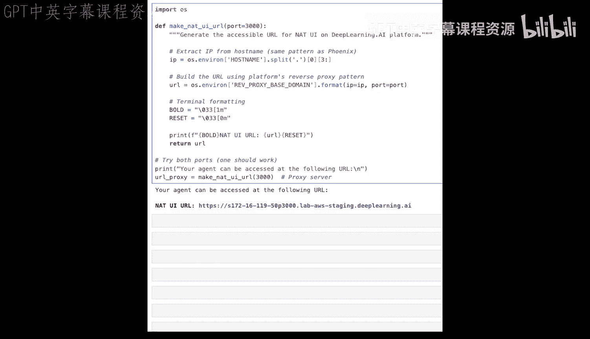

And now we're ready to chat with our climate agent。Let's start with one of our suggested questions。

 what was Mexico's average temperature 1990 to 2000 versus global？

You might remember that we looked at this U I in the first notebook。

 and it was just coming up with whatever the L L M happened to have in its training。 But now。

 our climate agent has tools that can pull from real world data。 and it has access to a calculator。

 so we can do calculations on that data。 So let's see how it does with this question。

 So for our question， we can see the agent successfully ran。

 and gave us a correct answer and we can also look at the intermediate steps。 For instance。

 we can see the chain of thought as the agent called various tools that calculate statistics。

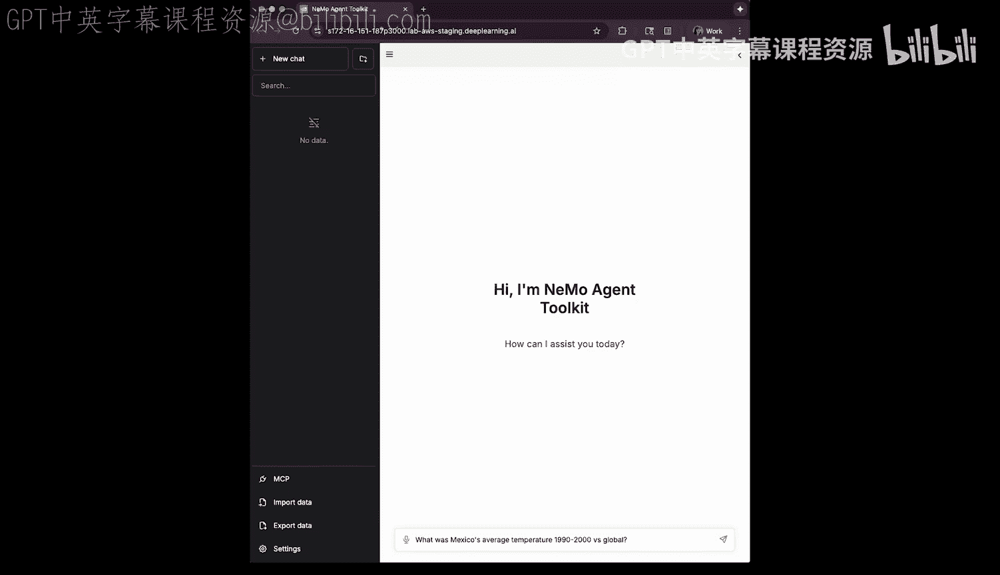

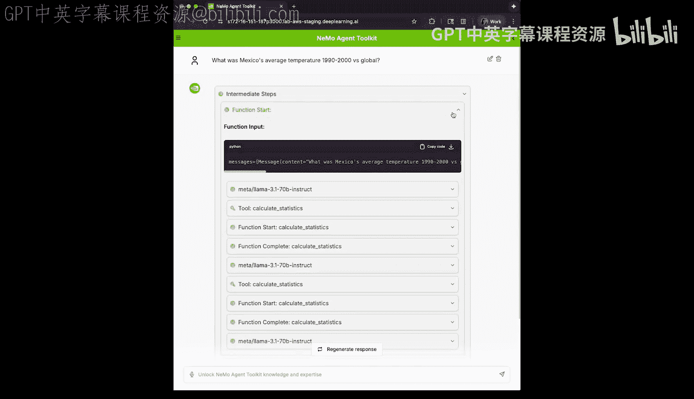

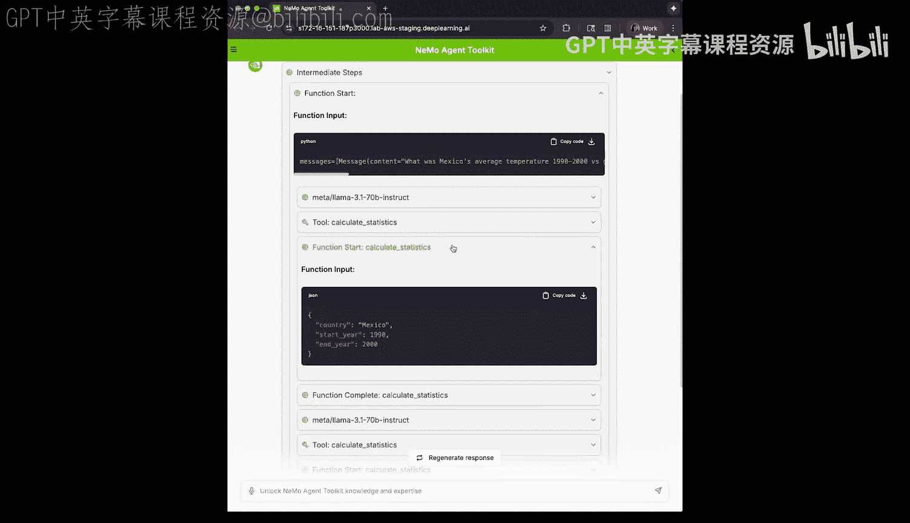

And the data that it passed into that function and the data that it got from that function。

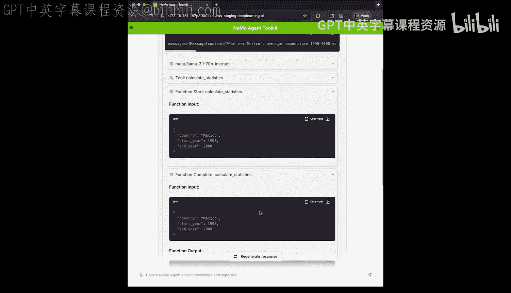

So this is a way for us to evaluate our agents in a live chat environment。

 And we can ask a follow up question。 What was the average temperature specifically in 2000 in Mexico。

 so we can chat over our data in a more realistic human setting。

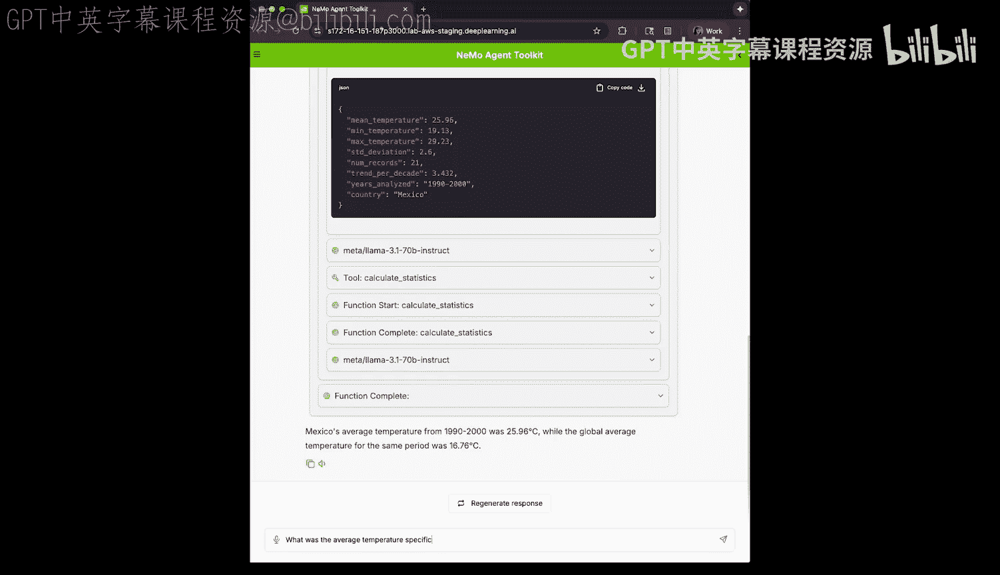

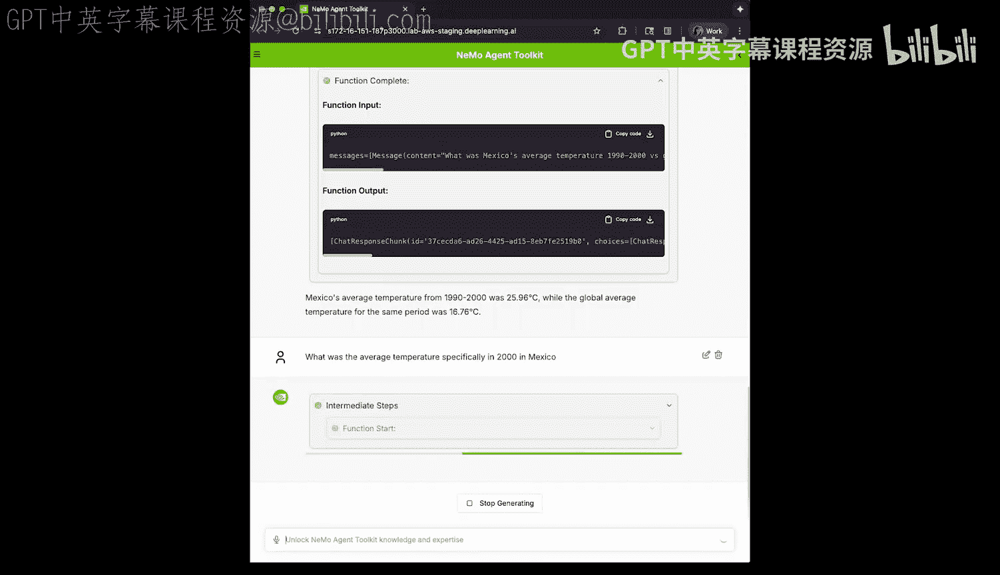

Let's ask another question。This question is a little bit more complex。

 it asks for a complete climate analysis for France with trends in visualization。

So we can see it did this complex climate analysis for France。

 and it generated a visualization that it dropped into a repository。

The U I is complex and has a lot of additional features。 For instance。

 we can stream results in real time and watch the agent think instead of just getting the results back all in one go。

 And you can talk to the U I using H DP streaming or web sockets or standard H D P。

And this U I is just one example。 Any front end can connect to your API Now that we've taken a look at the U I and ran it against our agent。

 let's clean everything up。 So we're ready to go。And we're done。So we have built a climate analyzer。

 It connects to real world data sources。 It combines multiple agents， one written in Lagra。

 another written in plain Python functions。 We served it with a production API。

 We ran evaluations against it， plugged it into observability。

 and we put a Ui in front of that API I proved that we can chat with our agent。

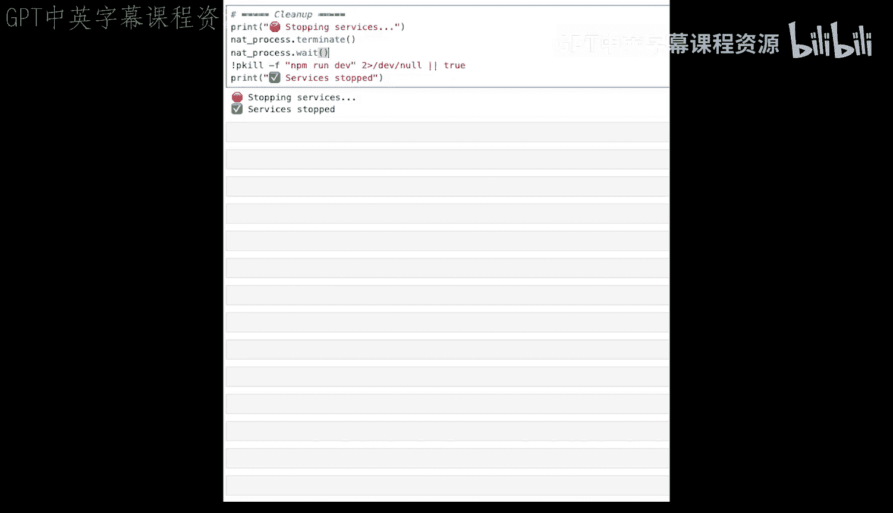