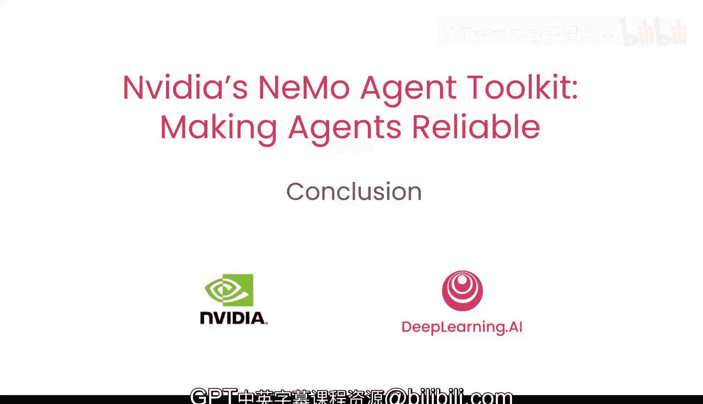

# 吴恩达《NVIDIA NeMo 智能体工具包：打造可靠的智能体｜NVIDIA NeMo Agent Toolkit》中英字幕 - P9：9.conclusion.zh_en - GPT中英字幕课程资源 - BV1pYBxBgEik

Congratulations， you've completed the course and now have a solid foundation for creating， observing。

 evaluating and deploying intelligent agent workflows using N A。😊。

You turn Python functions into reusable tools， build agents that reason about which tools to use。

 analyze real world data and made agent behavior visible with tracing and evaluations。

 You orchestrated multiple agents， evaluated agentic performance and deployed workflows as production ready applications with As and a polished interface With these skills。

 you can systematically debug measure and improve agents。

 scale workflows and combine tools and agents to solve new problems。

 Keep experimenting and exploring。 I'm excited to see what you build。

