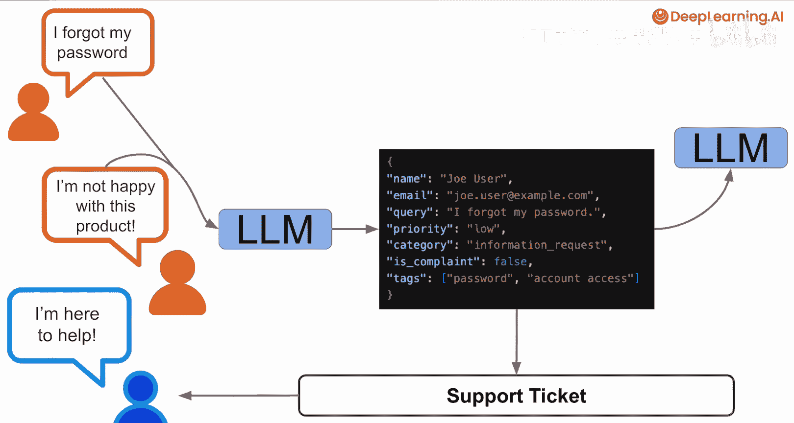
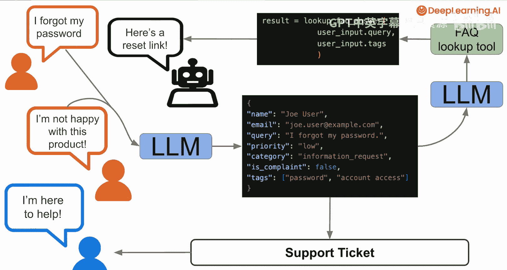
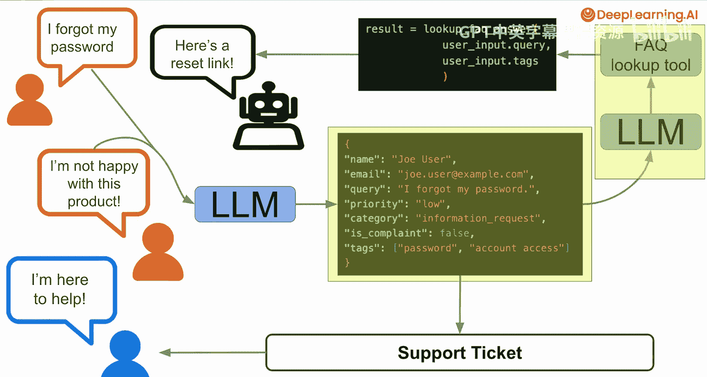

# 吴恩达《Pydantic 用于LLM工作流｜Pydantic for LLM Workflows》中英字幕 - P1：0.welcome-to-pydantic-for-llm-workflows.zh_en - GPT中英字幕课程资源 - BV1mptxz6E7n

Welcome to Pyedantic for LLM workflows In this course。

 you'll learn how you can use the Pyedantic Python package to get an LLM to give you structured output。

 And by that， I mean output that's formatted exactly the way you want it to be。So， of course。

 in general， LLMs produce freeform text and that can be great if you're doing something like summarizing an article or maybe coming up with an idea for a new recipe。

 but if you're building an LLM into a larger software system where you have multiple components and you want to be able to pass the data you're getting from an LLM to the next component in the system in a predictable way。

 that's when pedantic and structured output can be a big help。 So for example。

 imagine you're building a customer support application where the user can submit a request。

 maybe something like， hey， I forgot my password or a complaint like I'm not happy with the product I bought you could pass that customer query to an LLM and have it generate a structured response that might look like this where you have the user's information like their name and email。

 the text of their request， a priority and a category and then you might record some other things like whether or not this request is a complaint and maybe some tags or keywords about the request。

😊。

Just。Then your system could take this structured response and decide what to do next。

 Like if it's an urgent issue， you might create a support ticket and route it to a human support agent who can follow up and help。

 or for this simple request of I forgot my password。

 you might pass the structured response to another LLM agent that can call a tool like a function that can look up an FAQ response that could help the user。

 So maybe in this case， that would be an FAQ response with a password reset link and instructions。

 So whether it's this step of having an LLM create a structured response that becomes a support ticket with this exact set of fields and content or having an LLM provide the parameters you need to call a tool and look up an FAQ response。

 you have very precise expectations for what each of those LLM response needs to look like And what kind of data it needs to contain。

 So in this course， you'll learn different methods for using pedantic to ensure that an LLM is giving you exactly the data that you need。

Or in other words， you'll learn to validate the data that you're getting in a response from an LLM and along the way。

 you'll also be learning data validation skills that can help you with handling a wide variety of data in really any kind of software system and that might include things like human input to the system or external APIs and data sources or really any data that you're wanting to pass from one component to the next in your system。

 It turns out that Pyantic has actually been around since well before LLMs were a thing and it's one of the most popular data validation frameworks out there。

 In fact， Pyantic sees over 300 million downloads per month。

 making it not just one of the most popular data validation frameworks。

 but really one of the most popular Python packages period。

 and that's because data validation is at the core of really any software application。😊。

And so in the lessons that follow， you'll be learning how you can use pantic to get structured output from an LLM。

 and you'll also be building data validation skills that you can use in any software application where you want to pass data from one component to the next。

 so let's go on to the next video to get started。