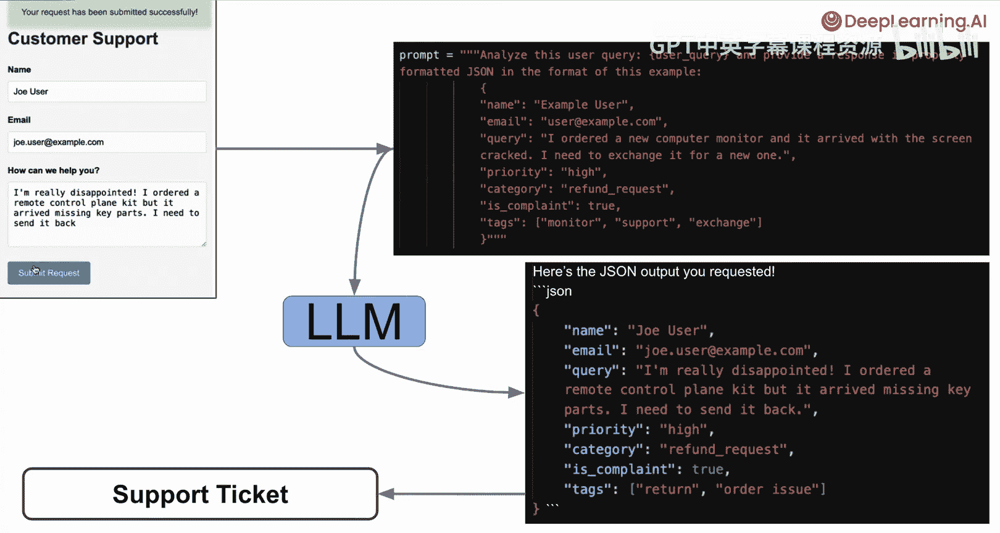
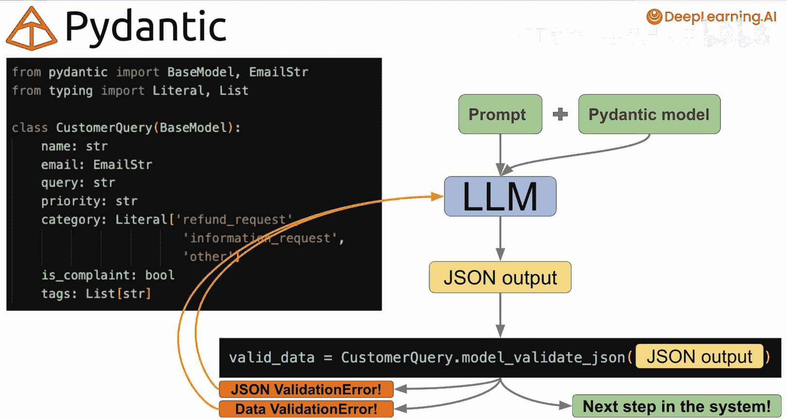
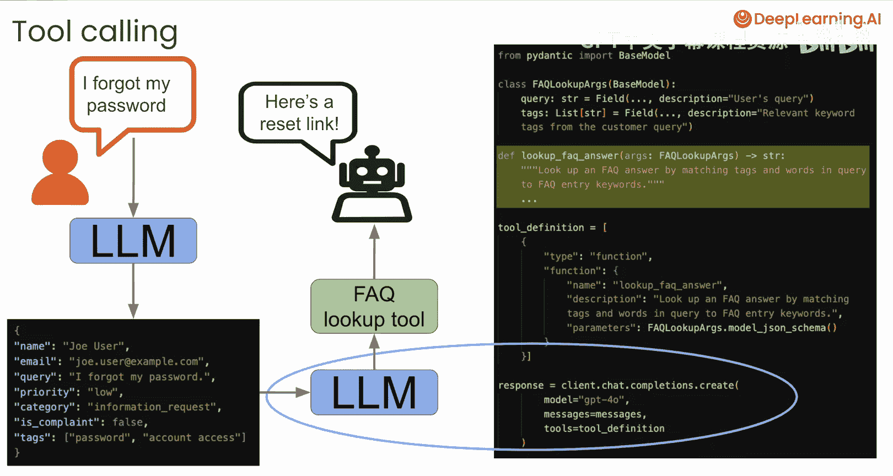
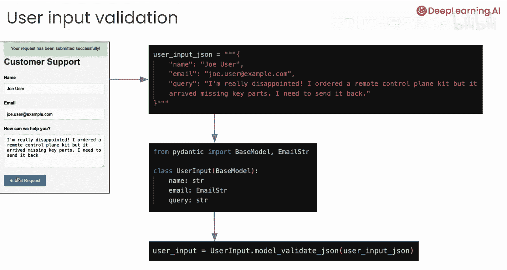

# 吴恩达《Pydantic 用于LLM工作流｜Pydantic for LLM Workflows》中英字幕 - P2：1.introduction-to-pydantic-for-llm-workflows.zh_en - GPT中英字幕课程资源 - BV1mptxz6E7n

In this video， I want to give you some context for where we're going with this course。 and in short。

 where we're going is getting structured output from an LLM using pyedantic。

 So the simplest way you might think about getting structured output from an LLM is well。

 just to ask for it。 And what I mean by that is that you can indicate in the prompt that you're passing to the LLM that you want the response to be formatted in a particular way。

So one really common approach is to ask for a response in what's called JavaScript object notation or JSON format。

And if you're not already familiar with JSON format， no need to worry。

 you'll learn everything you need to know in this course about working with LOM responses in JSON format。

So in this course， you're going to be building up a customer support system that we were looking at in the last video and so to get a sense of how this is going to work。

 you can imagine you have a system where the user can fill out a form indicating their name an email and a request。

 So in this case， you have Joe user here who ordered a remote control plane kit but found that it arrived missing some parts and now wants to return it。

You can then construct a prompt that looks like this where you're asking the LLM to analyze the user query and then here in curly braces。

 you're passing the user input into the prompt and then you ask for a response in JSson format that follows this example where you have all the fields you want to have filled out like name。

 email and query from the user input and then a priority category。

 whether or not it's a complaint and some tags And so this is just a hypothetical set of things that you might be asking for。

 You could be asking for whatever JSson structure you want here。

 and then you pass that prompt to an LLM and what you would be hoping for in this case is a response that looks like this where the name。

 email and query fields contain the user input and then you have your priority category is complaint and tags all filled out based on that user input。

 So JSson structure is similar to a Python dictionary where you open and close with these curly braces and then inside you have this key value pair format。

So in the prompt in this case， you've just said， here's the input from the user and I want you to provide a response in exactly this format。

 including the name， email， query and so on。And then with this structured output。

 you can automatically create a support ticket in your system or decide whether to call a tool or what to do next。

It turns out that when you ask an LLM to give you back a structured response like this。

 in many cases， it can come pretty close， but it's not always perfect。 For example。

 it might add additional text and the response like here's the JSON output you requested。

 or it might add some other formatting like this tripleback tick markdown formatting is really common in LLM responses when you're asking for JSO。

 and beyond that， it might not give you all the fields you expect。

 or it could end up formatting the fields in a way that's not usable。

 like maybe here getting the email format wrong。And it's this unpredictability of the response format that makes it hard to rely on LLMs to directly provide you with structured output。

 And this is where pedantic comes in with pedantic。

 you define data models that specify the structure and types of data you expect。 So in Python。

 this is what it would look like to define a pedantic data model for the request we were just looking at where you have fields for name。

 email， query and all the rest。

What you're doing with a pedantic model like this is defining both the field names and the data types for each field in your model。

 So here， name， query and priority are defined to be strings。

 The email field is defined as a special pedantic data type of email string that's looking for a specific email formatting。

 and then the category field is defined as a literal type that can only take on one of a few specific values。

 In this case， refund request， information request or other。

And then is complaint is a boolean that'll just be true or false。

 and tags is defined as a list of strings。You can then use this pyedantic data model to validate the response you receive from an LLM to ensure that it matches your expectations。

In this course， you'll learn about two ways to get structured output from an LLM using pydantic data models。

 The first and perhaps simplest way is to just prompt the LLM to give you structured output。

 giving an example in the prompt of what kind of structure you want and then take that LLM response。

 which you're hoping is in JSON format and attempts to create an instance of your data model。

 in this case， your customer query data model that you've defined up here。

Using that L L M response is input。 So that's what this line of code is doing right here with this model validate Json method。

 If the L L M response contains extra unexpected text or formatting。

 or if the Json itself is not properly formatted， then this step will fail with a validation error。

 letting you know that there is a problem with the Json input。If on the other hand。

 the JSON format is valid， but the data contained in the JSON doesn't match your model。

 then this step will fail with a validation error letting you know that there's a mismatch between your model expectations and the JSON that you put in。

So if this model validate JSON step is successful， and it's really kind of two steps happening behind the scenes first parsing the JSON and then using that to create an instance of your pyedantic data model。

 if all that runs without error， then you're working with validated data and you're ready to pass that data on to the next component in your system。

But if the validation of your LLM response fails， then what you can do is simply catch that validation error and pass it back to the LLM in a follow up request。

 asking it to correct the problem that caused the error。Often this works pretty well。

 And you can even run through multiple error catchching and correction cycles if you don't get a good result straight away。

 But it turns out that there's an even more reliable approach you can now use with many of the current LLM APIs and agent frameworks out there。

 And that's to pass your pedantic data model in as part of the initial request to the LLM。 That way。

 you're expressing exactly what you want in your API call。

 and you can more reliably get the data that you need in a format that you expect。 In some cases。

 what's happening behind the scenes when you're passing your pyedantic model in the API call is that this prompting and retry and validation logic is just being handled automatically for you。

 And in other cases， the LM provider is using an approach known as constrained generation to make sure you get valid Json every time。

 And you'll get a chance to play with frameworks using both of these approaches in the lessons。

 Another important use case for pedantic and LM workflows is tool calling。 For example。

 with that user query we looked at before that says， I forgot my password。😊。

You could pass that input to an LLM and have it provide a structured JSON response that looks like this。

And then you might want to pass that JSON to another LLM and give it the option to call a tool based on the user's query。

So in this case you might want the LLM to call an FAQ lookup tool。

 which you can think of as just another Python function that you've defined in your code that can return the appropriate response like here may a password reset link and some instructions for the user and so the way pyedantic comes into play for tool calling like this is that you'll first define a pyedantic data model that specifies the parameters for that function call so here you're defining a pyedantic model called FAQ lookupards and this model has two fields。

 one for the user query and the other for the tags associated with that user query。

 and this is just hypothetical the types of things you might be passing in if you're trying to search for a particular frequently asked question response。

And then you have your lookup FAQ answer function that's defined to take those FAQ lookup args as input。

 so this is just a regular old Python function that looks up an FAQ answer by matching tags and keywords in a query to FAQ entry keywords and I don't have the body of the function filled out here。

 but you'll see how all this works when we get into the code later in the lessons。

 and then you can define a tool you can use in your LLM API call and the way that looks at least for an API call to open AI in this case is that you specify a type of function and then provide the name of the function。

 the description of what it does， and then the input parameters it takes and this is where your pyantic data model comes in。

By passing in this model JSON schema from your pyedantic model。

 you're telling the LLM exactly what type of input parameters your function tool takes。

 and with that you can make an API call that looks like this where you're passing your tool definition in the tools' parameter。

 and that tells the LLM that it has the option to use that tool if the message is in the prompt indicate that would be a good next step。

If the LLM decides to call the tool， then it will return the parameters needed to call that function。

 you can then use your FAQ lookup As pedantic model to validate that the parameters provided by the LLM are indeed what the function expects。

And then you can call that function with those parameters and pass the result on to the next step in your system or back to the LLM to complete the rest of the response。

 So in this course， you'll learn these different methods for getting structured output from an LLM in the form of a Json response or the parameters to call a function and you'll do this using pyedantic data models But before diving into validating LLM responses to get started。

 we're going to take a look at the basics of pyedantic models themselves and to do that。

 we're going to zoom in first on the user input portion of this customer support system you're going to build。

 So in the next lesson， you're going to start by looking at how you can take user input that's coming to you in the form of a Python dictionary or as a Json string and what you'll do is define a pyedantic data model to validate that your user input is in the format you expect and that it contains the data you expect。

 So to start with， you'll just have a name and query fields defined as strings and an email field defined。

Does an email string。And then you'll use that Python dictionary or JSON string that contains the user input to create an instance of your user input data model。

 and with this， you'll get a sense of how pyedantic data models work and how you can use them to validate in this case。

 user input data， as I said before， where we're ultimately going with this course is using pyedantic to get validated structured output from an LLM。

 but before we get to that， I'll see you in the next lesson to look at the basics of pyedantic data models。

