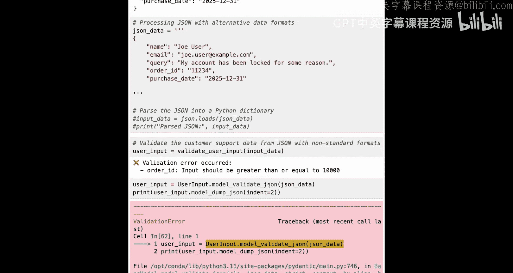

# 吴恩达《Pydantic 用于LLM工作流｜Pydantic for LLM Workflows》中英字幕 - P3：2.pydantic-model-basics.zh_en - GPT中英字幕课程资源 - BV1mptxz6E7n

In this lesson， you'll be taking a look at the basics of pyantic data models。

 which is to say how you can create them and how they work。

You'll be doing this in the context of validating user input。

 so we're going to run with that same scenario we've been talking about already。

 the customer support system where the first thing that happens is a user fills out a form that includes their name。

 their email and the text of their request and then the first step in your system is to validate that the user input matches your expectations。

 for example， that the email addresses formatted correctly。 So let's take a look at how that works。

All right， So to get started， you're going to do some imports from pyedantic your importing base model。

 which is going to be your starting point for really any pyedantic data model。

 B model has all kinds of built in functionality for data validation。

 And then you can build on top of it to customize your data models。

 And then you'll see how we're going to use validation error to catch errors。

And email string is a data type in your models。And then you're importing JsonN to do some Json parsing later on。

Next， you're going to define a pedantic data model。 In this case， a user input model。

 So this is a class called user input that inherits from base model。 and then you have three fields。

 name， email and query， where name and query are set to be strings and email is this email string type from pedantic。

And with that， you can create an instance of your user input model like this。

 where you say user input equals your class user input where name is set to Joe user。

 E is set to Joeuser@exle com and query is I forgot my password。 And then you can print that out。

So here you have something that doesn't look very exciting。

 But the cool thing that's happened behind the scenes here when you create an instance of your pyedantic data model like this is that pyedantic has validated that the data you put in matches the model expectations。

 In this case that the name is a string。 email matches this email string format and query is also a string。

 So here you're working with valid data。😊，Now， you can try creating another instance of your model where you have email set to not an email。

 So invalid data in this case， What happens when you run that。You get a validation error。

 So if you scroll all the way down to the bottom of this mess。

 you see validation error 1 validation error for user input。

 email value is not a valid email address。 An email address must have an at sign。Okay。

 so apparently Pyedantic is looking for an at sign here in this email string format。

 so you can try putting in an at sign and see what happens。Let's run that。

You get another validation error。 Okay， value for email is still not a valid email address。

 The part after the a sign is not valid， It should have a period。 Okay。

 so here's another clue as to what's going on inside the email string format。

 So let's add a period somewhere here after the ad sign。 and run that。 Okay。

 yet another validation error。And now it says an email address cannot end with a period。 O。

 but we're making progress here。 Let's try putting something after the period， and running that。Okay。

 that worked。 So this little experiment gives you a sense of in this case。

 what pedantic is doing behind the scenes to check that your email field matches the expectations of that email string format。

 So now you can see that it's looking for an at sign somewhere in there。

 It's looking for a period somewhere after the at sign and then something that comes after the period。

 So this is not saying that now you have a valid email address that's actually going to go somewhere。

 It's just saying， okay， this matches the basic expectations for an email string format。

 And so email string is a built in data type of pedantic。

 but you can define your own string patterns or other specific data types for whatever specific field you want in your model。

 And so rather than running headfirst into validation errors like we were just doing with email string。

 The next thing you're going to do is create a function。

Here you have a function called validate user input where you're going to pass in input data。

 In this case， this is going to be a Python dictionary。

 And then you're going to try parsing that input data into your user input model。

 And so this is just unpacking that Python dictionary into your user input model。 If that works。

 you'll say valid user input created and dump out the JSson representation of the contents of your model。

 And if there's problem， you'll say validation error occurred and print out the contents of the error。

 And so this is more like what you might be doing inside of a software application where you're trying to create an instance of your model。

 And if there's an issue with that， you want to capture that error。 and decide what to do next。

 So let's define that。And then you can try using that function to create an instance of your data model。

 So here you have input data defined as a Python dictionary。

 This is just the same input that we started with up top。

 and then you're using the validate user input model to print out the contents of the model to validate the input data that you've got here。

When you run that， says valid user input created and prints out the contents of the model。Great。

 so then you can start experimenting with some other versions of user input。In this case。

 you have input data that contains name and email， but not a query field。

 So what happens when you run that。Well， you get a validation error that's occurred。

 Queery field is required。 So it turns out that when you define a pyedantic data model。

 as you did above with these three fields， each of those fields are going to be required in your model。

 And it turns out you can include optional fields as well。

 So that's what we're going to do next here。So here you're going to do a few more imports from pyedantic。

 you're importing field from typing your importing optional。 and then from date time。

 you're importing date。 And these are what you're going to use to customize your model a bit further。

 Now you're going to define a new version of user input that has the same three fields at the top here。

 But now a new field called order I that's defined to be an optional field。

 it's going to be an integer。 And then with this field object。

 you can add some more customization and definition to in this case， the order I field。

 So you're saying the default value is going to be none。

 This is a description of what this field is all about。

 It's going to be a  five digit order number cannot start with 0。

 And then these are a couple of rules that you're setting in order to put constraints around what the input can be。

 So it's saying this has to be an integer greater than 10000 less than or equal to 99，99，9。

 So that enforces this rule of it being a five digit order number that cannot start with 0。

 And then you have purchased date， which is another optional field and it's going to be this date object from date time with a default of none。

 So let's define that。And then you can try out this new user input model with some new input。

 So here you have the exact same input that you started with up top and you're running through validate user input data again with that。

 Now with your new model of user input。And you get no problem at all。

 The optional fields were omitted in the input data。

 And so you have valid user input created with name。

 email and query populated in order I D and purchase date as null。

 So one thing that might look confusing here is that these are printed out as null here。

 When up here， you've defined the default to be none。

 It turns out that this is just the Json representation of the contents of your model。

 So if you go back up here and have a look at validate user input。

 So you see that what you're doing here is using this built in model dumped Json method of your pyedantic data model。

 And that prints out the Json representation of your model。

 If you go back down here and print out the actual contents of the model itself。 So。

Printing that out， you see that， in fact， order I is none and purchase date is none。

 So this is the Python representation， and this is the Json representation of the same data in the model。

And so now you can play around with this new user input model a bit。

Let's try user input data that includes all five fields。 And in this case。

 valid instances of order I D and purchase date and run that。Okay， great。

 So now you have valid user input that contains all five fields。

 And it's also interesting to take a look at what happens when you have some additional fields。

 So now you have input data that contains all five fields you expect and a couple of fields you don't expect system message and iteration。

 What happens when you run that。Well， no problem。 Valid user input created and pedantic just ignored these extra fields。

 So this is a feature of pyedantic。 and it's actually a really common way in which people use pyedantic。

 You might have data in your system that's coming to you in the form of a Python dictionary or Json data that has a zillion different fields。

 some of which you care about in some of which you don't。

 and you can define a pyedantic data model that grabs the fields you care about and validates those and just ignores the fields that you don't care about。

 So in this case， you have valid user input where you just ignored system message in iteration。

 One thing that you might have noticed here is that purchase date is getting printed out as a string representation of the date here again。

 purchase date is a string representation of the date。

 And this looks different from the date time object that you're putting in。 So what's going on there。

 Well， it turns out this is just another example of the Json representation versus the Python representation。

 So if in this case， you go ahead and print out what user input model。Contains。

Then you have purchase date is a datetime object just like you put in。

 And so then it can be interesting to look at what happens when you put in。

Input where the purchase date is that string representation instead。Turns out no problem。

 You can put in a date that looks like this or a date time object。

 And what's happening behind the scenes here is that pedantic is。

Converting that string into a daytime object。 And this is an example of what's called data type coercion。

 So pedantic， in this case， is handling multiple different formats for date。

 And this is a feature of pedantic that allows you to be a little bit more flexible with what the inputs can look like。

 So pyedantic has a number of different data types where there's automatic coercion of， in this case。

 dates in different formats。 And you can try this for other data types as well。 For example。

If you put in your order， I D as a string and run that。You see also no problem at all。

 Pyedantic can handle a string representation of an integer and automatically convert that for you。

 So data type coercion is something that happens automatically for certain data types in certain formats。

 And it's something that you can customize yourself， if you want to have a specific set of formats。

 be acceptable for a field in your model with pyedantic。

 you also have the option of turning off data type coercion。

 If you want to be very strict about the format that you're accepting in a particular field。

 So in this case， you've seen that you can put in an integer as a string。

 But what about putting in a string as an integer。 So in the name field here。

 this is defined to be a string field。 And if you try with 9，9，9，9，9。

And you'll find that you get a validation error in that's name。 The input should be a valid string。

 So in this case， integers can be coerced from strings。

 but strings will not be coerced from integers。 And next。

 you can take a step in the direction of where we're going with validating LLM output and start with Json data。

 So in this case， you're defining a Json string that contains the fields for your model。

 And then you can parse that into a Python dictionary and print out what you get。So in this case。

 you've parsed the JSON into a Python dictionary， and then you can go ahead and run your validate user input function on that Python dictionary and see that you have valid user input。

 So when we move on to looking at LLM responses， you'll be getting data as a string from the LLM and you'll be using that to populate your pythantic data model。

And so you can play around with different Json input data。 for example， in this case。

 data that contains order I that starts with 0。 So if you recall the rules for order ideas is that it must not start with 0。

 you can go ahead and parse that into a Python dictionary and see that there's no problem with that。

 of course， this is valid Json data。 And so there's no problem loading it into a Python dictionary。

 But then when you try to populate an instance of your user input model。

 you run into a validation error that order I should be greater than or equal to 10000。

 So it's sort of a two step process when you're starting with a string representation of Json data first you parse that Json。

 and then you populate an instance of your model。 But the way you're going to do that in practice。

Is to use this model validate Json built in method from Pyantic。

 So here you're taking your user input model and applying the model validate Json method directly on that Json data。

 And， of course， when you run that。You get a validation error because you have a problem with the order I D field。

 But what's happening behind the scenes here is you're doing this two step process of first parsing the Json and then populating your data model with the contents of the Json。

 So you can go up and fix the issue。 In this case， I you just turn this to a one。

Reefine that Json string and run this last cell again to validate the data that's in that Json string。

 You can also play around with what happens in this case if the Json itself is not valid。 So。

 for example， if you're missing one of these brackets。

 and I'm just going to comment out these other lines for the moment。

And run that to define new JSson data that has a problem。

 Then when you run model validate Json down here， you get a different type of validation error。

 In this case， a Json and a file problem， and it tries to describe what happened with the problem loading the JsonN。

 So you'll get different types of validation errors。

 depending on whether you have issues with the JSsonN input or issues with the data that's contained in the JSsonN。

 And that's where we're going next， validating the responses you get back from an LLM using this model validate JSson method from pedantic。

And there you have it， those are the basics of pyedantic data models。

You saw how you can create a data model by defining a class that inherits from base model and then defining the fields and the data types for that class。

And how you can populate an instance of your data model using either a Python dictionary or JSON data as input in the next lesson。

 you're going to take these skills and validate the output you're getting back in the response from an LLM。

 I'll see you there。

