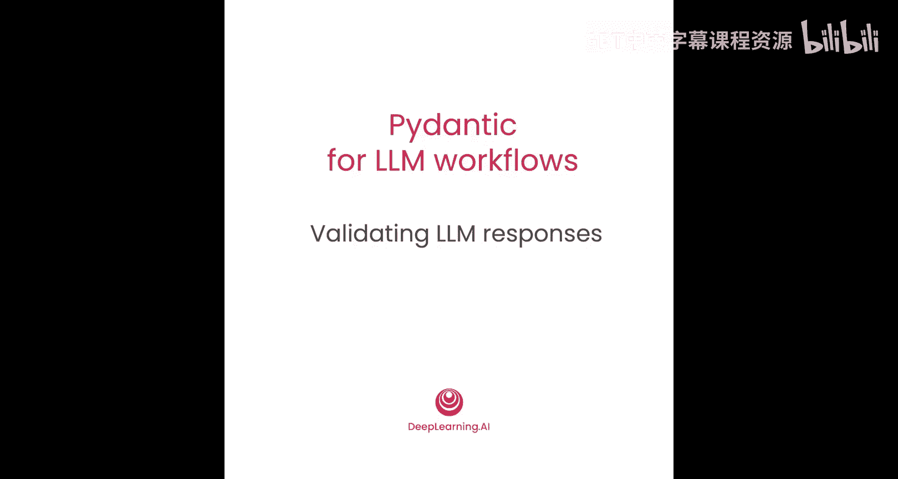
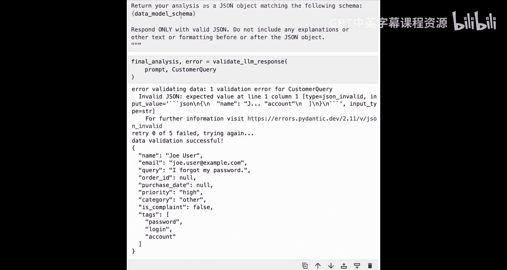

# 吴恩达《Pydantic 用于LLM工作流｜Pydantic for LLM Workflows》中英字幕 - P4：3.validating-llm-responses.zh_en - GPT中英字幕课程资源 - BV1mptxz6E7n

In this lesson， you're going to be prompting an LLM to give you back a structured response in JSON format。

 and then you'll use a pyedantic data model to validate whether or not the JSON contains exactly what you need。

And what you'll see is that you can often get pretty close by just asking the LLM to give you the structure that you want。

 And then what you can do with pedantic is catch any validation errors and pass them back to the LLM。

 And with this you're creating a feedback loop so that even if the initial response from the LLM has issues that are causing errors。

 you can ultimately get the LLM to correct its mistakes and give you exactly what you need。

 And so this is sort of what you might call a traditional approach for prompting for structure。

 you set up a retry feedback loop and kind of assume that you're going to get there eventually。

 even if the LLM didn't get it right the first time。 like I said before。

 we're going to look at some more elegant methods after this。

 but it's interesting to build this feedback mechanism once yourself。

 so that you can get a sense for what some of those more elegant methods are handling automatically for you behind the scenes。

 So let's jump into the code。

Okay， so starting off with some imports， mostly stuff you've seen from the previous lesson。

 and you've got a couple extras here from typing list and literal you're going to use in the definition of a new pyedantic data model。

 And then you're adding low dot end and open AI to set up an open AI client Next。

 you can go ahead and initialize your Open AI client。

And then you can set up some sample user input data。 So here you have a user input Json。

That contains all the fields in your user input model。

 And just note here that you're defining order I D and purchase date as null in the Json form here。

 And those will be read in as the defaults none in your model。

And then you can define the same user input model that you had from the previous lesson。

And then just like you did at the end of the previous lesson。

 you can create an instance of your user input model using the model validate JSO method on that user input JSO。

Next， you're going to define a new pedantic model called customer query。

 So now this is a class called customer query。 and in this case， you're inheriting from user input。

 just like any other Python class。 when you inherit from another class。

 you get all the attributes of that class and whatever you add on it。

 So this is going to be a new pedantic data model that gets all of these fields from user input。

 and you're adding on four additional fields of priority category is complaint and tags。

 And here priority is a string。 and you have a description of what this is priority level low medium high。

 Then category is a literal type， which means it has to be one of these three options。

 refund request information request or other。 and then is complaint is just a boolean that's going to be true or false and tags is a list of strings。

 So let's define that。And the next thing you're going to do is construct a prompt。 So first。

You'll define an example response structure， so this is giving an example that you'll put in the prompt to let the LLM know the structure that you're hoping for in the response。

Then you can construct a prompt where you're saying。

 please analyze this user query and you're passing in this validated instance of your user input model。

 The JSson representation of what's in the model。 And you're saying。

 return your analysis as a Json object matching this exact structure and data types。

 and then passing this example structure as the example in the prompt。

 and then respond only with valid Json do not include any other explanations or other text formatting before or after the Json object。

 And then we'll just print that out。 So let's go ahead and run that。

So you constructed a prompt that has this format。 please analyze this user query。

 Here's the user input that came in， returnturn your analysis as a JsonN object matching the structure。

 and here's the example， and then respond only with valid Json。

You can then define a function to call the LLM， in this case setting the model as DBT 40。

 then passing in your prompt and returning the content of the response。And then you can try it out。

So here we called the LLM and got back this response。

 which looks like a fairly close to accurate response。

 although what you can note is that we do have some extra formatting outside of the JSON string here。

 and that's going to be an issue。The next thing to do is to go ahead and try and validate that response you got by attempting to create an instance of your customer query model using the model validate Json method on that response content。

 So let's see what happens when you run that。Okay， a validation error。

 And down here you can see that it's a validation error for customer query invalid Json expected blah。

 blah blah， and you can see that it's identified what the problem is in the response format And then just like you did in the last lesson。

 you're going to define a function to capture errors a little more gracefully than just having this validation error gets viewed onto of the screen like this。

 And so you'll pass in the data model that you want to use for validation。

 the LLM response that you want to validate you'll try validateating that response with the model validate Json method of your model And if that works great。

 otherwise you'll capture that validation error and printed out and what you're going to return is either the validated data and none or none and the error message。

 So it's basically a tuple that you're returning that either contains the valid data and nothing for the error or nothing for the valid and the error and then you can try that out。

So here you captured just the tail end of that validation error explaining what went wrong and the issue with the JO。

And then what you're going to do with this error that you've captured is to construct a new prompt to send this back to the LLM and ask it to fix its mistake。

And to do that， you're going to define a new function。

 This function is called create retry prompt where you're passing in the original prompt。

 the original response from the LLM and the error message you got back。

 And then your retry prompt that you're constructing is a message that says this is a request to fix an error in the structure of an LLM response。

 Here's the original prompt。 Here's the original LLM response。

 And here's the error message that was generated when trying to parse this into the model。

 compareare the error message in the LLM response to identify what needs to be fixed or removed in the LLM response to resolve this error。

 And again， respond only with valid Json， do not include any explanations or other text or formatting before after the Json string。

 And then you're returning this as something that you can use in a new LLM call。

 So let's run that to define the function。 And then you can try running this function to construct a validation retry prompt。

And print it out。So when you do that， you can see what you're going to send off now to the LLM as a follow up request and it says iss a request to fix an error。

 here's the original prompt， and so this includes the entire original prompt down to here。

 and then here's the original response just to show the LLM what was returned the first time。

And then misgendered the error。 This is your validation error that came back from attempting to populate your pedantic model and then try to go ahead and fix this。

 So that's the prompt we're going to send off now。So you can go ahead and call the LLM again now passing in the validation retry prompt and see what you get back。

Okay， cool。 Looks like it cleaned it up。 Now， you've got none of that marked down formatting outside and what looks to be Valley Json。

So next， you can go ahead and。Attempt to validate with model that new response that you've got。

 the validation retri response and see what happens。another validation error。 O。

 but this is different。 So now its as one validation error for customer query。

 input should be in category， input should be refund request， information request or other。

 So up here， this is a category of account issue， which if you recall back up here in the definition of your model。

You have category defined as a literal， which can only take the values of refund request。

 information request or other。 And now what you've done in the example response structure is provide one of those。

 But this is a problem arising from the fact that the L L M doesn't know what the other ones are。

 So this was not quite set up for success。 But let's go ahead and see what happens if you capture this error。

 and create another retry prompt。 So you can use your create retry prompt function again to create a second validation retry prompt。

 And now you're passing in the validation retry prompt as the original prompt and the validation and the validation retry response as the original response。

 and the validation error。 So you can run that to see what you get。

And now this is getting to be a bit of a cumbersome prompt。

 but you can see this is a request to fix an error。

 and then the original prompt was also a request to fix an error。

 And so you can read through the entire original retry prompt and eventually you'll get down to where you had a new LLM response and this generated a new validation error and now we need to fix that。

 So you have a new prompt that you can send off to the LLM。

And you can use that to call the LLM again now with the second validation retry prompt and see which you get back。

Okay， well， so now it's a valid category information request。 but unfortunately。

 you got back this Json markeddown formatting again。 So the purpose of this lesson is in some sense。

 to have you experience firsthand the challenge of getting back a structured response in exactly the format you want from an LLM and just some of the common issues that arise from that。

 And what you'll do next is to set up a complete retry system so that you can send an initial prompt if you have a problem with the Json or with populating your data model。

 capture that validation error， construct a retry prompt and do it again and give yourself some number of reries in this case。

 we're setting the default number of retries to 5 to see if you can get to a valid response after some number of retries。

 So here you're defining a function called validate LLM response， passing in a prompt a data model。

 number of retries and LLM model。Setting up an initial LLM call to get back a response。

 And then for as many attempts as you're giving yourself in retryries。

 you'll try first just validating the LLM response you got。 if there's a problem with that。

 then first just print out some information and then construct a validation retry prompt and try it again。

 call the LLM if you get back valid data， that's great， if not。

 you'll run this loop as many times as you either need to to get valid data or until you run out of retries。

 So you can go ahead and define that。And then try it out。

So here you're just starting with the same original prompt that you constructed at the top of the lesson and passing in your customer query data model。

And when you run that。You see， you've got one validation error to do with customer query running at a Json problems like before。

 And so retry 0 or what was the initial attempt failed。 and you're trying again。

 And then it turns out on the first retry， you got more invalid Json， the problem was not corrected。

 And so that retry failed。 and then eventually you get to the issue with category that it should be refund request。

 information request or other。 And so retry2 of five failed。 But then in running a third retry。

 you actually got to an LOM response that was able to be validated in your model。

 And what you'll see if you run this multiple times is that it's a little different every time。

 because Lms never quite do the same thing every time and you never know quite what to expect。

 So here again， you've got a Json issue， a Json issue。

 then validation error with category field and another JsonN issue and then finally you've got to valid data。

 So sometimes it takes you three failed attempts sometimes two if you run this enough times you might go through。

5 attempts and actually never get to valid data。 And so you might be thinking at this point that this looks like kind of a flaky system。

 And you'd be right。 The fact of the matter is， I've kind of set this up in such a way that you're bound to experience these errors and retry requests。

 And there are certainly ways to construct your initial prompt to set yourself up for a better likelihood of success。

 But what you're experiencing here is actually what's going on behind the scenes when you're using a retry library that handles all this on the backend for you。

 And in the next lesson， you'll try that out。 But I wanted to give you the firsthand experience here of seeing what's happening when you're asking for a structured response from an LLM getting something that doesn't quite match and going back and retrying by passing back the error messages。

 This is exactly how this situation is handled in the backend logic of some of these libraries that'll do it for you。

 So before we go on to the next lesson， I just want to show you one more trick you can use with pedantic models that'll help you construct a better prompt I。

 If you want to set up a retry and。😊，Back loop like we just did。

 So here what you're going to do is to print out the model JsonN schema of your customer query data model。

 And when you do that， what you see is that even this relatively simple model has a complicated looking Json schema。

 And while this is a little bit difficult for a human to parse。

 this is exactly the thing that will let an LLM know much more clearly what you're looking for in your structured response。

 So rather than providing an example， like we did in the prompt at the top of the lesson。

 if you instead provide the model schema of your pyedantic data model。

 you'll often get to the structured response you need from the LLM much more quickly。

 So as a reminder， the prompt that we started with is one that looks like this。

Where you pass in the user input and then gave an example of the kind of output you're looking for。

 And this is really common。 A lot of people use this approach for whatever kind of output you're trying to get from the L L M。

 Proviing examples in the prompt can be a way to get to the response you want。 However。

 a better starting point would actually be。Providing a prompt like this where you pass in the user input as before。

 But instead of that example， pass in your data model schema that you defined up here。

 this long Json schema that describes exactly what your model expects。

 When you create a prompt like that， you're giving better instructions to the LL M as to what you're hoping for in the response。

And you can try out that new prompt in your validate LLM response retry function and see what you get。

So in this case， you had one issue still with invalid JSON， but after that。

 a single retry allowed you to get to valid data。And this is another example of what's happening behind the scenes when。

 as you'll see in the next lesson， you can pass your pyedantic data model in your API call。

 and what's often happening is the data model schema is being extracted from your model and used as part of the prompt to the LLM。

And with that， you have a new set of tools in your toolkit for getting the structure that you want from an LLM。

 even when it doesn't get it right the first time， it turns out that this exact mechanism is at work behind the scenes in some of the frameworks that allow you to pass your pedantic data model in directly in your API call。

 namely that mechanism of extracting the JSson schema from your pedantic model using that to construct a prompt and then handling validation and retrying in a feedback loop。

 And that's where we're going next in the next lesson we'll look at a variety of frameworks for getting the structure you want by passing your pedantic model directly in your API call。

 I'll see you there。

