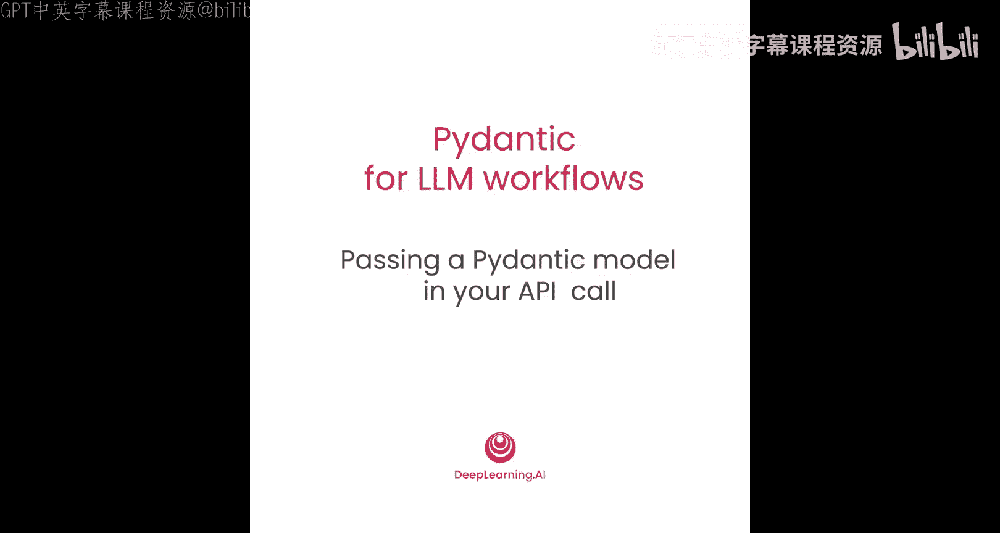
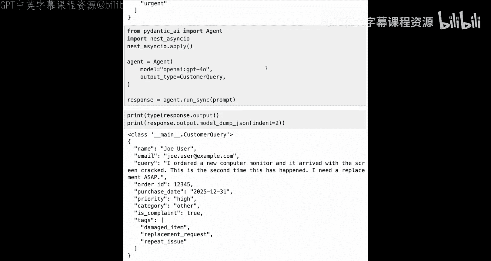

# 吴恩达《Pydantic 用于LLM工作流｜Pydantic for LLM Workflows》中英字幕 - P5：4.passing-a-pydantic-model-in-your-api-call.zh_en - GPT中英字幕课程资源 - BV1mptxz6E7n

In this lesson， you'll learn how you can use your pedantic data models directly in your API call to an LLM provider。

 and what you'll see is that this gives you a much cleaner and more reliable way to get a structured response than what we were doing in the last lesson of all that error handling and retry logic that you had to build。

And what you're going to do here is to play with this across a number of different frameworks and LLM providers。

 and with that you'll get firsthand experience with the fact that it kind of doesn't matter which LLM provider you're working with or which agent framework。

 really the way in which you're going to use pedantic data models to get the structure that you want in the response is essentially the same across different LLMs and agent frameworks。

 So let's jump into in the notebook and see how that works。

Alright， so to start off with youre adding a couple of imports here， you're importing instructor。

 which you can use as a wrapper around a number of different LLM providers in the API call to use your pedantic data model in the API call to get a structured response。

 and the way instructor works is actually quite similar to what you were doing in the last lesson you pass in the pedantic data model。

 Instruct extracts the JSON model schema and then constructs a prompt from that。

 and if there's any issue in the response， it will do a series of reriesries in order to get you back the response you're looking for and you're going to use that with Anthropic to start off this lesson。

The next thing you can do is go ahead and define。The pedantic data models you're familiar with from the previous lesson。

 So you have the same user input model here and the same customer query model that inherits from user input。

 You can go ahead and define those。And then you can create some example user input data So here you have a user input chase on just like you did before with information in all the fields。

And you can validate that user input by using your model validate JSO method on input。

And then you can construct a prompt。 You're going to make a really simple prompt that just says analyze the following customer query。

 passing in that user input and provide a structured response。

And then you can go ahead and set up an LLM call in this case。

 using instructor in combination with Anthropic to create a client where you can ask for a response and pass in your prompt as well as a response model。

 In this case， your customer query model as the response format that you're looking for。

 So with instructor， you could do this with open AI or Gemini or many of the other LLM providers out there。

 But just to change things up a little bit。 We're going to try this with Anthropic。

And then you can have a look at what you got back。So in this case。

 what you got back is actually an instance of your customer query data model。

 So the instructor package has gone off， made the LLM call for you and done any retrying that was necessary and then also validated the data and pass you back a populated instance of your customer query data model So there's no more need for extra validation steps on your end you get back a valid data model with all the fields filled out。

 And so you could use instructor just like this with a number of other LLM providers But there are also ways you can do this directly with an API call to openaiI for example。

 So here what you're doing is creating an open AI client and then calling the beta API with a response format of customer query。

 your data model and then you're going to grab the content of the response and print out the type of response you're getting back as well as what's in it。

And when you do that， what can see is that you're getting back a string。

 just like you would in a normal LLM response。 and that the format of that string looks to be approximately a representation of your data model。

 And so what's different here from what you just did with instructor and anthropic is that you're not getting back a validated instance of your data model directly。

 But you're getting back a Json string and what open AI is doing behind the scenes here is something called constrained generation。

 which is to say because you've indicated that you're looking for Json format in the response。

 The way that the response is actually generated guarantees that you'll get back valid Json。 Now。

 that's not to say that this is guaranteed to be a valid instance of your data model。

 but it is guaranteed to be valid Json in this case。

 you're never going to have to deal with any kind of malformed Json in the response when you're using open AI in this way。

 and what you can do next is to go ahead and try to create an instance of your customer query data model from that response content using the model validate Json method and then print out what you get back。

So in this case， it worked。 You got back valid data and didn't run into any validation errors in populating your data model。

 but it was one extra step to get to a valid instance of your model。

 It turns out that Open AI also offers another version of their API， this responses API。

 where you can pass in a parameter called text format and put your pedantic data model in there。

 and then when you run this， take a look at what kind of response you get back。So in this case。

 you can see that it's some kind of class with some nesting structure and deep down inside of there。

 it looks like you have an instance of your customer query data model。

And what I think is really interesting to do at this point before digging into what actually is inside of that response is to look at that response structure a little bit more closely。

 So here you're just defining a little function to pass in that L L M response。

 And you don't need to worry about the syntax going on here。

 But this dot M R O is what's known as method resolution order in Python。

 And thatll will just allow you to print out the inheritance structure of that response。

 And so when you run that。What you can see is at the top level you have this nested structure。

 and if you unpack that all the way down to the bottom， you eventually get to a pedantic base model。

 And so it's very interesting to note that the response coming back to you from Open AI is itself a pedantic model and what you've got in this case is an instance of your own pedantic model nested deep inside another pedantic model from OpenaiI。

 and it turns out that this is very common a lot of LLM providers out there are returning a pedantic data model to you as the response type and then deep down inside that model somewhere is the content that you're interested in。

 and it's at this point that I think you can start to see that when it comes to LLM workflows It's kind of pedantic models all the way down。

 you've got pedantic models that you're passing around to get the structure you want the responses that are coming back many times are pedantic models themselves。

 and that's because these LLM providers are doing their own data validation on their end before sending you back a response。

 and then as you'll see in the next lesson you'll also be using pedantic data models in tool。

CaSo for me， at least， I think this is kind of cool to discover how pedantic models are just woven through and through in LLM workflows。

And so， let's take a look at what you actually got back in this case。

When you're using the responses API from Open AI， then the content you're looking for is inside of response dot output parsed。

And so you can see inside of there。 you have an instance of your customer query data model。

 which means that the API has returned valid data。 and there's no more validation required on your end。

 And so in this case， Open AI is handling the construction of the initial Json using constrained generation and also populating the data model for you handling any validation before handing it back to you。

 And finally， I feel like this lesson would not be complete。 If we didn't take a look at pedantic AI。

 which is an agent framework built by the folks at pedantic where you can create an agent like this pass in your data model as the output type。

 and it's just very simple to set up an LLM call to really just about any LLM provider in this case。

 just for fun， we're going to go ahead and call Gemini。 And this N Asy Io stuff。

 you don't need to worry about this is just so that pedantic AI plays well within the Jupyter notebook environment。

 So let's run that。And then look it。 put you get back。So in this case， again， in response do output。

 you've got an instance of your customer query data model。

 and so you've got valid data coming back directly in the response。

 And so you can see that there are some differences in the responses that you're getting back。

 namely the tags field has different tags in each case。

 and that's just due to the fact that that's a list of strings that each LLM provider is going to populate a little bit differently。

And in this case， with pyedantic AI， you could go ahead and switch to another model provider quite easily。

 like Open AI， for example。Try calling Open A GP 40。And that worked。

 And you can see that you get back a slightly different response。

 But all you have to do is change out this model string to call a different LLM provider。

 And so here you've seen how you can pass your pedantic data model directly and the prompt to get structured output with a lot less hassled than than you were dealing with in the last lesson。

So in this lesson you've been using pedantic data models directly in your API calls to different LLM providers and agent frameworks。

 and you've seen that this can be an effective way of getting structured output and validated data from an LLM Next up。

 we're going to take a look at tool calling， which is the other big use case for pyedantic models within LLM workflows。

 So in the next lesson you'll use pyedantic models in the definition of tools that you'll pass to an LLM in an API call。

 and that will allow the LLM to give you back the exact parameters you need to call the tool that uses a function or an API as part of your system。

 I'll see you there。

