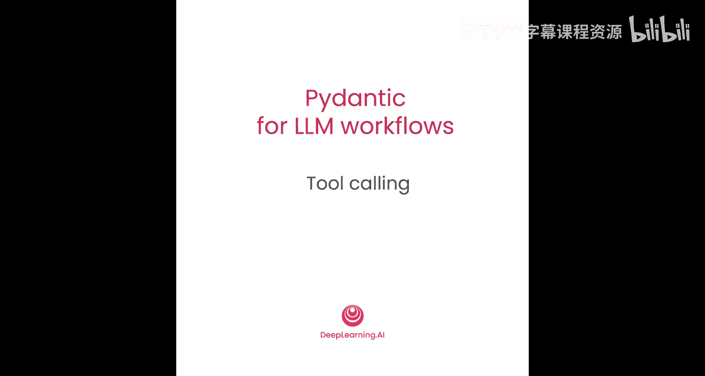
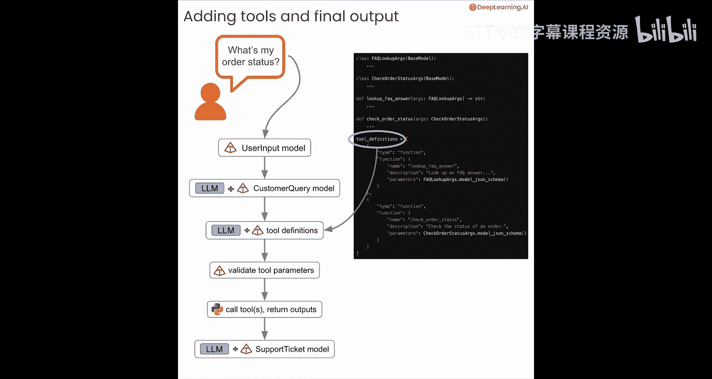
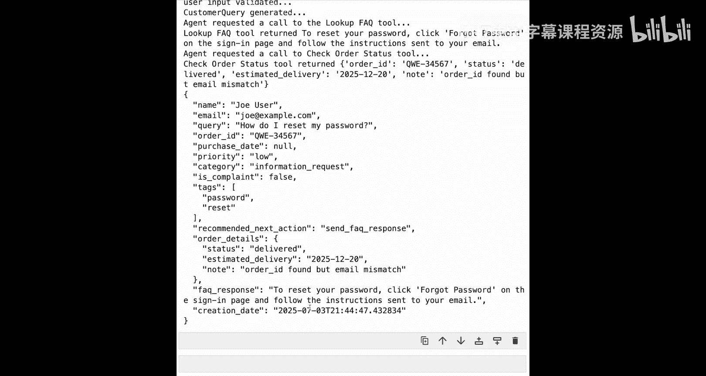

# 吴恩达《Pydantic 用于LLM工作流｜Pydantic for LLM Workflows》中英字幕 - P6：5.passing-a-pydantic-model-in-your-api-call.zh_en - GPT中英字幕课程资源 - BV1mptxz6E7n

In this lesson， you'll be taking what you've learned so far about getting structured responses from an LLM using pedantic data models。

 and you'll combine that with a new ability to use pedantic models in the definition of tools that you can pass in your LLM API call and so when it comes to the ways in which pyedantic gets used in LLM wordflows。

 These are the two big ones。 structured responses and tool calling。

 And so what you'll do in this lesson is combine these to implement reliable structure and tool calling in your application。

 So let's jump into the codeID。

There's going to be a lot of code flying by in this lesson。

 So I first want to give you just a high level visual picture for where we're going。

 And hopefully that'll make it a little easier to follow along。 So the starting point is the same。

 Namely， you're getting some user input that includes a name an email and some kind of message like what's my order status。

You'll first take that user input and validate it using your user input data model。

 then you'll pass your validated user input into an LLM call where you're asking the LLm to return valid instance of your customer query model and then you'll pass that to another LLM API call with some tool definitions And so the way you're going to code that up is first to start with two new pydantic data models。

 And these are FAQ lookup as and check orderder status as and you'll see how those get implemented in the notebook But basically these are defining the parameters that you'll use to make a tool call and those parameters go into two new functions that you'll defined。

 So you'll have lookup FAQ answer that takes FAQ lookup as as input and check orderder status that takes check orderder status as as input。

 So you'll see how those functions get defined in the notebook as well。 After that。

 you can make some tool definitions where you'll define tools that。

a name that's the Python function for that tool call and a description and then the parameters and for parameters。

 you're going to pass in the model Json schema of those pyedantic data models that you defined above and then you'll take those tool definitions and pass them in the API call and that's letting the LLM know which tools are available and then the job of the LLM is to return parameters for a tool call if in fact that seems like a good next step and then you'll take that response and first use the pyedantic data models that you defined for FAQ lookup as or check orderder status ags and validate that the tool parameters returned by the LLM are what they need to be in order to call those functions and then you'll go ahead and call those tools return the outputs and then you'll take all of that and bundle it up into one more LLM call where you're passing in your customer query your tool outputs and you've defined another pyedantic data model called support ticket which will be the final output from that last。

So you're going to be putting together a lot of different pieces， and this is the big picture。

All right， So in this notebook， there's going to be a fair amount of setup and a fair amount of code flying by。

 So bear with me。 I'll try to move quickly through the parts that you've seen before and pause to explain each time there's something new。

 And so the first thing is just a whole bunch of imports。

 This is basically everything you've seen from the previous lessons Now you're going to bring it all together。

 And next， you're going to define your user input data model。 But in this case。

 you're making it a little bit more complex by messing with the order I field。 So order I。

 which used to be an integer， is now going to be an optional string field where the default is still none。

 And the description is that there's a new format。 You have three capital letters than a dash and then five numbers。

 And the reason this is an interesting example， is just because oftentimes you'll have fields like this。

 where valid is not straightforward。 And that's where you need to bring in this field validator tool from pedantic。

 So with field validator。 you can set your validator on the order I D field。

 and then define a function。😊，That in this case， just has some regular expression parsing to see if the pattern in the input matches the expectation。

 And if it doesn't match， you can raise a value error。

 letting the user know what the problem is and what the expected format is。

 And so this is just one example of how you might handle some custom validation directly within your model。

 And it's a way in which you can enforce security on input data。 For example。

 if you had input coming in and you wanted to make sure it's not some kind of SQL injection or some kind of other malicious input you can validate whatever you've got coming into your data model with completely custom validation logic like this。

 So you can define that model。And then you're going to define your customer query data model。

Just as you did before， inheriting from user input and with these four additional fields。Next。

 you're going to define a validate user input function just as you did before so I won't say much about that。

And then you'll define a create customer query function that takes in validated user data in the form of a JSson string and calls an LLM to populate an instance of customer query。

 So this is just a slight twist on what you were doing before。

 essentially the same thing you're just calling an LLM using in this case output type of customer query。

 Now， here we're using the pyedantic AI framework and Google's Gemini model。

 But this is just the same thing you were doing before。

 calling an LLM to take user input and populate an instance of your customer query model。

 And so in this case， you're returning the response do output。

 which when you're calling pedantic AI is the validated instance of your customer query data model。

And then you can try out what you've got so far。So here you have some user input in the form of a JSON string。

 you can validate the user input， then create a customer query and print out what you've got。

All right， user input validated， customer query generated and looks like you got a valid instance of your customer query data model out the other end。

 And after that， you're going to define some new pyedantic models。 In this first case。

 you'll define a pantic model called FAQ lookup args that inherit from base model and has these two fields query and tags And so these two fields are what will be expected in an FAQ lookup function that you'll define in just a moment。

And then you'll define another model called check order status args that also inherits from base model and has an order I D field。

 just like what you had before with this field validator on the order I D field and an email。

 And so these are going to be the parameters that you'll pass into a check order status function。

 So let's define that。And then you're also going to define some fake database data。 So in this case。

 just some data that you can actually look up with an FAQ lookup function or an order status lookup function。

 And so here you have a tiny little fake FAQ database with a question。

 answer and keyword for each FAQ and on here you have a little order database with three different orders。

 including a status estimated delivery purchase date and email。

 And so you don't need to worry about the details of what's in here。

 this is just in order to complete the example。And then， you can define。

The look up FAQ answer function， which in this case takes as input。

 an instance of the FAQ lookup Args model that you created above。

 And this is just a function to go through that fake database of FAQs and a search based on keywords in the user input。

 And if it finds an answer， it returns the answer。 If not， so sorry。

 I couldn't find an FAQ answer to your question。And then， you can define。

A check order status function， which in this case takes as input。

 the check order status args pedantic model， a valid instance of that model as input。

 and then attempts to look up an order from that little fake order database using the order I D and email for confirmation of a matching order。

 Again， the details here are not something you need to worry about。

 This is all just in service of building up an example of tool calling in your customer support system。

And then finally， we get to the interesting part。You can define tools that you'll use in your API call to an LLM like this。

 where up here you have a first tool that has a name of lookup FAQ answer。

 That's the function that you'll call if in fact this tool is invoked and the parameters that that function expects are the FAQ lookup As and so you're passing this information in your API call to an LLM。

 and this is where your pydantic data model comes in in defining the parameters that that tool expects。

 and then you have another one for check order status where the parameters are the schema of check orderder status Ags model。

And as a final step before getting into the LLM calls。

 you're going to define a couple more pyedantic models。

 So this is now going to be your support ticket model， which is the ultimate output of the system。

 And so first you've got an order details model that just has a few fields of status。

 estimated delivery and note。 And then what you're going to do is you're going to use order details inside of support ticket。

 So now support ticket is a model that inherits from customer query。

 So it has all the attributes of customer query， and then you're adding some new things。

 So a recommended next action， which is another literal that has a certain set of acceptable values。

 escalate to agents and FAQ response。 order status or no actions needed。

 you have an order details field， and this is where you're going to pull in that order details model。

 And so this is an example of how you can construct a field inside of a pyedantic data model using another pyedantic data model。

 And then you have an FAQ response that can take the response。

 If you looked up an FAQ answer and a creation data。 So let's。Find those。

And now with all that infrastructure built up， you're ready to define your LOM call。

And so what you're going to do is define this decide next action with tools function and this takes as input an instance of your customer query data model and so the first thing you're going to do is define a system prompt and to do that you'll first extract the model JSON schema from the support ticket model and then construct a prompt that says you're a helpful customer support agent your job is to determine what support action should be taken for the customer based on the query and expect fields and support ticket schema below and so the idea here is that there's input from the user it gets converted via a first LLM call into a customer query data model and then this is passed on to another LLM called T decide what to do to call a tool or to construct a support ticket of a different form So it says if more information on a particular order ID or FAQ response would be helpful in responding to the user query and can be obtained by calling a tool then call the appropriate tool to get that information and then here at the bottom you're passing in the support ticket schema as the expectation。

For where you're ultimately trying to go。 Now， this is not saying。

 give me back this structure in the response， because what you're going to do with this LM call is decide whether or not to call tools。

 but this helps the LM decide whether or not a tool call is a good idea In this case。

 So in this case， your system prompt is all this stuff up here。

 And then your user prompt is the model dump of the customer query model that you passed in。

 So this is all the information that was in the user input as well as the additional information from the first LM call when you populated the customer query model。

 And then in this case， you're going to call open AI GP 40。

 And you're passing in those tool definitions in the tools parameter。

 which lets the LM know what tools are available to call as a next step。

 So let's go ahead and define that。And now you're ready for action。

So you can call the decide next action a To function， passing in customer query。

And what you're going to get back。 remember is the message response from the LLM， the tool calls。

 if there were any that were extracted from that message， and then the input prompts as well。

 And then what these print statements are doing are just printing out those tool calls。 if， in fact。

 the LLM is suggesting a tool call。 So you can run that。

And so what you get back in this case is that the content of the message。

 that place where you were previously getting back a freeform text response from the LLM。

 that's just null in this case， but down here in tool calls。

 you can see that there's an indication to call the check orderder status tool and so you can print that out a little bit more cleanly down here tool calls is passing in an order ID and an email and wants to call the check orderder status function and so the LLM is saying go ahead and call the check orderder status function with these parameters So the next thing you're going to do is set up a function to call tools if in fact the LLM wants to call a tool and so you can define a function called gettto outputs passing in tool calls from the LLM response and then if there was tool call go ahead and call the lookup FAQ answer function if that's the tool indicated or the check orderder status function if that was the tool that the LLM indicated and what you're doing is a first step in the event of a tool call is passing in the tool call function arguments into。

Your FAQ lookup as pedantic data model in this case and using the model validate JSON method to validate whether the parameters passed by the LLM are in fact valid for that tool call。

 so your pyedantic data model came into play in the API call itself as part of the tool definition for the LLM to know what parameters are valid and then the first thing you do when you get back parameters from the LLM is use that model to validate that those parameters returned by the LLM are going to work and then the next step is to go ahead and call that function passing in those arguments and return the results and then the same thing for check orderder status。

 the first thing to do is validate that the parameters returned by the LLM are in fact matching the expectations of your model and then call that function and in either case you'll return the outputs of the function so you can run this cell to define the getto outputs function and use it on the tool calls that you got back in the last LLM response。

And so you can see that you've got the agent requested a call to the check order status tool。

 Check order status tool returned this order I D and status from the database。

And noted that the order I and email match。 great。 So the tool outputs are this。

 And then you're able to pass those outputs on to the next step in the system。

 And so the next and final step in your system。 And I know this has been a lot。

 So just stick with me here。 We're almost there。 what you're going to do here is to define a generate structured support ticket function that takes in your customer query。

😊，The message that was the response from the previous LLM call and those tool outputs， if， in fact。

 there were any tools called。 And in this case， just for fun since you used pyedantic AI and Gemini in the first LLM call to create customer query and then open AI in the second LLM call to decide what tools to call here you're going to use anthropic with instructor as the third and final LLM call in your system to generate a structured support ticket。

 And， of course， there's no reason that you need to call three different frameworks and three different LLM providers to get all this done。

 It's just to demonstrate that when you're using pedantic。

 it really doesn't matter which framework or LLM provider you're working with。

 the way in which you pass your pyedantic models and get things done is essentially the same。

 So here in generate structured support ticket， you're going to first unpack those tool results or say no tool calls were made。

 If， in fact， that's the case。 and construct a prompt that says you're a support agent use all the information below to generate a support ticket as a validated pedantic model and a customer query is this。

 the L。Mesage from the previous call was this。 the tool results are this。

 And then you're going to set this up to get a response from Anthropic using Cla 37 passing the prompt here and setting the response model to the pedantic model you defined for support ticket。

 And then before you return the response， you'll add one more field called creation date。

 which is just date time dot now。 And this is just to demonstrate that you can populate the fields in your pedantic model any way you like。

 In this case， just grabbing the current date time and sticking it on to the creation date field in your pedantic data model before returning it。

 So let's define that。And now you're ready to create a support ticket。

G passing in the customer query message from the previous LLM response tool outputs into your generate structured support ticket function and print that out。

And so it worked。 Now you have a valid instance of your support ticket data model where you have all the information from the user input。

 you have the information from the customer query model。

 and then you have additional information in this case from a tool call to the check order status function。

 You have a recommended next action of send order status。

 No FAQ response in this case because that's not what this ticket was about。

 And you have a creation date。And so now you're ready to put the whole pipeline together and try it out with some brand new user input data。

 So here we have Joe userer again， and Joe says I'm really not happy with the product I bought gives an order ID and so we'll define that as the new user input data。

And then you can run this user input through everything you've defined so far。 So first。

 you'll validate the user Json。Create a customer query。Then decide next action with tools。

 grab those tool outputs if， in fact， there were tool calls recommended and then generate a structured support ticket。

So let's take a look at what happens when you run this whole thing end to end。Okay， great。

 user input， validated customer query generated agent requested a call to the tech order status tool。

Check order status tool returned some information about an order status。

 and you got out a validated instance of your support ticket model where you have a recommended next action to escalate to agent and you got some information about the order。

 So that's pretty cool。 It all worked。 And you can change the user input and see what happens。

 So maybe something like。How do I reset my password。And when you run that。

 user input validated customer query generated， okay。

 now the agent requested a call to the look up FAQ tool。

And got something returned about a forgot password and how to get that sorted out。

 You also have the agent requesting a call to the check orderder status tool。

 And this is because there's an order I in the user input。

 And that was part of the prompts to always use that tool if there's an order I D。 So in this case。

 you called both tools and then generated a support ticket with all that information。

 So I'd encourage you to play around and try this out with different user input。

 valid and invalid data。 And as you're probably starting to sense now。

 there's a whole lot more to the story here。 Like what happens if the LLM returns invalid parameters for your tool call。

 How would you handle that。 And so in these lessons。

 we've certainly not covered all the possibilities when it comes to how you can use pedantic in your LLM workflows。

 But I hope at this point， you're feeling like you've got some ideas and you're ready to explore further with building out pedantic models for your own LLM workflows。

What you have now is a system where you've built in data validation with pyedantic models at every stage。

 from user input to layering them into the validation of a customer query to defining the parameters for tool calling and in the final output。

 you've seen nested models and field validation。 And then just for fun on top of it all。

 you've built this pipeline using three different LLM providers and three different frameworks for calling your LLM APIs。

 At this point， I hope you're feeling like you've got an interesting set of tools to build LLM workloads using pyedantic models。

 Nice work。

