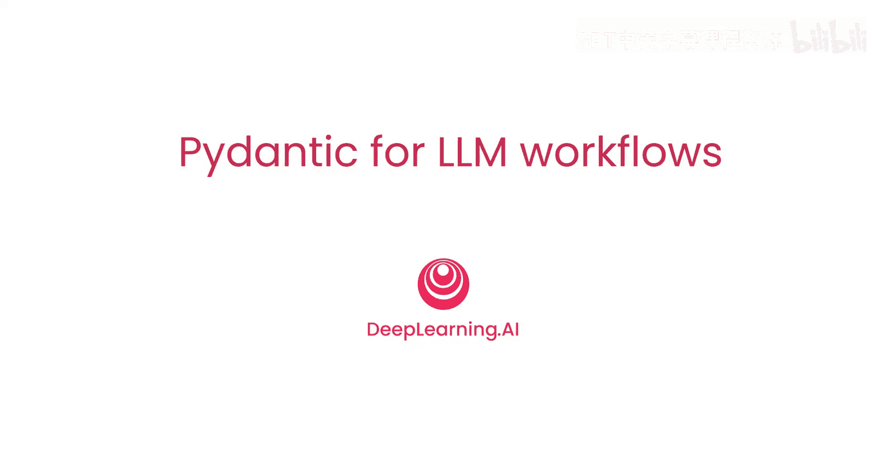

# 吴恩达《Pydantic 用于LLM工作流｜Pydantic for LLM Workflows》中英字幕 - P7：6.conclusion.zh_en - GPT中英字幕课程资源 - BV1mptxz6E7n

Congratulations on completing this course。 You've learned how to use Pedantic to bring structure。

 reliability and validation to all your L OM powered applications。 And beyond that。

 you've learned some core data validation skills that can be helpful in whatever software system you're building where you need to pass data from one component to the next。

 With this course， you've built a really solid foundation。 And with that being said。

 there's a lot more to pyedantic than we were able to cover in this course。

 So I hope you'll continue to learn and grow your skills。

 and I look forward to seeing what you build。😊。