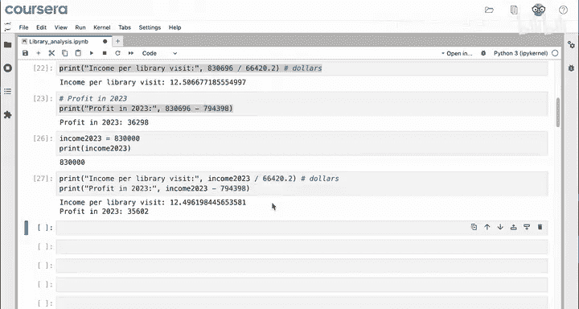
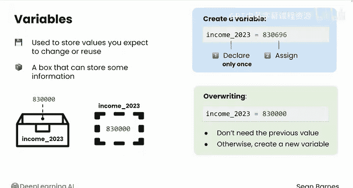
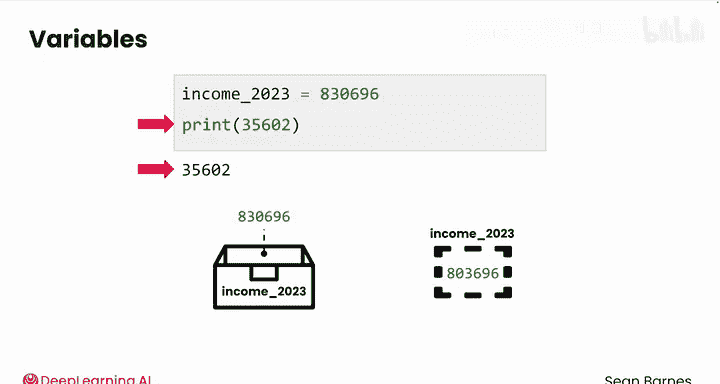

# 吴恩达《Python数据分析（数据分析第3课）｜Python for Data Analytics》中英字幕 - P10：9_变量存储.zh_en - GPT中英字幕课程资源 - BV1rp5yzjEgn

As you saw earlier， a key strength of programming is repeatability。

 one feature that's key to repeatability is reusing data with variables say you're working with the Plainville Library again and you've been asked to calculate the profit from 2023。

You write this line of code to do so， what value do you notice is repeated in these last two cells？

The total income from 2023 is used twice。Repeated values are an opportunity to use a variable in your code。

For few reasons。First， it's kind of annoying to type out this long number multiple times。

 it creates opportunities for mistakes like typos。Here's another common situation。

 Sa the library discovered that this number was recorded in error。

 and the actual value was 830000 even right now， you would have to go in manually and retype this value every place it appears。

 Imagine you have this value hundreds of times in your code。 How do you avoid this busy work。

Let's go back to the original correct value。You can create a variable to store this value once。

 but use it several times， you can create a variable called In 2023 and in that variable store the value 830。

696 What you're doing here is storing this integer inside a box with this name What will happen if you print In 2023。

You get 830696。 The number that you stored inside this name Co。

 Now you can use this name in any line of code where you need this value。

 If you copy over the cells where you use this number。

 you can replace all the instances of 830696 with income 2023。

What do you expect to happen when you run the cell？Well， you should see two lines printed。

 one for each print command。Here you go， both the profit in 2023 and the total income match what you had before。

And now if the library realizes that， hey， this number was actually supposed to be 830，000。

 you can change it in one place， run it again， and now it gets updated across all these results。

By the way， this process is very similar to what would happen in a spreadsheet Right now。

 you have the cell that contains 830696， and it's kind of like a variable with the name I4。

 the value inside the box I4 can change。 but no matter what this box is always called I4。

 So in any calculation that involves 830696， you can use this variable name I4。

 if you update the value in I4， for example， to 830000。 All of the calculations over here。

 update to reflect that。 Let's see what just happened here and how variables work in a little more detail。

 variabless are used to store values。 in particular values that you expect to change or reuse。

 You can think of each variable as a box that can store some information。

 When you create a variable to things happen， you declare it， choose its name and assign it。

 give it a value。😊，You declare a particular variable only once。

 but you can assign it a new value as many times as you like。

 Consider the line of code you saw a moment ago。 Incom 2023 equal 830696 you have a box you label income 2023 and you store the value 830696 inside it when you want to use this value in your code。

 you tell the computer to check the box labeled income 2023 and use whatever value is in there Python variables are similar to cell is in a spreadsheet。

 you have a cell， you store a value in it and that cell has a name In this case the name is income 2023 rather than a row and column reference。

 If this value needs to be updated with 830000 even the previous value gets completely thrown out and replaced you no longer have the previous value saved anywhere。

 This process is called overwriting and you should only do it if you are confident that you don't need the previous value otherwise you should create a new variable You also saw this calculation print In 2023-794398。

A moment ago， what's really happening here？In this case。

 you've already assigned income 2023 and now you're using it in an expression when Python comes to this line and sees income 2023。

 it looks for a box with that name， or you can think of it as a cell with that name and replaces the variable name with its current value In this case 830696 Then Python proceeds with a subtraction replacing this entire expression with 35602 and ultimately prints out that value as the result of the calculation variables are a powerful tool that appear in virtually every program follow me to the next video to see how to avoid common errors they can introduce in your code。

