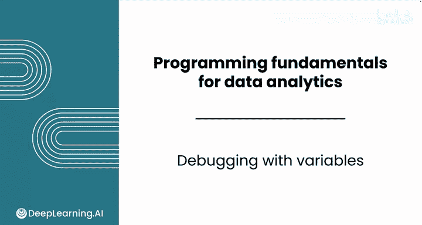
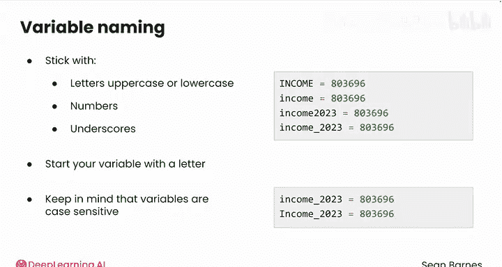
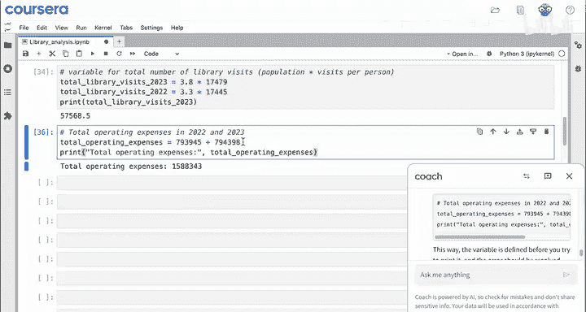
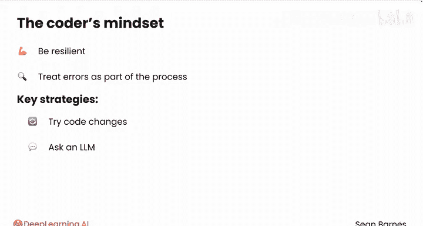

# 吴恩达《Python数据分析（数据分析第3课）｜Python for Data Analytics》中英字幕 - P11：10_使用变量调试.zh_en - GPT中英字幕课程资源 - BV1rp5yzjEgn

Because variables are so powerful， they can introduce the possibility for errors Find and fixing errors in your code is called debugging。

 let's take a look at how variables can introduce errors in your code as well as how to debug them。

 There are rules for variable naming。

Basically stick with letters， uppercase or lowercase， numbers， and underscore and you'll be fine。

 make sure you start your variable with the letter。

 you can read more about the specific rules for naming in the upcoming reading item。

 Keep in mind that variables are case sensitive。 The variable income 2023 is completely different from the capital income 2023。

 but to the computer lowercase I and capital I are as different as A A Z。

 Let's create a variable for the total number of library visits。

 That value is the population times visits per person。

What's a good name for this variable In theory， you could call it something like x x equals 3。

8 times 17479， running the cell， the code works completely fine。

 and the result matches the previous one。However， it's important to give variables descriptive names like total library visits。

 this name is longer， but it does help a ton to use a descriptive mate， the computer doesn't care。

 but you will print out total library visits and it's the same number。Now。

 what do you think would happen if you were to print capital T total library visits？

If you hit Shi En， this code doesn't work。Remember， if you get stuck， you can always ask your LLM。

For example， I am trying to print the total library visits but get this error。

 Please help me understand what's causing。 So the LLM says that the error you're encountering is due and mismatch in the variable names capitalization。

 This response matches what you just learned。 Remember that to the computer。

 capital T and lowercase T， They're completely different letters。

 You can fix this code by changing it back to lowercase T。 Now。

 say the library asks you to calculate the total library visits for 2022。

Let's see what happens if you reuse the same variable， total library visits。

You can say total library visits equals visits per person in the area for 2022， which is 3。3 times。

 and then the population of the area， which is only different by 34 people Now。

 what do you think will be printed out when you run this cell？Would it be the same value as before。

The new value from 2022 is printed。That's because these lines happen in order。

 at first total library visits is assigned this value on the right。

 which you happen to know is about 66，000。 Then it's assigned this new value about 57，000。

 and that completely overwrites the first value。 If you need both of these values later。

 you'll want to create two separate variables。 For example。

 you can add underscore 2022 and underscore 2023 to the end of each。Here's a quick test for you。

 What do you think would happen if you ran these two lines of code？You get an error。

 Can you spot the reason。Let's ask the chopbot。Why does this code cause an error？

So the LLM says that this error occurs because you're trying to print the value of total operating expenses before it's been defined。

You can try the code it suggests to see if that will fix the problem。So in short。

 you'll need to make sure the code to define your variable comes before any code where you use it。

 it's also okay if these appear in different cells。

 defining the variable in the first cell and then using it later in Jupyter notebooks。

 it's best practice to keep your code in a logical order with variables defined before they're used This strategy makes your code easier to read and helps avoid confusing errors When you're debugging in Python finding and fixing errors be resilient errorsors are a part of coding。

When you go to write an essay， you don't sit down and write the essay from the first word to the last without using Baspace。

 So treat errors as a normal part of the process。 There are three key strategies that you can use。

 First， try code changes。 Test your code is completely free。 It's as easy as shift dinner。

 You can start by thinking of ways to break your code。

 Like what would happen if I left off a quotation mark or parentheses。

 Then test it and see if your prediction is right。 You can always ask an LLM。

 Even a short prompt can be highly effective。Ask， what does this error mean and paste in the error message。

 Lms have been trained on a lot of code on the Internet。 So they are excellent Python coding buddies。

 If you want to connect with others about your code。

 I encourage you to search the web and join the deep learning do AI community。

 You're always welcome to start a new thread with any questions you have about this course。

 Great work。 building up your troubleshooting skills with variables。

 You'll encounter errors all the time。 They are completely normal part of programming。

 Foow me to the next video to get started with the new type of data lists。😊。

