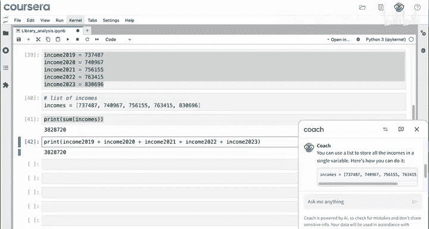
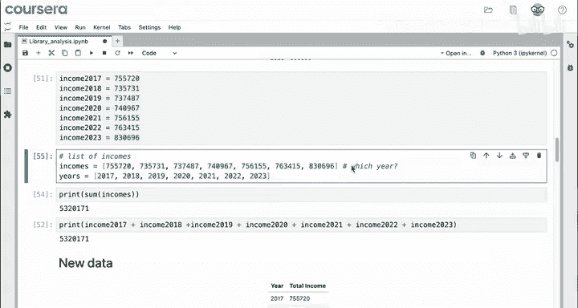
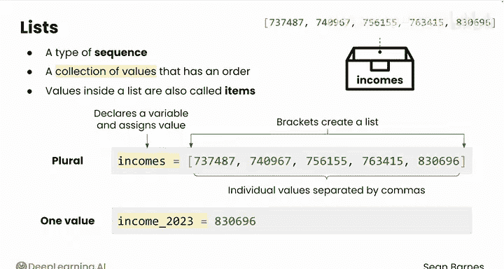

# 吴恩达《Python数据分析（数据分析第3课）｜Python for Data Analytics》中英字幕 - P12：11_创建列表.zh_en - GPT中英字幕课程资源 - BV1rp5yzjEgn

Single integers， floatkes and strings are quite useful on their own。 But in data analytics。

 you'll often encounter sequences。 ordered collections of values。

 One of the most common sequences is the list。 So the public library has come back to you with another analysis they want you to do。

 They want you to sum the total income across five years。

 Here's the data with the five different years and the total income from each year。 Let me ask you。

 how would you store this information in Python code。😊。

One way you could store this information is with variables。

 which you just learned about following the same pattern as before， you could do income 2019 equals。

 then the corresponding value， then income 2020 equals， then the corresponding value。And so on。

This seems inefficient， right？Right now， you only have five years of income， but remember。

 if you hop over to your spreadsheet， you had all this data from the Plainville Library in Hartford。

 Connecticut。 That's 28 years in total。 Ma 28 variables seems inefficient。 Let's ask your LLM。

 I am currently using several variables to store only the incomes in Python。What can I use instead？

And paste in the variables。 So the LLM says that you can use a list。

 Let's step through this suggested code。 The variable name incomes makes sense because this variable represents many incomes。

 not just one brackets indicate a list。 Each value is contained inside the brackets separated by commas。

 This list is useful because now you have just one variable that contains all the data。

 Run the cell so that you have declared and assign this variable and you can use it in your code。

 Now that you've created a list， you can do cool operations with it。For example。

 you can use special functions that work with lists like the sum function。

If you need to calculate the total income for all these years， you can say some open parentheses。

 incomes， the name of your list， close parentheses， now print this out and you get about 3。8 million。

That was fast。If you wanted to sum up all these individual variables。

 you'd have to do something like this。That is a pain。 These two lines of code are equivalent。

 but one of them is faster， easier， and less perto air。 One last thing before we formalize lists。

 let's say the library has come to you and they found the data from 2017 and 2018。

What now， Well， if you're working with the variables。

 you have to create two new variables and type in these values。

And then add them to this calculation to get the new sum of 5。3 million。

 How do you think you would add these numbers to your list？In this case。

 you can add them at the beginning of your list because this is an order data structure。

 theres a value for 2017 and now 2018， looking at this line of code that sums up the values in the list。

 how will it change？Well， it won't， some incomes is going to sum up all those incomes no matter how large the list is。

When you hit shift En， you can see that these values match。

 you might have noticed a drawback here with lists。After you put this data into a list。

 you don't have any way of knowing which number corresponds to which year。

You better hope you type them in the right order for now。

 you can address this issue by creating a second list that contains the years in order like this。

This strategy is kind of a workaround。 It's okay for small dataset sets like this one。

 but you'll learn better options in the next module to sum up lists are a type of sequence。

 meaning a collection of values that has an order， let's break down what's happening in this line of code Ins equals this list of all these values a list is appropriate for storing incomes here because you have a collection of items that is several numbers They all represent the same thing library incomes and they should be storeded in order by year focusing on the right side of the equal sign for a moment The brackets create a list and inside the brackets。

 you have individual values separated by comms in order to use this list later。

 you'll want to save it in a variable So incomes equals declares a new variable called incomes and assigns at the value of the list on the right you create a new box labeled incomes and storear this list inside lists often have a plural variable name because they represent a collection of values rather than just one value like income 2023。

Sometimes these values inside a list are also called items。

So you've seen that lists are extremely valuable when you have a collection of ordered values that represent the same type of data。

 that value comes from unlocking all these cool useful functions like some。

 follow me to the next video to learn more tasks you can perform at lists。

