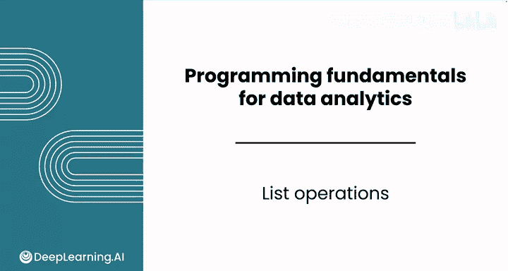
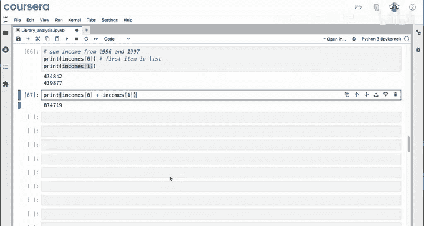
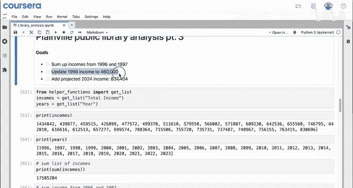
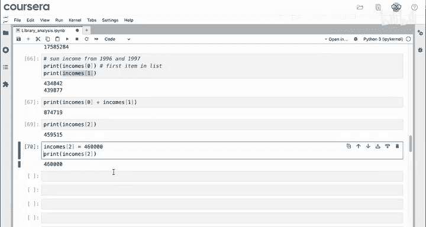
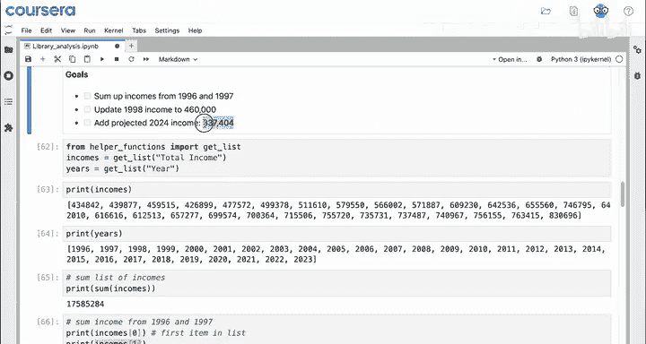
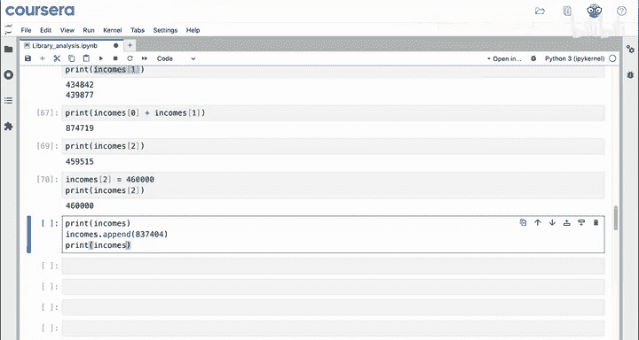
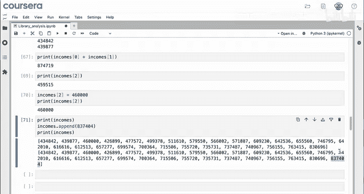
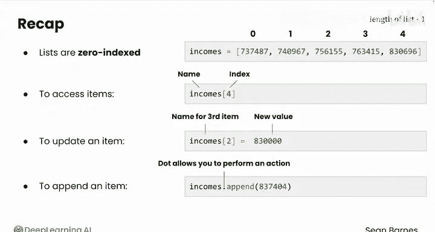

# 吴恩达《Python数据分析（数据分析第3课）｜Python for Data Analytics》中英字幕 - P13：12_列表操作.zh_en - GPT中英字幕课程资源 - BV1rp5yzjEgn

So you saw a list in action a moment ago。

Let's explore more of the cool operations you can perform with lists。

 let's start with some code that allows you to load some data from a CSV。

Don't worry too much about this code， you'll write your own code to load data from a CSV in the next module for now。

 just know that this code creates a list of incomes and are corresponding years from the Plainville Public Library data。

Each list is a column from the spreadsheet you saw previously， now you can work with more data。

So do you remember how to sum up all the values in this list， incomes， well。

 you can print the sum of that list。That's over $17 million。

 very cool now for your first task from the library sum the income from 1996 and 1997。

You'll need to access each income individually。To access 1996。

 start with the name of the list and comeses， open bracket。

 and the position or index that you want to access。Now this is a weird thing。

 but in Python and in the vast majority of programming languages。

 the first item in the list is at position zero or index0 as a human。

 this probably feels weird to you because we just don't start counting from zero no one has a zeroth birthday。

But because of the way computers are built， zero is the first index， so 1996 is the index0。

That means 1997 is an index 1。You can access it the same way， print out each of these values。

 and you get 434，000 and 439，000， so both of these look right to sum these up。

 you can just use the plus operator。That gives you about 874，000。

 so you completed the first task in the list Next up， updateate the 1998 income to 460。

000 flat 1998 is the index 2， so you can print incomes 2 One thing that's interesting about incomes 2 is it acts like a variable name。

So you can assign that variable， a new value using the equal sign just as you would any other variable。

 you can use the command incomes 2 equals 460，000。 Now print incomes 2 on a new line。

 and you can see that it did in fact change Co， you completed that task。

 Now you could add a projected 2024 income。 This is an interesting task。

 Think about what needs to happen here。

Your list is going to go from 28 items to 29， and you want to add this value to the end to add a value to this list。

 start with the name of the list and use dot aend Open parentheses， close parentheses。

 Then put the item you want to add inside the parentheses。 That's 837404。

 This dot is a new piece of code。 This is a function similar to some。

 What's happening is it's taking incomes。 You're going to append an item to it。

 and you're app pendingending the value of 837404。 Here's a reminder of what the list looks like Now。

 What do you expect the list to look like after you run this code cell running the cell。

 you have all the data you had before。 plus this new item that represents the projected 2024 income at the end of the list。

Let's quickly recap what you just saw， I know that demo moves quickly。

Remember that you can rewatch these demos anytime and slow down or speed up the video based on what feels best for you。

 First， lists are what programmers call zero index。

 the index of each item starts to a0 rather than one which takes them getting used to the index of the last item in a list is the length of the list minus1 That's because you start counting at zero instead of one So if there are 10 items in a list they have indices 0 through 9 you saw that you can access items using this command the name of the list a set of brackets and inside the brackets the index you'd like to access you also saw how to update an item So in this code incomes 2 acts like a variable acts like a variable means that incomes 2 is a name for the third item in the incomes list and no matter what value incomes 2 contains that will always be called incomes 2 use the command incomes 2 equals some new value and the value inside the list will be updated Finally you saw how to append an item to the list This used a new dot character dot allows you to perform an action In this case the append function。

On some data like a list， So this snippet of code Ins do a pen 837404 added a new item 837404 to the end of the list。

 you will see this dot many times throughout this course and when working as a data analyst so it's worth taking some time to practice in the upcoming reading item Fastic work with lists Before we wrap up this lesson。

 Let's take a look at functions。 You've seen a few functions so far printnt some and append Let's expand your repertoire I'll see in the next video。

