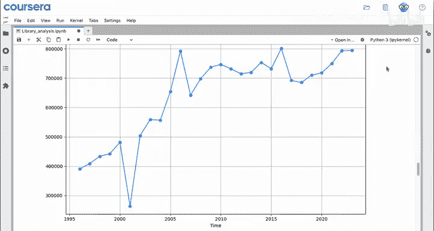

# 吴恩达《Python数据分析（数据分析第3课）｜Python for Data Analytics》中英字幕 - P14：13_函数调用.zh_en - GPT中英字幕课程资源 - BV1rp5yzjEgn

Once you have some data to work with in variables and lists。

 you'll want to take action using that data。In Python。

 functions take action on data you already learned earlier in this lesson that computer programs essentially take some input。

 process it and produce some output， functionss are like many computer programs。

 They take in some input that you provide， process it and produce some output The print function takes whatever you want to print。

 which can be one or several values or expressions。 processes it and displays it to the screen。

 The sum function takes a list as an input adds up everything inside it and outputs the total。

 a pen is a bit different。 They are actually two inputs， Can you spot them。

 the two inputs are the list and the item that you want to append。

 Then it processes these inputs by appending the item to the list and outputs the new longer list Let's break down the code for two of these functions a bit further In some you start with the name of the function open parentheses enter the inputs and close parentheses。

 You can also add multiple individual numbers If you separate them by commas The inputs to a function are called arguments。

 This term comes from math。 and if you find it distracting you can。Of these is just inputs。

 but the formal term is argument aend works a bit different on the left you have a list variable then a dot。

 than the name of the function， open parentheses， then the item you want to append。

 then close parentheses。Why is a pen different？As you can see one of the inputs。

 the list is not inside the parentheses， but the dot tells the function to also include the list as an input you'll often see this format when working with lists and other collections now that you've seen the code for a few functions up close。

 let's take a look at some more functions in action Okay we're back with the Plainville Public Library they've shared the operating expenses for the past several years here's some code to load in the operating expenses data and two lists and here's what those lists look like。

First， the library would like you to find the highest amount for expenses。

 now it may surprise you how straightforward this is Use print， open parentheses。

 add a label for this data。Then you can use a new function called Max and open another set of parentheses。

 What are you taking the max of， the list of expenses。Close the parentheses twice。

 The first set is for the max function， and the second is for the print function。

 This highlighting helps you remember which parentheses go with W function。

 Run the cell with shift enter。The maximum value for all years is 801，000。I don't know about you。

 but it would have taken me at least several seconds to do that。

 What's cool about lists and the max function is that no matter how long the list of expenses is。

 whether it's hundreds， thousands or millions of items。

 Max will find the maximum value quite efficiently for a list of 1 million items Python might take about half a second to find the max So I'm guessing that's faster than you So calculate the earliest year you can find the minimum value in the list years。

So you'll want to print it with a label。Use the men function。 You're finding the men of years。

 Close the parentheses for the men function and the print function Since you're done with your inputs。

 The earliest year is 1996， great。😊，Again， you could have scanned these years and found that out for yourself。

 but if this was a much longer list， or if it wasn't already sorted。

 you wouldn't want to waste your time doing that。 Now you can try something a little more complicated。

 calculating the average expenses to find the average。

 you'll add up all the expenses and divide by the number of expenses。

 you can write the steps and comments so you remember what to do add up the expenses。

 Divide by the number of expenses and then print the result。Start by adding the expenses。

Use the sum function， sum expenses。And save this value for later because you'll use it in another calculation in a second。

 so you can assign this result to a variable like total in the second step。

 divide the total by the number of expenses。So total divided by how do you get the number of items in a list？

You can use the length function L stands for like。And it's just going to count the number of items in the expenses list。

 which is 28，1 for each year assign this value to a new variable called average。

 So to recap you calculated the total by summing up all the expenses。

 then you divided that total value by the length of expenses or in other words。

 the number of expenses in the list， then you say that value in the variable average Finally。

 print a little label and average。What do you expect to print out when I run this code cell。

 You may not be able to calculate this in your head。

 but you should be able to give an educated guess。You're expecting a value somewhere between 4 and 800。

000 based on the values in the list， run this cell and you get a value around 640，000。

 so that kind of checks out。That value seems to fall somewhere in the middle of ill listed expenses。

 Last step。 and this is just for fun。 Here's a help or function called create line chart that takes two arguments。

 a list of years and a list numbers and creates a line chart。

 This really helps you get a sense of how expenses have changed over time。

 Python is an incredibly powerful tool for data visualization。

 which you'll learn all about in the third module of this course。 From types to expressions。

 variables， lists and functions， you now have many of the core tools you'll use daily as a data analyst In the final video of this lesson。

 you'll explore ways to understand the computer's inner workings as you code。😊。

See you in the next video。

