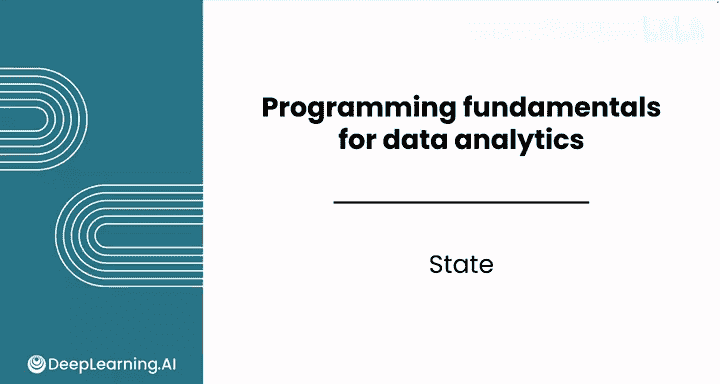
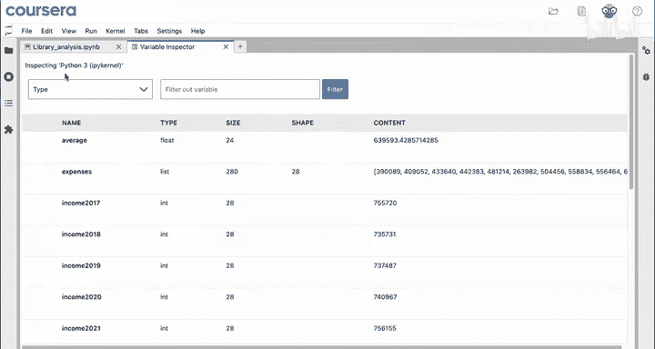
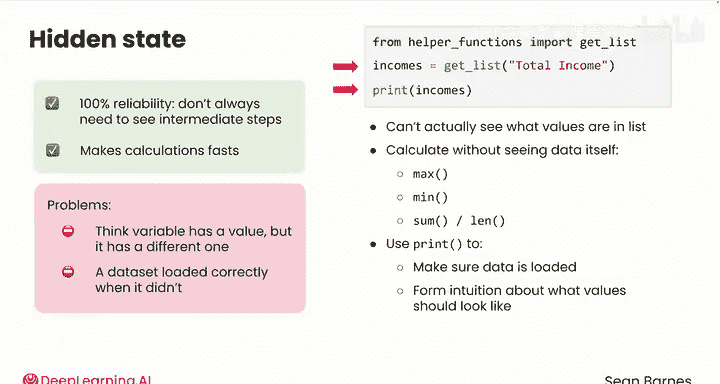

# 吴恩达《Python数据分析（数据分析第3课）｜Python for Data Analytics》中英字幕 - P15：14_状态管理.zh_en - GPT中英字幕课程资源 - BV1rp5yzjEgn

As your computer runs each line and each cell of Python code。

 it keeps track of what effects they've cost specifically it remembers the variables you've created and their values。

 allowing you to use them later on in your code。 let me show you something cool in this notebook。

 if you right click and say open variable inspector。

 you get this new window that shows all the different variables that you've created as well as their type their content or their value and some other information This is kind of like a snapshot of the current status of the notebook at this moment unlike spreadsheets where you can always see your data。

 Python keeps variables and their values hidden from view by default。

 while this makes Python efficient for handling large data sets。

 it means you need to actively check your variables values。

 using tools like this variable inspector or print statements to avoid mistakes you can drag this window over to the right side to be able to view variables and the code side by side So when you ran this code total equals sum of expenses which you saw in the previous video that command created a new row in the variable inspector total and the current。

is now 17。9 million These variables go back all the way to the beginning of this lesson because there's actually a lot of code here so far。

 So all of these variables are saved in the memory of the computer with whatever these particular values are。

 and that is the current state of the computer State is a really important concept in computing。

 because it tells you where am I at in my computation。 What variables have I created。

 Let's take a look at how this works。 A computer state is just like a snapshot of all of its current information。

Until you close your Jupyter notebook or manually restart the kernel。

 your variables are saved and the spreadsheet， you're looking at the state directly because all of the data and calculations are displayed in the cells in your Jupyter notebook。

 however， you aren't looking at that state。 unless you open the variable inspector。

 The variables and their values aren't shown to you。

 This feature helps you focus on the output of your program rather than all of the intermediate steps。

 It also makes computations faster because the computer doesn't have to spend resources displaying results。

 Here's an example。 you previously saw these lines of code。

 you know that Git list loads a column of data from a CSv。

 but you can't actually see what values are in the list。 You can calculate the max。

 min and average without ever seeing the data itself。

 You have the option to use the print command to make sure your data loaded correctly and to help you form an intuition about what the max Men and average values should look like。

 This hidden state gets to the heart of Python's ability to scale。

 If you have a computer that performs computations with 100% reliability。

 You don't always need to see the intermediate steps。As you would in a spreadsheet。

 this hidden state makes calculations fast。 At the same time， it's a common source of problems。

 You may think a variable has a certain value when it actually has a different one。

You may think of data loaded correctly when it didn't。

 It's up to you to inquire about the hidden state of your program。

 typically by using print statements。 printnt statements help you display the value of a variable at a particular point in the code。

 the variable inspector you saw a moment ago is also an option。

 Try not to make assumptions about your program state。

 And when your code isn't matching your expectations。

 use print statements or the variable inspector to see what values you're actually working with Once you've completed the practice lab and practice assignment for this lesson。

 follow me to the next one to learn more about control flow。

 how to repeat code and create branching code in your programs。 See there。😊。

