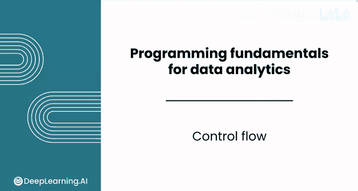
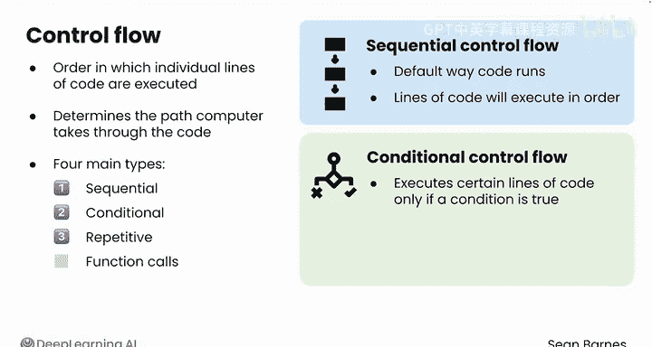
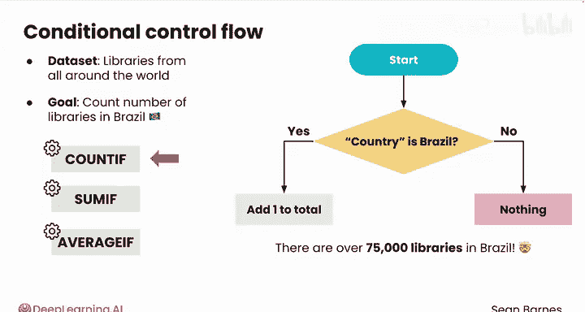
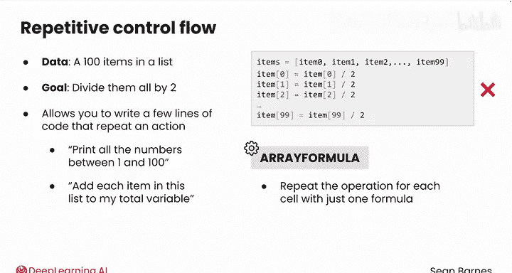

# 吴恩达《Python数据分析（数据分析第3课）｜Python for Data Analytics》中英字幕 - P16：15_控制流.zh_en - GPT中英字幕课程资源 - BV1rp5yzjEgn

In the programs you've written so far， each line in the cell was executed from top to bottom in order。

 however， you often need your programs to make decisions or repeat tasks。

 These patterns are called control flow。 Control flow is the order in which individual lines of code are executed or run。

 It determines the path your computer takes to the code。 There are four main types of control flow。

 S conditional repetitive and function calls。 you'll learn more about function calls at a later point。

 So this lesson focuses on the first three for now。

 you've already seen sequential control flow in the code you've created so far。

 It's the default way code runs。 unless you introduce some of the control structures you'll learn about in this lesson。

 your lines of code will execute in order。 Next up is conditional control flow。

 conditional flow executes certain lines of code only if a specified condition is true。

 It creates branching paths in your code kind of like a fork in the road where your code may go down one path or the other。

 but not both at the same time。 Lets draw a real worldorl example。

 say you're working with the data set of library。

From all over the world and you'd like to count the number of libraries that are in Brazil for the first library you would look at its country and then take action depending on that value if the value in country is Brazil。

 then you add one to your total If the value is anything else， then you do nothing By the way。

 there are over 75000 libraries in Brazil remember that you have already encounter conditionals and spreadsheets functions like countif sumif and average if handle different conditions For example。

 countif could handle this exact library task in a spreadsheet。

 counting up the rows where the country is Brazil。

Next up you have repetitive control flow if you have 100 items in a list and you need to divide them all by two。

 you don't want to have to write 100 lines of code。

 Reetitive control flow allows you to write a few lines of code that repeat in action Exles could be print all the numbers between one and 100 or add each item in this list to my total variable Reetitive control flow is similar to what happens with an array formula function and a spreadsheet you have some operation like text processing and you want to perform it on many cells without having to manually add the formula to each cell。

Aray formula will repeat the operationation for each cell with just one formula。

Control F gives you a ton of flexibility when designing programs。

 follow me to the next video to learn comparisons in Python。

