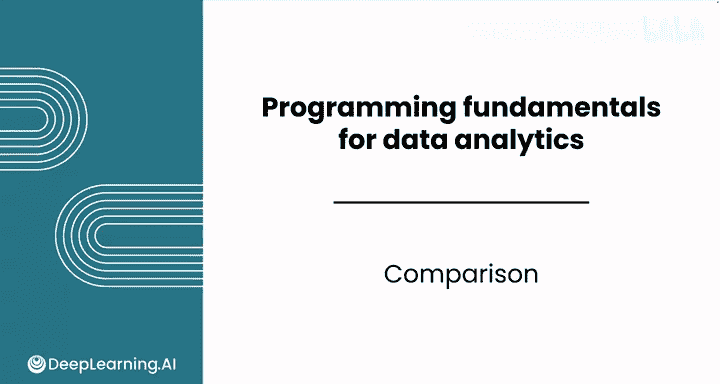
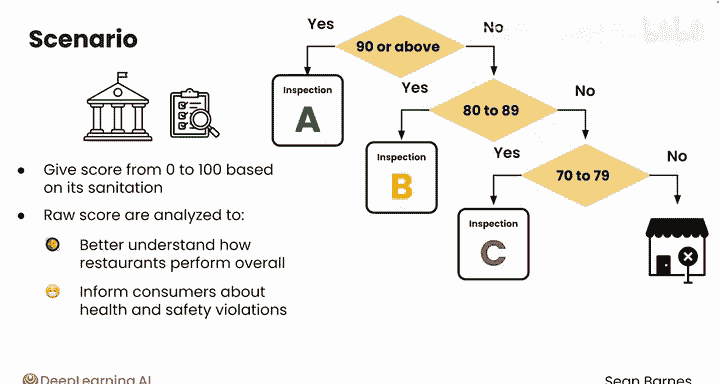
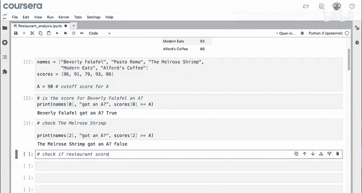
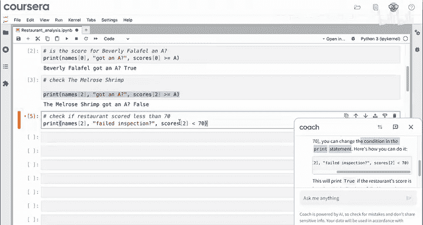
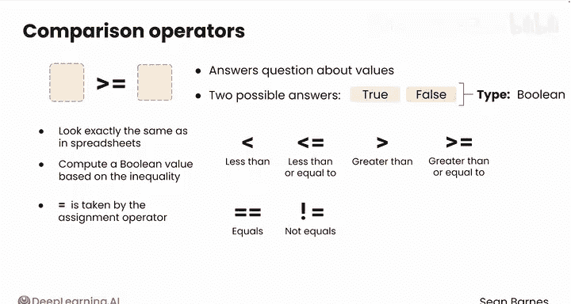
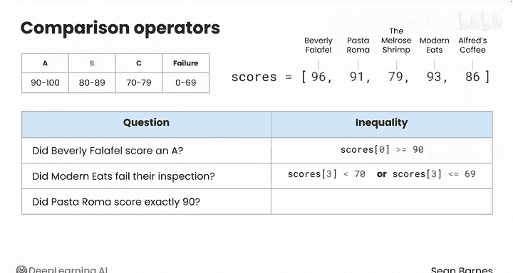
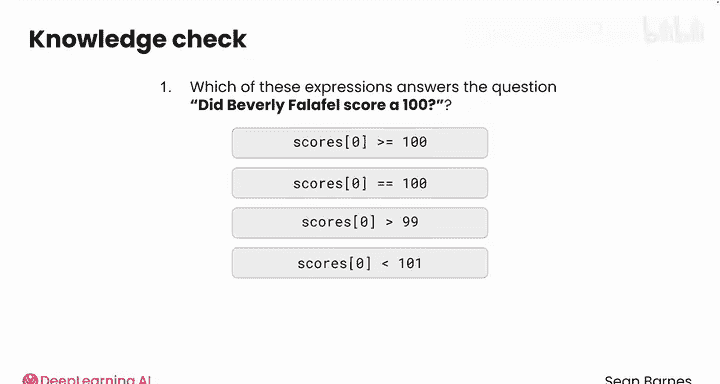

# 吴恩达《Python数据分析（数据分析第3课）｜Python for Data Analytics》中英字幕 - P17：16_比较运算.zh_en - GPT中英字幕课程资源 - BV1rp5yzjEgn

In data analyticslytic foundations， you learn that data is any information that can be used to make a decision。

So how can you make decisions based on data in Python。

 say you're working with a government agency that performs restaurant inspections？

The inspectors take a tour of the restaurant and give it a score from 0 to 100 based on its sanitation。

 These raw scores are then analyzed to better understand how restaurants are performing overall and to inform customers about health and safety violations。

 If the score is 90 or above it's considered an A。 The restaurant can display the a grade publicly and if typically inspected less frequently。

80 to 89 is a B。 the restaurant must display the B grade and it may be inspected more frequently。

70 to 79 is a C。 the restaurant must display the C and will need to take immediate corrective action or face closure。

 Anything below 70 is considered a failure which leads to immediate closure。

 noticeice how the different score is branch out into different courses of action。

 say you're given a data set like this one adapted from one released by the county of Los Angeles California USA you have a column of scores。

 but the need to be converted to ratings in order to send the correct signage and schedule necessary inspections or closures。

 This data has 67000 rows。 Each one representing an inspection。

 So even though you could do this manually。

Certainly wouldn't want it。 Let's use a random sample of five rows to see how you would go about converting these scores to ratings。

Then you can scale up to the entire data set later let's start by making some comparisons Here are two lists representing two columns of data。

 restaurant names， and the corresponding course。So names0 is Beverly falafel， and score0 is 96。

 the score for Beverly falafel。Having a list of multiple lines like this is completely fine by the way。

 you can also store the cutoff score for an A in the variable A， which is 90。

The first thing you might ask is is the score for Beverly falafel and A to do that， print。

 label this using the name zero， the first name， got an A question mark。

 and then score0 greater than or equal to a。What do you think should print？Well。

 the value of score0 is 96， the value of a is 90， and 96 is in fact greater than 90。

 so when you run this cell you get the value true。True is a special type of value that you'll explore more in a moment。

 Now you can do the same for the other scores。 Let's check whether the Melrose shrimp got an A。

So score is 2 greater than equal to a。The answer is false。 The Melbro shrimp has a score of 79。

 That's actually a C， unfortunate。So greater than or equal to is one comparison operator。

How would you check if a restaurant scored less than a 70， which would mean immediate closure？

You can ask your LOM to help modify this code。So the LLM says that you can change the condition in the print statement and it gives you some code to make this new comparison you can try out that code the Mel row shmp didn't fail few。

Notice that the LLM chose a different comparison less than。

Let's check out your options for comparisons in Python。

Greater than or equal to is just one of many comparison operators。

 comparison operators take in two values， one on the left and one on the right。

 And they answer a question about those values。 These questions can only have two possible answers。

 true or false。 Theres no in between This type of value。 The output is called a boolean。

Buolean has a fancy name， but it just means a true false value。

 It's just another data type in Python。 just like int， float and list。

 There are six comparison operators in Python。 First。

 you have less than less than or equal to greater than and greater than or equal to these look exactly the same as in spreadsheets and computer Boolean value。

 either true or false based on the inequality。 Next， you have equals。

 which is written with two equal signs and not equals， which is written as exclamation point equals。

 Why do you think the equality operator has two equal signs。

 That's because the single equals is already taken by the assignment operator。

 The one used to assign a value to a variable。 It's important to remember if your're checking for equality always write two equal signs。

 Here's a reminder of the score ranges for different grades on the left。

 as well as the random sample of restaurant scores on the right。

 Here are some questions you might have。 and the inequality that would answer each one。😊。

The Beverly falafel score in A， you already saw this could be answered with score 0 greater than equal to 90。

Did modern Es fail their inspection In that case， you could use the code scores 3。

 less than 70 Can you think of another way to answer the same question？

That would be scores 3 less than or equal to 69。 This inequality answers the exact same question。

 assuming the scores are of type integer， notice that if the scores were floats。

 the second expression wouldn't work， since values like 69。

5 would be counted as passing inspection De Paoverma score exactly 90。

 you could use the code Sc 1 equals equals 90。

Let's put your knowledge to the test， the Beverly falaf will score 100。

The correct answer is score0 equals equals 100。

Excellent work with comparison and buoleance。These operators allow you to make decisions in your code using conditionals。

 followow me to the next video to see how。😊。