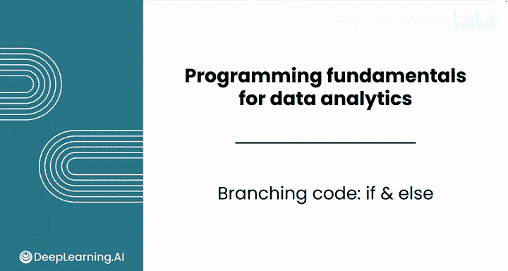
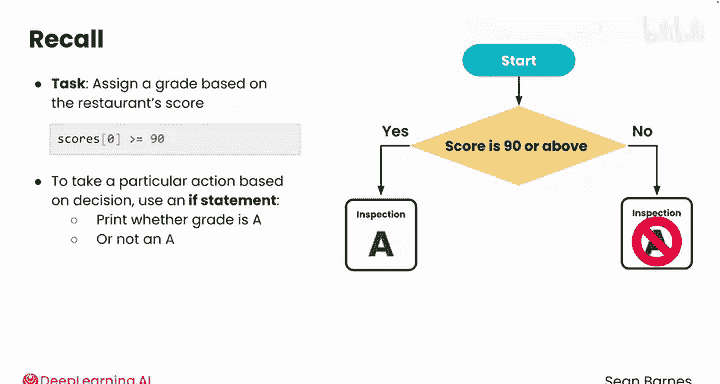
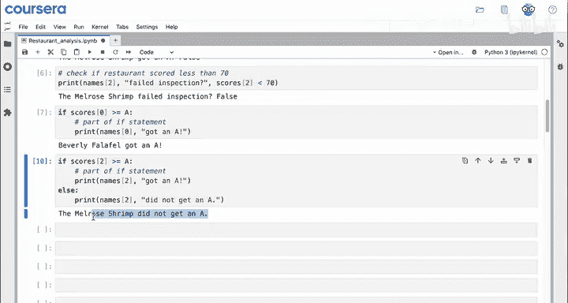
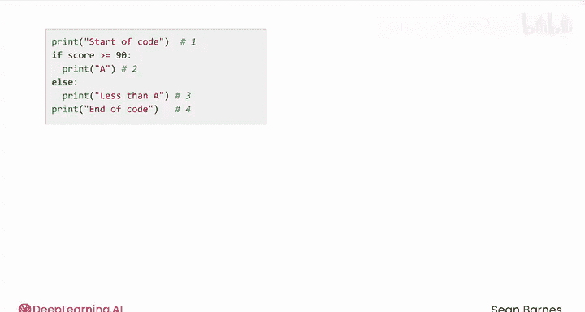
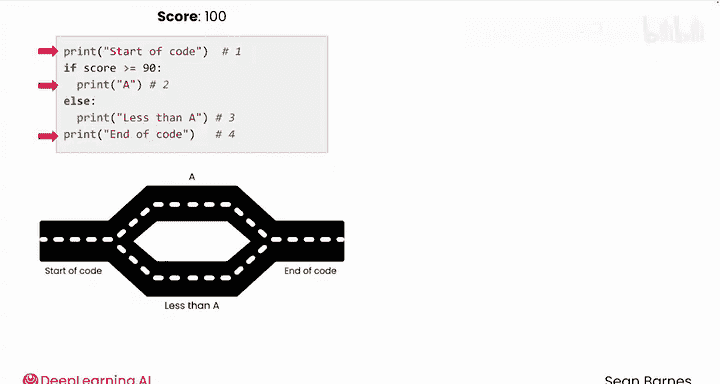
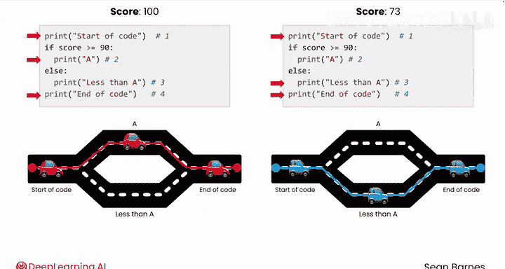
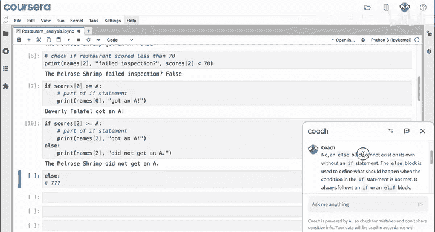

# 吴恩达《Python数据分析（数据分析第3课）｜Python for Data Analytics》中英字幕 - P18：17_分支结构：if-else.zh_en - GPT中英字幕课程资源 - BV1rp5yzjEgn

Now that you've practiced with comparisons， let's see how to use those comparisons to make decisions in your code recall that your task is to assign a grade based on the restaurant score。

 you already saw the code that makes that comparison for an A。

 A variable containing the score greater than or equal to 90 in order to take a particular action based on that decision。

 you'll need to use an if statement。 For example， your first step might be to simply print out whether the assign grade is an A or not an A。

 It's common to use a print statement to check that branch and code is working correctly。

 Your task is a check if each restaurant has received an A rating。

Remember， your ultimate goal is to scale this operation to all 67000 rows。

 Let's build towards that task step by step。 You already saw in the previous video that this comparison will check whether the score for Beverly falafel。

 the first restaurant in this list is greater than or equal to a， which is 90。

 The minimum score for an A to use that comparison to take some kind of action。

 you can write an if statement。 type if then paste in your comparison you saw earlier。 Then a colon。

 Now you'll see that when you hit enter your code is indented。

 a colon and indentation indicate that all of this code belongs together as part of the if statement。

 lines of code that are indented here will run only if score 0 is greater than or equal to a So you can enter a print statement。

 name 0 got an A。 What do you think will happen if you run this code。😊，Hitting shift enter。

 this line of code does run。 Beverly falafel got an A。 Now， remember the Melrose shrimp。

 They were having a tough time。 If you run this code now for scores 2 and names 2。

 which is the Melrose shrimp， what do you think will happen。This may be a bit trickier。

If your head shift enter， well， nothing happened。That's because the score for the Melbre shrit is a 79。

 which is not an A， so this conditional evaluated to false and the end ended block of code didn't run。

 You can add a separate branch in your code to handle that case when the condition is false。 So else。

 if the score is less than an A， you can print names 2 did not get an A。So now。

 no matter what the value of scores 2 is， one of these two blocks of code will run。Running it now。

 this code prints， but the Melbough shrimp did not get an A。

Here are a few lines of code that are very similar to the notebook you just saw。

 let me ask you how many paths are there through this code。

 how many different ways could this code execute？

There are two different paths。 It depends on the value of score If score is in fact greater than or equal to 90。

 then print statements 1，2 and 4 will execute， and the program will print start of code a and end of code If score is less than 90。

 then the computer will take a different path through the code printnt statements 1。

3 and 4 will execute instead and the program will print start of code less than a and end of code so you can use if statements to make decisions and create branching paths in your code you can write an if statement all in its own to execute some lines of code in a particular case or you can add an else after the if block can you have an else block on its own without an if statement for what if question like that。

 you can ask your LLM。

So the LLM says no。An else block cannot exist on its own without an if statement。

The L block is used to define what should happen when the condition in the if statement is not met。

Branchching code is fundamental to programming。In data analytics。

 not all data is relevant to the question you're trying to answer and different types of data need to be processed differently。

 follow me to the next video to extend your conditional to an entire list of data。

