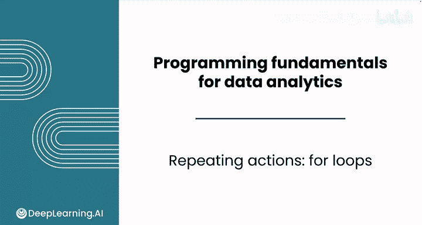
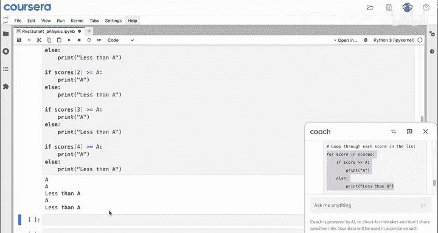
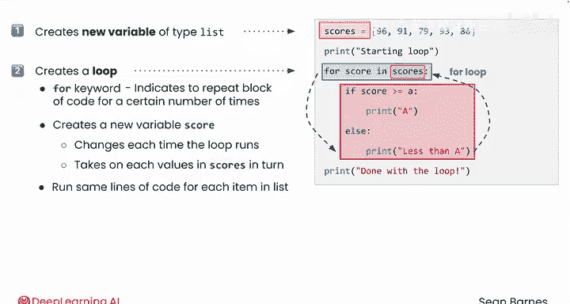
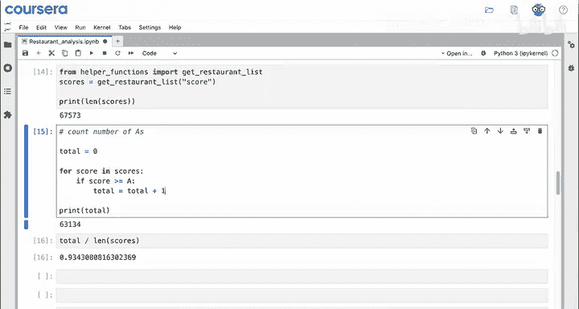

# 吴恩达《Python数据分析（数据分析第3课）｜Python for Data Analytics》中英字幕 - P19：18_循环结构：for循环.zh_en - GPT中英字幕课程资源 - BV1rp5yzjEgn

So far， you've learned how to write a conditional to check one piece of data at a time。

 but that's a tedious process to realize Python's efficiency。

 you'll need to write code to repeat actions Take a look at these two code blocks。

 which are a slightly simplified version of the code you worked with in the previous video。

What do you notice about them？While they look quite similar， in fact。

 they're only different by a single character， the index number of the list。

 Is there a way to rewrite this code so that it runs for every item in the list。You can ask the LLM。

 so I have a list of restaurant scores and I have written the following lines of code to check if their scores are an A or less than that。

I want to check all the scores， how can I rewrite my code to avoid repeating myself？

And the LLM replies that you can create a loop to iterate over all the scores in your list。Okay。

You have scores and A already to defined so you can skip that part。

 but you can copy the code for the loop and why not just run it to see what happens？

So this code printed five times one for each item in the list。If the score was higher than 90。

 it took the first branch of code， the F branch， and printed A。If not。

 it took the else branch and printed less than a。 notice that for score and scores is the only new line of code。

 This creates a control structure called a for loop。

 The for loop will run this indentic code block one time for every item in the list scores。

 each time it runs， it will run with a new value for the variable score going through the list。

So first， score will be 96 then 91 and so on。In fact。

 you can just write another loop and print score to see what's happening inside it。

 so you get each value in the list writing this loop up here is almost like having five identical copies of this code In fact。

 here's the equivalent code without a loop。If you run this code， it gives you identical output。

 but it sure saves a lot of time。

Take a look at this code， which you just worked with a moment ago， what does each component do？

The first line which you've seen before， scores equals。

 creates a new variable of type list that holds all the restaurant scores。

 the line for score and scores creates a loop。A loop repeats a block of code。

 the4 is a Python keyword that indicates that you're going to repeat that block of code for a certain number of times。

Score and scores creates a new variable score that changes each time the loop runs。

 and it takes on each of the values and scores in turn stepping back for a moment。

 this line of code called a four loop allows you to run the same lines of code for each item in a list without creating a new variable each time It's called a loop because once you get to the end of the intended code block。

 you loop back up to the top of it Once all the operations are done In this case。

 once the loop reaches the last item in the list， the loop stops and the computer moves on to the next line of code that comes after here's a quick demo of why four loops are so powerful。

 let's import a helper function that will read in the scores from the entire data set and save them in the variable scores。

 Now if you print the length of scores， you get over 67000。

 This is the full dataset set you can write a loop to count the number of A's in this data。

Start with the variable total with the value 0。You haven't started accounting yet。

Then for score and scores。You're checking each score in turn。

Then if the score is greater than or equal to a， you will add1 to total。So total equals total+ 1。

You have to add one to total and then overwrite the previous value of total after the loop。

 so not inventeddent， you can print the total。This code counts up how many restaurants earn an A rating what's your guess out of 67。

000 restaurants？More than 63，000 of them。So almost 95%。

Notice how easy it was to scale up from a list of five to a list of over 60，000。

You didn't need to change any of your loop code at all。This code also runs in a fraction of a second。

 typically around two or3 milliseconds， even though this data set is so large。

 it can cause Google sheetets to lag or crash。 Excel work creating a loop over tens of thousands of rows of data。

 You're starting to see the power of Python's efficiency。

 Foow me to the next video to see some common problems you might encounter when working with control structures。

😊。

