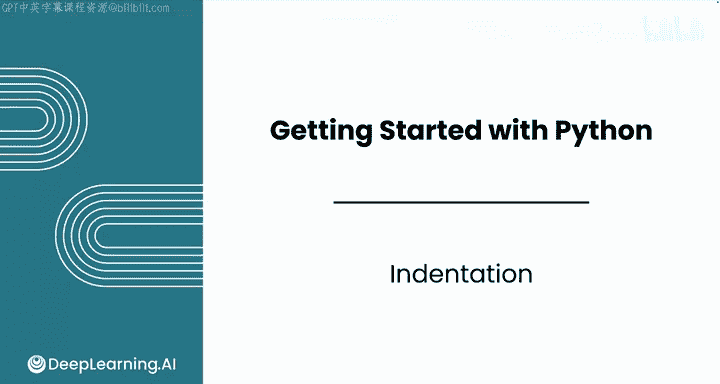
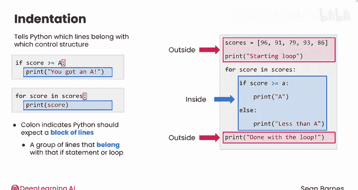
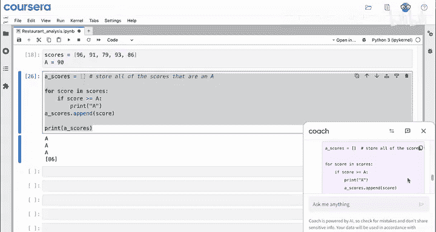
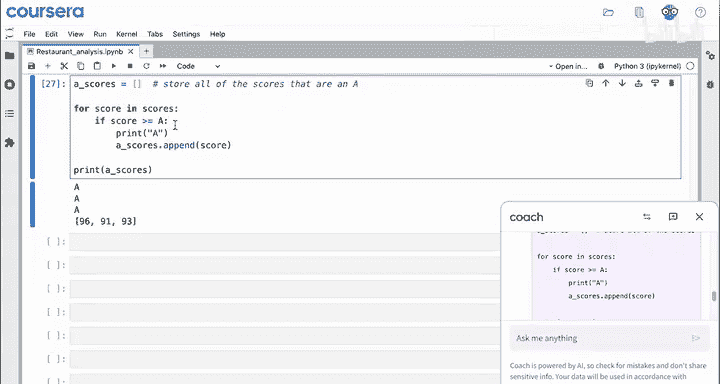
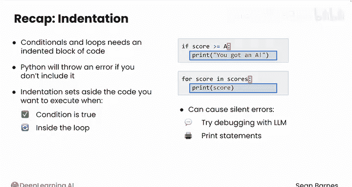

# 吴恩达《Python数据分析（数据分析第3课）｜Python for Data Analytics》中英字幕 - P20：19_缩进规则.zh_en - GPT中英字幕课程资源 - BV1rp5yzjEgn

With conditionals and loops， you're starting to create complex workflows in your coat。

Both of these control structures involve indentation， adding white space to your code。

Let's take a look at how indentation works and how it can go wrong Indentation is a common feature of control structures。

 like conditionals and leaps， Indentation is used to tell Python which lines belong with which control structure When you write an if statement or a loop。

 the line ends with a colon。That colon indicates that Python should expect a block of lines， or。

 in other words， a group of lines that belong with that if statement or loop。

 Here's one of the four loops you used in a previous video。

 You'll often hear people say that code is inside or outside the loop or inside the conditional。

 In this example， all of the code is inside the loop。

That's the code you want to execute for each item in the list。

 then you have code outside the loop that's not indented。So for control structures。

 the indentation is just as much a part of your code as what you type。

 Let's look at how indentation can go wrong with some code examples in the previous video。

 you saw code very similar to this loop In this case， you want to loop through each score。

 check if it's an A and if it is an A， you want to do two things。

Print a and append that score to this empty list of scores。

 so basically you want to end up with a list of all the scores that are Ace。 Now。

 imagine that this if statement was not indented like this。What do you think would happen。

You get an error Exp an indented block。 That's because Python sees this colon and it expects you to say。

 hey， here's the code that you should run inside this loop。 So technically。

 now this code is outside the loop。 Now， what about if the print line was not indented。In this case。

 shift En， you also get an indentation error， Exp an indented block because again Python sees a colon。

 and it expects you to say here's the code to execute if the if statement is true。 however。

 you can also have silent errors as well where your code runs It doesn't throw an error but it's not doing the right thing So here's an example of that this code works properly So if you say print a scores。

 what do you expect to be printed out after this code runs。Well， you've got five scores。

 but only three of them are A's， so you should see print A three times。

 and the list a scores should have these scores in it。 So 96，91，93。 there you go。 Now。

 what would happen if instead this line of code with the pen was not intendeddent。

You may want to pause the video and think about this for a moment。Let's see what happens。 Shi enter。

 In this case， there was no error。 So your code ran and there was no problem with it。

 A printed three times。 That's correct。 But all of the scores were added to your list of a scores instead of just the three A's。

 That happened because this line， a scores。 a pen score is not actually inside your if statement anymore。

 It's just inside the for loop。 So this line of code will run only if the score is greater than or equal to a。

 But this line of code will run for every value score。😊。

So that's why you end up with all the scores inside the list Now。

 what would happen if this line of code was indented all the way over to the left？

You may want to pause the video one more time and think about what you expect to happen。Again。

 your code ran， but it's not working properly， this line of code is now no longer inside the loop at all。

 so whatever the last value of score was got app pen to your list of scores。

If you want more explanation， you can always ask your LLM， why was this code not working。

 making sure to explain what you expected to do as well。

 you can say I wrote this code to append all the scores that are above the A threshold to the list A scores。

However， it only appended the value 86， why？And then paste in your code。

It says that the issue with their code is related to the indentation of the A scoress dotted pen line。

 and then it says because that line is outside the if statement。

 it only appends the last score from the scores list after the loop is finished。

And then it offers you a solution for how you can fix it so you can copy and paste this block of code and see if it corrects your issue。

It seems to now be working properly， the A scores dotta pen line is now properly indented within your if code block。

 so don't be afraid to ask your LLM for help if you need a second opinion on annotation。

So to recap， both conditionals and loops need to include an indented block of code。

 This indented block comes after the colon and Python will throw an error if you don't include it。

 The indentation is used to set aside the code you want to execute when the condition is true or inside the loop。

 you saw that sometimes indentation can cause silent errors。

 That is your code runs and doesn't yell at you with an angry red box but it's not working properly or doing what you expected it to do you can try debugging with an LLM or using print statements to help you find the error。

 Just keep in mind that not all errors stop your program。

 your code can run but still do the wrong thing as well Now that you're more familiar with indentation。

 you can expand your ability to create branching paths in your code so far you've learn how to create two paths but in Python you can create three or more paths。

 follow me to the next video to see how to do that。

