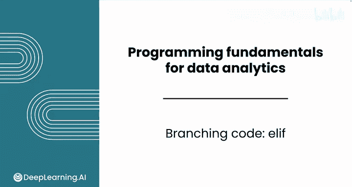
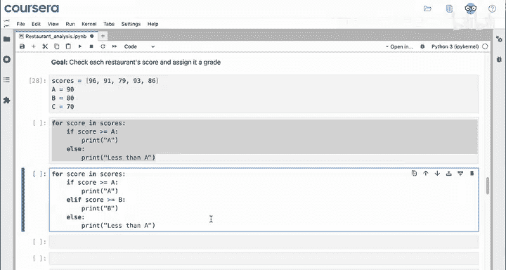
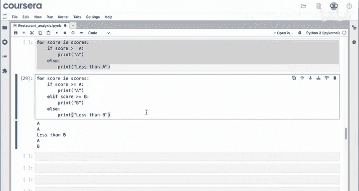
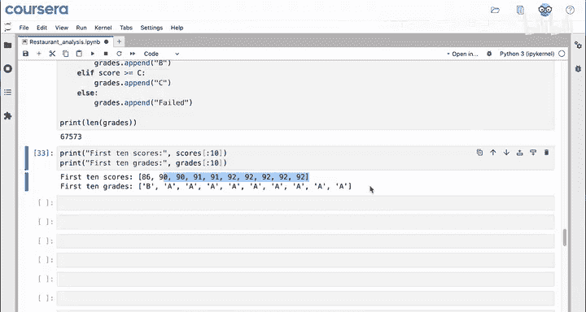
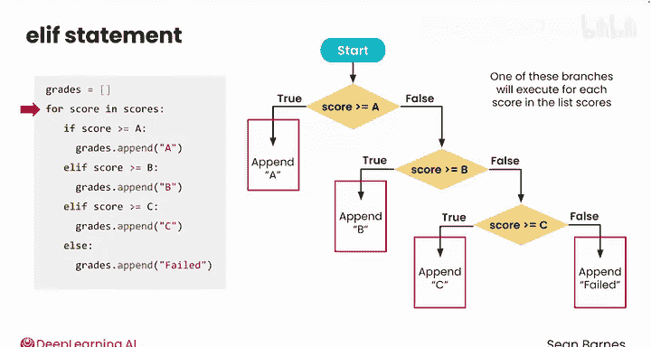
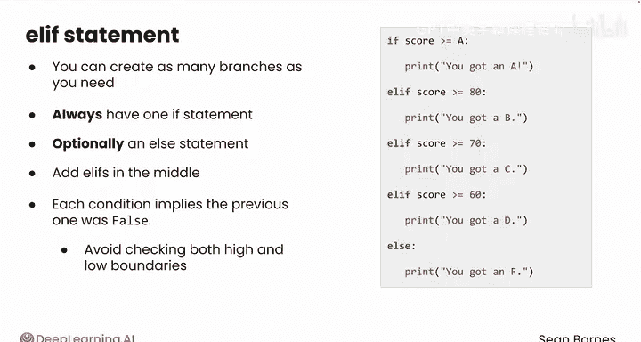

# 吴恩达《Python数据分析（数据分析第3课）｜Python for Data Analytics》中英字幕 - P21：20_多分支结构：elif.zh_en - GPT中英字幕课程资源 - BV1rp5yzjEgn

Let's put everything you've learned together loops and conditionals to assign restaurant food safety grades。

 The last piece of the puzzle is creating more than two branches in your code using control flow in a previous video。

 you were writing code to check each restaurant score and assign it a grade。

 This is where you left off in a previous video。😊。

Remember this code printed whether a score was an A or less than that。

You also have some new variables for B and C cutoff scores right now this code has two branches。

 A or less than A。To assign B's and C's， you need to create more than two branching paths。

 You can add a new branch using LF， which stands for Elsif。

 meaning essentially check another condition for me。 If score is greater than or equal to B。

 you want to print B。Notice that all three of these branches provide unique pathways for the code to execute。

You can only take one of them for each score。You can kind of think of them like a progressive filter。

Any scores that are greater than or equal to 90 follow this branch in the code and print A LF checks another condition is score greater than or equal to B。

 If so， print B， how should you to change the else print statement？Well。

 now the L is the catch all bucket for scores less than B。Run this code and you get A， A， Le than B。

 A and B， you can add as many LSs as you like until you've created all the branches you need in your code。

So you can add another LF score greater than or equal to C then print C。

 Now you change the L to failed if you didn't get an A， B or C， you failed。

Running that code now you have a C represented in your data as well Now that you've created these different branches inside your loop。

 you can do some cool operations， for example， say you're working with the full data set which you've previously created using this helper function you might want to create a new list containing all the assigned grades for the restaurants you can create a new empty list grades and append the newly assigned grade for each score inside your loop。

So instead of print A， you can say grades dota pan A。How would you finish modifying this code？

You can just append the corresponding grade inside each conditional。B， C， and failed last question。

 say this loop runs。 and afterwards， you print the length of all grades。

 How long do you expect this list to be。It should be the same length as the list of scores 67。

000 or so， you should take a look at this data and check whether your code worked properly。Remember。

 just because it ran doesn't mean it worked correctly。So how try asking your LLM。Here's a prompt。

Write me code to print out the first 10 items of the list scores and the list grades。

So let's try this cook， it's new and fancy， but looks like some kind of indexing of the list。

Running that code you can inspect the data This looks right the first grade is a B while the rest are all A's。

 all in the 90s that should match your intuition since you already saw that about 95% of scores are A's。

 let's model the branching code you just wrote using a flowchar just to solidify what you've learned the first if statement checks whether the score is greater than A or 90 if true。

 then the code will append A to the list of scores。

If false， then the code will move down this path to check if the second LF statement is true or false。

 if it's true， then the code depends B to the list。If that statement is false。

 then the code moves into the next LF， app pending C。 If it's true， If that final condition is false。

 it moves into the else block。 A pending failed。 This code creates four possible branches for each score。

 the code will go down one of these four paths。 Remember that all of this happens inside the for loop。

 So one of these four branches will execute for each score in the list scores。

If there are five items， this chain of decisions happens five times。 If there are 60，000 items。

 it happens 60，000 times。 You can create as many branches as you need。

You always have one if statement， and optionally an L statement。

 and if you need more than two branches， you can add Ls in the middle，1 LF。

2 Ls or as many as you need。 you can also have just if and LF statements。

 a pattern you can use if you don't need a catch all bucket at the end。

 Notice the descending pattern in the scores。 This pattern takes advantage of the sequential nature of if statements。

 Each condition applies at the previous condition was false。That way。

 you avoid having to check the score against both the high and low boundaries for the grade。

 Great work， creating branching code with LF。

In the next video， you'll learn the final key concept of this module。

 how to loop through multiple lists at once， I'll see there。

