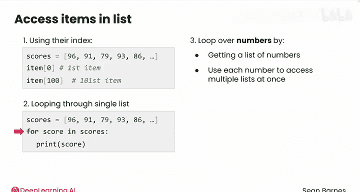
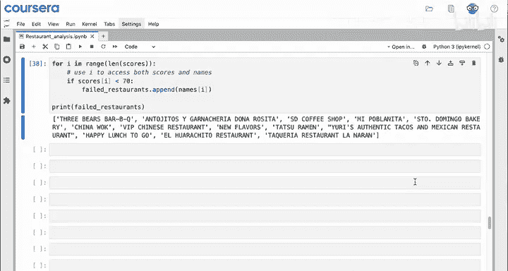
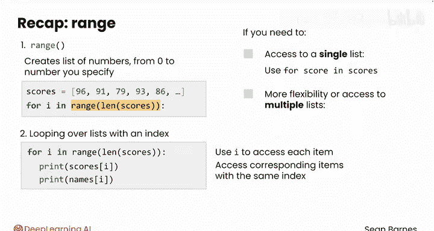

# 吴恩达《Python数据分析（数据分析第3课）｜Python for Data Analytics》中英字幕 - P22：21_使用range函数循环.zh_en - GPT中英字幕课程资源 - BV1rp5yzjEgn

You've already seen how to write a loop to loop over a list。 However， four loops are quite flexible。

 Let's take a look at how to use them to loop over multiple lists at once before looking at the code。

 recall that you can access items in a list using their index。 So for example。

 score0 accesses the first item and scores 10 accesses the hundred and first item and so on。

 The big idea here is that instead of looping through a single list with a line of code like for score and scores。

 you can loop over numbers， essentially by just getting a list of numbers and using each number to access multiple lists at once。

 This strategy allows you to access the same position and multiple lists together say you've been asked to create a list of all the restaurants that failed inspection that list is probably pretty short。

 Since 95% of restaurants got an A So start with getting two lists。

 scores and names from the restaurant data you've already seen what scores looks like。

 But if you print the first 10 values of names you get just a bunch of names of different restaurants。

😊。

So now you have two columns in the data What's challenging about this problem is that you want to loop through the scores list。

 but you want to save a name based on that score， not the score itself。

 if you just start with the loop like for score and scores。

 you only have access inside the loop to the scores， not the names。Let's map this out。

 you can say if score is less than 70， that's a failing score。

Then you want to append the restaurant name to a list of fill restaurants。So up top。

 create failed restaurants equals an empty list。But how do you know which restaurant you're talking about at any given time。

 This loop structure isn't going to work out。 However， you have another option available to you。

 You may remember this code where you had a short list of names and scores and you access both values using their index their position in the list。

 So if you are able to loop over a list of numbers。

 you could use the same number to access both the names and the scores lists。 It's a little abstract。

 Let's write the code。 So what we're going to do is for I。

 which stands for index in range and start with 10 just as an example。Print eye。

So range is what's new here。Range creates essentially a list of numbers from zero by default to this value input。

 not including this value。In this case，0 through9。Those numbers are the different values that I will have throughout the loop。

 These numbers are exactly the same indices as the list of length 10。

 your list starts at0 and its indices go all the way up to 9。

 So what you can do to loop through these two lists at once is for I and range and then get the length of a list L scores either list works since they're both from the same length。

This range function creates a range from 0 to 67，573。

Those are all the indices that you need to access and now you can access both scores and names inside this loop using the same index so you can move through both lists together accessing scores I and names I together if you're accessing the 10th score you're accessing the 10th restaurant name as well so you can say if score I is less than 70 So is the score less than 70 If so you want failed restaurants about a pen names I So if the score is failing。

 add the corresponding name to the list。 Once the loop is done。

 you can print failed restaurants just to see what's in there shift in。And that was super fast。

 You got this list of the restaurant mains， each of which had a score less than 70。

You learn two new concepts in this video， the range function and looping over lists with an index range essentially creates a list of numbers that you can loop through starting from zero by default up to but not including the number you specify you'll commonly see a pattern like this range L scores used to loop through all the emdices in a list in this case the list of scores once you've created a loop with a line like for I and range L scores you can use I to access each item in the list like scores I if you have two corresponding lists。

 you can access corresponding items with the same index like scores I and mains eye so if you need to access a single list you can use the for score and scores code you learned previously。

If you need more flexibility or to access multiple lists。

 you can use the index based loop you learn in this video。

 C job working with multiple columns of data。 You'll learn many more nuances in the next module。

 For now， follow me to the final video in this lesson where you'll take an in depth look at execution order。

 I'll see there。😊。

