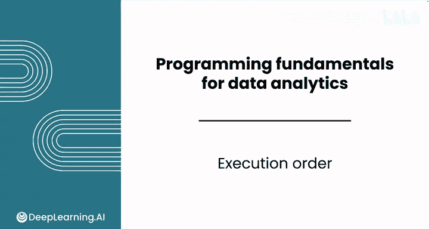
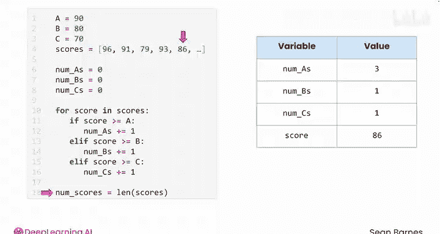

# 吴恩达《Python数据分析（数据分析第3课）｜Python for Data Analytics》中英字幕 - P23：22_执行顺序.zh_en - GPT中英字幕课程资源 - BV1rp5yzjEgn

Execution order is the sequence in which your program runs individual lines of code。

 You've seen how control flow allows you to repeat code or take one of several branches。

 Let's trace through an example。 Here's some code that totals up the number of A's。

 B's and C's in the data。 When you're debugging， it can help to step through the code line by line。

 Here's how you can approach that。 let's keep track of the values of each variable as you step through the first five values in the list。

 Pay attention to the control structures。 First， which variables you expect to say the same as this code runs。

A， B， C and scores will stay the same Since the cutoff scores are constant and you don't expect to be appending to the list or doing any other operations on it。

 Meanwhile， nu A's， nu b's and nu C's will change as the scores are tally。

 The value for score will also change as the loop runs。

 So you can watch the values of each tally and score zooming in in the loop。

 And the first cycle or iteration。 score gets the value 96。

 Then the computer checks if the scores greater than or equal to a a has the value 90。

 and 96 is greater than 90。 So the computer will execute the line underneath adding one to the variable nu A's。

 which is now one。 The computer then skips the LF blocks and returns to the first line of the loop。

 And the next iteration score gets the value 91。 The first thing the computer does is check if the value is greater than or equal to a。

 which is 90。 And since that expression is true， it executes the next line to add one to the variable nu A's。

 which is now2。 the LF and L blocks are skipped and the loop returns。

At the top in the next iteration， score has the value 79。

 The computer first checks if score is greater than or equal to a， which is 90。

 but that expression is false。 So the next line of code is skipped。

 Then the computer checks the next condition。 else if score is greater than or equal to B。

 Since B is 80， this expression is also false。 So the computer skips the next line and moves to the next L block。

 This condition is true。 So the computer executes the line under LF adding one to the number of C's。

 which is now1。 The loop then returns to the top。 Now score has the value of 93。

 The first condition is true， So the computer executes the line underneath and adds one to nu A's。

 which is now 3。😊，The loop returns to the top。 Finally， score gets the value 86。

 The first condition is false since 86 is not greater than or equal to 90。 The next line is skipped。

 Then the computer checks else if the score is greater than or equal to 80， which is true。

 So the line underneath the first L if is executed， adding one to none Bs， which is now one。

 The loop continues this process until it reaches the end of the list。

 Then the computer can move on to the next line of code。

 which involves calculating the length of the list。 Great work tracing through that code。

 You just constructed a common coding pattern， Taing up different kinds of items in a list。😊。

It's the same operation as some if and a spreadsheet you've now built up the core skills needed for computer programming in Python data types。

 variables， conditionals and loops， you've covered a lot of ground and just one module and I'm excited for you to try out the upcoming assignment and graded lab follow me to the next video to see how you'll complete your first graded lab。

