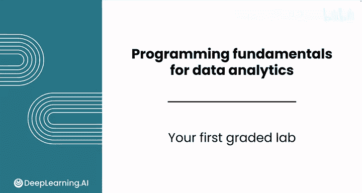
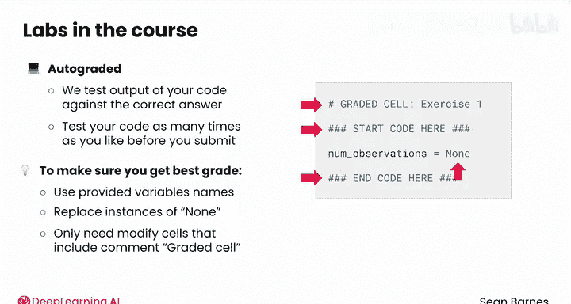
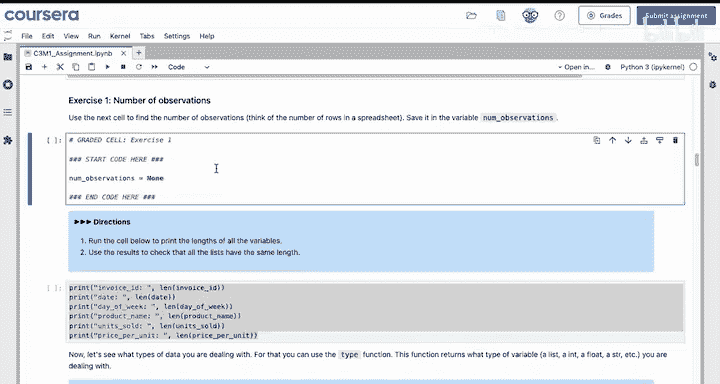
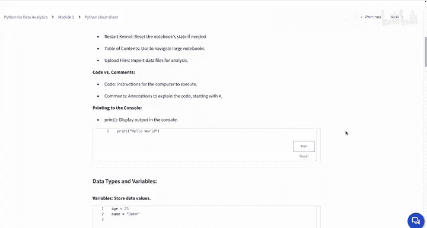

# 吴恩达《Python数据分析（数据分析第3课）｜Python for Data Analytics》中英字幕 - P24：23_你的首次分级实验.zh_en - GPT中英字幕课程资源 - BV1rp5yzjEgn

Coming up， you'll complete your first graded Python lab for this course。

 You'll analyze a real world data set to test your Python skills。

 The labs in this course are auto graded， meaning that we will test the output of your code against the correct answer。

😊。

If your code outputs the right answer， you'll get points for that exercise。

 You can test your code as many times as you like before you submit your answer。

 so there's no pressure to get things right the first time throughout the labs。

 youll see code blocks like this the comment graded cell lets you know that you'll need to add your own code to the cell and you'll get points based on whether its output is right。

 you'll need to add your code only between the start code here and end here comments。

If you put your code outside these comments， the autograder won't recognize it。

 Some important notes as you complete the lab to make sure you get the best grade possible。

 Use the provided variable names。 In this case， you shouldn't change the name nu observations。

 because the autograder won't be able to recognize it replace any instances of none that you see none just serves as a placeholder if you see none that's an indication that you'll need to add your own code there。

 you only need to modify cells that include the comment graded cell。

 you can add new cells to experiment with if you'd like。 but only the graded cells will be evaluated。

 This is the interface you'll see when completing your first graded lab you'll be working in Jupiter lab and Coursera。

 the same interface you've seen throughout the videos in this module but with extra Courra options at the top。

 the important options here are the courseursera coach grades and submit assignment buttons remember that while working on your assignment if you'd like to chat with an LLM either to ask a question or help fix an error message you can click the Coursera coach button So if you ask how can I define a new variable in Python。

😊。

The coach will give you a response with some examples。

 Remember that if you close the chat and reopen it， your chat history will be safe。

 so you don't have to worry about keeping that up if you want to reference it later for a little more space when you're working。

 you can click the file browser button over here on the left for each exercise as you already saw you'll have this comment that says graded cells So you'll need to fill that out you'll notice that some code cells like this one here。

 don't have that comment so you don't need to change anything in them and you'll need to put your answers between the start code here and encode here comments in this cell。

 you'll need to replace this none with whatever the correct code should be。

 Once you've completed all the graded cells you're ready to submit go up here to the right and click submit assignment you may have to acknowledge the honor code before submitting then the grades tab will pop up which you can also access using this button Once your submission has been graded。

 which may take a few minutes you can view the results Here's what would happen if you submitted a blank assignment just to show you you'll see whether or not you passed the grade you received and the grade to pass In this case。

Pcent or higher for each exercise， you'll see how many points you earn for that exercise as well as the output from running your code so you get some feedback to help you improve on each exercise you can resubmit as many times as you like if you'd like to save your assignment to come back to it。

 It's important that you click this save button before closing this window Otherwise you'll lose your progress。

 The next item in this course is the Python cheat sheet it contains a handy reference for all the concepts you've learned so far in this course feel free to use it alongside the courseurra coach to help you complete the assignment before each graded lab in this course。

 you'll get an updated version of the cheat sheet with all the new concepts youve learned in each module So get ready for your first lap。

You'll work with data from a local shop to calculate sales for different types of products once you're done at the lab。

 join me in the next module to explore how to work with entire spreadsheets in your code great work so far and I'll see there。

