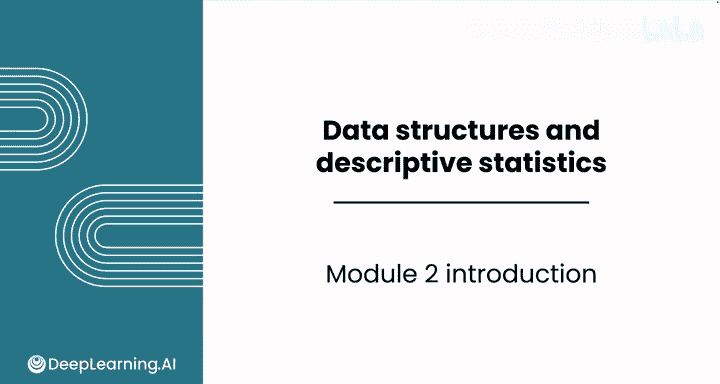
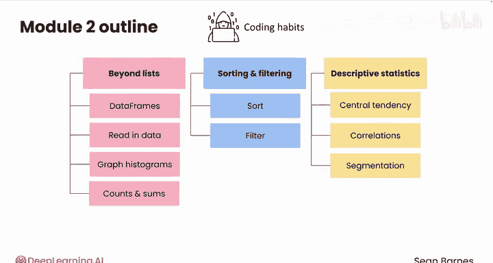

# 吴恩达《Python数据分析（数据分析第3课）｜Python for Data Analytics》中英字幕 - P25：24_模块2 简介.zh_en - GPT中英字幕课程资源 - BV1rp5yzjEgn

Welcome to moduled 2， data structuress and Descriptive statistics。

In this module， you'll discover how to organize， analyze and derive meaningful insights from your data using a powerful Python library called Pans。

 you'll learn how to use essential data structures。

 including data frames and series that allow you to work efficiently with large dataset sets throughout this module。

 you'll use a real-word data set of survey responses about coding habits In the first lesson。

 you'll explore data structures beyond lists， learning how data frames can store and organize complex data just like a spreadsheet。

 but with much more analytical power you'll learn how to read in data。

 graph histograms and calculate counts and sums on your data。

 The second lesson focuses on sorting and filtering crucial skills that let you focus on exactly the information you need you'll learn how to sort your data and meaningful ways and filter to find precisely what you're looking for in the final lesson。

 you'll learn how to calculate descriptive statistics using pans for measures of central tendency to correlations between features and segmentation。

 you'll also create visualizations to help。😊，Communicate your findings effectively。

 including bar charts and scatter plots。

By the end of this module， you'll be able to transform massive data sets into actionable insights using Python。

 follow me to the first lesson to begin exploring these powerful data structures， See there。

