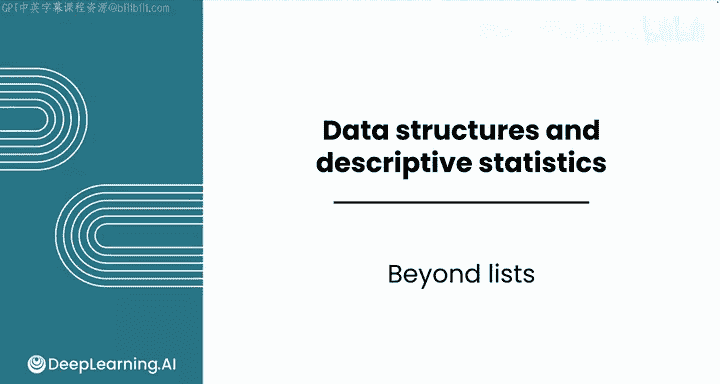
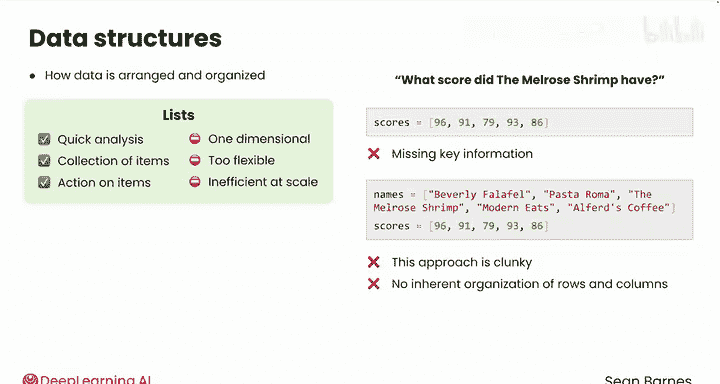
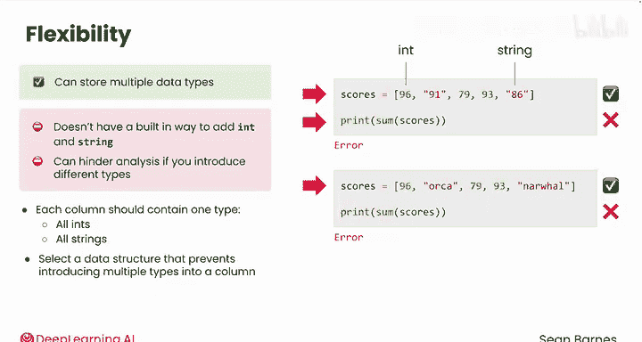
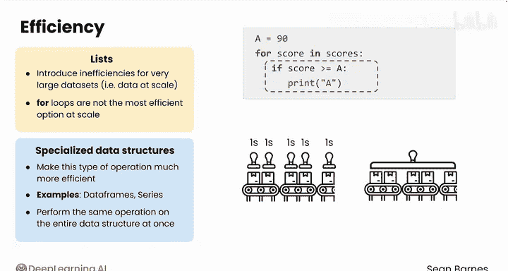

# 吴恩达《Python数据分析（数据分析第3课）｜Python for Data Analytics》中英字幕 - P26：25_进阶列表操作.zh_en - GPT中英字幕课程资源 - BV1rp5yzjEgn

In the previous module， you worked extensively with lists would store data in a sequence。

It turns out the way you store information when your're coding is quite important In Python。

 you can use different structures to store data in your code。

 data structure is just a fancy term for how data is arranged and organized。

 A list is just one type of data structure。 in the previous module。

 you work with 28 years of library data or around 6000000 restaurant greets。

 Ls help you perform quick analysis and you didn't need to scale just yet to millions of rows。

 a list is useful when you have a collection of items and you need to take action on those items by storing them together。

 taking action becomes more convenient However， lists have a few key limitations In particular。

 they're one dimensional。 They're too flexible and they're inefficient at scale。

 Once you understand these limitations you'll feel comfortable choosing from the other data structures available to you regarding dimensionality list can only store essentially one column of data。

 say you have a list of restaurant scores and you wanted to answer a question like what score did the Melrose shrimp have。

 You're missing some key information Can you tell what it is。

That would be the restaurant names for some applications， it's useful to just have a list of scores。

 for example， to calculate the average restaurant score。

 but the majority of the time you'll be working with twodimensional data data with rows and columns you saw one workaround for this dimension constraint in the previous module which was to maintain two separate but related lists like names and scores however。

 this approaches is clunky since there's no inherent organization of rows and columns just two separate lists。

 other data structures are twodimensional， allowing you to store multiple columns of data together just like in a spreadsheet lists are also very flexible For example。

 lists and Python can actually store multiple data types。 This list is perfectly valid。

 but what do you think happens when you run this line of code to sum of the values。

It throws an error and that's because Python doesn't have a built-in way for you to add in and string types As far as Python is concerned。

 your list might just contain a mix of numbers and c creatures so it doesn't support something a mix of numeric and nonnumeric types This flexibility is desirable in some applications but in data analytics it can hinder your analysis Each column in your data should contain one type of data all ints or all strings for example。

 you want to select a data structure that prevents you from accidentally introducing multiple types into a column lists also introduce inefficiencies for very large data sets that is for data at scale for example。

 in the previous module you used a four loop to run code for each item in a list This solution works perfectly and four loops are a very common tool in Python programming however。

 they are not the most efficient option and scale When this four loop runs it essentially steps through each operation in order running the indentive code for each score in turn imagine a conveyor belt of scores going past you one by one and your job is to stamp each score in turn if it's an A。

However， some specialized data structures using data analytics make this type of operation much more efficient you'll encounter two of them over the next couple of videos data frames and series instead of operating on each item in the data structure individually you can perform the same operation on the entire data structure at once if you imagine the conveyor belt of scores going past in this example you have a very wide stamp that can stamp all five scores at once if needed in the first example if each task takes one second the four loop code would take five seconds while the more efficient code would take just one second Of course there's more complexity to it but at scale for very large data sets this efficiency adds up significantly this process of performing an operation on the entire data structure at once is called vectorization don't worry too much about this term you don't need to code a vectorization it's a built-in feature of the data structures you'll be working with so while lists are incredibly useful they aren't the only data structure。

Follow me to the next video to get started importing your code from files outside your notebook。

 which will allow you to use data structures developed by others， I'll see you there。

