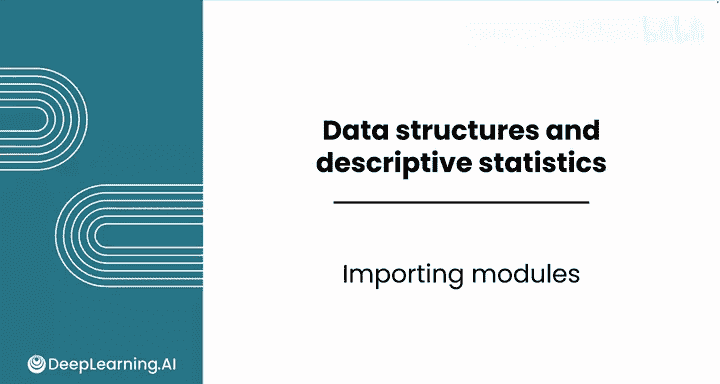
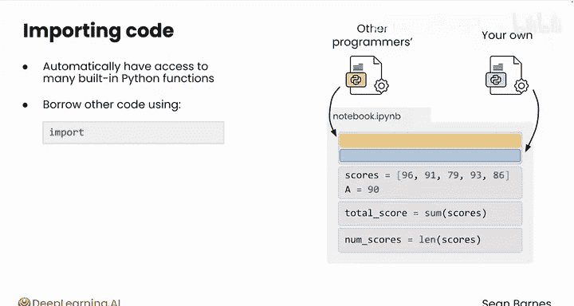
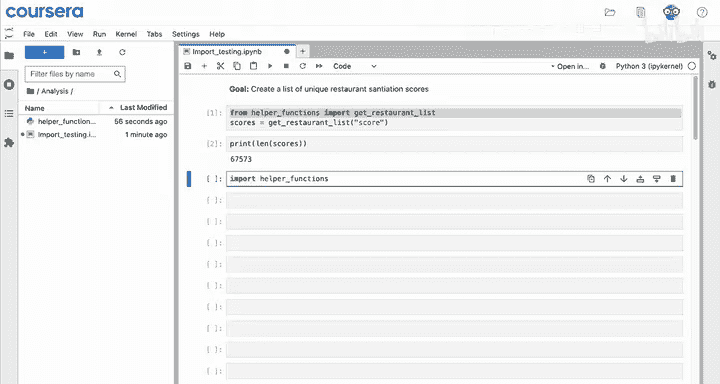
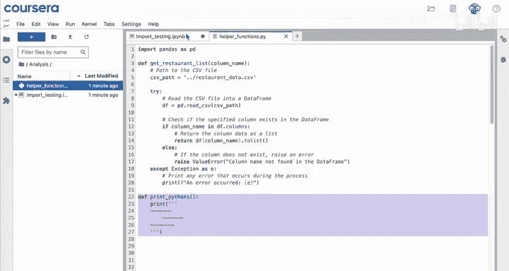
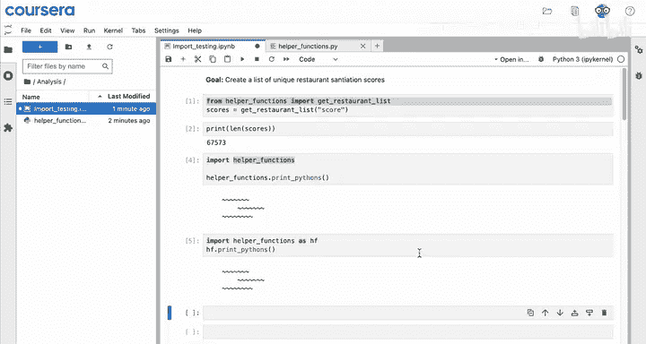
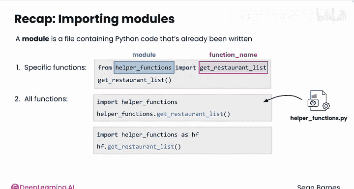

# 吴恩达《Python数据分析（数据分析第3课）｜Python for Data Analytics》中英字幕 - P27：26_模块导入.zh_en - GPT中英字幕课程资源 - BV1rp5yzjEgn

When you're working on a notebook， you of course， have access to all the code within the at notebook。

 but you can also augment your code with code from other files。

 whether written by you or someone else in your notebook， in addition to the code you've written。

 you also automatically have access to many built in functions like some and L。

You can also borrow other programmers' code， including your own code that you've previously written using the import command。

Say you're still working with the restaurant scores data from the previous module and you'd like to create a list of all the unique scores different restaurants earned in the previous module。

 you saw these two lines of code which load the score column of restaurant data into a list variable named scores In the first line you're importing the Git restaurant list function from the module called helper functions。

 How does this work Where is helper functions。First of all。

 in the same folder as this notebook there's another file called Helper functions。

 PY it's a Python file that contains some useful functions and here is what those functions look like This is the entire file helper functions。

 Py don't worry too much about this code for now you're just going to borrow this function to use in your notebook you could just copy and paste all this code into your notebook however that can get clunky if you want to borrow a lot of code or you don't have easy access to the file instead you can import this code After this import command you have access to this function get restaurant list。

You can call that function， so this is a great way to borrow code from yourself。

 You have some code in another file and you'd like to use it in this one。

There are a few different options for importing in Python this option from module import function allows you to choose which functions you want。

 you can also import all the functions in this module by just using import helper functions。

So import module。Now you can try using other functions in the file like print Pythons。

Hey， what's this error， Pri Pythons is not definedied。

Let's check with the LLM to see how to fix this， say I'm trying to use the print Python's function from helper functions。

pyy。Why do I get this error？Psir。So it looks like you need to reference the module name in order to access his functions。

 it gives you the correct code that you can then copy and paste back into your cell and run。

 and you can see that it's referencing the module name in order to call the function。Allright。

 very cute Pythons it's a little annoying to have to write this long helper functions bit every time you want to print Pythons。

 you can give this module a nickname using ass， import helper functions as HF Now you can say HF dot print Pythons and there you do' and this nickname just makes your code shorter。

A module is a file containing Python code that's already been written。

 You just saw two ways to import modules to use in your notebook you can import specific functions using a line of code like from helper functions import Git restaurantest list then you can use Git restaurant list directly in your code in general this command looks like from module import function name if you want to import all the functions in a module rather than listing specific ones you can use a command like import helper functions This command allows you to borrow all the functions contained in helper functions。

 Py If you use this style of command you'll have to call specific functions using the module name as well like helper functions。

 Git restaurant list you can also use as to give a module nickname which saves you some typing for example。

 you can use import helper functions as HF to give helper functions a shorter nickname。

You can import code from another file on your computer。

 but you can also import code from the internet， code written by other programmers。

 follow me to the next video to learn how to import the pandas module。

 which provides powerful data structures for data analytics。

