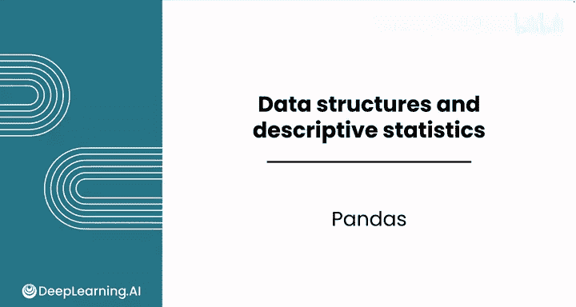
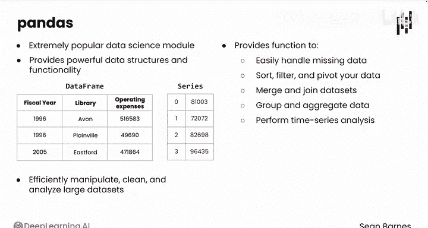
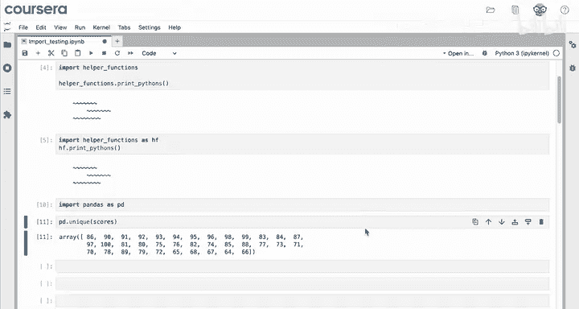

# 吴恩达《Python数据分析（数据分析第3课）｜Python for Data Analytics》中英字幕 - P28：27_Pandas库应用.zh_en - GPT中英字幕课程资源 - BV1rp5yzjEgn

There are millions of Python programmers worldwide， and you're one of them。

 it turns out that you can borrow code published by those other programmers。

 one of the most important modules for data analytics。

 which you'll be borrowing is called Pandas As a data analyst。

 you'll likely use the Pandas module daily。

Originally written back in 2008， Pas is an extremely popular data science module that provides powerful data structures and functionality。

 The two foundational data structures it provides are data frames which store data and tables and series which are like the pro version of lists。

 Padas allows you to efficiently manipulate clean and analyze large datas。

 It provides functions to easily handle a missing data， sort。

 filter and pivot your data mergeion join datas， group and aggregate data and perform time series analysis。

 It also supports importing data from various file formats like CSv Excel and even datas。

 Unfortunately， the name pans has nothing to do with the cute cuddly animal from real life。

 but here' is a picture of a panda to make up for that fact。

 recall from earlier that you were working on creating a list of unique sanitation scores using the restaurant data。

 you can use pandas to do that。 Padas wasn't written by you or probably anyone you know This is a bunch of code written by others in the Python community。

 It's actually several hundred thousand lines of code。 You'll typically see pans。

Imported with I pandas as PD so giving it the nickname PD Now pandas has been imported and you can use all of that cool code just a quick example。

 you'll explore a lot more in the coming videos， but you can use the PD。

 unique function to get a list of unique scores It's exactly like the spreadsheet function unique Think about how complicated of an operation that might have been if you had to write this code from scratch yourself it would have required a loop and a conditional or two and maybe that wouldn't even be the best or fastest way of finding these unique values So borrowing this unique function from the pandas library was like borrowing a power tool from a friend You get a superpower capability at no cost。

Paands has a lot of cool functions to get started， you'll likely want to read in your data from a CSV file。

 followow me to the next video to see how。