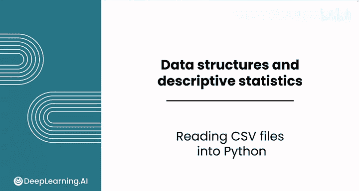
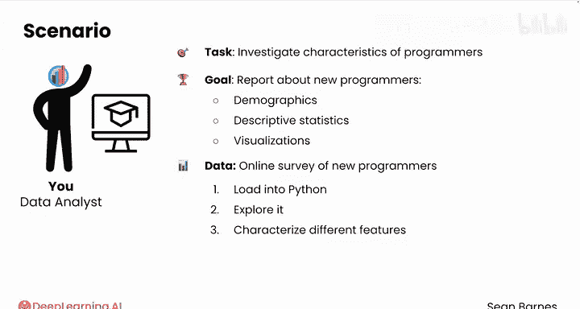
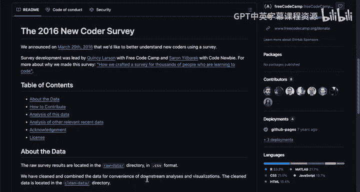
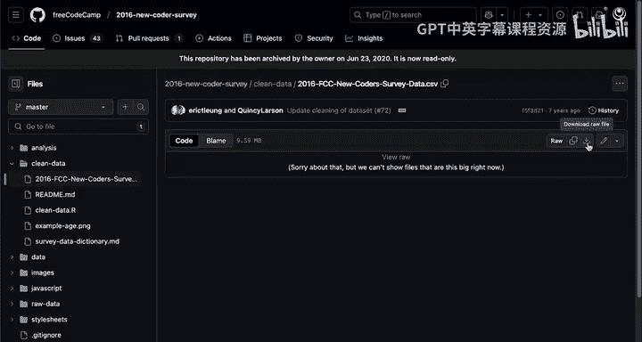
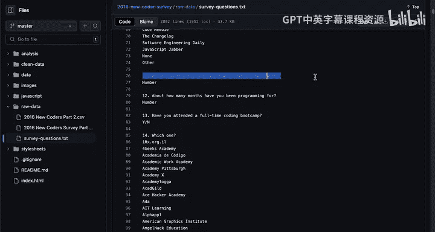
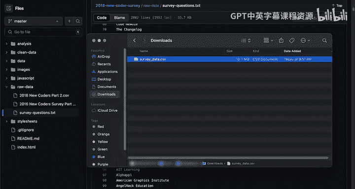
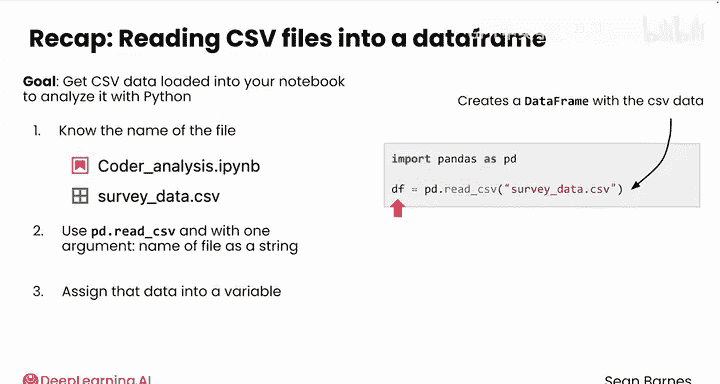

# 吴恩达《Python数据分析（数据分析第3课）｜Python for Data Analytics》中英字幕 - P29：28_将CSV读入Python.zh_en - GPT中英字幕课程资源 - BV1rp5yzjEgn

Let's put pandas to the test by examining some data about new programmers。

You'll start by loading the data into your python notebook so you can analyze it say you're working with a company that makes an educational product for new programmers。

 you've been asked to investigate the characteristics of programmers from all over the world to help with marketing efforts The goal of this initiative was to create a report about the characteristics of new programmers your team is interested in demographics and they like descriptive statistics and visualizations to include in the report you've located some data online with the survey of new programmers You want to load the data into Python explore it and characterize the different features to come to a conclusion about what kinds of people start learning to code you don't know anything about this data so your first step is to check out the source This is publicly available data It scoreding Github which is a website for sharing code don't worry too much about the specifics of Github you're just investigating the data the data was collected in 2016 by free codecamp and code newbie The data itself is located in the clean data directory If you go to clean data the only cv file here is the new code or survey data clicking on this file you can download it directly using。

This little download button。

You can also see in the raw data folder the survey questions。

Are you already working as a software developer， how many hours do you spend learning each week and so on once you've downloaded the file。

 you'll see that it has the same long file name as before， which will be relevant in a moment。

 you can rename the file to something shorter like survey data。

Now， how do you get this file into your code you won't need to do this step yourself。

 but just so that you're aware of how it works， you'll need to make sure that Surdata。

csv is moved into the same folder as your notebook In this case。

 it needs to be uploaded into the Coursera Jupiter lab environment It also needs to be in the same folder as your notebook This step will already be done for you in the labs for this course。

 Please note that in this demo you'll see a modified version of the original dataset that includes a subset of the original features and shorter column names。

Because these two files are in the same folder you can access the CSV file with just the file name。

 start by importing pandas as PD， it's customary to put all your import statements at the top of your code by the way。

 then you're going to use the PD。read CSsv function with survey data that CSv as the only argument。

 notice that the file name is a string since its text store the result of this function in a variable。

 let's call a DF。What's the type of this data， let's ask the LLM how can you figure out the type of a variable in Python？

Looks like you can use the type function， so the type of DF is a Pa's data frame。

A data frame is kind of like the Python version of a spreadsheet。

 Your first step once you load in the data should be to check it out for example。

 you can just type DF and hit shift enter to take a look at your data frame。

Each row represents a submitted survey from one person and each column represents one of the questions from that survey。

 Look at the bottom of this output。 There are over 15000 survey responses and you're working with 16 features you may also notice that some of these responses have N which stands for not a number Those cells are empty there's no information noticeice that the indices for the data frame started at zero just like a list By the way。

 you can also print Df but the output you get is much uglier using the Jupyter notebook's default variable display for data frames is much easier in the eyes you might already be thinking of some research questions。

 What is the distribution of age look like in this survey how much money have people spent learning to code or how many months have they spent programming This column may help you see whether this is truly a survey of beginners You may also be curious about some relationships between features in the data What is the relationship between hours spent learning to code each week and the income that a person makes or between the income a person makes and how many months they spent programming maybe the more months they spent programming the more income they have。

So there's a lot to explore here， let's quickly recap reading N CSV data using pandas。

Your goal is to get some CSsv data loaded into your notebook so you can analyze it with Python you'll need to know the name of the file you're working with and it's easiest if that file is located in the same folder as your notebook in the Courra labs。

 this step will already be done for you then you'll use the command Pd do read csv and give the function one argument the name of the file as a string like survey data do csv this function will create a data frame with the csv data allowing you to work with it in Python。

 your final step is to assign that data into a variable so you can use it later in the demo you saw the variable Df which is the common shorthand for data frame you could also use data or survey data or whatever other name makes sense to you Now that you have your data loaded in you can start to investigate some of the questions you're interested in。

Follow me to the next video to see how to explore your data frame。

