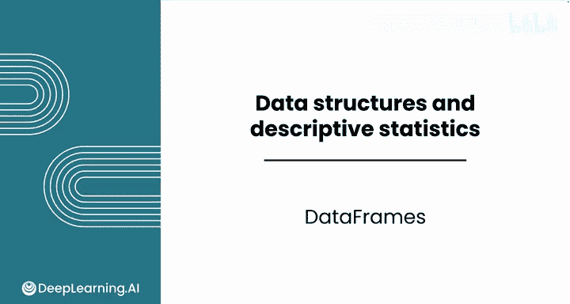
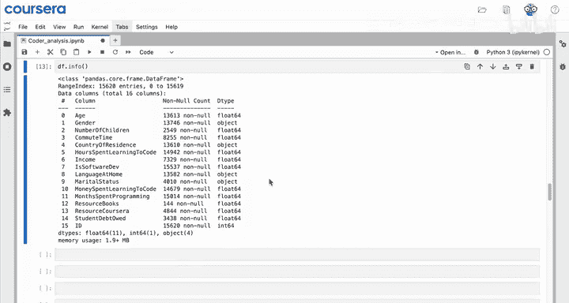
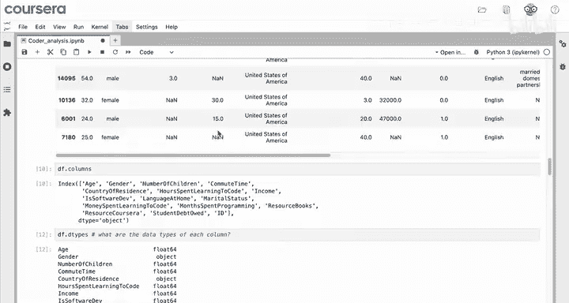
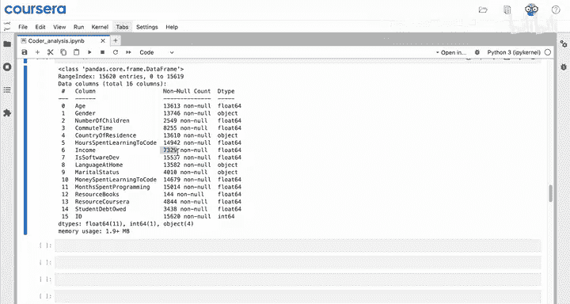
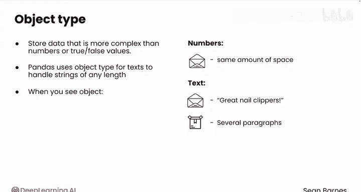

# 吴恩达《Python数据分析（数据分析第3课）｜Python for Data Analytics》中英字幕 - P30：29_数据框基础.zh_en - GPT中英字幕课程资源 - BV1rp5yzjEgn

Data frames will be your main tool in Python for representing data and rows and columns。

Paandndas gives you a lot of options for exploring and summarizing this type of data This notebook picks up where you left off in the previous video after importing the survey data do csv file as the variable Df a data frame how else can you explore a data frame If you're unsure how to start you can always ask your LLM。

Try a prompt like how can I get some basic facts about a data frame in Python？

So it gives you some great suggestions First， you can try dot head。

 That gives you the first five rows of the data。 you can also give it a number as an argument to see more or fewer rows like three。

One thing you might notice is that the early rows have NAN for the number of children。

 while the later rows do have values， so it seems like maybe this data is sorted in some way。

What if you just wanted to see a few random rows in the data you can use Df dot sample。

 which gives you a random row in the data frame Here's one sample row number 14195 like dot head。

 you can give sample a number as an argument to get more than one row For example D dot sample 5 will randomly sample5 rows sampling the data frame gives you more diversity in the responses so you can get a better sense of the range of values represented in the data So what else might you want to know about this data Maybe you'd like a list of the names of all of the columns the command d do columns displays the names of all the columns very succinctly age gender and so on What types of data are stored in the data frame Remember types are crucial in python and data frames each column has an assigned data type meaning that every value in that column is the same type。

 the command df do d types for data types ask the computer what are the data types of each column in this data frame notice that you have a mix of float 64 and object a float 64 is essentially just a floating point or decimal number you'll learn more about object types in a moment but。

Kind of a catch all for nonnumeric types or categorical data and you may notice that these columns。

 gender， country， language， marital status， these could all be represented as strings you can summarize all that information using Df。

 infofo which the LOM suggested earlier This command gives you a summary of all the columns and their types What else do you see here that's new。

Well， that would be the non null count。 if you go back up to the data。

 you saw earlier that some of these cells are empty。 there's nothing in there。

 typically either the person didn't answer that question or the way that data was clean created a blank cell。

 but whatever the reason is it's just left blank blank doesn't mean zero because， for example。

 there are many naNs for student debt owe。 It wouldn't be good practice to assume these people have zero student debt。

 but rather that they didn't answer the question。 going back to the non null values。

 The lower this number is， the more null data points you have。 For example。

 it looks like over half of the respondents did not share their income。

 Let's take a closer look at how data frames work in Python。

 You saw how data frames represented a table or spreadsheet of data。

 They are a type of data structure or way of storing data that represents that data in rows and columns。

 you can think of data frames is similar to a bunch of lists stored together。

 Each one represents a column。 For example， to represent the survey data。

 you could have a list variable called age with all the ages and a list variable called gender with the genders。

 all the way to student debt O a data frame。

Combininees all of those lists into a single data structure。

 You saw earlier that some of the columns in your data frame have the type object。

 The object type is used to store data that is more complex than simple numbers or true false values。

 you can think of this complexity like selecting a package for shipping。

 Numbers are like standard envelopes。 They always take up the same amount of space。

 but text is different。 you might need a standard envelope or a large box。 For example。

 if you have a data set containing product reviews， some might be short， like great nail clippers。

 While others might be several paragraphs。 Padas uses the object type for text because it needs this flexibility they handle strings of any length。

 You don't really need to worry about the particulars。 For now， when you see object。

 you can assume that that column contains text。 Data frames have many advanced capabilities。

 which you'll see throughout this module。 follow me to the next video to see a key difference between attributes and methods。

